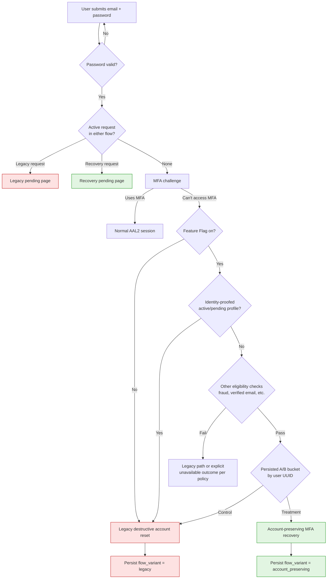
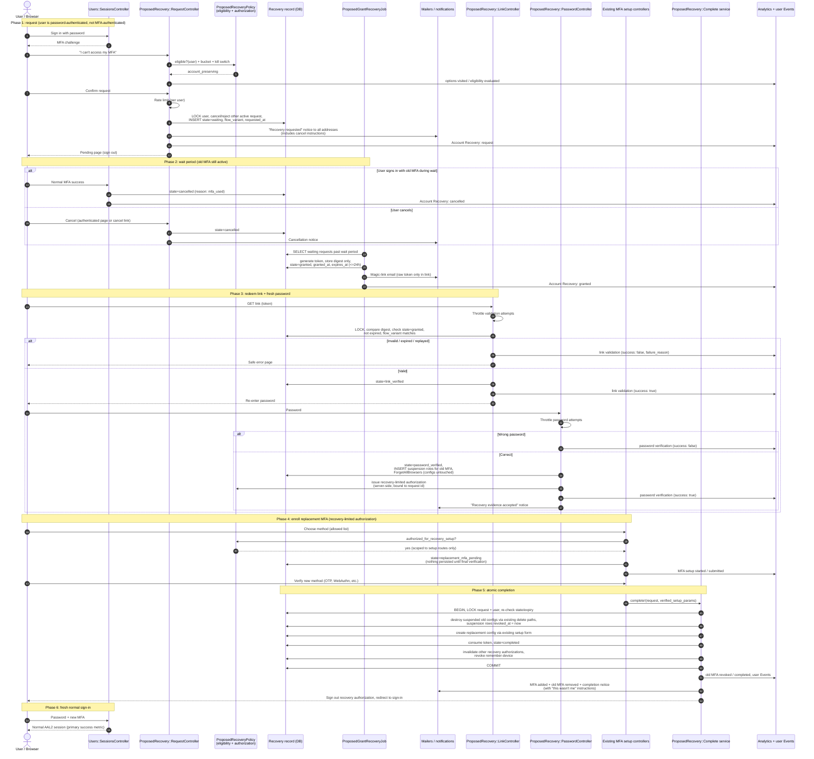
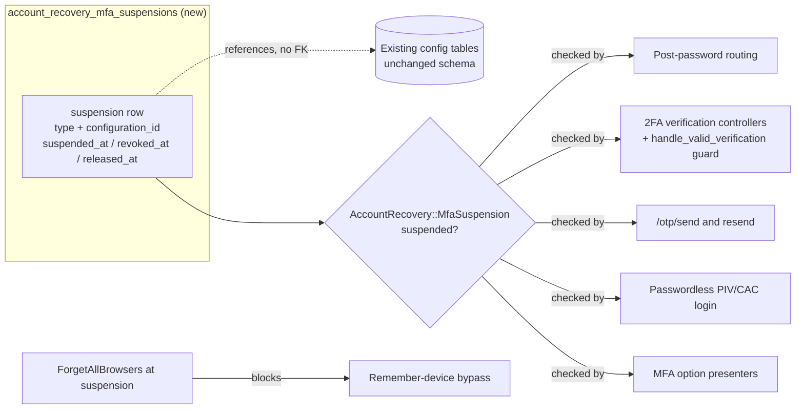
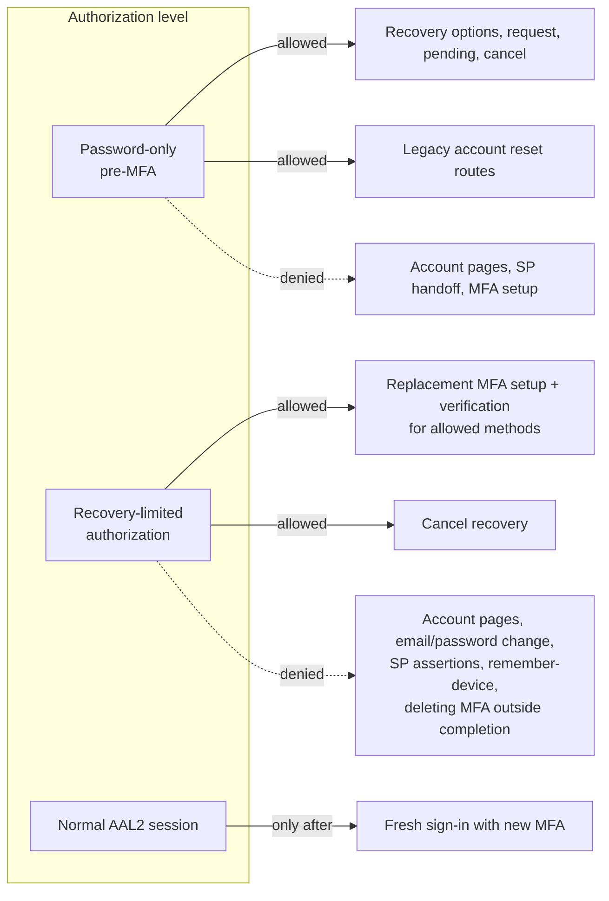
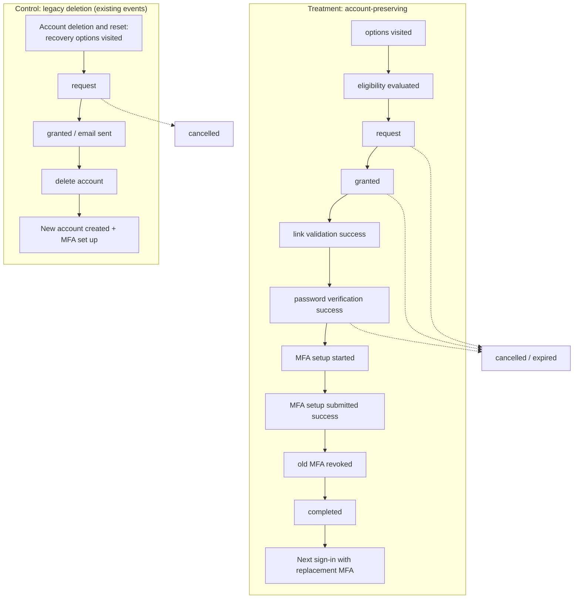
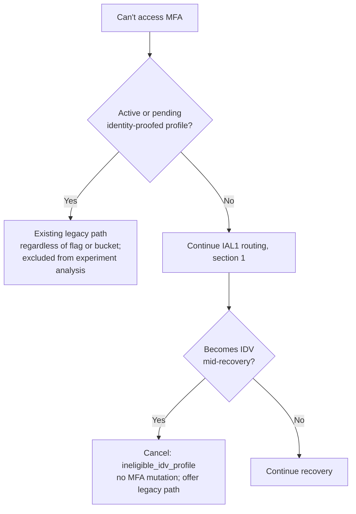

# ADR 0001 Flows: Account-Preserving MFA Recovery

Companion diagrams for
[ADR 0001: Account-Preserving MFA Recovery](./0001-account-preserving-mfa-recovery.md). The ADR is
authoritative; these diagrams illustrate it. Component names prefixed with `Proposed` do not exist
yet and are illustrative, not final class names.

## 1. Routing: legacy vs. account-preserving recovery

Routing happens only after successful password authentication, when the user reports they cannot
access any MFA method.

Key rule: once a request is created, its `flow_variant` is fixed. Flag or bucket changes never
move an in-flight request to the other flow.

## 2. End-to-end sequence (programmatic)

## 3. Recovery request state machine

```mermaid
stateDiagram-v2
    [*] --> requested: password-authenticated user\nselects recovery (treatment, eligible)
    requested --> waiting: record persisted,\nnotice sent
    waiting --> granted: job after wait period;\ntoken digest stored, link emailed
    granted --> link_verified: valid token\n(atomic check)
    link_verified --> password_verified: fresh password correct;\nold MFA suspended
    password_verified --> replacement_mfa_pending: setup started\n(recovery-limited auth)
    replacement_mfa_pending --> completed: new MFA verified;\natomic replace + revoke

    waiting --> cancelled: user cancel / old MFA used /\nbecame IDV
    granted --> cancelled: user cancel / old MFA used /\nbecame IDV
    link_verified --> cancelled: user cancel / became IDV
    password_verified --> cancelled: user cancel / became IDV
    replacement_mfa_pending --> cancelled: user cancel / became IDV

    granted --> expired: token TTL elapsed
    link_verified --> expired: recovery TTL elapsed
    password_verified --> expired: recovery TTL elapsed
    replacement_mfa_pending --> expired: recovery TTL elapsed

    waiting --> superseded: new request / legacy request
    granted --> superseded: new request / legacy request
    link_verified --> superseded: new request
    password_verified --> superseded: new request
    replacement_mfa_pending --> superseded: new request

    completed --> [*]
    cancelled --> [*]
    expired --> [*]
    superseded --> [*]
```

Terminal states (`completed`, `cancelled`, `expired`, `superseded`) never return to an active
state. Each transition and its side effects run under a row lock or equivalent atomic update.

## 4. Old MFA lifecycle

```mermaid
stateDiagram-v2
    [*] --> active
    active --> active: recovery requested / waiting / granted\n(still usable; using it cancels recovery)
    active --> pending_revocation: link + fresh password verified\n(suspended from sign-in)
    pending_revocation --> revoked: completion transaction\n(same commit as new MFA activation)
    pending_revocation --> pending_revocation: recovery expired/cancelled\n(NOT auto-restored; retry or new request)
    revoked --> [*]
```

The replacement method is never persisted as an inactive configuration. It is created inside the
completion transaction, after the old rows are destroyed, so a partially configured method is
never active and the unique indexes cannot collide. "Suspended" is not a column on the
configuration tables; it is a row in the recovery-owned suspension ledger. See the ADR section
[Implementing the suspended (inactive) state](./0001-account-preserving-mfa-recovery.md#implementing-the-suspended-inactive-state).

## 5. Authorization boundaries

`MfaSetupConcern#confirm_user_authenticated_for_2fa_setup` is not weakened. Instead it gains one
explicit, separately tested branch: allow setup when `ProposedRecoveryPolicy` confirms a valid
recovery-limited authorization bound to an active request in `password_verified` or
`replacement_mfa_pending`.

## 6. Telemetry funnel and comparison

All events carry `flow_variant` and the persisted A/B bucket via existing analytics A/B
integration. Primary metric: distinct eligible users reaching **T11** ÷ distinct eligible users
reaching **T3**. Control is compared on users who regain a working account (C5) ÷ requests (C2),
noting that control loses account continuity by design.

## 7. IDV users

