# Login.gov delegated access: functional requirements and implementation record

**Status.** 2026-10-13. Fourteen code-only feature branches are stacked on `login-delegated-access`; the top of the stack is `delegated-access-encrypted-userinfo`, which the local pointer branch `delegated-access-integration` names. Every branch is built and pushed to GitHub `18F/identity-idp`. Two designs are recorded and not built: the delegated-access history view on the account page and the acceptance of delegated tokens at the user-information endpoint for agencies that cannot yet introspect (section 15). The performance review's remaining findings and the other open items are in Appendix D.

This is the single authoritative document for Login.gov's delegated access. It holds the functional requirements, the protocol-level requirements and the implementation record in one text, organized by the branch that delivers each part. It is the only document: how the work was planned, and how each requirement changed on the way, is recorded in the decisions log (section 16) and in git history, nowhere else (D88). The protocol rows keep the identifiers they have always had.

## How to read this document

**Start with [Appendix A, the traceability matrix](#appendix-a-traceability-matrix).** It is generated from this document and maps every branch to its section, its functional requirement rows, its protocol rows and the foundation items it keeps. A reviewer who has a branch name, a requirement identifier or a decision number finds the owning section there first.

The body has one section per branch, numbered 1 to 14 in stack order. Each section has the same parts:

- **Objective**: what the branch delivers, for whom, and why it is designed that way, in plain terms.
- **How it works**: a walkthrough for a reviewer who has not read the code: a diagram of the flow or the data model, sample requests and responses with the fictitious names, and the checks the branch makes in the order it makes them.
- **Functional requirements**: the `FR-…` rows the branch owns, each in its current state.
- **Protocol rows**: the protocol-level rows (`ONB-`, `CON-`, `ACC-`, `EXC-`, `REF-`, `INT-`, `SAML-`, `DISC-`, `BIL-`, `ATT-`, `UINF-`), each in its current state.
- **As built**: the classes, routes, migrations, configuration keys, analytics events, locale keys and specs the branch adds, with verification counts.
- **Decisions**: one line per decision that shaped the branch, pointing at the full entry in section 16.
- **How to review**: the branch to diff against, what to check first, which specs prove it, what must not change for existing clients, and the branch's open items.

Two sections and five appendices support the branch sections:

- **Section 15** covers the base branch and the work outside this repository: document-image sharing for a direct service provider (kept on the base), third-party-initiated login (in the reference applications), the reference applications and the end-to-end harness, the configuration repository, the two designs documented and not built, and the functional requirement rows no branch owns.
- **Section 16** is the decisions log: every numbered decision (`Dnn`) with its rationale, the alternative rejected and what it applied to.
- **Appendix A** is the generated traceability matrix. **Appendix B** is the branch stack, merge order and review procedure. **Appendix C** lists the environment-specific pieces. **Appendix D** holds the performance review and the open items with their owners. **Appendix E** describes the foundation branch and what the stack kept, replaced and removed. **Appendix F** defines the terms.

## The branch stack

Each branch starts from the tip of the one before it. Review a branch as the diff against the branch directly below it; acceptance is a fast-forward of `login-delegated-access`, bottom to top (Appendix B).

```
login-delegated-access                         base: main merge, this document, CLAUDE.md / AGENTS.md, the skill
 ├─  1. delegated-access-registry              section 1   onboarding data model and registry
 ├─  2. delegated-access-consent               section 2   authorize request and consent screen
 ├─  3. delegated-access-account-page          section 3   Account → Delegated access
 ├─  4. delegated-access-site-keys             section 4   per-site keys (ported)
 ├─  5. delegated-access-dpop                  section 5   public-client key binding (DPoP)
 ├─  6. delegated-access-token-exchange        section 6   RFC 8693 exchange at the token endpoint
 ├─  7. delegated-access-token-lifecycle       section 7   refresh rotation, revocation, suspension and deletion
 ├─  8. delegated-access-introspection         section 8   RFC 7662 introspection
 ├─  9. delegated-access-saml-assertions       section 9   SAML assertions as an issued token type
 ├─ 10. delegated-access-operations            section 10  discovery and operational metadata
 ├─ 11. delegated-access-billing-reporting     section 11  billing rows and reports
 ├─ 12. delegated-access-fraud-signals         section 12  Attempts API fraud signals
 ├─ 13. delegated-access-config-content        section 13  content seeded from identity-idp-config
 └─ 14. delegated-access-encrypted-userinfo    section 14  encrypted userinfo responses
```

Not branches: document-image sharing is foundation code kept on the base and enabled only in the sandbox (section 15.1); third-party-initiated login lives in the reference applications (section 15.2); the account-page history view is planned (section 15.5); delegated tokens at the user-information endpoint are documented and not built (section 15.6).

## Conventions

- **Identifiers are preserved.** `FR-<area>-<n>` rows state what the capability must do (the legend below explains every area); the protocol rows (`ONB-`, `CON-`, `ACC-`, `EXC-`, `REF-`, `INT-`, `SAML-`, `DISC-`, `BIL-`, `ATT-`, `UINF-`, `DOC-`, `TPL-`, `REF-IMPL-`, `RS-DPOP-`) state how it is built; `Dnn` numbers the decisions. An identifier means the same thing in every document, commit message and review that has ever used it. A row owned by one branch is referenced by its identifier elsewhere, never copied.
- **Current state only.** Every row states the requirement as it stands today. Where a decision changed a row, the row is written in its amended form and cites the decision as "(Dnn)"; the dated amendment trails live in git history and in section 16. Nothing in a row is marked planned, implemented or superseded; the two unbuilt designs are described as such in section 15.
- **Decisions live in section 16.** A branch section lists its decisions in one line each; the rationale and the rejected alternative are in section 16 only.
- **Fictitious hosts.** Examples use fictitious hosts so that no reader mistakes them for a real deployment or for the local stack: Login.gov is `https://idp.example.gov`; MyBenefits Assistant is `https://mybenefits.example.gov`; the Housing Assistance Records API is `https://records-api.housing.example.gov` and its agency site `https://records.housing.example.gov`; the Retirement Benefits Portal API is `https://benefits-api.retirement.example.gov` and its agency site `https://portal.retirement.example.gov`. The local fixture registers the same actors under `localhost` ports and `.localdev` API identifiers; section 15.3 and Appendix C give that mapping.
- **Fictitious names.** Code, fixtures, comments, examples and this document use the fictitious names: MyBenefits Assistant, run by the Office of Benefits Coordination (agency 100); the Department of Housing Support (101) with its application Housing Assistance Records; the National Retirement Administration (102) with its application Retirement Benefits Portal. No real service provider is named. The Department of State appears only as the subject of the business case its requirement rows describe (section 15.1); it is not a fixture.
- **Vocabulary.** *Service provider*: the application the person signs in to, which then acts for them (OAuth's client, OpenID Connect's relying party, RFC 8693's actor); never "broker" in this repository. *Application*: an agency's record for one service it registers for delegation, carrying consent content and owning one or more agency APIs. *Resource server* or *agency API*: one URL a delegated token is issued for. *Agency SP*: the agency's service-provider record when the record itself matters. *Person*: the member of the public. The reference applications outside this repository name their own roles from their own side; that naming does not reach this repository's code or wire contract. Appendix F defines the remaining terms.
- **Requirement language.** MUST, SHOULD and MAY as in RFC 2119 and RFC 8174. Values in parentheses (lifetimes, limits) are current defaults, not requirements, unless a row says otherwise.
- **Standards over invention.** Wherever a cited standard covers a behavior, the behavior is the standard's: RFC 6749, 6750, 7009, 7516, 7519, 7523, 7636, 7662, 8693, 8707, 8725, 9449, 9700, OpenID Connect Core 1.0 and Discovery 1.0, RFC 8414, RFC 8417 and 8936 with the OpenID Shared Signals Framework, NIST SP 800-63B and 800-63C. Two standards were considered and not used: RFC 9068 (JWT access tokens; tokens stay opaque so an agency must ask Login.gov before trusting one) and RFC 9396 (rich authorization requests; named scopes fit the existing consent and scope code).

## Identifier legend

Every requirement row carries an identifier. The letters say which area of the capability the row belongs to; the number is only a label and says nothing about priority or order. Functional requirement rows start with `FR-`; protocol rows, which say how a functional requirement is built on the wire, carry the area letters alone.

| Functional requirement prefix | Stands for | What the rows cover | Owned by |
|---|---|---|---|
| **FR-ONB** | Onboarding | The registry of applications, their APIs and content, the approved service providers, and how that content is maintained | Sections 1 and 13 |
| **FR-CEN** | Consent enforcement | What an approval permits, how long it is valid, what Login.gov records about it, and how revocation takes effect everywhere | Sections 2, 3, 6 and 7 |
| **FR-CUX** | Consent user experience | What the person sees and can do on the consent screen and on the account page | Sections 2 and 3, one row in 15 |
| **FR-KEY** | Per-site keys | Keys derived for a service provider and sealed to its browser | Section 4 |
| **FR-TOK** | Tokens | Issuing delegated tokens, their lifetime, renewal, revocation and key binding | Sections 5, 6, 7 and 9 |
| **FR-VER** | Verification | How an agency API confirms a delegated token or assertion with Login.gov | Sections 8 and 9 |
| **FR-OPS** | Operations | The master switch, discovery, monitoring, the reference setup and the gates before production | Sections 1, 10 and 15 |
| **FR-BIL** | Billing | Which party is billed for a delegated use and the reports that count delegation outcomes | Section 11 |
| **FR-FRD** | Fraud signals | Delivery of fraud-relevant events to agencies through the Attempts API | Section 12 |
| **FR-DOS** | Department of State case | Document-image sharing for a direct service provider and encrypted user-information responses, the needs of the passport use case | Sections 14 and 15.1 |
| **FR-TPL** | Third-party-initiated login | The alternative pattern in which an agency signs the person in itself, implemented in the reference applications | Section 15.2 |
| **FR-FIT** | Pattern fit | When the token service is the right pattern and when third-party-initiated login is | Section 15.8 |

| Protocol row prefix | Stands for | Owned by |
|---|---|---|
| **ONB** | Onboarding data model and seeding | Sections 1 and 13 |
| **CON** | Consent: the authorization request and the consent screen | Section 2 |
| **ACC** | Account page | Section 3 |
| **EXC** | Exchange: the token exchange request and response | Sections 5 and 6 |
| **REF** | Refresh: renewal, rotation and revocation of delegated access | Section 7 |
| **INT** | Introspection: an agency verifying a token | Section 8 |
| **SAML** | SAML assertions as an issued token type | Section 9 |
| **DISC** | Discovery metadata | Section 10 |
| **BIL** | Billing rows and reports | Section 11 |
| **ATT** | Attempts API fraud-signal events | Section 12 |
| **UINF** | User-information endpoint | Section 14 |
| **DOC** | Document-image sharing | Section 15.1 |
| **TPL** | Third-party-initiated login | Section 15.2 |
| **REF-IMPL** | Reference implementations: the three reference applications and the end-to-end harness | Section 15.3 |
| **RS-DPOP** | Resource-server handling of key-bound tokens | Section 15.3 |

Two more numberings appear. **Dnn** is a decision, recorded in full in section 16 and listed in one line under the branch section it shaped. **Enn** is an item of the foundation review in Appendix E: a piece of the foundation branch the stack kept, replaced or removed.

# 1. `delegated-access-registry`: the registry of applications, their APIs and the content people are shown

**Stack position** 1 of 14, on `login-delegated-access`.

## Objective

This branch gives delegated access its vocabulary and its database records. It delivers nothing a person can see yet; every later branch reads what it creates. The consent screen (section 2) shows these records, the account page (section 3) lists them, and the token exchange (section 6) checks them.

Three kinds of record are defined. An *application* is an agency's own `service_providers` row that the agency registers for delegation. It carries the agency's plain-language description of the application for the consent screen, and it owns one or more *resource servers*: the application's API URLs, each stored as a `token_exchange_resource_servers` row. A *service provider* is the application the person signs in to and which then acts for them. A service provider is approved for delegation by a flag on its own record, and its record carries the content that tells the person who operates it and how it handles their information. An *approval* (a `token_exchange_grants` row) records that one person allowed one service provider to act for them at one application. There is one live approval row per person, service provider and application. The row records where the approval was given, whether the person asked Login.gov to remember it, and the versions of the agency, application and service provider content the person saw.

Consent is given per application, not per agency and not per individual API, because people recognize the application they use, and one choice per application keeps the screen readable (D1, D2). Approval and opt-in live on partner records rather than in application configuration so that they pass through the same reviewed onboarding path as every other partner setting (D7). Content carries two version counters: one that rises on every edit, and one that the editor raises only when the edit changes the meaning of what the person agreed to. A wording fix therefore never re-asks a person, while a change of meaning always does (D9). Agencies and service providers that never register for delegation are untouched, because every new column is nullable or has a default.

## How it works

The branch adds columns to two existing tables (`agencies` and `service_providers`) and creates two new tables (`token_exchange_resource_servers` and `token_exchange_grants`). The diagram shows how they relate. A `service_providers` row plays one of two roles: an application owned by an agency, or a service provider that the person signs in to. The approval row points at both.

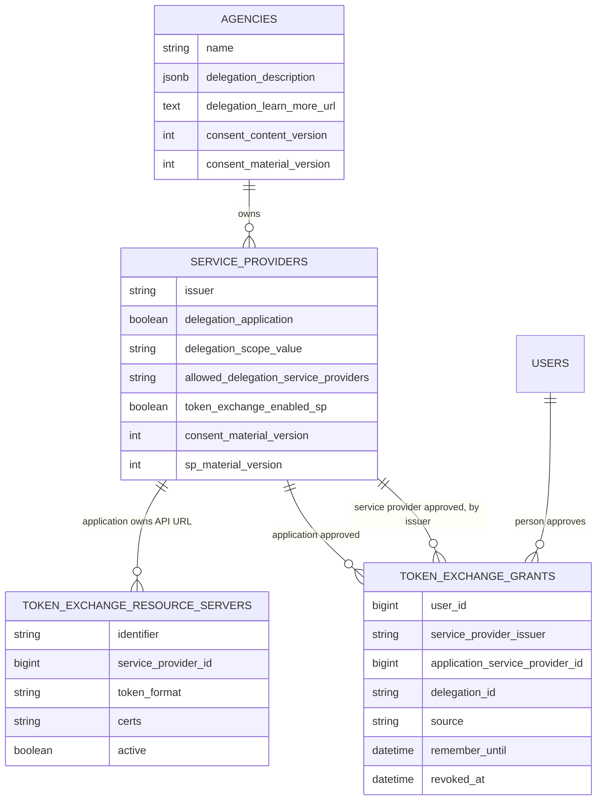

The diagram shows only the columns that drive behavior; the full column lists are in "As built". Notice that an approval names the service provider by its `issuer` string, not by its row id, in the same way the existing `identities` table names a service provider.

The registry is loaded from a YAML file. In local development, review applications and personal sandboxes the file is the fixture `config/delegated_access.localdev.yml`, loaded by `rake delegated_access:seed`. The fixture reads its hostnames from environment variables and falls back to the local reference applications; the samples below show the fallback values. This is the application entry for Housing Assistance Records, the Department of Housing Support's `oauth` API:

```yaml
service_providers:
  'urn:gov:gsa:openidconnect:sp:records_agency':
    agency_id: 101
    ial: 2
    friendly_name: 'Housing Assistance Records'
    logo: 'generic.svg'
    return_to_sp_url: 'https://records.housing.example.gov'
    redirect_uris:
      - 'https://records.housing.example.gov/'
      - 'https://records.housing.example.gov/auth/result'
      - 'https://records.housing.example.gov/logout'
    certs:
      - 'rs_records_demo'
    attribute_bundle:
      - email
    delegation_application: true
    delegation_scope_value: 'housing_records'
    delegation_display_name:
      en: 'Housing Assistance Records'
      es: 'Registros de asistencia para la vivienda'
    delegation_description:
      en: 'check where your housing application is in review, whether anything is missing, and submit missing documents for you.'
    delegation_data_provided:
      en: ['Case number', 'Current status', 'Next step', 'Documents requested']
    delegation_access_type: 'read_write'
    delegation_learn_more_url: 'https://records.housing.example.gov/'
    allowed_delegation_service_providers: []
    token_exchange_resource_servers:
      - identifier: 'https://records-api.housing.example.gov'
        token_format: 'oauth'
        certs:
          - 'rs_records_demo'
```

Notice three things: `delegation_application: true` turns an ordinary service provider record into an application; `delegation_scope_value: 'housing_records'` is the value a service provider sends as `token_exchange:housing_records` to ask for it; and the empty `allowed_delegation_service_providers` list means any service provider Login.gov has approved may ask. The `delegation_description` completes the sentence "This lets the service …", which the consent screen supplies. The one resource server under it is the API URL a delegated token will be issued for.

This is the entry for the approved service provider, MyBenefits Assistant, run by the Office of Benefits Coordination (agency 100):

```yaml
service_providers:
  'urn:gov:gsa:openidconnect:sp:sinatra_sts':
    agency_id: 100
    ial: 2
    friendly_name: 'MyBenefits Assistant'
    logo: 'generic.svg'
    return_to_sp_url: 'https://mybenefits.example.gov'
    redirect_uris:
      - 'https://mybenefits.example.gov/'
      - 'https://mybenefits.example.gov/auth/result'
      - 'https://mybenefits.example.gov/logout'
    certs:
      - 'sp_sinatra_demo'
    token_exchange_enabled_sp: true
    delegation_operator_legal_name: 'Office of Benefits Coordination'
    delegation_operator_type: 'federal'
    delegation_service_description:
      en: 'helps you find benefits you may qualify for and track your applications in one place.'
      es: 'le ayuda a encontrar beneficios y a seguir sus solicitudes en un solo lugar.'
    delegation_data_handling_statement:
      en: 'used only while you are signed in and deleted when you sign out. Not shared outside the Office of Benefits Coordination.'
    delegation_privacy_policy_url: 'https://mybenefits.example.gov/about'
    delegation_support_contact: 'help@mybenefits.example.gov'
    delegation_uses_ai: true
    delegation_ai_description:
      en: 'answer your questions and suggest benefits you may qualify for.'
```

Notice that `token_exchange_enabled_sp: true` is Login.gov's approval of this service provider for delegation, and that the rest of the entry is the "who is asking" content the consent screen shows. Every localized value is a map keyed by locale with `en` required; rendering falls back to `en` when the person's language is missing.

The agency's own content sits in the `agencies` section of the same file, keyed by agency id:

```yaml
agencies:
  101:
    name: 'Department of Housing Support'
    abbreviation: 'DHSP'
    delegation_description:
      en: 'helps people find, keep and pay for housing.'
      es: 'ayuda a las personas a encontrar, conservar y pagar su vivienda.'
    delegation_learn_more_url: 'https://records.housing.example.gov/'
```

Notice that the agency description, like the application description, is a sentence completion: the consent screen prints the agency's name and then this text.

When a person approves an application (on the consent screen in section 2 or from the account page in section 3), the stored approval row looks like this:

```text
token_exchange_grants
  user_id:                          12345
  service_provider_issuer:          urn:gov:gsa:openidconnect:sp:sinatra_sts
  application_service_provider_id:  67        (the Housing Assistance Records row)
  delegation_id:                    dlg_…     (random, unique, carried on every token later)
  source:                           consent_screen
  consented_at:                     2026-10-13 14:02:11 UTC
  remember_until:                   2027-10-13 14:02:11 UTC   (null when not remembered)
  rails_session_id:                 null      (set only when not remembered)
  agency_content_version:           1
  application_content_version:      1
  sp_content_version:               1
  proofed_in_session:               false
  first_exchanged_at:               null
  revoked_at:                       null
  revocation_reason:                null
```

Notice that `remember_until` and `rails_session_id` are alternatives: a remembered approval has a date, and an approval that covers one sign-in only has the browser session it was given in. The three version numbers are what the person saw; they are compared with each owner's material version later. A revoked row keeps its data and gains `revoked_at` and a reason; rows are never deleted, and a partial unique index (`index_token_exchange_grants_live`) allows only one unrevoked row per person, service provider and application.

The whole capability is behind one configuration key, which is off by default:

```yaml
# config/application.yml.default
token_exchange_enabled: false
```

Notice that this is the only configuration key the branch introduces; every later key arrives with the branch that reads it.

The decision logic the branch defines, in the order the code checks it:

- A service provider may request delegation (`ServiceProvider#delegation_service_provider?`) when `token_exchange_enabled` is on, its record is active, and `token_exchange_enabled_sp` is true. If any of these is false, the service provider is treated as not approved.
- A record is an application (`#delegation_application?`) when it is active and `delegation_application` is true. An application accepts a given service provider (`#accepts_delegation_from?`) when its `allowed_delegation_service_providers` list is empty or names that service provider's issuer. `DelegationApplications.accepting(issuer)` returns every active application that accepts the issuer; it is the single answer to "which applications may this service provider ask for".
- An API URL is usable (`TokenExchangeResourceServer#usable?`) only while the resource server row, its application and the application's record are all active. Setting `active` to false on any of them is the kill switch.
- An approval is valid now (`TokenExchangeGrant#valid_now?`) when, in order: it is not revoked; its application is still an active application; its service provider is still approved; every recorded content version is at or above the owner's current material version (`#current_content?`); and either it is remembered and `remember_until` is in the future, or it was given in the sign-in that is asking now (`#current_authorization?`, which compares the row's `rails_session_id` with the session recorded on the person's `identities` row for that service provider). The first failing check decides; there is no partial validity.
- Recording an approval (`TokenExchangeGrant.approve!`) runs in one transaction under a lock on the user, revokes any earlier live row for the same key with reason `superseded_by_new_consent`, and creates the new row with the current content versions copied from the agency, the application and the service provider.

## Functional requirements

| Id | Requirement |
|---|---|
| **FR-ONB-1** | Login.gov MUST keep an approved list of service providers permitted to request delegated access. A service provider not on the list MUST NOT be able to request or obtain a delegated token. |
| **FR-ONB-2** | Login.gov MUST keep a registry of applications available for delegation. Each application MUST identify the agency that owns it, the delegation scope value a service provider uses to request it, which service providers it accepts (none listed meaning any approved service provider), and each of its agency API URLs with how that API proves its identity to Login.gov and whether it consumes OAuth tokens or SAML assertions. |
| **FR-ONB-3** | Each application MUST carry agency-written, plain-language content for the consent screen: a display name, what it lets the service do, what information it provides, whether it is read-only or can make changes, and where to learn more. The agency itself MUST have a public name, logo, a short description and a learn-more link. Agency and application content are separate because they may differ. Every edit MUST be versioned and marked as material or not (FR-CEN-5). Until the partner Dashboard gains the fields, the content, logos included, is maintained by the Login.gov team in the configuration repository `identity-idp-config` (`delegated_access.yml`), reviewed by pull request and seeded in every environment; the version pair is set in that file. (D77) |
| **FR-ONB-4** | Each service provider MUST supply content describing itself: who operates it (name and type of organization), what the service does, how it handles the person's information, whether it uses AI or automated decision-making and for what, a privacy policy, and a support contact. |
| **FR-ONB-5** | Login.gov MUST review and approve partner content before it is shown to the public, and MUST record who approved it and when. While content is maintained in `identity-idp-config`, the pull request review is the review, and the approval is recorded in the file (`consent_approved_at`, `consent_approved_by`) with the content it approves. (D77) |
| **FR-ONB-6** | Partner content MUST be available in every language Login.gov supports, with English as the fallback when a translation is missing. |
| **FR-ONB-7** | Login.gov MUST be able to disable a service provider, an agency, or a single agency API without deleting it, and disabling MUST take effect at the next use of any related token. |
| **FR-ONB-8** | Login.gov MUST define the list of delegable agency APIs. A service provider MUST NOT be able to add to it or alter it through its requests. |
| **FR-ONB-9** | Onboarding MUST use Login.gov's existing, reviewed partner-configuration process (the partner Dashboard synced to the identity provider, and the configuration repository for production), not a separate path. The Dashboard MUST gain the fields FR-ONB-2 to FR-ONB-4 require; this is a dependency on a separate repository. Until it is met, content is maintained in `identity-idp-config` (`delegated_access.yml`, reviewed by pull request) and the identity provider seeds it with `rake db:seed` in every environment, production included; an entry's `restrict_to_deploy_env` decides where it is written, and the fictitious entries are restricted to the sandbox. The local fixture is the same file's development copy, linked in place by `bin/setup`. (D77) |
| **FR-OPS-1** | The entire capability MUST be behind a single control that Login.gov can turn off, and when off, Login.gov MUST NOT advertise it to partners. |

## Protocol rows

| Id | Requirement |
|---|---|
| **ONB-1** | Login.gov MUST maintain a list of service providers approved for delegation. Only a service provider approved for delegation may request a `token_exchange:*` scope or call the exchange endpoint. |
| **ONB-2** | The registry unit is the application: an agency-owned `service_providers` row with `delegation_application: true`, `delegation_scope_value` (unique, `[a-z0-9_]{1,64}`), localized consent content (`delegation_display_name`, `delegation_description`, `delegation_data_provided`), `delegation_access_type`, `delegation_learn_more_url`, `consent_content_version`, `consent_material_version`, `consent_approved_at`/`consent_approved_by`, and `allowed_delegation_service_providers` (a string array; empty means any service provider approved for delegation). Each application owns one or more resource servers, `token_exchange_resource_servers` rows that are its API URLs: a stable `identifier`, `attempts_service_provider_id`, `billing_issuer`, `certs` (the public keys the API authenticates with), `token_format` and `active`. Whether a token is key-bound follows the service provider's client type (EXC-17); no per-API flag requires or waives binding. (D1, D47) |
| **ONB-3** | There is one delegation scope per application, `token_exchange:<delegation_scope_value>`. No scopes table exists; the scope value and the consent content live on the application row. The consent screen lists the application's resource server identifiers for information. (D2) |
| **ONB-4** | Service providers MUST supply, and Login.gov MUST approve, content describing who the service provider is. |
| **ONB-5** | All of the above MUST be managed through Login.gov's existing service-provider onboarding pipeline (`config/service_providers.yml` with `ServiceProviderSeeder`, and `ServiceProviderUpdater` in lower environments), never through ad-hoc edits or application configuration. The delegated-access content (agencies with their consent content, service providers approved for delegation, applications with their consent text, logos and resource servers) travels the same pipeline with one more file, `delegated_access.yml` in `identity-idp-config`, linked to `config/delegated_access.yml` at deploy and loaded by `DelegatedAccessSeeder` from `rake db:seed` in every environment. Edits are pull requests in that repository; no admin interface exists in the identity provider. (D77) |
| **ONB-6** | Every new database column MUST carry a `comment: 'sensitive=true'` or `comment: 'sensitive=false'` as enforced by `lib/tasks/column_comment_checker.rake` and `spec/db/schema_spec.rb`. |
| **ONB-7** | The seeder and updater MUST upsert resource servers by `identifier` under their application, and the updater MUST deactivate (not delete) children absent from a Dashboard payload, so grants and tokens keep their foreign keys and `active: false` carries its kill-switch meaning. |
| **ONB-8** | Agency-authored `description` MUST be stored as the completion of the sentence stem "This lets the service ___", and `display_name` SHOULD start with a verb; the consent screen supplies the stem. |
| **ONB-10** | `agencies` carries agency-level consent content: localized `delegation_description`, `delegation_learn_more_url`, `consent_content_version`, `consent_material_version`, all nullable or defaulted so agencies without applications are unaffected. (D12) |
| **ONB-11** | Every content owner (agency, application, service provider) has two version counters: `*_content_version`, incremented on every edit, and `*_material_version`, set equal to it when the editor marks the edit as material. Grants record the versions they were given under; validity compares them with the material versions (CON-12). (D9) |
| **ONB-13** | Service provider approval is `service_providers.token_exchange_enabled_sp` only. No application-configuration allow-list of service providers exists; `token_exchange_enabled` is the single master switch. (D7) |
| **ONB-14** | Every identifier, string, comment, analytics property and locale key in the repository says service provider; the term the foundation branch used for it appears nowhere. (D11) |

Rows ONB-12 and ONB-15 (the production content source and `restrict_to_deploy_env`) belong to section 13.

## As built

1. The schema changes are five migrations in `db/primary_migrate`: `20261009100000_add_delegation_content_to_agencies`, `20261009100100_add_delegation_application_columns_to_service_providers`, `20261009100200_create_token_exchange_resource_servers`, `20261009100300_add_delegation_service_provider_columns_to_service_providers` and `20261009100400_replace_token_exchange_grants`. Every column carries `comment: 'sensitive=…'`. The second migration builds the unique index on `delegation_scope_value` concurrently (so it runs outside a transaction) and removes the foundation's allow-list column. The last migration drops the foundation's grant table and its per-service-provider settings table and creates `token_exchange_grants` in the (user, service provider issuer, application) shape; it is irreversible by design. Nothing is renamed or kept as a copy, because the sandbox data is disposable.
2. The `agencies` table gains the agency's own consent content: localized `delegation_description`, `delegation_learn_more_url`, and the version pair `consent_content_version` and `consent_material_version`.
3. The `service_providers` table gains the columns an application needs: `delegation_application`, `delegation_scope_value`, localized `delegation_display_name`, `delegation_description` and `delegation_data_provided`, `delegation_access_type` (`read` or `read_write`), `delegation_learn_more_url`, `consent_content_version`, `consent_material_version`, `consent_approved_at`, `consent_approved_by` and `allowed_delegation_service_providers`.
4. The same table gains the columns a service provider needs: `token_exchange_enabled_sp` (Login.gov's approval), `delegation_operator_legal_name`, `delegation_operator_type` (one of `federal`, `state_local`, `contractor`, `non_government`), localized `delegation_service_description`, `delegation_data_handling_statement` and `delegation_ai_description`, `delegation_uses_ai`, `delegation_privacy_policy_url`, `delegation_terms_of_service_url`, `delegation_support_contact`, and the version pair `sp_content_version` and `sp_material_version`.
5. The new table `token_exchange_resource_servers` holds one row per API URL: `identifier` (unique), the owning application's `service_provider_id`, `attempts_service_provider_id`, `billing_issuer`, `certs`, `token_format` (`oauth` or `saml2`) and `active`. The migration also creates a `dpop_required` column on this table; no code on this branch reads it. There is no `token_exchange_scopes` table.
6. The new table `token_exchange_grants` holds one approval per row: `user_id`, `service_provider_issuer`, `application_service_provider_id`, `delegation_id` (unique), `source` (`consent_screen` or `account_page`), `consented_at`, `remember_until`, `rails_session_id` (the one column marked `sensitive=true`), `agency_content_version`, `application_content_version`, `sp_content_version`, `proofed_in_session`, `first_exchanged_at`, `revoked_at` and `revocation_reason`. A partial unique index named `index_token_exchange_grants_live` allows one unrevoked row per (user, service provider issuer, application).
7. The models are: `TokenExchangeResourceServer`, which knows whether its URL is usable (`#usable?`), whether it issues SAML (`#saml?`), which record receives fraud signals (`#attempts_recipient`), which issuer is billed (`#billing_issuer_value`), and defines `#warn_if_unbillable`, the warning for an API URL whose billing issuer has no partner agreement; `TokenExchangeGrant`, which records approvals (`approve!`), decides validity (`valid_now?`, built from `current_content?` and `current_authorization?`), ends approvals (`revoke!`, `revoke_for!`, `revoke_all_for!`), defines the maximum remember period `MAX_REMEMBER` (one year, the same constant as the service provider consent period) and the `dlg_` prefix of `delegation_id`, and joins its service provider through `belongs_to :service_provider_record` on `service_provider_issuer` (preloaded wherever a page lists many approvals); `DelegationLocalizedContent`, the concern that stores localized text as JSON keyed by locale with an `en` fallback and defines a `<column>_for` reader for each localized column, all rendered as escaped text; `ServiceProvider#delegation_application?`, `#accepts_delegation_from?`, `#delegation_scope`, `#delegation_service_provider?` and `#delegation_read_write?`; the `Agency` content readers; and `DelegationApplications.accepting`, which returns every active application that accepts a given service provider, with `grouped_by_agency` for display.
8. `ServiceProviderSeeder` and `ServiceProviderUpdater` write the application, service provider and agency columns straight through from their input, and write the nested `token_exchange_resource_servers` list by upserting each entry on its `identifier`. The updater deactivates any resource server that is missing from a payload instead of deleting it. Code comments on the seeder, the updater, `AgencySeeder` and the models state that the partner Dashboard does not yet carry these fields.
9. `DelegatedAccessSeeder`, the task `rake delegated_access:seed` (`lib/tasks/delegated_access.rake`) and the fixture `config/delegated_access.localdev.yml` load the fictitious registry: one service provider (MyBenefits Assistant, operated by the Office of Benefits Coordination, agency 100), two agencies (the Department of Housing Support, 101, and the National Retirement Administration, 102) with one application each (Housing Assistance Records with the OAuth API `https://records-api.housing.example.gov`, and Retirement Benefits Portal with the SAML API `https://benefits-api.retirement.example.gov`), and consent content for all of them. The seeder reads the file through ERB so hostnames can come from the environment, upserts agencies by id, and writes service providers through `ServiceProviderSeeder#write_service_provider` so the data shape is identical to production's. On this branch the task refuses to run in `prod` and `staging`. The fixture is the single contract between the seed task and the end-to-end harness (D51). Where the seeder reads from in deployed environments is section 13.
10. The configuration key `token_exchange_enabled` in `lib/identity_config.rb` and `config/application.yml.default` is the master switch, and it is `false` by default. No other configuration key is introduced here; each later key arrives with the branch that reads it.
11. This branch deletes the foundation's `token_exchange_service_providers` configuration key, its per-service-provider settings table and model with their auto-enrollment, its whole-service-provider opt-in column, its two localdev fixtures, its design document, and every identifier, string, comment and analytics property that used the foundation's term for the service provider. The foundation's consent and account partials survive under new names (`_delegation_consent.html.erb`, `_delegation_manage.html.erb`, with `DelegationServiceProviderPresenter`) only until sections 2 and 3 provide their own.
12. The specs are `spec/models/token_exchange_grant_spec.rb`, `spec/models/token_exchange_resource_server_spec.rb`, `spec/services/delegated_access_seeder_spec.rb`, `spec/services/service_provider_seeder_spec.rb`, `spec/services/service_provider_updater_spec.rb`, and the factories under `spec/factories/` (`token_exchange_grants.rb`, `token_exchange_resource_servers.rb`, and the `:delegation_application` and `:delegation_service_provider` traits in `service_providers.rb`). 533 examples across the touched specs pass locally, lint is clean, and `rake delegated_access:seed` loads the fixture into the development database.

## Decisions

- **D1** An application is one agency-owned service provider record, and consent is given per application (full entry in section 16).
- **D2** There is one delegation scope per application; the application's API URLs are shown for information, and the `resource` parameter selects one of them at exchange.
- **D3** Consent content is partner Dashboard data synced by the updater, which is a dependency on a separate repository.
- **D7** Opt-in (`allowed_delegation_service_providers`) and approval (`token_exchange_enabled_sp`) live on partner records, not in application configuration.
- **D8** The approval key is (user, service provider, application), not the sign-in session, because an approval given in advance happens outside any sign-in.
- **D9** Only material content changes re-ask the person; every edit bumps a version, and the editor marks it material or not.
- **D10** A reviewed seed file and a rake task supply local, review-app and sandbox data until the Dashboard carries the fields.
- **D11** The full terminology sweep lands on this branch, including in code that later branches delete.
- **D12** Agency-level content lives on the `agencies` table.
- **D77** Production content is YAML in `identity-idp-config`, not an admin interface; section 13 builds it.

## How to review

- Diff against `login-delegated-access`, starting from the merge base, so that the base branch's later documentation commits do not appear in the diff.
- Check first: the five migrations in `db/primary_migrate` (every column has `comment: 'sensitive=…'`, each is safe under strong_migrations, and the drop-and-create in `20261009100400` is intended); the approval validity rule in `TokenExchangeGrant#valid_now?` (live, not revoked, every recorded content version at or above the owner's material version, and either remembered and unexpired or given in the current sign-in); and that a case-insensitive search of the branch for the foundation's term for the service provider finds nothing outside migration history.
- Specs that prove it: the two model specs (`spec/models/token_exchange_grant_spec.rb`, `spec/models/token_exchange_resource_server_spec.rb`), the seeder and updater specs (`spec/services/service_provider_seeder_spec.rb`, `spec/services/service_provider_updater_spec.rb`), and `spec/services/delegated_access_seeder_spec.rb`.
- Must not change for existing clients: agencies and service providers that never register an application behave as before, because every new column is nullable or has a default; `ServiceProviderUpdater` payloads that carry none of the new keys still apply.
- Open items: the Dashboard has none of these fields, so production content comes from `identity-idp-config` (section 13). Held until the harness run: a resource-server upsert shared by the seeder and the updater; an `SslCertsLoadable` concern; `DelegatedAccessSeeder` reusing `AgencySeeder#write_agency`; `DelegationApplications.accepting` returning a preloaded relation.

# 2. `delegated-access-consent`: requesting applications at sign-in and the consent screen

**Stack position** 2 of 14, on `delegated-access-registry`.

## Objective

This branch lets a service provider ask for delegated access as part of the person's ordinary OpenID Connect sign-in, and it collects the person's consent on the screen Login.gov already shows before handing the person back to a service provider. The service provider names each application it wants by adding a scope of the form `token_exchange:<scope value>` to its sign-in request, where the scope value is the one the agency registered for the application (section 1).

Login.gov refuses the sign-in request outright, with an error to the service provider, when the request names an application that does not exist or is disabled, names an application that does not accept this service provider, comes from a service provider that is not approved for delegation, or does not ask for an identity-verified sign-in. The service provider learns of its mistake at once, and the person is never shown a choice that cannot be honored. When the request is well formed and any requested application lacks a current remembered approval, the completions screen (the screen that lists the attributes about to be shared) gains a delegation section. It shows a card describing the service provider in the service provider's own approved words, and then one row per requested application, grouped by the agency that owns it. The rows are shown selected and locked, because the requested applications are a condition of this sign-in in the same way requested attributes are today. The person approves all of them by continuing, or declines all of them by cancelling back to the service provider. There is no partial approval and no recorded decline.

The person may ask Login.gov to remember the approvals for up to a year. The default is not to remember, in which case the approvals cover this sign-in only. An approval given earlier, on another screen or in advance from the account page, is honored and is never shortened by a later screen. The token response tells the service provider exactly which applications were approved. Everything on the screen comes from content Login.gov approved at onboarding and is rendered as escaped text, so nothing in the live request can change what the person reads. The server approves the applications it recorded in the session when the request arrived, never a list the browser submits.

## How it works

The flow below follows MyBenefits Assistant (the service provider) asking for the two fixture applications, Housing Assistance Records and Retirement Benefits Portal, during an identity-verified sign-in.

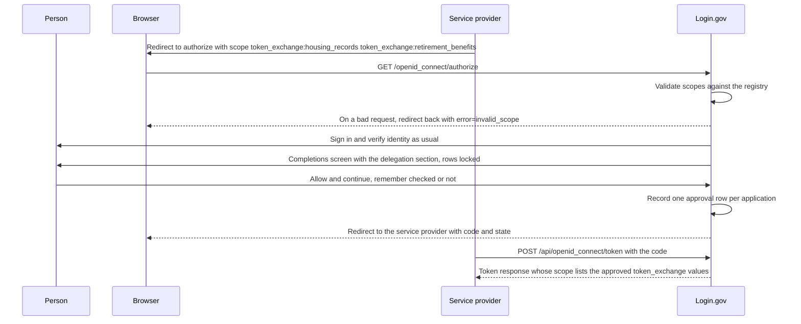

Notice that the registry check happens before the person sees anything, and that the approvals are written before the redirect back, so the token response can report them.

This is the sign-in request. It is an ordinary Login.gov OpenID Connect authorization request with PKCE; the only new element is the two `token_exchange:` values in `scope`. The redirect address and the client identifier are the fixture's.

```http
GET /openid_connect/authorize
    ?client_id=urn%3Agov%3Agsa%3Aopenidconnect%3Asp%3Asinatra_sts
    &response_type=code
    &acr_values=urn%3Aacr.login.gov%3Averified
    &scope=openid+email+token_exchange%3Ahousing_records+token_exchange%3Aretirement_benefits
    &redirect_uri=https%3A%2F%2Fmybenefits.example.gov%2Fauth%2Fresult
    &state=…
    &nonce=…
    &prompt=select_account
    &code_challenge=…
    &code_challenge_method=S256 HTTP/1.1
Host: idp.example.gov
```

Notice `acr_values=urn:acr.login.gov:verified`: the request asks for an identity-verified sign-in, which delegation requires. A request with `token_exchange:` values that asks only for authentication is refused.

When the request fails one of the delegation checks, Login.gov sends the browser straight back to the service provider's registered redirect address. This is the response to a request that named `token_exchange:not_a_thing`:

```http
HTTP/1.1 302 Found
Location: https://mybenefits.example.gov/auth/result
    ?error=invalid_scope
    &error_description=Scope+Unknown+delegation+scope%3A+not_a_thing.+Please+see+our+documentation+at+…
    &state=…
```

Notice that the error code is `invalid_scope`, the code RFC 6749 §4.1.2.1 assigns to a bad scope value, and that the description names the unknown value. A request from a service provider that is not approved for delegation, or that does not ask for identity verification, gets the same error code with the message "Delegation scopes (token_exchange:*) require an identity-verified request from a service provider approved for delegated access." Unknown scopes without the `token_exchange:` prefix are still dropped silently, as they always have been.

When the request is valid and at least one requested application lacks a current remembered approval, the completions screen shows the delegation section. In text, the person sees this:

```text
You’re allowing MyBenefits Assistant access to your information

MyBenefits Assistant is a government service that helps you find benefits you
may qualify for and track your applications in one place.

About this service
  MyBenefits Assistant is run by      [logo] Office of Benefits Coordination
  Uses AI  [AI]                        It uses AI to answer your questions and
                                       suggest benefits you may qualify for.
  Your information                     Information from the agencies you approve
                                       is used only while you are signed in and
                                       deleted when you sign out. Not shared
                                       outside the Office of Benefits Coordination.
  How long access lasts                After this sign-in, MyBenefits Assistant
                                       can act for you for up to 12 hours, unless
                                       you end it sooner from your account.
  Learn more about MyBenefits Assistant

MyBenefits Assistant needs access to these applications
These applications are required to continue to MyBenefits Assistant. If you
don’t want to allow one of them, cancel and return to MyBenefits Assistant.
Each agency has written what its application does in its own words.

  [logo] Department of Housing Support          1 application requested
         helps people find, keep and pay for housing.
         About the Department of Housing Support
    [x] Housing Assistance Records (required to continue)
        [New] [Required]
        This lets the service check where your housing application is in
        review, whether anything is missing, and submit missing documents for you.
        Will receive: Case number, Current status, Next step, Documents requested
        Services the application will use:
          https://records-api.housing.example.gov
        [Can make changes]              Learn more from Department of Housing Support

  [logo] National Retirement Administration     1 application requested
         administers retirement benefits and earnings records.
    [x] Retirement Benefits Portal (required to continue)
        [Already approved] [Required]
        Approved from your account on October 1, 2026
        This lets the service view your estimated monthly benefit and your
        yearly earnings record.
        Will receive: Estimated monthly benefit, Yearly earnings record
        Services the application will use:
          https://benefits-api.retirement.example.gov
        [Read only]                     Learn more from National Retirement Administration

  [ ] Remember my approvals for 1 year
      If you leave this unchecked, these approvals last for this sign-in only.
      You can review, approve in advance, or revoke approvals at any time
      under Account → Connected accounts.

  Only the applications listed above will be shared, and each receives only
  the information it is approved for. Login.gov never shares your password.

  [ Allow and continue ]
  [ Cancel and return to MyBenefits Assistant ]
```

Notice that both application checkboxes are checked and disabled, so the form submits nothing for them; the only live inputs are the remember checkbox and the two buttons. Each row carries a status badge: `New` for an application with no live approval, `Already approved` for one covered by a remembered, current approval (here given from the account page, so the date is shown), and `Updated` for one whose approval lapsed because the agency, application or service provider made a material change to its content. Every sentence about the service provider and the applications is registry content from section 1, rendered escaped; the fixed wording around it comes from the locale files.

When the person submits, Login.gov records one `token_exchange_grants` row (section 1) for each application that needed approval, with `source: consent_screen`. If the remember box is checked, `remember_until` is one year from now; otherwise `rails_session_id` is set to this browser session and `remember_until` is empty. The row for Retirement Benefits Portal above is left untouched, because it already has a remembered, current approval. Cancelling sends the browser to the service provider with `error=access_denied` and writes nothing.

After the handoff, the service provider redeems its code at the token endpoint as usual (`POST /api/openid_connect/token` with `grant_type=authorization_code`, the `code` and its PKCE `code_verifier`). The response gains one member:

```json
{
  "access_token": "…",
  "token_type": "Bearer",
  "expires_in": 899,
  "id_token": "…",
  "scope": "openid email token_exchange:housing_records token_exchange:retirement_benefits"
}
```

The `access_token`, `id_token` and `expires_in` members (the remaining lifetime of the person's session, in seconds) are exactly what they were before this branch. Notice that `scope` lists the attribute scopes that were requested plus only the `token_exchange:` values that are approved and valid for this sign-in. It is computed when the code is redeemed, from the live approval rows, so an approval revoked between the screen and the code exchange is not reported. If the person had approved only Retirement Benefits Portal, the value would be `openid email token_exchange:retirement_benefits`. A token response for a request without `token_exchange:` values has no `scope` member at all, exactly as before this branch. The `aud` of the `id_token` stays the service provider's `client_id`.

The decision logic, in the order the code applies it:

- Parsing the request (`OpenidConnectAttributeScoper`): attribute scopes are intersected with the allowed list, so an unknown attribute scope is silently dropped. Values that start with `token_exchange:` are kept as given, never added to any attribute list, and exposed as bare values through `#delegation_scope_values`.
- Validating the request (`OpenidConnectAuthorizeForm#validate_delegation_scopes`), only when at least one `token_exchange:` value is present: first, if the service provider is not approved for delegation (`#delegation_service_provider?`, which also requires the master switch to be on) or the request does not ask for identity verification (IAL2, IALmax, or a service provider whose default is identity verification), the error is `delegation_not_allowed`. Otherwise every requested value is looked up in `DelegationApplications.accepting(client_id)`, which already excludes inactive applications, inactive agencies and applications whose allow-list excludes this service provider; any value not found produces the error `unknown_delegation_scope` naming the missing values. Either error is sent to the service provider as `error=invalid_scope`. A SAML sign-in never carries delegation values.
- Deciding whether to show the section (`VerifySpAttributesConcern#delegation_consent_needed?`), checked after the existing reasons for showing the completions screen: it is skipped if the service provider did not request delegation; skipped if the person already answered for this sign-in (the session holds a SHA-256 digest of the authorize URL, which is unique per sign-in because every sign-in carries a fresh `state` and `nonce`); otherwise `TokenExchangeGrant.partition_current` splits the requested applications into `kept` (a live approval that is remembered, unexpired and current) and `needing_approval` (everything else), and the section is shown when `needing_approval` is not empty.
- Recording consent (`TokenExchangeConsent`): every `kept` approval is left untouched, so a later screen never shortens one; every application in `needing_approval` gets a new row through `TokenExchangeGrant.approve!`, which supersedes any earlier live row for that key with reason `superseded_by_new_consent`. The list of applications comes from the session, not from the form.
- Reporting the result (`OpenidConnectTokenForm#granted_scope`): for each requested application, the live approval is checked with `valid_now?(identity:)`, which counts a non-remembered approval only when its `rails_session_id` equals the session recorded on the person's `identities` row for this service provider.

## Functional requirements

| Id | Requirement |
|---|---|
| **FR-CEN-1** | A service provider MUST request delegated access as part of the person's OpenID Connect sign-in request, naming each application it wants by that application's delegation scope value. Only OpenID Connect service providers can request delegation; SAML remains a format for tokens issued to agency APIs. (D15) |
| **FR-CEN-2** | Login.gov MUST refuse a request that names an application that does not exist or is disabled, belongs to a disabled agency, does not accept the requesting service provider, or comes from a service provider not approved for delegation. The refusal MUST be reported to the service provider as an error, not shown to the person as a choice. |
| **FR-CEN-3** | Delegated access MUST be available only for identity-verified sign-ins. A request that names applications but does not ask for identity verification MUST be refused as an error to the service provider. (D14) |
| **FR-CEN-4** | Existing sign-in behavior for service providers that do not request delegation MUST be unchanged. |
| **FR-CEN-5** | The consent screen MUST be shown whenever a requested application is not covered by a remembered, unrevoked, current approval. An approval stops being current when the agency, the application or the service provider has made a change to its consent content that it marked as material since the person approved; editorial changes do not re-ask. (D9) |
| **FR-CEN-6** | Cancelling the consent screen MUST leave no approval, no sign-in and no record at the service provider or any agency, and MUST NOT affect whether or how the person is asked next time. There is no per-application decline (FR-CUX-5). (D5, D13) |
| **FR-CEN-7** | Once the person has answered the screen for a sign-in, they MUST NOT be asked again within that same sign-in. |
| **FR-CEN-9** | The service provider MUST be told which applications were approved, and only those. |
| **FR-CEN-10** | An application the person has not approved MUST have no effect anywhere: its APIs MUST NOT be usable, nothing MUST be reported to its agency, and no record of the person MUST be created at it. |
| **FR-CEN-11** | An approval that was not remembered MUST be valid only for the sign-in in which it was given. A remembered approval, whether given on the consent screen or in advance from the account page, MUST be valid for no longer than the remember period counted from when it was given. (D6, D16) |
| **FR-CEN-12** | Approving an application MUST NOT create or alter any direct relationship between the person and that application or its agency in Login.gov, and MUST NOT affect any direct sign-in the person has with them. |
| **FR-CEN-17** | Login.gov MUST record each approval: which applications were requested and approved, whether it was given on the consent screen or in advance from the account page, the agency, application and service provider content versions the person saw, whether it was remembered, when, and in which sign-in. |
| **FR-CUX-1** | Consent MUST be collected on Login.gov's existing consent screen, so the person sees one consent step at sign-in, not two. |
| **FR-CUX-2** | The screen MUST tell the person who is asking: the service provider's name and logo, what it does, who operates it, whether it uses AI and for what, how it handles their information, and where to learn more. It MUST also state, in one plain sentence, how long the service provider's access lasts per sign-in (up to 12 hours). It does not describe fraud-signal delivery to agencies; that disclosure belongs to the privacy policy. (D53) |
| **FR-CUX-3** | The screen MUST present one row per requested application, labeled with the owning agency's public name and logo and the application's display name, grouped by agency. Under each application the screen MUST show the agency's description, the application's description, the information the service will receive, whether access is read-only or can make changes, a link to learn more, and the application's API URLs. The APIs are shown for information; the person approves the application as a whole. (D1) |
| **FR-CUX-4** | Applications named in the service provider's request MUST be shown selected and locked: they are a condition of the sign-in, as requested attributes are today. Nothing not named in the request MAY appear selected or be approved by this screen. (D5) |
| **FR-CUX-5** | The person declines a requested application by cancelling the sign-in. There is no partial approval of a request: the service provider either receives every application it requested or no sign-in. The screen MUST say so plainly next to the locked rows. (D5) |
| **FR-CUX-6** | The person MUST be able to cancel and return to the service provider without approving anything. Cancelling returns the person to the service provider with the standard access-denied error and completes no sign-in. (D13) |
| **FR-CUX-7** | The person MUST be offered the choice to have Login.gov remember the approvals given on this screen for a limited period (one year). The default MUST be not to remember; an approval that is not remembered is valid for this sign-in only. The screen MUST explain what remembering means and where to review or change approvals. Approvals given in advance from the account page (FR-CUX-13) are always remembered for the same period, counted from the moment they were given. The choice applies only to requested applications that lack a current remembered approval; an existing remembered approval is never shortened by a later screen. (D6, D16, D52) |
| **FR-CUX-8** | The screen is shown only when a requested application lacks a current remembered approval (FR-CEN-5). Requested applications the person already approved, on an earlier screen or from the account page, are shown selected and locked like the others, marked as already approved; a requested application without an approval is marked as new; one whose approval lapsed because of a material content change is marked as updated and shows the current content. (D17) |
| **FR-CUX-9** | Everything shown about a service provider or agency MUST come from content Login.gov approved at onboarding. Nothing in the service provider's request MAY alter what the person sees, and partner-written content MUST NOT be able to execute or alter the page. |
| **FR-CUX-10** | The screen MUST meet Login.gov's accessibility and plain-language standards and MUST be available in every supported language. |
| **FR-CUX-11** | The layout and wording MUST follow the approved consent-screen design (*Consent screen mockup*), adjusted for the locked rows of requested applications, and MUST use fictitious agency and service names in any published example. |

## Protocol rows

| Id | Requirement |
|---|---|
| **CON-1** | A service provider requests delegation by including one or more `token_exchange:<delegation_scope_value>` values in the OpenID Connect `scope` parameter, each naming an application (ONB-2). |
| **CON-2** | Login.gov MUST reject the authorization request with `error=invalid_scope` (RFC 6749 §4.1.2.1) if any `token_exchange:` value names no application, names an application that is inactive or whose agency is inactive, names an application whose `allowed_delegation_service_providers` is non-empty and excludes the requesting service provider, or if the requesting service provider is not approved for delegation. |
| **CON-3** | Rejection under CON-2 MUST apply only to values with the `token_exchange:` prefix. Unknown scopes without that prefix MUST keep today's behavior (silently ignored), because existing integrations send values that are not valid scopes and rely on them being dropped. |
| **CON-4** | `token_exchange:*` values MUST only be honored on identity-proofed (IAL2 / IALmax) requests. Delegated tokens carry verified identity to other agencies, so the exchange can never elevate assurance. |
| **CON-5** | When a request carries `token_exchange:*` values, the completions screen MUST be shown unless every requested application is covered by a live, remembered grant whose recorded content versions are at or above the current `*_material_version` of the agency, the application and the service provider. Editorial content edits never cause the screen to be shown. (D9) |
| **CON-6** | `token_exchange:*` values MUST NOT be written to `identities.verified_attributes`, so they can never satisfy the existing "already consented" check by accident. |
| **CON-7** | The screen MUST show (a) a card describing the service provider from the ONB-4 content (logo, a heading naming it, its one-sentence description, run by, uses AI, your information, learn more) and (b) one row per requested application, grouped by agency with a count: agency name and logo (`Agency#name`, CON-18), agency description, application display name, description, data provided, an access badge ("Read only" / "Can make changes"), the learn-more link, and the application's resource server identifiers for information. Requested applications are rendered checked and disabled; the screen states that cancelling is how to decline. Nothing not requested is shown or approved by this screen. The buttons are "Allow and continue" and "Cancel and return to <service provider>". (D1, D5) |
| **CON-8** | All agency- and service provider-supplied content MUST be rendered HTML-escaped. Content MUST come only from the database, never from the authorization request. |
| **CON-9** | The screen MUST show a "Remember my approvals for 1 year" checkbox, unchecked by default, applying to the requested applications. Unchecked means the grants are valid for this authorization only (CON-11, CON-19). Its help text MUST say the person can review and change these approvals under Account → Delegated access and that, if unchecked, Login.gov will ask again next time. The remember period is 12 months for every application, `read_write` included; read-write risk is carried by the token and family lifetimes (REF-5), not by a shorter remember period. (D6, D52) |
| **CON-9a** | There is no per-application decline. Cancelling the screen creates no grant, completes no sign-in and leaves no record at the service provider or any agency; it has no effect on whether the screen is shown next time. (D5) |
| **CON-10** | Grants are one live row per (user, service provider issuer, application) in `token_exchange_grants`: `user_id`, `service_provider_issuer`, `application_service_provider_id`, `delegation_id`, `source` (`consent_screen` or `account_page`), `consented_at`, `remember_until`, `rails_session_id` (single-authorization grants only), `agency_content_version`, `application_content_version`, `sp_content_version`, `proofed_in_session`, `first_exchanged_at`, `revoked_at`, `revocation_reason`. A new decision for the same key supersedes the earlier live row (revoked with reason `superseded_by_new_consent`). The grant is not tied to the service provider `identities` row because advance approval happens outside any authorization. (D1, D8) |
| **CON-11** | A grant is valid when `revoked_at` is null, the application and its agency and the service provider are active, the service provider is still approved, and either `remember_until` is in the future or the grant is the current authorization (CON-19). `remember_until` MUST be at most one year after consent. An `account_page` grant always has `remember_until`. |
| **CON-12** | A grant is current only while `agency_content_version` is at or above `agencies.consent_material_version`, `application_content_version` at or above the application's `consent_material_version` and `sp_content_version` at or above the service provider's `sp_material_version`. Otherwise it is treated as not valid and consent is re-collected. (D9) |
| **CON-13** | Revoking the service provider connection (`RevokeServiceProviderConsent`) MUST revoke all of that service provider's live grants for the person, with reason `sp_disconnected`. Built on section 3 (FR-CEN-14). |
| **CON-14** | Declined requests are not recorded, because none exist. Not-remembered grants are recorded (`remember_until: null`) so the outcomes report (BIL-7) can count delegation that was requested but never used; consent screens shown without a completed authorization are counted from analytics, not from grant rows. |
| **CON-15** | The token response from `/api/openid_connect/token` MUST include a `scope` value listing the attribute scopes and only the `token_exchange:*` values the person approved that are valid for this authorization (RFC 6749 §5.1: `scope` is REQUIRED when it differs from the request). It MUST be computed at token time from the live grants, not stored on `identities.scope` (the handoff that follows the screen re-links the identity and overwrites that column), and MUST be present only when delegation was requested, so existing token responses are unchanged. |
| **CON-16** | The `id_token` MUST NOT list the target APIs in `aud`. `aud` stays the service provider's `client_id` (OpenID Connect Core §2); listing targets there would let an API accept the service provider's ID token as if issued to itself. |
| **CON-17** | Once the person has submitted the screen for an authorization, it MUST NOT be shown again before that authorization's handoff completes, or the redirect back to the authorize URL would loop. The implementation records a SHA-256 digest of the authorize URL (`sp_session[:request_url]`) in the user session at submit and skips the delegation reason while it matches. It MUST NOT key on the SP request id, which `ServiceProviderRequestHandler` reuses when the same service provider authorizes again in one browser session; every authorization carries a fresh `state` and `nonce`, so its URL is unique. |
| **CON-18** | The agency shown for each group MUST be the agency SP's `Agency#name`, not the agency SP's `friendly_name`: people decide by agency, and an agency may register several records whose friendly names mean nothing to the public. |
| **CON-19** | A grant MUST record the browser session (`rails_session_id`) in which consent was given. A non-remembered grant is the current authorization (CON-11) exactly while that value equals `identities.rails_session_id`, which the handoff sets from the same session; re-authorizing re-links the identity and the grant lapses. Recording a new decision for a (user, service provider, application) supersedes any earlier live grant for that key (reason `superseded_by_new_consent`), except that a remembered, current approval is kept untouched (CON-24). |
| **CON-20** | `token_exchange:*` values that cannot be honored because the person cancelled MUST NOT produce any grant, Attempts delivery, billing row or agency-side record (ATT-*, BIL-*). |
| **CON-21** | Delegation scopes are accepted on OpenID Connect authorization requests only. A SAML AuthnRequest cannot request delegation; `requested_delegation_scopes` is set only by the OIDC authorize path. (D15) |
| **CON-22** | A request carrying `token_exchange:*` values whose ACR does not ask for identity verification (IAL2 or IALmax) fails with `invalid_scope`, not silently. (D14) |
| **CON-23** | Cancelling the consent screen uses the completions screen's existing cancel path: the person is returned to the service provider with `error=access_denied`, no sign-in completes, and no grant, Attempts event or billing row is written. (D13) |
| **CON-24** | The remember choice applies only to requested applications without a live remembered approval. A requested application that already has one keeps that row untouched (no supersession, no shortening); it is re-recorded only when its approval is stale (CON-12) or absent. (D16) |
| **CON-25** | Each requested row is badged: `new` (no live approval), `already approved` (live, current approval) or `updated` (live approval made stale by a material content change). Only version numbers are stored; the updated row shows the current content. (D17, D18) |
| **CON-26** | The service provider card (CON-7) carries one plain sentence stating how long the service provider's access lasts per sign-in (up to 12 hours, `token_exchange_refresh_token_ttl_seconds`), in every supported language. The screen says nothing about Attempts API delivery to agencies; that disclosure is the privacy policy's. (D53) |

## As built

1. The sign-in request. `OpenidConnectAttributeScoper.delegation_scope?` and `#delegation_scope_values` keep `token_exchange:*` values (the prefix is the constant `DELEGATION_SCOPE_PREFIX`) through parsing without adding them to the attribute scope lists, and `OpenidConnectAttributeScoper.new(scope, allowed:)` takes the request's allowed attribute scopes so the form parses the scope string once. `OpenidConnectAuthorizeForm#validate_delegation_scopes` adds the error `delegation_not_allowed` when the service provider is not approved or the request is not identity-verified, or the error `unknown_delegation_scope` naming the values not found in `DelegationApplications.accepting`, which already excludes inactive applications, inactive agencies and applications whose allow-list excludes the caller; the form's error redirect reports either as `invalid_scope`. The bare values travel in the stored service provider request and in `sp_session[:requested_delegation_scopes]` through `FederatedProtocols::Oidc`, read back by `ServiceProviderSession#requested_delegation_scopes`; `FederatedProtocols::Saml` returns an empty list. The authorize analytics event logs the values as `delegation_scopes`.
2. Showing the screen. `VerifySpAttributesConcern#delegation_consent_needed?` is the completions-screen reason `:delegation_requested`, checked after the existing reasons. It calls `TokenExchangeGrant.partition_current(user:, service_provider_issuer:, applications:)`, which preloads the applications' agencies, loads the live approvals in one query (`live_by_application`) and returns `{ kept:, needing_approval: }`; the screen is needed when `needing_approval` is not empty. The once-per-sign-in marker is `user_session[:delegation_consent_authorization]`, a SHA-256 digest of `sp_session[:request_url]`. `DelegationApplications.requested(issuer, scope_values)` turns the bare values into application records in request order. Delegation values never enter `requested_attributes` or `verified_attributes`.
3. The screen. `app/views/sign_up/completions/_delegation_consent.html.erb`, rendered from `CompletionsPresenter#delegation_groups` when `#delegation_requested?` is true, shows the service provider card, the agency-grouped locked rows (`check_box_tag` checked and disabled, with `aria-describedby` pointing at the explanation and the status badges, and the active resource server identifiers listed), the `new`, `approved` and `updated` badges (`CompletionsPresenter::DelegationRow#status`) with the account-page approval time when that is the source, the remember checkbox (`idv_form[delegation_remember]`, unchecked), the access-duration sentence (`CompletionsPresenter::DELEGATION_ACCESS_HOURS`, 12) and the no-password statement. The page heading becomes "You're allowing <service provider> access to your information". The submit button reads "Allow and continue"; the cancel button and footer link go to `return_to_sp_cancel_path(step: :sign_up)`, which returns `access_denied`. The locked checkboxes submit nothing; `SignUp::CompletionsController#update` approves the applications recorded in the session. Every string shown about a partner comes from the registry and is escaped. The fixed strings live under `sign_up.delegation.*` in `config/locales/{en,es,fr,zh}.yml`.
4. Recording. `VerifySpAttributesConcern#record_delegation_consent` runs `TokenExchangeConsent`, which keeps every `kept` approval untouched and calls `TokenExchangeGrant.approve!` for each application in `needing_approval` with `source: consent_screen`, the three content versions, either `remember_until` or `rails_session_id`, and `proofed_in_session` (whether identity verification happened in this browser session). The controller then logs the analytics event `delegation_consent_submitted(issuer:, applications:, remembered:, newly_approved_count:)`. Consent writes approval rows only; nothing is created at any agency.
5. The token response. `OpenidConnectTokenForm#granted_scope` returns the attribute scopes plus the approved `token_exchange:*` values that are valid for this sign-in, computed at code redemption; `TokenExchangeGrant#current_authorization?(identity:)` and `#valid_now?(identity:)` accept the identity the code exchange already loaded, so no second query is needed. The response is unchanged when no delegation scope was requested.
6. This branch deletes `token_exchange` as an attribute scope (from `IAL2_SCOPES`, `ATTRIBUTE_SCOPES_MAP` and `CAPABILITY_SCOPES`), whose presence in `verified_attributes` skipped the screen for a year; the "allow all linked" and "auto-enroll" controls, the per-application choice and the consent-screen TypeScript pack (`delegation-consent.ts`); the connected-applications reach query and the decision-recording methods in the concern; and the `sign_up.token_exchange_grant.*` strings.
7. The specs are `spec/features/openid_connect/delegated_access_consent_spec.rb` (locked rows, cancel to `access_denied`, remembered skip, request growth, material change, `invalid_scope`; Bullet is enabled for feature specs, which is why the approval lookup is one query), `spec/forms/openid_connect_authorize_form_spec.rb`, `spec/forms/openid_connect_token_form_spec.rb`, `spec/services/token_exchange_consent_spec.rb`, `spec/services/openid_connect_attribute_scoper_spec.rb`, `spec/presenters/completions_presenter_spec.rb` and `spec/models/token_exchange_grant_spec.rb`. Rubocop, erb_lint, i18n and analytics lints are clean.

## Decisions

- **D1** Consent is given per application (section 1).
- **D2** There is one scope per application (section 1).
- **D3** Content comes from partner configuration, never from the request (section 1).
- **D4** An approval given in advance from the account page is consent, and the screen honors it.
- **D5** Requested applications are take-it-or-cancel; no per-application decline exists or is recorded.
- **D6** The remember choice, unchecked by default, applies to requested applications; account-page approvals are always remembered.
- **D9** Only material content changes re-ask the person (section 1).
- **D13** Cancelling returns the person to the service provider with `access_denied`.
- **D14** Delegation scopes on a sign-in that is not identity-verified are refused with `invalid_scope`.
- **D15** Only OpenID Connect service providers can request delegation.
- **D16** The remember choice applies only to applications lacking a current remembered approval; nothing is downgraded.
- **D17** A stale approval shows locked with an "updated" badge and the current content.
- **D18** There is no content history table; approvals store version numbers only.
- **D52** The remember period stays one year for every application, read-write included.
- **D53** The screen states the access duration and says nothing about fraud signals.

## How to review

- Diff against `delegated-access-registry`.
- Check first: `OpenidConnectAuthorizeForm#validate_delegation_scopes` (what is refused and with which error code); `VerifySpAttributesConcern#delegation_consent_needed?` and the once-per-sign-in marker; that the submitted form carries no application list the server trusts (the server reads the applications from the session); and `OpenidConnectTokenForm#granted_scope`.
- Specs that prove it: the feature spec `spec/features/openid_connect/delegated_access_consent_spec.rb` (locked rows, cancel to `access_denied`, remembered skip, request growth, material change, `invalid_scope`), the two form specs (`spec/forms/openid_connect_authorize_form_spec.rb`, `spec/forms/openid_connect_token_form_spec.rb`), the consent service spec `spec/services/token_exchange_consent_spec.rb`, and `spec/models/token_exchange_grant_spec.rb` for `partition_current`.
- Must not change for existing clients: a request without `token_exchange:*` values parses, consents and returns `scope` exactly as before; delegation values never enter `requested_attributes` or `verified_attributes`; unknown scopes without the prefix are still ignored silently.
- Open items: the approved mockup needs a revision for the locked, disabled checkbox (FR-CUX-11); declines exist nowhere as records, so the outcomes report counts `withdrawn_before_use` instead (section 11, D68); the fraud-signals branch (section 12) adds release hooks into this concern and controller.

# 3. `delegated-access-account-page`: approving in advance, reviewing and revoking from the account

**Stack position** 3 of 14, on `delegated-access-consent`.

## Objective

This branch gives the person a place in their Login.gov account to see and control delegated access: the page Account → Delegated access at `/account/delegated_access`. The page lists every service provider that Login.gov has approved for delegation, whether or not the person has ever signed in to it, and under each service provider every active application that accepts it, grouped by the agency that owns the application. For each application the page shows whether the person has approved it, when and from where the approval was given, and how long the approval remains, all in the agency's own words.

From the page the person can approve applications in advance by selecting them and confirming on a second page that shows the same content the consent screen shows. The person can also revoke one application, revoke everything one service provider may do, or end all delegated access across every service provider, each after its own confirmation page. Every approval and every revocation writes an event to the person's account history and sends the person an email. Disconnecting a service provider from the connected-services list revokes that service provider's approvals too. Signing out revokes nothing.

The controls live on a dedicated page rather than under each connected service for two reasons: a person may want to approve an application before a first sign-in to the service provider, and a single-step toggle is too easy to flip without reading what it grants (D19, D20, D23). Only remembered approvals are listed, because an approval given for one sign-in lasts hours and listing it would invite revoking something that is already ending. The page shows the current state only, with no usage and no history; account history events keep the record, and a history view is planned (D54, D55). The consent screen and this page render service provider and application content through shared partials, so the two cannot drift apart.

## How it works

The branch adds one page, two confirmation pages and the routes that serve them. No migration is needed; everything is read from and written to the `token_exchange_grants` table of section 1.

```text
GET    /account/delegated_access                                                 the page
GET    /account/delegated_access/:service_provider_id/approve                    confirm an advance approval
POST   /account/delegated_access/:service_provider_id/approve                    record the approval
GET    /account/delegated_access/:service_provider_id/applications/:application_id/revoke   confirm: one application
DELETE /account/delegated_access/:service_provider_id/applications/:application_id/revoke   revoke one application
GET    /account/delegated_access/:service_provider_id/revoke                     confirm: one service provider
DELETE /account/delegated_access/:service_provider_id/revoke                     revoke one service provider
GET    /account/delegated_access/revoke                                          confirm: everything
DELETE /account/delegated_access/revoke                                          end all delegated access
```

Notice that every write (`POST` or `DELETE`) is paired with a `GET` that shows a confirmation page first, and that the `:service_provider_id` and `:application_id` segments are the numeric ids of `service_providers` rows. The page requires a fully authenticated session (two-factor confirmed), like the rest of the account.

The page itself, in text, for a person who has approved one of the two fixture applications from the account page:

```text
Delegated access

Some services can act on your behalf at other agencies after you sign in with
Login.gov. Each agency describes its application in its own words. Approvals
you give here last for 1 year and are honored when you sign in; you can end
them at any time.

[ End all delegated access ]

MyBenefits Assistant
  MyBenefits Assistant is run by Office of Benefits Coordination
  Uses AI: It uses AI to answer your questions and suggest benefits you may qualify for.
  Your information: … used only while you are signed in and deleted when you sign out …
  Learn more about MyBenefits Assistant

  ▾ Department of Housing Support                         0 of 1 approved
      [ ] Housing Assistance Records
          This lets the service check where your housing application is in review …
          Will receive: Case number, Current status, Next step, Documents requested
          Services the application will use: https://records-api.housing.example.gov
          [Can make changes]

  ▾ National Retirement Administration                    1 of 1 approved
      Retirement Benefits Portal                           [Approved]
          Approved on October 1, 2026. Given from your account. Ends in 12 months.
          This lets the service view your estimated monthly benefit and your
          yearly earnings record.
          Will receive: Estimated monthly benefit, Yearly earnings record
          Services the application will use: https://benefits-api.retirement.example.gov
          [Read only]                                      Revoke

  [ Approve selected ]                   Revoke everything for MyBenefits Assistant
```

Notice that the service provider card at the top is the same card the consent screen shows, and each application block is the same application content. An unapproved application has a checkbox; an approved one shows its status, source and time remaining and offers Revoke instead. Each agency is a collapsible group, open when it holds an approval. A service provider that is no longer approved or active keeps its section while live approvals remain, with the text "<service provider> is no longer approved to act on your behalf. You can still end the approvals you gave it." and only the revoke controls.

Approving in advance is two steps. Selecting applications and pressing "Approve selected" submits a `GET` to the confirmation page:

```http
GET /account/delegated_access/42/approve?application_ids[]=67 HTTP/1.1
```

The confirmation page is headed "Allow MyBenefits Assistant to act on your behalf at these applications?", explains that the approval lasts 12 months, repeats the service provider card and the selected applications with their agency content, and has one "Allow" button, which sends `POST /account/delegated_access/42/approve` with the same `application_ids[]`. Notice that the server re-derives the list on both steps: anything that is not an active application accepting this service provider, or that already has a remembered, current approval, is dropped before either page renders. On success the person returns to the page with "You approved 1 application for MyBenefits Assistant." and the new approval row has `source: account_page` and `remember_until` one year from now.

Revocation always cascades from the person's confirmation to the approval rows, and from there to the record and the notice. What ends depends on which of the three routes the person used:

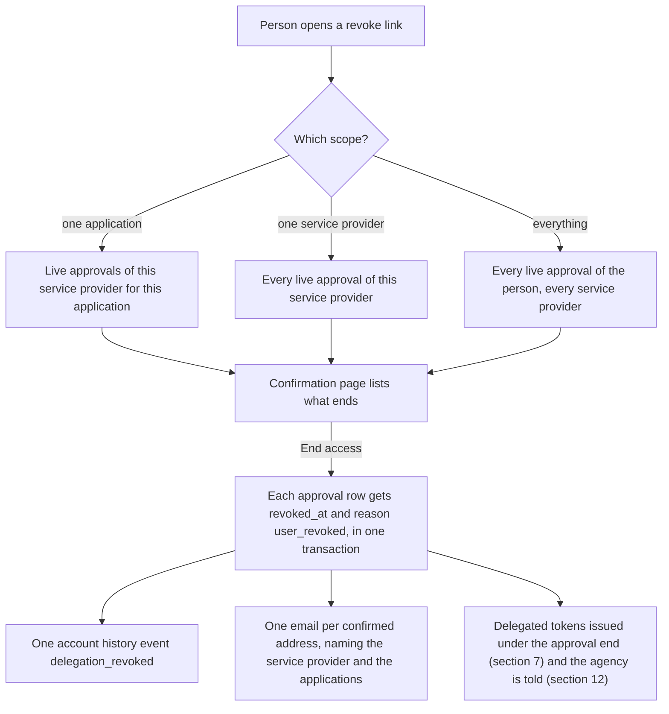

Notice that one revocation, whatever its scope, produces exactly one history event and one email per confirmed email address, both naming every application that ended. The rows are never deleted; a revoked row keeps its data with `revoked_at` set. On this branch, revocation marks the approval rows; the branches of sections 6 and 7 make the delegated tokens and refresh families issued under a revoked approval stop working, and section 12 tells the agency.

The emails the person receives, by subject line:

```text
You allowed MyBenefits Assistant to act on your behalf          (after an advance approval)
You ended what MyBenefits Assistant can do on your behalf        (after revoking one application or one service provider)
You ended all delegated access                                  (after ending everything)
```

Each email lists the application names, says the action came from the person's account, carries the standard disavowal link, and goes to every confirmed email address, as the existing connected-service emails do. The matching account history events are `delegation_approved` and `delegation_revoked`.

The way in: on `/account/connected_services`, the entry for a service provider approved for delegation gains the link "Manage what <service provider> can do on your behalf", which jumps to that service provider's section of the page, and the account navigation gains "Delegated access" under Connected services.

The decision logic, in words:

- Which service providers are listed (`DelegatedAccessPresenter#sections`): every active service provider with `token_exchange_enabled_sp` true, plus any service provider the person still has a remembered approval for, so that an approval can be revoked even after its service provider is no longer approved or active. Sections are sorted by display name. A section with no applications is not shown.
- Which applications are listed under a service provider: `DelegationApplications.accepting(issuer)` plus any application a remembered approval names, grouped by agency with `grouped_by_agency`. A section is approvable only while its service provider is still approved (`#delegation_service_provider?`); otherwise it offers only revocation.
- Which approvals are shown: `TokenExchangeGrant.remembered`, that is, live rows with `remember_until` in the future. A row with `rails_session_id` and no `remember_until` (an approval for one sign-in) is not shown.
- Approving (`Accounts::DelegatedAccess::ApprovalsController`): the service provider must be active and currently approved for delegation, or the request is not found, so the registry cannot be enumerated from here. The selected `application_ids[]` are intersected with `DelegationApplications.accepting(issuer)`, then `TokenExchangeGrant.partition_current` drops anything that already has a remembered, current approval. An empty result redirects back to the page with "Select at least one application to approve." Otherwise `AccountDelegationApproval` writes one row per application through `TokenExchangeGrant.approve!` with `source: account_page` and `remember: true`, in one transaction.
- Revoking (`Accounts::DelegatedAccess::RevocationsController` and `AccountDelegationRevocation`): the route decides the scope (one application, one service provider, or everything), and the service becomes the matching subset of the person's live rows. If the subset is empty the confirmation page redirects back to the page. On `DELETE`, every row in the subset is revoked with reason `user_revoked` in one transaction; then one history event, the emails and one analytics event follow.
- Disconnecting a service provider (`RevokeServiceProviderConsent#call`): in the same transaction that marks the connection deleted, every live approval for that service provider is revoked with reason `sp_disconnected`. Signing out touches no approval.

## Functional requirements

| Id | Requirement |
|---|---|
| **FR-CEN-14** | Disconnecting the service provider from the person's account MUST revoke all of that service provider's approvals. |
| **FR-CEN-15** | Signing out of Login.gov MUST NOT by itself revoke approvals the person chose to remember. Suspension or deletion of the account MUST revoke all of them (built in section 7). |
| **FR-CUX-12** | The person's Login.gov account MUST include a page that, for each service provider approved for delegation, lists every registered application that accepts that service provider, grouped by agency, showing for each whether it is approved, when and from where, how long the approval remains, the APIs covered and whether each is read-only or can make changes, in the agency's own words. Only remembered approvals are shown; an approval valid for one sign-in only is not listed. The page shows current state only: no history and no usage (when tokens were first or last issued); past approvals and revocations are visible in the person's account history (FR-CUX-13), and a history view is planned (FR-CUX-15). Service providers the person has not yet signed in to are included so approval can be given in advance. (D23, D54) |
| **FR-CUX-13** | From that page the person MUST be able to approve one or more applications in advance (selecting them, then confirming on a page that shows the same content the consent screen shows), revoke a single application, revoke an entire service provider, or end all delegated access across every service provider in one action, each revocation after its own confirmation. An advance approval is a remembered approval (FR-CUX-7) and is honored by the consent screen (FR-CUX-8). Each approval and revocation MUST be recorded in the person's account history and MUST be reported to the person by email. (D20, D21, D22, D54) |
| **FR-CUX-14** | The page MUST be reachable from the existing list of connected services. |

## Protocol rows

| Id | Requirement |
|---|---|
| **ACC-1** | A dedicated page, `/account/delegated_access`, lists every service provider approved for delegation, connected or not, and under each every active application that accepts that service provider (ONB-2), grouped by agency in collapsible groups, each row with: approval state and source, `consented_at`, time remaining (`remember_until` minus now), the application's resource servers and access type, from the registry content. Only remembered grants are listed (`remember_until` present and in the future); a single-authorization grant (`rails_session_id` set, `remember_until` null) is not shown. The page shows current state only: no token-activity indicator, no issuance times and no history list; past approvals and revocations are visible through the account history events of ACC-5. A service provider that is no longer approved or active keeps its section while live grants remain, offering only revocation. (D19, D23, D25, D54) |
| **ACC-2** | Unapproved applications carry a checkbox; submitting the selection leads to a confirmation page that renders the selected applications with the consent-screen content, and one confirmation creates a grant per application with `source: account_page` and `remember_until` twelve months from now. Approved rows offer Revoke; each section offers Revoke all; the page offers ACC-6. Every revocation has its own confirmation page and calls `TokenExchangeGrant#revoke!` with reason `user_revoked`; tokens issued under the grant cascade (REF rows, section 7) and the agency is told (ATT rows, section 12). (D20, D21) |
| **ACC-3** | The existing `/account/connected_services` page MUST link to the delegated-access page from each entry for a service provider approved for delegation. |
| **ACC-4** | Advance approvals from the account page are honored by the consent screen: a requested application with a live `account_page` grant counts as covered for CON-5 and, when the screen is shown for another application, is rendered checked, disabled and marked already approved. (D4) |
| **ACC-5** | Each approval and revocation made on the page writes an account history event (`delegation_approved`, `delegation_revoked`) and sends the person an email naming the service provider and the applications, with the standard disavowal link, to every confirmed email address, as `sp_user_consent_revoked` does today. (D22) |
| **ACC-6** | A page-level End all delegated access action (`/account/delegated_access/revoke`, with a confirmation page listing every service provider and application that will lose access) revokes every live grant of the person across every service provider with reason `user_revoked` (tokens cascade, section 7; one `delegated-access-revoked` event per grant, section 12), writes one `delegation_revoked` account history event and sends one email naming every service provider and application (ACC-5). (D54) |

CON-13 (disconnecting a service provider revokes its grants) is owned by section 2 and built here as FR-CEN-14. ACC-7 and FR-CUX-15 (the history view) are planned, not built; see D55.

## As built

1. The routes in `config/routes.rb` under `/account/delegated_access` are: `GET /account/delegated_access` (`accounts/delegated_access#show`, named `account_delegated_access`); `GET` and `POST /account/delegated_access/:service_provider_id/approve` (`accounts/delegated_access/approvals#new` and `#create`); and `GET` and `DELETE` confirmation-and-action pairs for one application (`…/:service_provider_id/applications/:application_id/revoke`), one service provider (`…/:service_provider_id/revoke`) and everything (`…/revoke`), all served by `accounts/delegated_access/revocations#show` and `#destroy`. There is no migration.
2. The page is `Accounts::DelegatedAccessController#show`, rendered in the account side-navigation layout and backed by `DelegatedAccessPresenter`. The presenter builds one section per service provider in `ServiceProvider.active.where(token_exchange_enabled_sp: true)`, plus a section for any service provider named by one of the person's `TokenExchangeGrant.remembered` rows. Each section lists every application from `DelegationApplications.accepting` plus any application a remembered approval names, grouped by agency in `<details>` groups that are open when the group holds an approval. An approved row shows the approval time, the time remaining (from `remember_until`) and where the approval was given; approvals for a single sign-in are not shown. A service provider that is no longer approved or active keeps its section for revocation only.
3. Approving starts on the page: the unapproved rows are checkboxes in a `GET` form to `Accounts::DelegatedAccess::ApprovalsController#new`. Its `#load_applications` asks `TokenExchangeGrant.partition_current` which of the selected applications still need a decision, dropping anything that is not an application accepting the service provider or that already has a remembered, current approval, and `#new` renders `DelegationApprovalPresenter` (the service provider card, the selected applications grouped by agency, and the statement that the approval lasts 12 months, from `#remember_months`). `#create` records the approvals through `AccountDelegationApproval`, which calls `TokenExchangeGrant.approve!` with `source: account_page`, remembered for `TokenExchangeGrant::MAX_REMEMBER`. An empty selection returns to the page with a notice.
4. Revoking is `Accounts::DelegatedAccess::RevocationsController`, which serves the three scopes (one application, one service provider, everything) with one confirmation page, `app/views/accounts/delegated_access/revocations/show.html.erb`, listing what ends. `AccountDelegationRevocation` selects the live rows in scope, names the scope (`application`, `service_provider` or `all`) and revokes the rows with reason `user_revoked` in one transaction. The confirmation page names each row's service provider through `grant.service_provider_record&.friendly_name`, falling back to the issuer; `RevocationsController#show` preloads that association only for the all-providers scope, where the page shows a name on every row.
5. The notice is `DelegatedAccessNotificationConcern`, which writes the account history event (the `Event` types `delegation_approved`, number 31, and `delegation_revoked`, number 32, in `app/models/event.rb`) and sends `UserMailer#delegation_approved` or `#delegation_revoked` (with the service provider name, the application names and the disavowal token; the views are `app/views/user_mailer/delegation_approved.html.erb` and `delegation_revoked.html.erb`) to every confirmed email address.
6. The way in: the connected-services entry (`app/views/accounts/_connected_app.html.erb`) for a service provider approved for delegation links to that service provider's section of the page, and `NavigationPresenter` adds "Delegated access" under Connected services.
7. Disconnecting: `RevokeServiceProviderConsent#call` revokes the service provider's live approvals with reason `sp_disconnected` in the same transaction as the connection revocation. Sign-out touches no approval.
8. Shared content: `DelegationServiceProviderCard` with `app/views/shared/_delegation_service_provider_card.html.erb` (which carries the access-duration row when given a number of hours) and `app/views/shared/_delegation_application_content.html.erb` are rendered by both the consent screen and this page.
9. The analytics events are `delegated_access_page_visited`, `delegation_account_approved(issuer:, applications:)` and `delegation_account_revoked(issuer:, applications:, scope:)`; the end-all revocation, which has no single service provider, is logged without an issuer.
10. The fixed strings live under `account.delegated_access.*` (with `account.navigation.delegated_access`, `account.connected_apps.manage_delegated_access`, `headings.account.delegated_access` and `user_mailer.delegation_approved.*` and `user_mailer.delegation_revoked.*`) in `config/locales/{en,es,fr,zh}.yml`.
11. This branch deletes the inline section under each connected service (its partial, its TypeScript pack `delegation-manage.ts`, its controller, its presenter `DelegationServiceProviderPresenter`, `AccountShowPresenter#delegation_for`, the `token_exchange_grant` route and the `account.connected_apps.token_exchange.*` strings), the connected-applications query `DelegationApplications.connected_for`, and the `delegation_grant_toggled` analytics event.
12. The specs are `spec/features/account_delegated_access_spec.rb`, `spec/controllers/accounts/delegated_access_controller_spec.rb`, `spec/controllers/accounts/delegated_access/approvals_controller_spec.rb`, `spec/controllers/accounts/delegated_access/revocations_controller_spec.rb`, `spec/presenters/delegated_access_presenter_spec.rb`, `spec/presenters/delegation_approval_presenter_spec.rb`, `spec/services/account_delegation_approval_spec.rb`, `spec/services/account_delegation_revocation_spec.rb`, `spec/services/revoke_service_provider_consent_spec.rb`, `spec/mailers/user_mailer_spec.rb` and `spec/views/accounts/delegated_access/show.html.erb_spec.rb`, plus the consent-screen regression in the feature spec of section 2. 616 examples across the touched specs pass locally; rubocop, erb_lint, i18n and analytics lints are clean.

## Decisions

- **D84** A dedicated Account → Delegated access page holds the controls; there are no inline controls under each connected service (full entry in section 16).
- **D85** Advance approval is select-then-confirm; nothing is approved without the confirmation page.
- **D86** Every revocation confirms on its own page, like disconnecting a service today.
- **D87** Approvals and revocations from the page write an account history event and send an email with a disavowal link.
- **D23** Every service provider approved for delegation is listed, connected or not.
- **D24** The page shows no token activity; the planned history view carries it.
- **D25** Agencies render as collapsible groups, with approved groups open; there is no pagination.
- **D54** The page lists remembered approvals only and current state only, and offers an End all delegated access action.
- **D55** A per-service-provider history view (ACC-7, FR-CUX-15) is planned, not built.

## How to review

- Diff against `delegated-access-consent`.
- Check first: the routes block in `config/routes.rb`; `ApprovalsController#load_applications` (it drops anything not accepting the service provider or already remembered); the three `AccountDelegationRevocation` scopes; `RevokeServiceProviderConsent` (reason `sp_disconnected`); and that the page shows approvals with `remember_until` only.
- Specs that prove it: the feature spec `spec/features/account_delegated_access_spec.rb`, the three controller specs, the mailer spec `spec/mailers/user_mailer_spec.rb`, and the two presenter specs.
- Must not change for existing clients: connected-services entries for service providers not approved for delegation render as before; disconnecting such a service provider revokes nothing because it has no approvals; the consent screen renders the same shared partials it did before this branch.
- Open items: the token cascade behind `TokenExchangeGrant#revoke!` arrives with sections 6 and 7 (here revocation marks the approval row); the history view (D55) is not built; the fraud-signals branch (section 12) adds a release call to `ApprovalsController#create`. Held until the harness run: views on `ButtonComponent`/`TagComponent`; a `ServiceProvider#delegation_display_name_or_default` helper; a shared mailer instructions partial; folding `AccountDelegationApproval` into a `TokenExchangeGrant.approve_all!`.

# 4. `delegated-access-site-keys`: per-site keys sealed to a service provider's browser (ported)

**Stack position** 4 of 14, on `delegated-access-account-page`.

## Objective

A per-site key is a 32-byte secret that is unique to one person and one service provider, is the same on every device the person signs in from, and is delivered only to that service provider's browser. The service provider's page generates a P-256 key pair in the browser, sends the public half with the authorization request as `site_key_jwk`, and receives the site key sealed (encrypted) to that public key in the URL fragment of the redirect back. Login.gov derives every site key from one per-person root. The root is stored wrapped under the person's password, so Login.gov cannot read a site key at rest, and because the sealed key travels in the fragment the service provider's server never sees one either. The feature exists so that a browser-based service provider can hold a stable secret per person for its own purposes, for example to encrypt data it keeps for the person, without that secret being extractable from Login.gov or usable by any other service provider.

The branch is a port of the five per-site-keys pull requests of `18F/identity-idp` (#13618 to #13622), cherry-picked with their original commit messages. They cover the sealing primitives, the password-wrapped custody of the root, the release of the sealed key on OpenID Connect authorization, recovery after a password reset with a recovery code, and recovery with the personal key for identity-verified people. The feature is independent of the delegation chain: nothing here reads an approval, a delegated token or an agency API, and nothing in the delegation branches reads a site-key root. It sits before the key-binding branch because the two share the authorization form and the same security posture, which is a secret held in the service provider's page and never on its server, so every branch from the exchange on builds on it (D64). The whole capability is off unless Login.gov enables it with `site_key_enabled`, and a service provider receives a key only if Login.gov allow-lists it with `site_key_allowed` in Login.gov's own configuration.

## How it works

The flow below shows a sign-in to a service provider that is allow-listed for site keys. "Browser" is the service provider's page running in the person's browser.

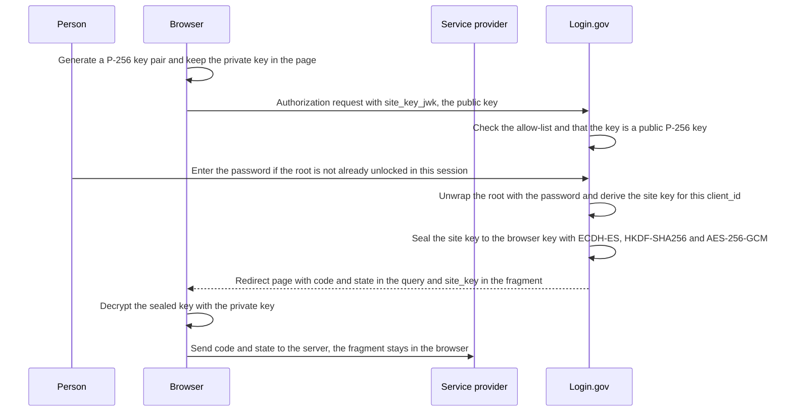

The authorization request is an ordinary OpenID Connect request with one extra parameter, `site_key_jwk`. Its value is the base64url encoding of the JSON of the browser's P-256 public key.

```http
GET /openid_connect/authorize
    ?client_id=urn:gov:gsa:openidconnect:sp:sinatra_sts
    &response_type=code
    &scope=openid%20email
    &redirect_uri=https://mybenefits.example.gov/auth/result
    &acr_values=http://idmanagement.gov/ns/assurance/ial/1
    &state=…
    &nonce=…
    &prompt=select_account
    &code_challenge=…&code_challenge_method=S256
    &site_key_jwk=eyJrdHkiOiJFQyIsImNydiI6IlAtMjU2Iiwi…
```

Notice that `site_key_jwk` is the only addition; the rest of the request is the service provider's usual sign-in request.

Decoded, `site_key_jwk` is a JSON Web Key with exactly the public members of a P-256 key. The WebCrypto metadata members `alg`, `ext`, `key_ops`, `kid` and `use` are accepted and ignored; any other member, including the private `d`, is refused.

```json
{ "kty": "EC", "crv": "P-256", "x": "…", "y": "…" }
```

Notice that `x` and `y` must each decode to exactly 32 bytes and must lie on the P-256 curve; a key that fails either test is refused as `site_key_jwk_invalid`.

On success Login.gov does not answer with a `Location` header. It always renders the client-side JavaScript redirect page with `Cache-Control: no-store`, whatever `openid_connect_redirect` is set to, and that page navigates the browser to the redirect URI below. The authorization code and `state` are in the query, where the service provider's server reads them; the sealed site key is in the fragment, which the browser never sends to a server and which never appears in a `Location` header or a request log.

```text
https://mybenefits.example.gov/auth/result?code=…&state=…#site_key=eyJ2IjoxLCJlcGsiOnsia3R5IjoiRUMiLCJjcnYiOiJQLTI1NiIsIng…
```

Notice that the query carries only `code` and `state`; everything secret is after the `#`.

Decoded, the `site_key` fragment value is base64url JSON with four members: the format version, the ephemeral public key Login.gov generated for this one sealing, the AES-GCM nonce and the ciphertext with its 16-byte authentication tag appended.

```json
{
  "v": 1,
  "epk": { "kty": "EC", "crv": "P-256", "x": "…", "y": "…" },
  "iv": "…",
  "ct": "…"
}
```

The browser derives the same AES key Login.gov used: an ECDH shared secret between its private key and `epk`, run through HKDF-SHA256 with an empty salt, the info string `"login.gov site key wrap v1\n<client_id>"` and a 32-byte output. It decrypts `ct` with AES-256-GCM using that key, `iv`, and the same string as additional authenticated data. The plaintext is JSON:

```json
{ "k": "…", "email": "person@example.com" }
```

Notice that `k` is the base64url site key (32 bytes) and that the person's email address, when the request asked for the `email` scope, travels inside the sealed payload rather than in the ID token or the user-information response; with the `all_emails` scope the member is `emails`, a list of every confirmed address. Because the `client_id` is part of both the HKDF info and the authenticated data, a sealed key presented under another service provider's identifier fails to decrypt.

The site key itself is derived from the root with HKDF-SHA256 using the salt `"login.gov site key v1"`, the `client_id` as the info string and a 32-byte output, so each service provider receives a different key from the same root and no service provider can compute another's.

When Login.gov cannot release the key after the person has been through the password prompt once, it answers the service provider with an OAuth error redirect instead of prompting again:

```text
https://mybenefits.example.gov/auth/result?error=temporarily_unavailable&error_description=Site+keys+are+temporarily+unavailable+for+this+account.+Please+try+again+later.&state=…
```

Notice that no authorization code is issued, no handoff is recorded and no billing row is written, because the key is sealed before the identity is linked.

A request that fails validation is refused with the ordinary authorization error redirect, `error=invalid_request`, and one of two descriptions: `site_key_jwk is not enabled for this client_id.` when the service provider is not allow-listed or the feature is off, and `site_key_jwk is not a valid P-256 public JWK.` when the key is malformed.

The capability is configured in two places. The feature switch and the recovery rate limit live in Login.gov's application configuration:

```yaml
# config/application.yml.default
site_key_enabled: false
site_key_recovery_attempt_window_in_minutes: 15
site_key_recovery_max_attempts: 5
```

The allow-list is a per-service-provider column set only from the service provider configuration file. Locally it is set on one test client:

```yaml
# config/service_providers.localdev.yml (test section)
'urn:gov:gsa:openidconnect:test':
  friendly_name: 'Example iOS App'
  …
  site_key_allowed: true
```

Notice that `site_key_allowed` is in `ServiceProviderUpdater`'s ignored attributes, so a Dashboard payload cannot turn it on.

The root is stored in one row per person. Every wrap column holds the same 32-byte root encrypted under a different secret the person holds:

```text
site_key_roots
  user_id                        one row per person (unique), deleted with the account
  encrypted_root                 the root wrapped under the password; empty after a password reset
  encrypted_root_recovery_code   the root wrapped under the recovery code
  recovery_code_generated_at     the minting time of the current recovery code
  recovery_code_acknowledged_at  when the person confirmed saving it; empty until then
  encrypted_root_personal_key    the root wrapped under the personal key (identity-verified people)
```

While a session has the root unlocked it holds the root KMS-encrypted under the session key `encrypted_site_key_root`, with `site_key_root_fingerprint` (a digest of the stored wraps) so the session re-locks when another session changes a wrap. The other session keys are `site_key_recovery_code` (a freshly minted code waiting to be shown), `site_key_root_unavailable` (a transient failure this session) and `site_key_password_prompt` (the digest of the one authorization request the person has already been prompted for).

Before releasing a key the authorization controller decides what the person must do first, from the vault's `status`:

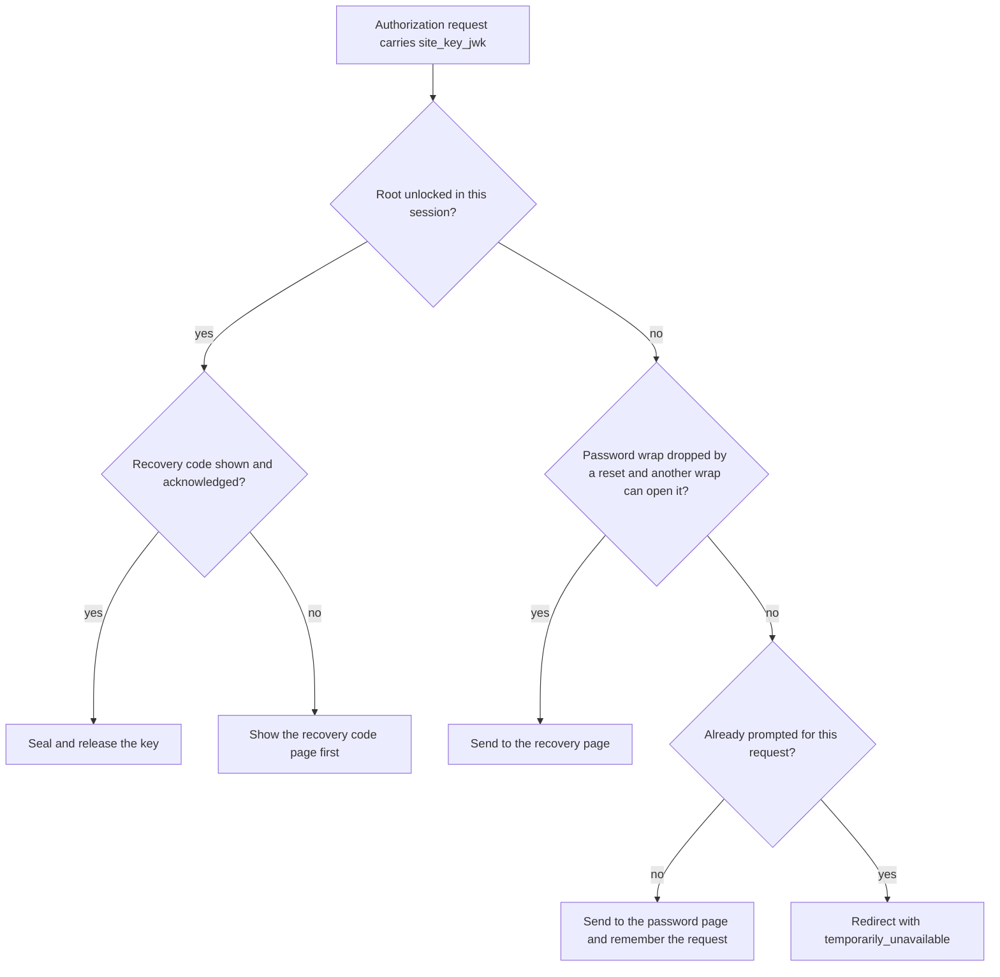

The checks, in order, and what each produces:

1. The authorize form validates `site_key_jwk` with the other parameters. A blank value means no site key is requested and nothing below runs. A value from a service provider that is not allow-listed, or while `site_key_enabled` is false, fails as `site_key_jwk_not_allowed`; a value that is not a P-256 public key fails as `site_key_jwk_invalid`. Both become `error=invalid_request` on the redirect back.
2. When a site key is requested, the form computes `server_scope`, which is the requested scope without `email` and `all_emails`, and that is the scope stored on the identity. Delegation scopes (`token_exchange:*`) are unaffected and still reach the identity.
3. The controller's `confirm_site_key_available` runs before the request is processed. When the root is unlocked and the recovery code is acknowledged the request proceeds. When the root is unlocked but a recovery code has not been acknowledged, the person is sent to `/account/site_key/recovery_code`. When a password reset dropped the password wrap and the recovery code or personal key can still open the root, the person is sent to `/account/site_key/recover`. Otherwise the person is sent to the password page once; the controller remembers a digest of `client_id`, `state` and `site_key_jwk`, and a second arrival of the same request with the root still locked is answered with `temporarily_unavailable`. A different request (a new `state`) prompts again.
4. `prepare_site_key` runs after the completion-screen checks and before the identity is linked. It derives the site key for the `client_id`, collects the addresses the `email` and `all_emails` scopes would have shared, and seals them to the browser key. Any failure (`SiteKeys::SealError`, an encryption or KMS error, an OpenSSL error, a bad redirect URI) logs `site_key_release_failed` and answers `temporarily_unavailable` with no code issued.
5. On success the handoff builds the redirect URI with the fragment, logs `site_key_released` with `email_sealed` and `all_emails_sealed` flags, and renders the client-side redirect page with `Cache-Control: no-store`.

The root's lifecycle outside the authorization request follows the person's password. Signing in to an allow-listed service provider creates a root if the person has none, wrapped under the password just entered, and mints a recovery code to show once; signing in anywhere else unwraps an existing root and never creates one. Before the second factor the unlock runs with `repair: false`, so a root that fails to open is only marked unavailable; after the second factor a failure is repaired, by dropping a dead password wrap when another wrap can open the root or by replacing the root when nothing can. A password change re-wraps the cached root in the same database transaction as the password update, under a row lock, and deletes a root that cannot be re-wrapped. Every password reset path drops the password wrap, deleting the row when no other wrap remains. Deleting the account deletes the row through the foreign key.

Recovery after a reset is a small set of account pages. The person enters the recovery code (or, when identity-verified, the personal key) at `/account/site_key/recover`; a correct code caches the root in the session and the next password entry re-wraps it. Attempts are rate-limited (5 attempts per 15 minutes by default) and the person may instead start over, which deletes the root and any data a service provider encrypted with the old key.

## Functional requirements

This branch carries no requirement rows of its own in the delegation areas (onboarding, consent, tokens, verification, fraud signals, billing, operations); it supplies supporting key-custody primitives. The rows below are the functional requirements of the ported feature, and every one is met by the branch as built.

| Id | Requirement |
|---|---|
| **FR-KEY-1** | A per-site key MUST be unique to one person and one service provider, MUST be the same on every device the person signs in from, and MUST be delivered only to that service provider's browser, encrypted to a public key the browser generated. Login.gov MUST refuse a recipient key that carries private material, is not a valid point on the expected curve, or is malformed. |
| **FR-KEY-2** | A key sealed for one service provider MUST NOT be usable by any other service provider. The sealing MUST bind the encrypted key to the service provider's identifier, so that a sealed key presented under another identifier fails to decrypt. |
| **FR-KEY-3** | The per-person root from which site keys derive MUST be stored so that Login.gov cannot recover it without the person's password. It MUST be unlocked only when the person enters the password, and it MUST be held in the session only in encrypted form. |
| **FR-KEY-4** | A root MUST be created only when the person signs in to a service provider Login.gov has allow-listed for site keys. The allow-list MUST be set by Login.gov's own configuration and MUST NOT be settable through the partner Dashboard. |
| **FR-KEY-5** | When the person changes their password, the root MUST be re-wrapped under the new password in the same operation as the password change. A root that cannot be re-wrapped MUST be deleted rather than left unreadable. |
| **FR-KEY-6** | Every password reset path MUST drop the password wrap of the root, deleting the root itself when nothing else can open it, and deleting the account MUST delete the root. After a reset the person MUST be able to recover the root with the recovery code issued for it and, when identity-verified, with the personal key, so a site key stays stable across resets. |
| **FR-KEY-7** | The whole capability MUST be off unless Login.gov enables it. When off, no root is created, unlocked or released, and the allow-list has no effect. |

## Protocol rows

The ported feature has no identified protocol rows (no EXC-, INT- or similar identifiers); its class table, lifecycle and configuration statements are folded into the requirements above and the record below. Its one protocol identifier is the decision row E92.

| Id | Requirement |
|---|---|
| **E92** | Per-site keys are ported as their own feature. `SiteKeys::RecipientJwk` accepts only a P-256 public JWK. `SiteKeys::Sealer` seals with ECDH-ES, HKDF-SHA256 and AES-256-GCM, with the HKDF info and the GCM additional authenticated data both equal to `"login.gov site key wrap v1\n<client_id>"`, so a sealed key is bound to one service provider. The per-person root is wrapped under the password with the profile-PII scheme, created only for allow-listed service providers, re-wrapped on password change and unwrapped from the password on password reset. `site_key_enabled` defaults off. Standards: RFC 7518 §6.2 and RFC 8037 (EC public JWK members), RFC 7518 §4.6 (ECDH-ES), RFC 5869 (HKDF), NIST SP 800-38D (GCM). (D56) |

## As built

1. The branch is five ported commits on `delegated-access-account-page`, with their original messages: the sealing primitives; per-site key roots wrapped under the person's password; release of sealed keys on OpenID Connect authorization; recovery after a password reset; recovery with the personal key. The port kept both sides of the "both added" conflicts in `app/models/service_provider.rb` and its spec (the delegation columns beside `site_key_allowed`), in `db/schema.rb`, and in `OpenidConnectAuthorizeForm` (the site-key validation and `server_scope` beside the delegation-scope validation).
2. Sealing. `SiteKeys::RecipientJwk` parses `site_key_jwk`, which is base64url JSON of a P-256 public JWK. It accepts and ignores the WebCrypto `exportKey('jwk')` metadata members (`ext`, `key_ops`, `alg`, `kid`, `use`) and rejects any other member, including a private `d`, as well as off-curve points and coordinates that are not 32 bytes. `SiteKeys::Sealer` encrypts to that key with ECDH-ES, HKDF-SHA256 and AES-256-GCM, using `"login.gov site key wrap v1\n<client_id>"` as both the HKDF info and the additional authenticated data, and outputs base64url JSON `{v, epk, iv, ct}`; failures raise `SiteKeys::SealError`. `Encryption::AesCipher` and `Encryption::AesCipherV2` raise `Encryption::DecipherError` when a payload fails authentication, so a wrong password is distinguishable from a transient failure.
3. Custody. The table `site_key_roots` holds one row per user (a unique index on `user_id`, with a foreign key that cascades on user deletion) containing a 32-byte root wrapped by `SiteKeys::RootCipher` through `Encryption::Encryptors::PiiEncryptor`, which is the scrypt-of-password plus KMS scheme used for profile PII. A wrap that fails authentication raises `SiteKeys::RootMismatchError`. `SiteKeys::Vault` unlocks the root at password entry (`unlock`, creating one only when called with `create:`), keeps it KMS-encrypted in the session under `encrypted_site_key_root` together with a fingerprint of the stored wraps so a session re-locks when another session changes the wrap, and offers `replace!` under a row lock, `wrap_cached_root` and `store_root_or_forget!` for password change, and `needs_password?` for the password page. `SiteKeyConcern#unlock_site_key_root` runs at sign-in, at password capture and at sign-up password entry: before the second factor with `repair: false`, and after it with repair. `site_key_root_wanted?` is `current_sp.site_key_allowed?`.
4. Allow-list. The column `service_providers.site_key_allowed` (boolean, default false) is read through `ServiceProvider#site_key_allowed?`, which also requires `site_key_enabled`. It is set only from `service_providers.yml` (`service_providers.localdev.yml` locally, where the test-section client `urn:gov:gsa:openidconnect:test` carries it). `ServiceProviderUpdater` lists it in `SP_IGNORED_ATTRIBUTES`, so the Dashboard cannot turn it on.
5. Lifecycle. Sign-in to an allow-listed service provider creates the root if the person has none, wrapped under the password just entered; sign-in anywhere else unwraps an existing root and never creates one. `UpdateUserPasswordForm` re-wraps the cached root in the same transaction as the password update under a row lock; when the root is locked in the session the password page (`Users::PasswordsController`) asks for the current password first; a root that cannot be re-wrapped is deleted. `ResetPasswordForm`, `PasswordResetFromDisavowalForm` and `ResetUserPassword` call `SiteKeyRoot#forget_password!`, which drops the password wrap when an acknowledged recovery-code wrap or a personal-key wrap can still open the root and deletes the row otherwise.
6. Release. `OpenidConnectAuthorizeForm` validates `site_key_jwk` (locale keys `openid_connect.authorization.errors.site_key_jwk_invalid` and `site_key_jwk_not_allowed`) and computes `server_scope`. `link_identity_to_service_provider` passes `server_scope`, so `token_exchange:*` scopes still reach the identity while `email` and `all_emails` are withheld from it when a site key is requested; those addresses travel inside the sealed payload instead. `OpenidConnect::AuthorizationController` seals the key in `prepare_site_key` before the identity is linked, returns it through the fragment with a forced client-side redirect and `Cache-Control: no-store`, and answers `temporarily_unavailable` (locale key `openid_connect.authorization.errors.site_key_unavailable`) when sealing fails or the root stays locked after one password prompt. The site-key request digest hashes `client_id`, `state` and `site_key_jwk` only, so `dpop_jkt` and `site_key_jwk` coexist on the authorization request without interaction.
7. Recovery. `SiteKeys::RecoveryCode` (codes share the personal-key format), `SiteKeys::RecoveryForm`, the controllers `SiteKeys::RecoveryCodesController` and `SiteKeys::RecoveriesController`, the views under `app/views/site_keys/**` and `app/views/accounts/_site_key_recovery_code.html.erb`, and the routes `/account/site_key/recovery_code` (show, new, create, update) and `/account/site_key/recover` (new, create, confirm_destroy, destroy). Recovery attempts are limited by the `site_key_recovery` rate limiter. `site_key_recovery_code` is a sensitive session path in `lib/session_encryptor.rb`. Identity verification (`Idv::ProfileMaker`) and a new personal key (`Accounts::PersonalKeysController`) wrap the root under the personal key; using the personal key as a second factor (`Users::VerifyPersonalKeyController`) recovers the root with it.
8. Migrations, under `db/primary_migrate`: `20261003110000_create_site_key_roots`, `20261003110001_add_site_key_allowed_to_service_providers`, `20261003110002_add_recovery_code_to_site_key_roots` (`encrypted_root_recovery_code`, `recovery_code_generated_at`, `recovery_code_acknowledged_at`) and `20261003110003_add_personal_key_to_site_key_roots` (`encrypted_root_personal_key`; `encrypted_root` becomes nullable). Their timestamps predate the delegation migrations (`20261009…`), so a fresh database applies them first.
9. Configuration: `site_key_enabled` (boolean, default false), `site_key_recovery_attempt_window_in_minutes` (15) and `site_key_recovery_max_attempts` (5) in `lib/identity_config.rb` and `config/application.yml.default`. Locale strings in en, es, fr and zh.
10. Analytics: `site_key_root_created` (`replaced`), `site_key_root_unlock_failed` (`error`, `root_replaced`), `site_key_released` (`client_id`, `email_sealed`, `all_emails_sealed`), `site_key_release_failed` (`client_id`, `error`), and the recovery events `site_key_recovery_visited`, `site_key_recovery_submitted`, `site_key_recovery_abandoned`, `site_key_recovery_code_viewed`, `site_key_recovery_code_acknowledged`, `site_key_recovery_code_downloaded`, `site_key_recovery_code_new_visited` and `site_key_recovery_code_regenerated`. No key material is logged.
11. Specs: `spec/services/site_keys/{recipient_jwk,sealer,root_cipher,vault,recovery_code}_spec.rb`, `spec/models/site_key_root_spec.rb`, `spec/controllers/site_keys/{recoveries,recovery_codes}_controller_spec.rb`, `spec/controllers/concerns/site_key_concern_spec.rb`, `spec/lib/session_encryptor_spec.rb`, the authorize form and authorization controller specs, the password and session controller specs, and `spec/support/site_key_helper.rb`, which opens a sealed key independently of `SiteKeys::Sealer` so the specs pin the wire format a browser implements. Verified locally: 282 examples across the touched specs after the first two picks, then 314, 559 and 562 after each later pick; rubocop and the analytics-events lint clean.

## Decisions

- **D56** Per-site keys are ported as their own feature branch, independent of the delegation chain (full entry in section 16).
- **D64** The branch sits after the account page and before the key-binding branch, so every delegation branch from the exchange on builds on it.
- **D19** The feature fits the public-client baseline: the sealed key is held in the service provider's page, as its key-binding key is, and no server of the service provider sees either.

## How to review

- Diff against `delegated-access-account-page`.
- Review as a port, not as new design: compare each commit with the upstream pull request. The local conflict resolutions are in `app/models/service_provider.rb` and its spec, `db/schema.rb`, and `OpenidConnectAuthorizeForm`.
- Check first that `site_key_enabled` is false by default and that `ServiceProviderUpdater` cannot set `site_key_allowed`. Then read `SiteKeys::RecipientJwk` (private members and off-curve points refused) and `SiteKeys::Sealer` (the `client_id` in both the HKDF info and the additional authenticated data), and confirm in `OpenidConnect::AuthorizationController` that the sealed key is delivered only in the fragment of a client-side redirect.
- Specs that prove it: the `SiteKeys::*` specs, `spec/models/site_key_root_spec.rb`, the authorize form spec, the authorization controller spec, the password and session controller specs, and the two site-key controller specs.
- Must not change for existing clients: with the flag off no root is created and no password path changes, and the authorize form behaves as before for a request without `site_key_jwk`.
- Open items: a transient unlock failure followed by a password change deletes the root (a limitation carried from the source); which service providers are allow-listed first and what each does with the key in its browser; and whether a released site key should ever be tied to a delegation (left to future work).

# 5. `delegated-access-dpop`: key binding (DPoP) for public-client service providers

**Stack position** 5 of 14, on `delegated-access-site-keys`.

## Objective

A browser-based service provider is a public client: it has no secret to keep, and the tokens Login.gov issues to it live in the person's browser, where any script on the page can read them. Client authentication cannot protect such tokens, but sender constraint can. This branch is the whole proof-of-possession layer of RFC 9449 (DPoP, "Demonstrating Proof of Possession") in one reviewable unit. The service provider holds a key pair in the browser, and every request that presents one of its tokens to Login.gov also carries a short-lived signed proof made for that HTTP method, that URL and that token. Login.gov verifies the proof at the authorization-code exchange, the token exchange, renewal, revocation, the service provider's own verification calls, and the user-information and document-image endpoints. The authorization code itself is bound to the key at the authorization request, so an intercepted code cannot be redeemed with another key. A token copied from the browser, a proxy or a log is useless without the key.

Whether binding applies is a setting on the service provider's record, `dpop_required`. It takes effect only for a public client and is independent of approval for delegated access. A public client whose record sets it is bound end to end and strictly: its authorization request without a key thumbprint is refused, and every place that accepts one of its tokens requires a proof. A public client approved for delegation whose record does not set it is a bearer client end to end, at the exchange included. Login.gov onboards such a client with bearer tokens and can tighten later by setting the flag, without a code change. The exposure that binding closes is accepted for such a client as an onboarding trade-off. It is mitigated by the 15-minute token lifetime, renewal rotation with reuse detection, the revocation cascades and an onboarding warning, and every delegation-approved public client is expected to set the flag before production. Binding is never decided per agency API. Confidential clients, which authenticate with their registered key and keep bearer tokens, are unaffected (D82).

The branch carries the proof verifier, the binding of the authorization request and code, the bound code exchange, the `DPoP` scheme at the user-information and document-image endpoints, the per-client setting with its onboarding warnings, and the migration that drops the per-API flag. The exchange, lifecycle, introspection and SAML branches above it only call the verifier and compare thumbprints, gated on the same predicate, so they stay pure delegation logic (D64).

## How it works

The flow below is the sign-in of a public client whose record sets `dpop_required`, through to its first call to the user-information endpoint. "Browser" is the service provider's page running in the person's browser; for a public client the page is the client.

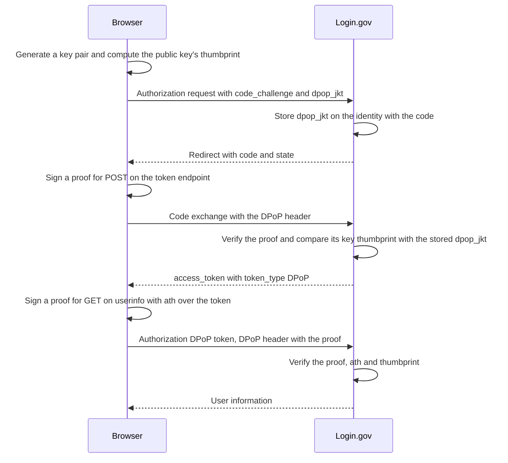

The authorization request is the ordinary PKCE request with one more parameter, `dpop_jkt`, the RFC 7638 thumbprint of the browser's public key (base64url SHA-256, 43 characters, no padding). MyBenefits Assistant asks for sign-in and for delegation to Housing Assistance Records:

```http
GET /openid_connect/authorize
    ?client_id=urn:gov:gsa:openidconnect:sp:sinatra_sts
    &response_type=code
    &scope=openid%20email%20token_exchange:housing_records
    &redirect_uri=https://mybenefits.example.gov/auth/result
    &acr_values=…
    &state=…
    &nonce=…
    &code_challenge=…&code_challenge_method=S256
    &dpop_jkt=NzbLsXh8uDCcd-6MNwXF4W_7noWXFZAfHkxZsRGC9Xs
```

Notice that `dpop_jkt` has the same shape as `code_challenge`; the form checks both against one format constant.

A flagged client that omits `dpop_jkt` is sent back with the ordinary authorization error redirect:

```text
https://mybenefits.example.gov/auth/result?error=invalid_request&error_description=dpop_jkt+is+required%3A+this+client+is+registered+with+dpop_required%2C+so+the+authorization+code+must+be+bound+to+the+thumbprint+of+its+DPoP+key+%28RFC+9449+section+10%29.&state=…
```

Notice that no code is issued; a malformed value from any client is refused the same way with the `dpop_jkt_invalid` description.

A DPoP proof is a JSON Web Token (JWT) the browser signs with its private key, one per request, carried in the `DPoP` request header. Decoded, the header and payload of the proof for the code exchange are:

```json
{
  "typ": "dpop+jwt",
  "alg": "ES256",
  "jwk": { "kty": "EC", "crv": "P-256", "x": "…", "y": "…" }
}
```

```json
{
  "jti": "e1j3V_bKic8-LAEB",
  "htm": "POST",
  "htu": "https://idp.example.gov/api/openid_connect/token",
  "iat": 1760356800
}
```

Notice that the header carries the public key itself, not a key identifier, and that the payload names the exact method and URL of the request; there is no `ath` because no token accompanies a code redemption. When a token does accompany the proof, as at the user-information endpoint below, the payload also carries `"ath": "<base64url SHA-256 of the token>"`.

The code exchange is the usual PKCE request with the proof in the header. The proof is read from the `DPoP` header only; a `dpop_proof` field in the body is not permitted and is dropped.

```http
POST /api/openid_connect/token
Content-Type: application/x-www-form-urlencoded
DPoP: eyJ0eXAiOiJkcG9wK2p3dCIsImFsZyI6IkVTMjU2Iiwiandr…

grant_type=authorization_code&code=…&code_verifier=…
```

```json
{
  "access_token": "…",
  "token_type": "DPoP",
  "expires_in": …,
  "id_token": "…",
  "scope": "openid email token_exchange:housing_records"
}
```

Notice `token_type` is `DPoP` rather than `Bearer`: the token must from now on be presented under the `DPoP` authorization scheme with a fresh proof. `expires_in` is the number of seconds left in the person's sign-in session. For an unflagged public client the same request without a header receives `"token_type": "Bearer"`, and the `scope` member appears only when delegation scopes were granted (section 6).

Every proof problem at the token endpoint is one error code with a description that says what to fix:

```http
HTTP/1.1 400 Bad Request
Content-Type: application/json

{
  "error": "invalid_dpop_proof",
  "error_description": "A DPoP proof is required: this client's tokens are bound to its key, so send a DPoP header signed by that key with the request (RFC 9449)."
}
```

Notice that only three failures have their own description (no proof, a proof from a key other than the bound one, a reused `jti`); every other failure shares one description listing what a valid proof must satisfy, so the response does not help an attacker tune a forged proof check by check. A code issued without a thumbprint, which happens only when the record is flagged after the authorization request, is refused with the `dpop_code_unbound` description and the person must sign in again. The token exchange (section 6), renewal and revocation (section 7) and the service provider's own introspection (section 8) carry the same header; at those endpoints a token accompanies the proof, so its payload also carries `ath` over that token.

At the user-information endpoint the token travels under the `DPoP` authorization scheme and the proof carries `ath`:

```http
GET /api/openid_connect/userinfo
Authorization: DPoP <access_token>
DPoP: eyJ0eXAiOiJkcG9wK2p3dCIsImFsZyI6IkVTMjU2Iiwiandr…
```

A bound token presented as a bearer token, or a bearer token presented under the `DPoP` scheme, is refused with a challenge naming the scheme and the accepted algorithms:

```http
HTTP/1.1 401 Unauthorized
WWW-Authenticate: DPoP algs="ES256 RS256", error="invalid_token"
Content-Type: application/json

{"error": "This access token is bound to a key: present it with the DPoP authorization scheme and a DPoP proof signed by that key (RFC 9449)."}
```

A bound token under the right scheme with a missing or failing proof is refused with the proof error:

```http
HTTP/1.1 401 Unauthorized
WWW-Authenticate: DPoP algs="ES256 RS256", error="invalid_dpop_proof"
Content-Type: application/json

{"error": "A DPoP proof is required: this client's tokens are bound to its key, so send a DPoP header signed by that key with the request (RFC 9449)."}
```

Notice that a confidential client's bearer request receives neither challenge: its unknown-token error body is unchanged and has no `WWW-Authenticate` header, and a stray `DPoP` header on its request is ignored. The document-image endpoint applies the same rules with its own URL in `htu`.

Whether a client is bound is decided in one place, `ServiceProvider#dpop_bound?`, and read by both forms and the verifier call sites:

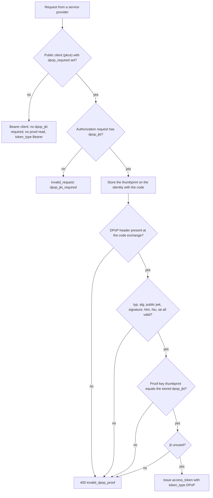

The verifier's checks, in the order RFC 9449 §4.3 lists them, and what each produces:

1. The proof is present. A missing proof is `invalid_dpop_proof` with the `dpop_proof_required` description.
2. The proof parses as a JWT, its `typ` header is `dpop+jwt`, and its `alg` is `ES256` or `RS256` (never `none`, never a shared-secret algorithm).
3. The `jwk` header is a public key with no private members, and the signature verifies under it. The key is self-asserted; what makes it meaningful is that the same key must sign every later proof.
4. `htm` equals this request's method and `htu` equals this request's URL after normalization (scheme and host lowercased, a default port dropped, a trailing slash ignored, query and fragment removed), so a proof captured for one endpoint cannot be replayed at another.
5. `iat` is an integer within `dpop_proof_max_age_seconds` (300 seconds) either side of now. No server nonce is issued (D22).
6. When a token accompanies the proof, `ath` equals the base64url SHA-256 of that token; when no token accompanies it, `ath` must be absent.
7. When the token is already bound, the proof key's RFC 7638 thumbprint equals the stored one. A different key is `invalid_dpop_proof` with the `dpop_key_mismatch` description.
8. Last, `jti` has not been seen before for this key. The check is last so that a rejected proof never consumes a `jti`. A reused value is `invalid_dpop_proof` with the `dpop_proof_replayed` description. Every failure in steps 2 to 6 shares the `dpop_proof_invalid` description.

At the token endpoint the proof check runs after every other check on the form, so a wrong `code_verifier` is reported as a verifier error, not a proof error, and the proof's `jti` is not consumed; the verifier runs once per form.

The single-use `jti` values are recorded in Redis by `ReplayGuard`:

```text
key    dpop:jti:<SHA-256 hex of "<key thumbprint>\n<jti>">
value  "1"
ttl    600 seconds (twice dpop_proof_max_age_seconds), set only if the key did not exist
```

Notice that the thumbprint is part of the hashed key, so one client cannot burn another client's `jti` values, and that a value is recorded only after the signature verified.

The setting is one column on the service provider's record, written through the configuration repository and the Dashboard:

```yaml
# config/delegated_access.localdev.yml, service_providers section
'urn:gov:gsa:openidconnect:sp:sinatra_sts':
  agency_id: 100
  ial: 2
  friendly_name: 'MyBenefits Assistant'
  pkce: true
  dpop_required: true
  token_exchange_enabled_sp: true
  …
```

Notice that `pkce: true` and `dpop_required: true` must both be present for the client to be bound; the token-exchange branch (section 6), which registers the sample service provider as a public client, sets both on this entry, and the configuration repository's `delegated_access.yml` (section 13) does the same for deployed environments, so the end-to-end harness exercises the bound path. The proof window is one application setting:

```yaml
# config/application.yml.default
dpop_proof_max_age_seconds: 300
```

The thumbprint is stored on the sign-in's identity row as `identities.dpop_jkt` (a string, not sensitive) and only when binding applies; a thumbprint sent by an unflagged client is validated for shape and then discarded. Onboarding (`ServiceProviderSeeder` and `ServiceProviderUpdater`) logs a warning after every write when the record cannot mean what it says: a confidential client that sets `dpop_required` (the setting is ignored) or a public client approved for delegation that does not set it ("its delegated tokens will be bearer tokens").

## Functional requirements

| Id | Requirement |
|---|---|
| **FR-TOK-19** | All proofs of identity or possession presented to Login.gov by service providers and agencies, including key-possession proofs, MUST be short-lived and protected against replay. A key-possession proof is required of a public-client service provider only when its record sets `dpop_required` (FR-TOK-24); every proof that is presented is held to this row. (D82) |
| **FR-TOK-22** | Login.gov MUST support binding a delegated token to a key the service provider holds (DPoP, RFC 9449). When the exchange or renewal request carries a proof signed by that key, the token MUST be usable only with a fresh proof from the same key, and renewal of a bound token MUST require the same key. Whether binding applies is a per-client setting on the service provider's record (`dpop_required`, public clients only), never a per-API setting: an agency does not require or waive binding for its API. A public-client service provider approved for delegation whose record sets it MUST be bound end to end and MUST be refused without a proof wherever one is due. One whose record does not set it holds bearer tokens end to end, its exchange carrying `client_id` alone and its delegated tokens, renewal credentials and verification responses carrying no binding. Every browser-based service provider is recommended to set it before production. (D47, D82) |
| **FR-TOK-23** | Login.gov MUST report the binding to the agency when it verifies a token (the key thumbprint and a token type of `DPoP`), and the agency MUST verify a proof from that key on every request and refuse a bound token presented without one. A key-bound SAML assertion carries the thumbprint as an attribute. |
| **FR-TOK-24** | Binding MUST be mandatory for a public-client service provider whose record sets `dpop_required`, and MUST cover the service provider's own access token and renewal credential as well as the delegated tokens. Login.gov MUST verify the proof wherever it accepts one of those tokens, including its user-information endpoint, and MUST refuse a bound token presented without a proof. A public-client service provider whose record does not set it is a bearer client end to end, at the exchange included, and MUST NOT be asked for a proof or a key thumbprint. The setting MUST be ignored, with a warning at onboarding, on a confidential client; service providers that are confidential clients MUST be unaffected. Onboarding MUST warn when a delegation-approved public client does not set it and when a confidential client does. (D82) |
| **FR-TOK-25** | For a public-client service provider whose record sets `dpop_required`, the authorization code MUST be bound to the same key at the authorization request (RFC 9449 §10), so an intercepted code cannot be redeemed with another key, and its authorization request without a key thumbprint MUST be refused. A public-client service provider whose record does not set it is not asked for one. (D82) |

Rows owned by other branches that this branch's call sites serve: FR-TOK-2 and the exchange proof (section 6), FR-TOK-12 and FR-TOK-14 for renewal and revocation (section 7), FR-VER-2 for the service provider's own verification (section 8), FR-TOK-9 for the thumbprint attribute on a SAML assertion (section 9), and FR-OPS-1 for the proof algorithms in discovery (section 10).

## Protocol rows

| Id | Requirement |
|---|---|
| **EXC-17** | DPoP is mandatory for a public service provider (`pkce: true`) whose record sets `dpop_required` (`ServiceProvider#dpop_bound?`). The authorization-code grant, the token-exchange grant, the refresh grant, `/api/openid_connect/userinfo` and its own introspection each require a valid proof, and a token issued to it carries `token_type: DPoP` and `cnf.jkt`. A request from such a client without a proof fails with `invalid_dpop_proof` (RFC 9449 §5) or, at userinfo, `401` with `WWW-Authenticate: DPoP` (§7.1). The setting is ignored on a confidential client, and onboarding warns when it is set there. A public service provider approved for delegation whose record does not set it follows EXC-19a, and onboarding warns when it writes such a record ("its delegated tokens will be bearer tokens"). Confidential clients and their bearer tokens are unaffected. (D82) |
| **EXC-18** | `/api/openid_connect/userinfo` MUST verify the DPoP proof for a bound service-provider access token (`htm`, `htu`, `iat`, `jti`, `ath`, and a thumbprint equal to the token's `cnf.jkt`) and MUST refuse a bound token presented as a bearer token (RFC 9449 §7.1). Delegated tokens remain refused at userinfo regardless of proof (EXC-6). |
| **EXC-19** | A public service provider whose record sets `dpop_required` MUST send `dpop_jkt` on the authorization request (RFC 9449 §10); a request from it without `dpop_jkt` is refused with `dpop_jkt_required`. Login.gov binds the issued authorization code to that thumbprint and refuses a code exchange whose proof key differs. A public service provider whose record does not set it is not asked for `dpop_jkt`; a well-formed value is still accepted from any client and stored only when binding applies. (D82) |
| **EXC-19a** | A public service provider approved for delegation whose record does not set `dpop_required` is a bearer client end to end. Its code exchange issues a bearer access token (`token_type: Bearer`); the token-exchange grant accepts that bearer subject token with `client_id` alone and no proof; the delegated tokens it receives are bearer tokens with no `cnf`; introspection reports no binding; a SAML assertion issued to it carries no `dpop_jkt` attribute; and the refresh grant carries no proof. The other controls are unchanged: the 15-minute access-token lifetime, refresh rotation with reuse detection, the revocation cascades and the consent checks. The exposure key binding closes for a flagged client (a token taken from the browser replayed by its holder) is accepted for such a client as an onboarding trade-off, and every delegation-approved public service provider is expected to set `dpop_required` before production. (D82) |

Rows owned by other branches: EXC-2 and EXC-9 (client handling and the proof at the exchange, section 6), REF-2 (bound refresh tokens, section 7), INT-4 and INT-9 (`cnf.jkt` and `token_type` in the verification response, section 8), DISC-2 (`dpop_signing_alg_values_supported`, section 10), and RS-DPOP-1 (the agency's obligation, section 15.3).

## As built

1. The proof verifier. `DpopProofVerifier` (`app/services/dpop_proof_verifier.rb`) runs the RFC 9449 §4.3 checks in order: the `typ` header is `dpop+jwt` (`PROOF_TYPE`); the `alg` header is in `ALLOWED_ALGORITHMS` (`ES256`, `RS256`); the `jwk` header is a public-only key; the signature verifies; `htm` matches the method; `htu` matches the URL after normalization (scheme and host lowercased, a default port dropped, a trailing slash ignored, query and fragment removed); `iat` is within `dpop_proof_max_age_seconds` (300) either side of now; `ath` is present and equal to the token's digest (`Digest::SHA256.urlsafe_base64digest`) when a token accompanies the proof and absent otherwise; the proof's key thumbprint equals the expected thumbprint when the token is already bound; and the single-use `jti` is checked last, so a rejected proof never consumes one. A missing proof, a key mismatch and a replay each have their own `error_description`; every other failure shares one, so the response does not help tune a forged proof. No server nonce is issued (D22). The class also exposes `thumbprint` (RFC 7638), `token_hash` and `normalize_url` for the other branches.
2. The replay guard. `ReplayGuard.first_use?(namespace:, scope:, value:, ttl:)` (`app/services/replay_guard.rb`) is the one Redis `SET NX` for single-use values. It is keyed by a namespace and a SHA-256 of the presenter and the value, so one caller cannot burn another caller's values. The proof's `jti` is recorded under the namespace `dpop:jti` and the key thumbprint for twice the acceptance window (E98). The token-exchange branch records client-assertion `jti` values through the same guard.
3. The per-client setting. `service_providers.dpop_required` (boolean, default false) is set through the configuration repository and through the Dashboard once it has the field. `ServiceProvider#dpop_bound?` is `pkce == true && dpop_required` and is the only predicate the forms, the identity linker and the verifier call sites read. `ServiceProvider#warn_if_key_binding_misconfigured`, run by `ServiceProviderSeeder` and `ServiceProviderUpdater` after every write, logs a warning when a confidential client sets the flag (it is ignored) and when a public client approved for delegation lacks it ("its delegated tokens will be bearer tokens").
4. The authorization request. `OpenidConnectAuthorizeForm#dpop_jkt` is required when `dpop_binding_required?` (the record's `dpop_bound?`) and refused as `dpop_jkt_required` when missing for such a client. A value from any client must match `BASE64URL_SHA256_FORMAT` (43 base64url characters, the constant shared with the S256 `code_challenge` check) and is refused as `dpop_jkt_invalid` otherwise. The thumbprint is stored through `IdentityLinker#link_identity(dpop_jkt:)` on `identities.dpop_jkt` only when binding applies.
5. The code exchange. `OpenidConnectTokenForm#validate_dpop_proof` runs after every other check for a bound client. A code whose identity has no thumbprint is refused (`dpop_code_unbound`); otherwise the `DPoP` header is verified once per form, without `ath`, against `identities.dpop_jkt`. The response reports `token_type: DPoP` for a bound client and `Bearer` otherwise, and every proof problem is `invalid_dpop_proof` with status 400. `OpenidConnect::TokenController#form_params` reads the proof from the `DPoP` request header only; a body field is not permitted.
6. The user-information endpoints. `AccessTokenVerifier` reads the `Bearer` and `DPoP` authorization schemes. Its `#verify_key_binding` refuses a bound token under `Bearer` (`bound_token_requires_dpop`) and an unbound token under `DPoP` (`token_not_bound`), both with `WWW-Authenticate: DPoP algs="ES256 RS256", error="invalid_token"`, and refuses a failing proof with `error="invalid_dpop_proof"`. `OpenidConnect::UserInfoController` and `OpenidConnect::DocumentImagesController` pass the header, method and URL to the verifier and set the challenge on the 401 response. `#load_identity` reads `identities` only, so delegated tokens stay refused with or without a proof.
7. No per-API flag. The migration `20261009120000_remove_dpop_required_from_token_exchange_resource_servers` (under `safety_assured`) drops `token_exchange_resource_servers.dpop_required`; the factory trait, the seeder and updater expectations and the per-API fixture keys are gone with it. Binding is never decided per API (D47).
8. Migrations, under `db/primary_migrate`: `20261009100500_add_dpop_jkt_to_identities` (string, `sensitive=false`), `20261013100000_add_dpop_required_to_service_providers` (boolean, default false) and the removal above. Configuration: `dpop_proof_max_age_seconds` (300) in `lib/identity_config.rb` and `config/application.yml.default`. Locale keys in en, es, fr and zh: `openid_connect.authorization.errors.dpop_jkt_required`, `openid_connect.authorization.errors.dpop_jkt_invalid`, `openid_connect.token.errors.dpop_code_unbound`, `openid_connect.user_info.errors.bound_token_requires_dpop`, `openid_connect.user_info.errors.token_not_bound`, and the `invalid_dpop_proof` descriptions `openid_connect.token.errors.dpop_proof_required`, `dpop_proof_invalid`, `dpop_key_mismatch` and `dpop_proof_replayed`.
9. Fixture. `config/delegated_access.localdev.yml` from the token-exchange branch (section 6, which registers the sample service provider as a public client) and the configuration repository's `delegated_access.yml` (section 13) set `pkce: true` and `dpop_required: true` on the reference browser client (MyBenefits Assistant, `urn:gov:gsa:openidconnect:sp:sinatra_sts`), so the end-to-end harness keeps exercising the bound path. `spec/features/openid_connect/delegated_access_consent_spec.rb` registers that client with `dpop_required: true` and sends `dpop_jkt` as it does.
10. Specs: `spec/services/dpop_proof_verifier_spec.rb`, `spec/services/replay_guard_spec.rb`, `spec/services/access_token_verifier_spec.rb`, `spec/services/identity_linker_spec.rb`, `spec/forms/openid_connect_authorize_form_spec.rb`, `spec/forms/openid_connect_token_form_spec.rb`, `spec/requests/openid_connect/token_spec.rb`, `spec/requests/openid_connect_userinfo_spec.rb` (which compares a confidential client's bearer request byte for byte with and without a stray `DPoP` header), the consent feature spec, `spec/models/service_provider_spec.rb`, `spec/services/service_provider_seeder_spec.rb`, `spec/services/service_provider_updater_spec.rb`, `spec/factories/token_exchange_resource_servers.rb`, and `spec/support/delegated_access_helper.rb` (`DelegatedAccessHelper` for client assertions and `DpopHelper`, which builds proofs with one P-256 key per example), both included from `spec/rails_helper.rb`. Verified locally: 361 examples across the branch's specs and 54 across the specs the per-API removal touches; rubocop clean.
11. Stays elsewhere by design: `ResourceServerAuthenticator` and `DelegatedAccessClientHandling` (sections 6 and 7), the CORS rules for the revocation and verification endpoints (sections 7 and 8), and the discovery members `dpop_signing_alg_values_supported` and `none` (section 10).
12. Key binding follows the per-client flag (D82). `service_providers.dpop_required` (boolean, default false; migration `20261013100000_add_dpop_required_to_service_providers`) and `ServiceProvider#dpop_bound?` (`pkce` and `dpop_required`) are the predicate behind `OpenidConnectAuthorizeForm#dpop_binding_required?` and `OpenidConnectTokenForm#dpop_binding_required?`; approval for delegation plays no part in it. A flagged public client must send `dpop_jkt` (`dpop_jkt_required` in en, es, fr and zh) and proves possession at the code exchange, the token exchange, refresh, revocation, userinfo and its own introspection. An unflagged public client is a bearer client: its `dpop_jkt` is accepted when well-formed and ignored, its sign-in token is a bearer token, the exchange identifies it by `client_id` alone and issues bearer delegated tokens (`token_type: Bearer`, no `cnf` on introspection, no `dpop_jkt` SAML attribute), and refresh, revocation and its own introspection need no proof. Binding then follows the token, not the record: a bound token or family presented by any client still demands its key (the exchange and refresh answer `invalid_dpop_proof`, introspection answers a DPoP challenge, revocation leaves the token untouched and answers `200 {}`), and a flagged client presenting an unbound token is refused. `ServiceProvider#warn_if_key_binding_misconfigured` is called by `ServiceProviderSeeder` and `ServiceProviderUpdater`: it warns when a delegation-approved public client lacks the flag ("its delegated tokens will be bearer tokens") and when the flag is set on a confidential record (ignored). The local fixture (both environment sections) and the configuration repository's `delegated_access.yml` set `dpop_required: true` on the reference browser client. Commits: dpop `d18cf57b12`, token-exchange `cfa3044697`, token-lifecycle `c24507a5eb`, introspection `e916a6bbb2`, with fixups on saml-assertions, operations and config-content; verified with 2,150 examples of the delegated-access set at the top of the stack, rubocop, the analytics and tracker lints and gitleaks clean.

## Decisions

- **D19** The service provider is a browser-based public client with DPoP; confidential clients are unchanged (full entry in section 16).
- **D20** Binding is a property of the service provider record, not a per-request option; D82 narrows it to the record's `dpop_required`.
- **D21** The authorization code is bound to the key through `dpop_jkt`.
- **D22** Server nonces (RFC 9449 §8) stay deferred; freshness rests on the `iat` window and the single-use `jti`.
- **D46** The proof algorithms are ES256 and RS256.
- **D47** There is no per-API `dpop_required` flag; binding is never decided per agency API.
- **D64** The key-binding code lives in this one branch, before the exchange.
- **D82** Key binding is a per-client setting, `service_providers.dpop_required`, for public clients only: strict when set, bearer end to end when not, and independent of delegation approval.

## How to review

- Diff against `delegated-access-site-keys`.
- Check first: read `DpopProofVerifier` once against RFC 9449 §4.3 and confirm the order of checks, with the `jti` last. Then read `ServiceProvider#dpop_bound?` and confirm it is the only predicate (never `pkce` plus delegation approval) behind `dpop_binding_required?` on both forms, the `identities.dpop_jkt` write and `verify_key_binding`.
- Check that a flagged client is refused without `dpop_jkt` at authorize and without a proof at the code exchange and userinfo; that an unflagged public client approved for delegation receives `token_type: Bearer` at the code exchange and never sees a challenge; that the flag has no effect on a confidential client beyond the warning; and that both the seeder and the updater warnings fire.
- Specs that prove it: the verifier spec, the replay guard spec, the token request spec, the userinfo request spec, the authorize and token form specs, and the service provider model, seeder and updater specs.
- Must not change for existing clients: confidential clients and public clients without the flag keep bearer tokens and never see a challenge; `dpop_jkt` is optional for them; and the authorization-code grant's responses are otherwise unchanged.
- Open items: the Dashboard needs the `dpop_required` field before partners can set it there; every delegation-approved public client should set the flag before production; `Addressable` for `htu` normalization is held until the harness run; and D22 is revisited if partner clock skew, pre-computed proofs or an agency's request for nonces appears.

# 6. `delegated-access-token-exchange`: token exchange at the token endpoint

**Stack position** 6 of 14, on `delegated-access-dpop`.

## Objective

This branch lets a service provider that holds a person's approval obtain a delegated token for exactly one agency API. The service provider presents the access token from the person's Login.gov sign-in at Login.gov's existing token endpoint and follows the OAuth 2.0 Token Exchange standard (RFC 8693). The exchange is a delegation, not an impersonation: when the agency later verifies the token it learns that the person is the subject and that the service provider is the party acting. No separate service or route is introduced. The grant type alone selects the exchange form at the endpoint every integration already uses.

The design keeps every control that direct sign-in has and adds none that is weaker. The caller proves who it is before anything about the registry or the person's approvals is revealed. A confidential client proves itself with a signed client assertion over its registered key. A public client sends its client identifier and, when its record requires key binding, a proof that it holds the key its sign-in token is bound to. The subject token must belong to that caller, and the sign-in that issued it must still be live, so an old or copied token cannot start a new delegation later. The request names exactly one registered API, and the person must hold a live, current approval of the application that owns it. The issued token is an opaque random reference whose meaning exists only at Login.gov: it is valid for one API, for fifteen minutes or less, cannot be exchanged again, and cannot read the person's attributes at the user-information endpoint. Nothing is written for the agency or the application, so a delegation never creates or revives a connection the person did not make.

The token's format is a fact about the agency's API, so the API's registration decides whether an OAuth token or a SAML assertion is issued. The service provider may name a format but does not need to (D70). A refusal for a missing or lapsed approval names the application's delegation scope, so the service provider can send the person through a sign-in that requests it. Every other problem with the API is refused without detail. No ceiling refuses a registered service provider for volume. Issuance is logged and monitored against alert thresholds, and protection against a runaway caller belongs to the infrastructure layer.

## How it works

The person has signed in to MyBenefits Assistant (the service provider, run by the Office of Benefits Coordination) through Login.gov and, on the consent screen, approved MyBenefits Assistant to act for them at Housing Assistance Records (an application of the Department of Housing Support). MyBenefits Assistant now holds a Login.gov access token for that sign-in. To call the Housing Assistance Records API it exchanges that access token for a delegated token.

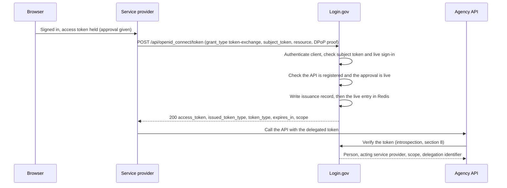

MyBenefits Assistant is registered in the fixture as a browser public client whose record sets `dpop_required`, so its sign-in token is bound to a key held in the browser and the exchange carries a DPoP proof (RFC 9449) in the `DPoP` request header. The request body is a normal form post to the token endpoint.

```http
POST /api/openid_connect/token
Content-Type: application/x-www-form-urlencoded
DPoP: eyJ0eXAiOiJkcG9wK2p3dCIsImFsZyI6IkVTMjU2IiwiandrIjp7…

grant_type=urn:ietf:params:oauth:grant-type:token-exchange
&client_id=urn:gov:gsa:openidconnect:sp:sinatra_sts
&subject_token=…
&subject_token_type=urn:ietf:params:oauth:token-type:access_token
&resource=https://records-api.housing.example.gov
&requested_token_type=urn:ietf:params:oauth:token-type:access_token
```

Notice that `resource` names exactly one registered API identifier (RFC 8707), `subject_token_type` is always the access-token URN, `requested_token_type` is optional, and the proof travels only in the `DPoP` header, never in the body.

The proof is a signed JWT of type `dpop+jwt` whose header carries the public key and whose payload names this request and hashes the subject token.

```json
{
  "typ": "dpop+jwt",
  "alg": "ES256",
  "jwk": { "kty": "EC", "crv": "P-256", "x": "…", "y": "…" }
}
{
  "htm": "POST",
  "htu": "https://idp.example.gov/api/openid_connect/token",
  "iat": 1791849600,
  "jti": "…",
  "ath": "…"
}
```

Notice that `ath` is the base64url SHA-256 hash of the `subject_token`, `jti` is single use, and the key's RFC 7638 thumbprint must equal the binding (`dpop_jkt`) recorded on the sign-in token at issuance.

A confidential service provider sends no `client_id` and no proof. Instead it authenticates with a `private_key_jwt` client assertion (RFC 7523) signed by a key on its record, and the rest of the body is the same.

```http
&client_assertion_type=urn:ietf:params:oauth:client-assertion-type:jwt-bearer
&client_assertion=eyJhbGciOiJSUzI1NiIs…
```

Notice that the assertion's `iss` and `sub` are both the service provider's issuer, its `aud` is the token endpoint URL, its `exp` is at most five minutes after `iat`, and its `jti` is single use.

On success the endpoint answers HTTP 200 with the RFC 8693 response. In the fixture the Housing Assistance Records API sets `max_access_token_seconds: 300`, so the token lives five minutes rather than the default fifteen.

```json
{
  "access_token": "…",
  "issued_token_type": "urn:ietf:params:oauth:token-type:access_token",
  "token_type": "DPoP",
  "expires_in": 300,
  "scope": "token_exchange:housing_records"
}
```

Notice that `access_token` is a 43-character random string that carries no claims, `token_type` is `DPoP` because the subject token is bound to a key (a confidential client receives `Bearer`), `scope` is the application's delegation scope and not anything the caller asked for, and there is no `id_token`. On this branch's own diff this is the whole response. In the integrated stack the lifecycle branch (section 7) adds `refresh_token` and `refresh_token_expires_in` to the same method.

Every refusal is HTTP 400 with the RFC 6749 §5.2 shape. The one refusal that says anything about the person's approvals is `consent_required`, which tells an authenticated caller which scope to request.

```json
{
  "error": "consent_required",
  "error_description": "The user has not approved this application for this client, or the approval has lapsed. Start an authorization request with the scope token_exchange:housing_records to ask for it."
}
```

Notice that the description names `token_exchange:housing_records`, the delegation scope of the application that owns the requested API, so the service provider can start a new sign-in that asks for it.

A grant type the endpoint does not serve, including the exchange URN while `token_exchange_enabled` is off, is answered the same way for every caller.

```json
{
  "error": "unsupported_grant_type",
  "error_description": "This grant type is not supported."
}
```

The checks run in a fixed order and stop at the first failure, so a caller that has not authenticated learns nothing about the registry or the person's approvals:

1. The client. A `code_verifier` on this grant is `invalid_request` (`code_verifier_not_allowed`). A caller sending `client_assertion` or `client_assertion_type` is authenticated as a confidential client through `ResourceServerAuthenticator`; a caller sending `client_id` alone is identified as a public client; a caller sending neither is `invalid_client` (`client_authentication_required`). The two credentials are not interchangeable: a client assertion from a record with `pkce: true`, or a bare `client_id` from a confidential record, is `invalid_client` (`client_type_mismatch`). A record that is not approved for delegation is `invalid_client` (`client_not_approved`).
2. The request shape, each `invalid_request`: `subject_token_type` must be the access-token URN (`invalid_subject_token_type`), `subject_token` must be present and free of null bytes (`subject_token_missing`), `requested_token_type` must be absent or one of the two token-type URNs (`invalid_requested_token_type`), and `resource` must name exactly one value (`resource_missing`, `multiple_resources`).
3. The subject token, `invalid_grant` (`invalid_subject_token`): it must be a `ServiceProviderIdentity` row that is not deleted, has a user, belongs to this client's own issuer and, when the client's record is `dpop_bound?`, carries a `dpop_jkt`. A delegated token is never an identities row, so it can never be a subject token.
4. The proof, `invalid_dpop_proof`, run only when the subject token carries a binding: the proof must be for POST to the token URL, carry `ath` over the subject token and be signed by the key whose thumbprint is the token's `dpop_jkt`. An unbound subject token needs no proof and none is read.
5. The sign-in, `invalid_grant` (`subject_token_session_ended`): the identity's `rails_session_id` must still have a positive lifetime in `OutOfBandSessionAccessor`, the same test the user-information endpoint applies.
6. Identity assurance, `invalid_grant`: the person must be identity-verified (`User#identity_verified?`) and the sign-in must carry identity assurance level 2 (IAL2) or IALmax, which is IAL2 for a verified person (`identity_not_verified`), and the account must not be suspended (`user_suspended`).
7. The resource, `invalid_target` (`unknown_resource`): a `TokenExchangeResourceServer` must match `resource`, be `usable?` (it, its application and the application's agency active) and its application must accept this caller (`accepts_delegation_from?`). Every one of these failures has the same wording so the endpoint does not describe the registry.
8. The format, `invalid_target` (`saml_not_available`): at this branch's position an API registered `saml2` is refused, because SAML assertions arrive with section 9.
9. The approval, `consent_required`: a live approval of the application for this service provider and this person (`TokenExchangeGrant.live_by_application`) that is `valid_now?`. A single-authorization approval counts only when its `rails_session_id` is the subject token's session; a remembered approval counts while it is within `remember_until` and its content versions are current.

A `scope` parameter is never read. When every check passes, the token is issued. The lifetime is the lower of `token_exchange_access_token_ttl_seconds` and the API's `max_access_token_seconds`, never higher. The issuance record is written in one database transaction together with the approval's `first_exchanged_at`, and only after that commits is the live entry written to Redis, so a token can never be live without its record.

The live entry is the only place a delegated token's meaning exists. Its key is the hex SHA-256 digest of the token string, and its time to live (TTL) in Redis equals the token's lifetime.

```text
delegated_token:<hex SHA-256 of the token>        TTL = lifetime (300 s here)
{
  "aud": "https://records-api.housing.example.gov",
  "scope": "token_exchange:housing_records",
  "grant_id": 1,
  "delegation_id": "…",
  "user_id": 1,
  "service_provider_id": 1,
  "resource_server_id": 1,
  "ial": 2,
  "aal": 2,
  "refresh_family_id": "…",
  "dpop_jkt": "…",
  "token_type": "DPoP",
  "token_format": "oauth",
  "sp_rails_session_id": "…",
  "issued_at": 1791849600,
  "expires_at": 1791849900,
  "issuance_id": 1
}
delegated_tokens:grant:1     set of digests of the live tokens under approval 1
delegated_tokens:family:…    set of digests of the live tokens in one refresh family
```

Notice that the token string itself is never stored, that an entry that has expired is simply absent (which introspection reads as "not active"), and that the two index sets let a revocation of an approval or a family delete every listed entry without scanning.

The Postgres row in `token_exchange_tokens` is the secret-free issuance record. Nothing reads it to decide whether a token is valid.

```yaml
# token_exchange_tokens (one row per exchange)
grant_id: 1
resource_server_id: 1
service_provider_id: 1
user_id: 1
delegation_id: "…"
scope: token_exchange:housing_records
ial: 2
aal: 2
refresh_family_id: "…"
token_type: DPoP            # Bearer, DPoP or N_A
token_format: oauth         # oauth or saml2
dpop_jkt: "…"
sp_rails_session_id: "…"    # sensitive=true
issued_at: 2026-10-13 12:00:00
expires_at: 2026-10-13 12:05:00
revoked_at: null
revocation_reason: null
```

Notice that there is no token digest column: the row exists for billing, fraud-signal events, the account page and audit, and revocation marks it so the history shows why a token ended.

The configuration and fixture values that shape the exchange are these.

```yaml
# config/application.yml.default
token_exchange_access_token_ttl_seconds: 900
token_exchange_enabled: false

# config/delegated_access.localdev.yml (excerpt)
'urn:gov:gsa:openidconnect:sp:sinatra_sts':      # MyBenefits Assistant
  pkce: true
  dpop_required: true
  token_exchange_enabled_sp: true
'urn:gov:gsa:openidconnect:sp:records_agency':   # Housing Assistance Records
  delegation_scope_value: 'housing_records'
  token_exchange_resource_servers:
    - identifier: 'https://records-api.housing.example.gov'
      token_format: 'oauth'
      max_access_token_seconds: 300
```

Notice that the service provider has no `certs` (it is a public client) and that `max_access_token_seconds` can only shorten the default lifetime.

## Functional requirements

| Id | Requirement |
|---|---|
| **FR-TOK-1** | Token issuance MUST follow the OAuth 2.0 Token Exchange standard (RFC 8693) at Login.gov's existing token endpoint, and no separate service is introduced. A grant type the endpoint does not serve is refused with the standard `unsupported_grant_type` code. (D71) |
| **FR-TOK-2** | A service provider that is a confidential client MUST prove its identity at issuance with a cryptographic key it alone holds. A service provider that is a public client (one whose tokens are held in the person's browser) sends its client identifier instead. When its record requires key binding (FR-TOK-24), a public client MUST bind every token it receives to a key it holds (FR-TOK-22) and MUST present a proof from that key at issuance, so a token stolen from the browser cannot be exchanged. Which of the two kinds a service provider is MUST be fixed at onboarding. (D82) |
| **FR-TOK-3** | Each delegated token MUST be valid for exactly one agency API, named by the service provider in the request, so a token stolen from one agency API is useless at any other. |
| **FR-TOK-4** | Delegated tokens MUST be short-lived, 15 minutes by default. An agency MAY set a shorter maximum for one of its APIs (for example an API that makes changes). No API may have a longer one. |
| **FR-TOK-5** | A delegated token MUST identify the person to the agency, identify the service provider as the party acting, state the approved access, and carry a delegation identifier the agency can use to join the token to fraud-signal events and billing. |
| **FR-TOK-6** | A delegated token MUST NOT be usable to obtain further tokens, and MUST NOT be usable at Login.gov's user-information endpoint, with or without a key-possession proof. The person's identity attributes for an agency are available only through the agency's verification (section 8); the service provider never receives them through delegation. A time-boxed opening for an agency that cannot yet verify by introspection is documented in section 15.6 and is not built. The recommendation is against it, because that endpoint authenticates no caller. (D83) |
| **FR-TOK-7** | Issuance MUST be possible only while the person's Login.gov sign-in to the service provider is still active. Once a token has been issued, continued access rests on renewal (FR-TOK-10), not on the sign-in. |
| **FR-TOK-8** | Issuing a delegated token MUST NOT revive a connection the person revoked, and MUST NOT alter a direct session the person has with the agency. |
| **FR-TOK-17** | A service provider MUST NOT be able to widen its own access beyond what Login.gov defined and the person approved. Because there is one scope per application there is nothing to narrow either: a `scope` parameter on the issuance request is ignored and the issued scope is the application's. (D72) |
| **FR-TOK-20** | Login.gov MUST NOT impose a hard per-service-provider ceiling on issuance or renewal that refuses requests from a registered service provider, because a service provider in nationwide use acts for many people at several agencies in quick succession. Login.gov MUST instead monitor issuance and renewal volumes and error rates per service provider against configurable alert thresholds. Protection against a runaway caller belongs to the infrastructure layer. (D37) |
| **FR-TOK-21** | Delegated tokens MUST be opaque references, not signed tokens carrying claims. Their meaning is established only by Login.gov (section 8). |
| **FR-TOK-26** | When issuance is refused because the person has not approved the application that owns the requested API, or because that approval has lapsed, Login.gov MUST tell the service provider so and MUST name the application's delegation scope, so the service provider can start a new sign-in requesting it. This MUST be told only to a service provider that has proved its identity, and only for a registered API. Any other problem with the API is refused without that detail. (D31) |
| **FR-CEN-8** | Login.gov MUST issue a delegated token only for an API of an application the person approved, and only while the approval is still valid: not revoked, not expired, and not superseded by a material change in consent content. |
| **FR-CEN-16** | Disabling an agency, an agency API, or a service provider at Login.gov MUST stop all related delegated access at the next check. |

Rows owned by other branches that this branch enforces at the exchange: FR-TOK-19 and FR-TOK-22 (the proof and the replay protection, section 5), FR-CEN-10 and FR-CEN-12 (no effect at an unapproved application and no relationship created at the agency, section 2), FR-CEN-13 (revocation ends live tokens, section 7), and FR-TOK-9 (the SAML format, section 9).

## Protocol rows

| Id | Requirement |
|---|---|
| **EXC-1** | Login.gov MUST implement RFC 8693 token exchange at the existing token endpoint, `POST /api/openid_connect/token`, selected by `grant_type=urn:ietf:params:oauth:grant-type:token-exchange`, with `subject_token_type=urn:ietf:params:oauth:token-type:access_token` and the RFC 8707 `resource` parameter naming exactly one registered resource server. A request naming two or more resources fails with `invalid_request`, because Login.gov issues one token with one audience. No new route is added for the exchange. (D30) |
| **EXC-2** | Client handling at the token endpoint depends on the client type fixed at onboarding. A confidential service provider authenticates the token-exchange and refresh grants with `private_key_jwt` (RFC 7523) against the certificates on its record, with `aud` equal to the token endpoint URL. A request without a valid client assertion fails with `invalid_client`. A public service provider (`pkce: true`) sends `client_id` without a client assertion. When its record sets `dpop_required` it MUST present a DPoP proof (RFC 9449 §4.3) whose key thumbprint equals the binding of the subject or refresh token it presents, with `ath` over that token. When its record does not set `dpop_required`, it presents its bearer subject token with `client_id` alone (EXC-19a). `code_verifier` is refused on these grants. The token endpoint's existing CORS rule is unchanged. (D82) |
| **EXC-3** | Login.gov MUST mint only when all of the following hold: the subject token belongs to the authenticated service provider; the service provider is approved for delegation; the person is identity-verified with an active profile and the sign-in carries IAL2 (or IALmax with a verified user); a live, current approval (CON-11, CON-12) exists for the application that owns the requested `resource`; and the resource server, its application, that application's agency and the service provider are all active. Otherwise it returns an RFC 8693 §2.2.2 error: `invalid_client` for authentication, `invalid_grant` for subject-token and session problems, `invalid_target` with one wording for a resource that is unknown, inactive or whose application excludes the caller, and `consent_required` with `error_description` naming the application's `token_exchange:<value>` scope when an authenticated caller names a registered, active resource that accepts it and the person has no live, current approval. (D31) |
| **EXC-4** | The minted token is an opaque random reference. The live token is a Redis entry keyed by its SHA-256 digest with a TTL equal to its lifetime, holding `aud` (the resource server identifier), `scope` (the application's approved delegation scope), the service provider as actor, the grant, the `delegation_id`, the forwarded IAL and AAL and its expiry. The `token_exchange_tokens` row is the secret-free issuance record (no digest, and nothing is read from it to decide validity), kept for billing, fraud-signal events, the account page and audit. The lifetime is `token_exchange_access_token_ttl_seconds` (default 900) or the resource server's `max_access_token_seconds` when that is lower, and never higher. (D26, D27) |
| **EXC-5** | The exchange MUST NOT create, update or read the agency application's `identities` row, MUST NOT return an `id_token`, and MUST NOT create an authorization code. |
| **EXC-6** | A token minted by exchange MUST be rejected as `subject_token` (no chained delegation), and MUST be rejected by `/api/openid_connect/userinfo`. |
| **EXC-7** | The response MUST include `access_token`, `issued_token_type`, `token_type`, `expires_in`, `scope`, and, per section 7, `refresh_token`. |
| **EXC-8** | The exchange is not rate-limited per service provider and never refuses a request for volume. Login.gov logs every exchange and failure through analytics and monitors volume and error rate per service provider against configurable alert thresholds. Runaway-caller protection belongs to the infrastructure layer (edge and load balancer), not the application. (D37) |
| **EXC-9** | Login.gov MUST accept an RFC 9449 `DPoP` header on the token-exchange grant. When the proof is present and valid (RFC 9449 §4.3: `typ`, `alg` `ES256` or `RS256`, public-only `jwk`, signature, `htm`, `htu`, `iat` within the acceptance window, unused `jti`, `ath` over the subject token), the minted token and its refresh family MUST be bound to the proof key by storing its RFC 7638 thumbprint (`dpop_jkt`), and `token_type` MUST be `DPoP` (`N_A` for a SAML assertion, which carries the thumbprint as a `dpop_jkt` attribute instead). A proof that is present but invalid MUST fail with `invalid_dpop_proof`. There is no per-resource-server requirement: whether a proof is due follows the service provider's record (EXC-17, EXC-19a), and a confidential service provider's exchange never carries one. The proof is checked after every other validation so an unauthenticated or unauthorized caller learns nothing. The proof's single-use `jti` and the client assertion's `jti` are recorded through one replay guard, each under its own namespace and the presenter's identity. (D46, D47, D82) |
| **EXC-10** | The implementation MUST follow the token endpoint's existing conventions: `OpenidConnect::TokenController#create` dispatches on `grant_type` to a form object; the form exposes `#submit` (returning a `FormResponse`) and `#response`; the controller logs the token event with the form's attributes and `analytics.sp_integration_errors_present` when `integration_errors` are present; parameters are read through `params.permit`; the response is rendered with `render json:` and status `:ok` on success or `:bad_request` on failure. |
| **EXC-11** | Error responses MUST keep the token endpoint's current shape, a JSON object with an `error` key and HTTP 400, and MUST set `error` to the RFC 6749 §5.2 / RFC 8693 §2.2.2 code (`invalid_client`, `invalid_grant`, `invalid_target`, `invalid_scope`, `unsupported_grant_type`, `invalid_request`) with the human-readable message in `error_description`. A `grant_type` that is not `authorization_code`, `refresh_token` or the RFC 8693 URN answers `unsupported_grant_type` through `OpenidConnectUnsupportedGrantForm`. This is an error path only, so existing authorization-code clients are unaffected. (D71) |
| **EXC-12** | The subject token's sign-in session MUST still be live at the first exchange (the same `OutOfBandSessionAccessor` TTL check that `userinfo` applies); otherwise the exchange fails with `invalid_grant`. Once minted, the delegated family no longer depends on that session (REF-6). (D28) |
| **EXC-13** | There is one scope per application (ONB-2), so there is nothing to narrow: a `scope` parameter on the exchange is ignored and the issued `scope` is the application's value. (D72) |
| **EXC-14** | The person's live approval of the application that owns the requested resource is exchanged into one token. That approval's `delegation_id` identifies the exchange to the agency (introspection, fraud-signal events, billing `request_id`), so the agency's join key is stable across renewals. |
| **EXC-15** | A caller that authenticates but is not approved for delegation fails with `invalid_client`, not `invalid_grant`, because approval is a property of the client. |
| **EXC-16** | The exchange response MUST include `refresh_token_expires_in` (seconds until the family ends) alongside `expires_in`, and both MUST be computed from the single instant at which the issuance record is created, so a service provider can schedule refreshes without clock arithmetic against the response time. |
| **EXC-20** | Delegated tokens MUST NOT be JWTs or any other self-describing format. A resource server learns a token's meaning only by introspection (section 8), and the service provider learns nothing from the string. (D29) |
| **EXC-21** | `requested_token_type` is OPTIONAL (RFC 8693 §2.1). The issued format is the `token_format` registered for the resource server named in `resource`. A request that sends nothing, or sends the registered format's URN, is served. A request that sends the other URN is served in the registered format, which `issued_token_type` states and the exchange analytics log. A value that is neither URN fails with `invalid_request`. (D70) |

Rows owned by other branches that the exchange touches: EXC-17, EXC-18, EXC-19 and EXC-19a (section 5), REF-1 to REF-9 (the refresh family the exchange opens, section 7), INT-1 to INT-11 (how the live entry is read, section 8), and SAML-1 to SAML-15 (the SAML format, section 9).

## As built

1. Dispatch. `OpenidConnect::TokenController#build_form` is a `case params[:grant_type]`. The value `authorization_code` goes to `OpenidConnectTokenForm`. The value `OpenidConnectTokenExchangeForm::GRANT_TYPE` (the RFC 8693 URN) goes to `OpenidConnectTokenExchangeForm` while `token_exchange_enabled` is on. Anything else, including the URN with the flag off, goes to `OpenidConnectUnsupportedGrantForm`, which answers `unsupported_grant_type` and carries the token event's attributes so the controller needs no special case. The exchange is logged as `openid_connect_token_exchange` and everything else as `openid_connect_token`. `#form_params` reads the RFC 9449 proof from the `DPoP` request header only; a `dpop_proof` body field is not permitted.
2. Client handling by type (`OpenidConnectTokenExchangeForm#validate_client` on this branch's own diff; the lifecycle branch moves the same code into the shared concern `DelegatedAccessClientHandling`). A confidential service provider sends `client_assertion` and `client_assertion_type`, which are checked by `ResourceServerAuthenticator.new(client_assertion:, audience:, key_source: :service_provider)`. The authenticator applies RFC 7523 with RS256 pinned, requires `iss` equal to `sub`, tries every certificate on the record so key rotation does not break callers, requires `aud` to name the endpoint, requires `exp` at most five minutes after `iat` with ten seconds of leeway, verifies the signature before the replay cache is touched, and records the `jti` through `ReplayGuard.first_use?` under the client identifier for the assertion lifetime plus leeway. The same class takes `key_source: :resource_server` when agencies authenticate at verification and revocation. A public service provider sends `client_id` naming a record with `pkce: true`. The credentials are not interchangeable: a client assertion from a `pkce` record, or a bare `client_id` from a confidential record, is `invalid_client` (`client_type_mismatch`). A `code_verifier` on this grant is `invalid_request`. Once the credential is accepted, a record that is not `delegation_service_provider?` is `invalid_client` (`client_not_approved`) before anything about the request is looked at.
3. Validation order. Each check stops at the first failure so nothing about the registry or the person's approvals reaches a caller that has not authenticated. The order is: the client (`invalid_client`); the request shape (`validate_request_shape`, `invalid_request`: `subject_token_type` must be the access-token URN, `subject_token` must be present and free of null bytes, `requested_token_type` must be absent or one of `REQUESTED_TOKEN_TYPES` or else `invalid_requested_token_type`, and there must be exactly one `resource`); the subject token (`validate_subject_token`, `invalid_grant`: a `ServiceProviderIdentity.not_deleted` row with a user for this client's own issuer, carrying `dpop_jkt` when the client's record is `dpop_bound?`); the proof (`validate_public_client_proof`, `invalid_dpop_proof`), run only when the subject token carries a binding, with `ath` over the subject token and `expected_thumbprint: identity.dpop_jkt`; the sign-in, live by the `OutOfBandSessionAccessor` TTL (`validate_session_live`, `invalid_grant`); identity assurance (`identity_verified?`, which combines `User#identity_verified?` with the sign-in's identity assurance level) and an account that is not suspended (`validate_identity_assurance`, `invalid_grant`); the resource (`validate_resource`): a `TokenExchangeResourceServer` that is `usable?` and whose application `accepts_delegation_from?` the caller, every failure worded the same (`invalid_target`); the format (`validate_token_format`): an API registered `saml2` is refused `invalid_target` (`saml_not_available`) at this branch's position; the approval (`validate_grant`): `TokenExchangeGrant.live_by_application` and `valid_now?`, with the current authorization taken from the grant's `rails_session_id` matching the identity's (`consent_required` naming `application.delegation_scope`). A `scope` parameter is not read.
4. Bearer and bound paths follow the subject token. An unbound subject token, which only a client without `dpop_required` can present, needs no proof, none is read, and the delegated token is issued as `Bearer`. A bound subject token is honored only with a proof from its key, and the delegated token is bound to the same thumbprint with `token_type: DPoP`. The decision is the one expression `dpop_jkt.present? ? 'DPoP' : 'Bearer'` where the issuance record is created in `#issue!`.
5. Registered format. `TokenExchangeResourceServer#saml?` decides what is issued. A `requested_token_type` naming the other format does not fail the exchange: the registered format is issued, `issued_token_type` reports it, and the `openid_connect_token_exchange` event carries `requested_token_type_mismatch: true` beside `requested_token_type` and `token_type`.
6. Storage (hybrid). `DelegatedAccess::OpaqueToken.generate` (32 random bytes as base64url, 43 characters) and `.digest` (hex SHA-256) are the one source for every opaque string Login.gov hands out and looks up: `TokenExchangeToken.generate_token`, `TokenExchangeRefreshToken`, `DelegatedTokenStore.digest` and `Billing::SignInWaiverLink.digest`. `OpenidConnectTokenExchangeForm#issue!` writes, in one transaction, the `token_exchange_tokens` issuance record (`grant_id`, `resource_server_id`, `service_provider_id`, `user_id`, `delegation_id`, `scope`, `ial`, `aal` taken from the identity or resolved from its `acr_values` through `AuthnContextResolver`, a fresh `refresh_family_id`, `token_type` `DPoP`, `Bearer` or `N_A`, `token_format`, `dpop_jkt`, `sp_rails_session_id` (`sensitive=true`), `issued_at`, `expires_at`, `revoked_at`, `revocation_reason`) and the grant's `first_exchanged_at` once. Only after commit does `DelegatedTokenStore.write` put the live entry built by `TokenExchangeToken#live_attributes` in Redis at `delegated_token:<hex SHA-256 of the token>` with the fields `aud`, `scope`, `grant_id`, `delegation_id`, `user_id`, `service_provider_id`, `resource_server_id`, `ial`, `aal`, `refresh_family_id`, `dpop_jkt`, `token_type`, `token_format`, `sp_rails_session_id`, `issued_at`, `expires_at` and `issuance_id`, with a TTL equal to the lifetime. The digest is listed in `delegated_tokens:grant:<grant_id>` and `delegated_tokens:family:<refresh_family_id>`, index sets whose TTL only ever grows. The table has no digest column, and `DelegatedTokenStore.read` is the only validity check.
7. Lifetime. The lifetime is the lower of `token_exchange_access_token_ttl_seconds` (900) and the resource server's `max_access_token_seconds` (migration `20261009100600`), never higher. The response's `expires_in` is the issuance record's `lifetime_seconds`.
8. Response (`#response`). On success: `access_token`, `issued_token_type`, `token_type`, `expires_in` and `scope`, with no `id_token`. On this branch's own diff the response carries no `refresh_token`, although the issuance record already carries the `refresh_family_id` the lifecycle branch attaches to. In the integrated stack the same method adds `refresh_token` and `refresh_token_expires_in` (seconds until the family ends, counted from `issued_at`), and section 9 adds `session_live: false` for a SAML assertion issued after the sign-in ended. Errors are HTTP 400 with `error` and `error_description`.
9. Re-approval and revocation. `TokenExchangeGrant.approve!` closes the earlier live rows as `superseded_by_new_consent` before the replacement is written, then each earlier row's `transfer_live_tokens_to!(replacement)` calls `DelegatedTokenStore.move_grant`, which rewrites every live entry's `grant_id` while keeping its remaining TTL, moves the digests to the replacement's index set and re-points the open issuance rows (E97). `TokenExchangeGrant#revoke!` marks the row, calls `DelegatedTokenStore.revoke_grant` (which deletes the listed entries and the set) and marks the open issuance rows with the same reason, so `user_revoked` and `sp_disconnected` end live tokens at once. `DelegatedTokenStore.revoke_family` serves the lifecycle branch.
10. Userinfo seam. `AccessTokenVerifier#load_identity` looks up `identities` only, and its comment states that delegated tokens live in `DelegatedTokenStore`, are never found there, and that no second lookup path is to be added. The userinfo request spec presents a live delegated token and gets 401, and the exchange spec shows that a delegated token cannot be a subject token.
11. Removed. `OpenidConnect::ExchangeController`, the `/api/openid_connect/exchange` POST and OPTIONS routes and its `Rack::Cors` resource in `config/application.rb` (the token endpoint already carries the CORS rule a browser client needs); `IdTokenBuilder`'s `actor:` parameter and `act` claim (the builder is back to `main`'s shape, with `c_hash` and `nonce` always present); minting through `IdentityLinker` against the target; the claim-space narrowing and the `target_in_use` check; and the earlier exchange form body with its spec and the exchange controller spec.
12. Analytics. `openid_connect_token_exchange(success, service_provider_issuer, resource_server_identifier, application_issuer, client_type, token_type, requested_token_type, requested_token_type_mismatch, expires_in, error_code, error_details)`. The issuer is logged as authenticated, or as claimed when authentication failed, and `sp_integration_errors_present` is fed with `event: :oidc_token_exchange_request` for the claimed issuer. Nothing refuses for volume.
13. Migrations and configuration. Migrations `20261009100600_add_max_access_token_seconds_to_token_exchange_resource_servers` and `20261009100700_create_token_exchange_tokens` (indexes on `grant_id`, `refresh_family_id`, `user_id`, `resource_server_id` and `service_provider_id`). The configuration key `token_exchange_access_token_ttl_seconds` (900) is in `lib/identity_config.rb` and `config/application.yml.default`. Locale keys under `openid_connect.token.errors.*` (`client_not_approved`, `consent_required` with `%{delegation_scope}`, `invalid_requested_token_type`, `invalid_subject_token` and the other codes) exist in en, es, fr and zh.
14. Fixture. In `config/delegated_access.localdev.yml` MyBenefits Assistant is a public client (`pkce: true`, no `certs`, `dpop_required: true`), and the Housing Assistance Records API carries `max_access_token_seconds: 300` as the read-write example.
15. Specs. `spec/requests/openid_connect/token_exchange_spec.rb` covers both client types end to end: issuance, userinfo refusal, no second exchange, revocation, every error class in the order above, the bearer and bound subject-token paths, replay of a client assertion and of a proof, header-only proof, the flag off, and other grant types. Also `spec/forms/openid_connect_unsupported_grant_form_spec.rb`, `spec/models/token_exchange_token_spec.rb`, `spec/services/delegated_token_store_spec.rb`, `spec/services/resource_server_authenticator_spec.rb`, `spec/services/delegated_access/opaque_token_spec.rb`, `spec/requests/openid_connect_userinfo_spec.rb` and `spec/factories/token_exchange_tokens.rb`. Client assertions come from `DelegatedAccessHelper` (fixture keys under `keys/`) and proofs from `DpopHelper`. Verified locally: 582 examples across the touched specs after the first four commits and 213 across the follow-up set (re-approval transfer, fixture); the i18n spec, 65 examples; rubocop and the analytics lints clean. Eleven commits on `delegated-access-dpop`.

## Decisions

- **D26** Token storage is hybrid: a Redis live entry keyed by digest plus a secret-free Postgres issuance record (full entry in section 16).
- **D27** The delegated token lifetime is 900 seconds by default, shorter per API, never longer.
- **D28** The subject token's sign-in must be live for the first exchange; the family then runs independently.
- **D29** Delegated tokens are opaque random references, never signed JWTs.
- **D30** Exactly one `resource` per exchange; one token has one audience.
- **D31** `consent_required` names the scope, only after authentication and only for a registered resource; everything else is `invalid_target`.
- **D37** No per-caller ceiling; every exchange and failure is logged with the issuer and the error code.
- **D47** Key binding follows the service provider's record, never the API.
- **D57** The fixture service provider is a browser public client.
- **D70** The agency API's registered format decides the issued token type; `requested_token_type` is optional.
- **D71** An unknown grant type answers `unsupported_grant_type`.
- **D72** There is no scope narrowing on the exchange.
- **D82** The bearer exchange path for a public client whose record does not set `dpop_required` is `client_id` alone, no proof, and bearer delegated tokens.

## How to review

- Diff against `delegated-access-dpop`.
- Check first the validation order in `OpenidConnectTokenExchangeForm` (nothing about the registry or approvals is revealed before the client is authenticated, and the proof is read only for a bound subject token), `OpenidConnectTokenExchangeForm#issue!` (the record is written in the transaction and the Redis entry after commit), the `DelegatedTokenStore` key and index-set shapes, and `ResourceServerAuthenticator` (the signature is verified before the replay cache is touched).
- Specs that prove it: the exchange request spec (every error class in order, the bearer and bound paths, replay of an assertion and of a proof, header-only proof, the flag off, other grant types), the store and token model specs, the authenticator spec, and the userinfo refusal.
- Must not change for existing clients: the `authorization_code` grant's responses are byte for byte the same; only a malformed `grant_type` changes its error text (an error path, D71); the token endpoint's CORS rule is unchanged.
- Open items: at this branch's position an API registered `saml2` is refused as `invalid_target`, and the refresh family the issuance record names is attached by the lifecycle branch. Held until the harness run: `OpenidConnectTokenForm` delegating to `ResourceServerAuthenticator`, and `ServiceProviderIdentity#session_live?` as the one TTL test. The billing branch adds `Billing::DelegatedReturnRecorder` and the fraud-signals branch adds the token-issued event to `#issue!`.

# 7. `delegated-access-token-lifecycle`: renewing, ending and cleaning up delegated access

**Stack position** 7 of 14, on `delegated-access-token-exchange`.

## Objective

This branch lets a service provider that has exchanged once keep working for the person without sending them back through Login.gov, for a bounded period, and lets it stop early. Every exchange opens a refresh family: the exchange response carries a refresh token beside the delegated token, and the `refresh_token` grant at the existing token endpoint mints the next token for the same API, the same access and the same delegation identifier. The family ends at an absolute time, 12 hours after the exchange that opened it by default. It never ends later than the person's remembered-approval period, and it is shorter where an agency or Login.gov has set a lower limit. A refresh never extends it. Continued access therefore rests on the family, not on the person's browser session, which is what lets a service provider finish an unattended task after the person has left.

The design follows the OAuth 2.0 security best current practice (RFC 9700) for refresh tokens. Every refresh rotates the credential under a database row lock, so two concurrent refreshes cannot both succeed. A refresh token presented a second time revokes the whole family and the theft is reported to the agency, so a stolen credential costs its holder the access rather than extending it. Only digests of refresh tokens are stored, and the delegated tokens themselves live in Redis for exactly their own lifetime. A refresh renews the one issuance record the exchange opened rather than writing another, so billing and the account page join a single record per exchange, and refresh-token rows are deleted a day after their family ends.

The branch also closes every path by which access could outlive the person's decision. Revoking an approval, whether by the person or by Login.gov, removes the family's live tokens at once and marks its rows, so no refresh can revive it. A service provider can end a family or a single token itself through the standard revocation endpoint (RFC 7009), which never confirms whether a token exists. Account suspension and account deletion revoke every approval the person holds. Signing out of Login.gov touches nothing, because the person chose to let the service provider keep working.

## How it works

A refresh family is the chain of tokens one exchange starts. It has one issuance record in Postgres, one absolute end, and a sequence of refresh tokens of which exactly one is usable at any time. The diagram shows every state a family passes through.

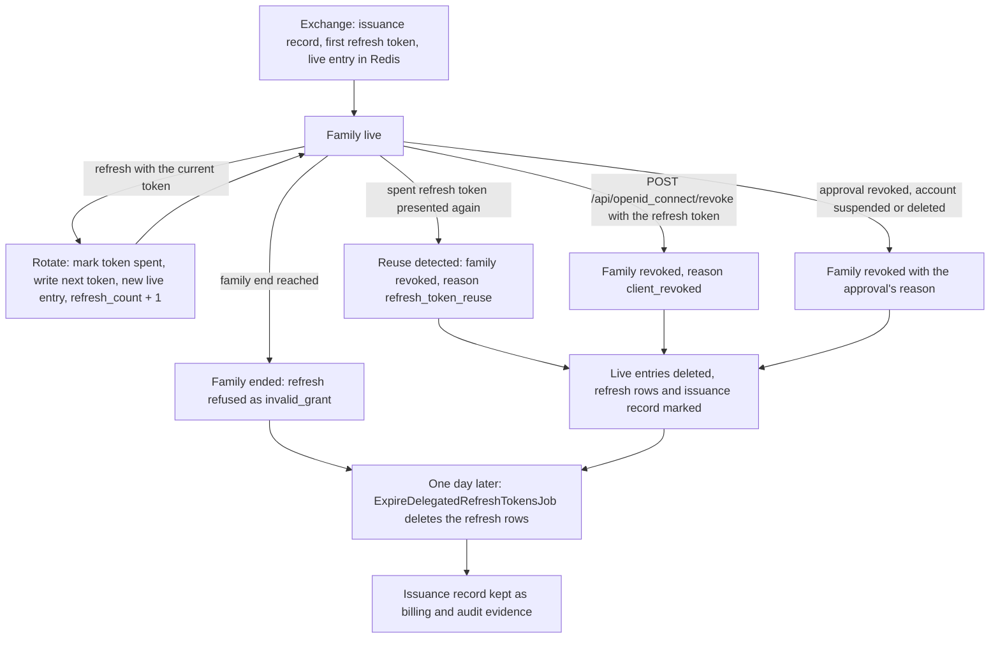

Signing out of Login.gov appears nowhere in the diagram: it does not end a family.

With this branch in place the exchange response (section 6) carries two more fields. Here MyBenefits Assistant exchanged for the Housing Assistance Records API, whose fixture entry caps access tokens at 300 seconds and the family at 14400 seconds (four hours).

```json
{
  "access_token": "…",
  "issued_token_type": "urn:ietf:params:oauth:token-type:access_token",
  "token_type": "DPoP",
  "expires_in": 300,
  "scope": "token_exchange:housing_records",
  "refresh_token": "…",
  "refresh_token_expires_in": 14400
}
```

Notice that `refresh_token_expires_in` is the time until the whole family ends, counted from the same instant as `expires_in`, and that the service provider can schedule every refresh from these two numbers alone.

When the access token is about to expire, the service provider refreshes at the same token endpoint. A public client whose record sets `dpop_required` sends `client_id` and a DPoP proof signed by the key the family is bound to. The proof is for POST to the token URL and carries no `ath`, because a refresh token is not an access token.

```http
POST /api/openid_connect/token
Content-Type: application/x-www-form-urlencoded
DPoP: eyJ0eXAiOiJkcG9wK2p3dCIsImFsZyI6IkVTMjU2IiwiandrIjp7…

grant_type=refresh_token
&client_id=urn:gov:gsa:openidconnect:sp:sinatra_sts
&refresh_token=…
```

Notice that there is no `resource` parameter (one is refused) and no `scope` parameter (one is accepted only if it equals the family's scope exactly). A confidential client sends `client_assertion_type` and `client_assertion` with `aud` equal to the token endpoint URL instead of `client_id`, and no proof.

The sequence below shows one refresh in the integrated stack.

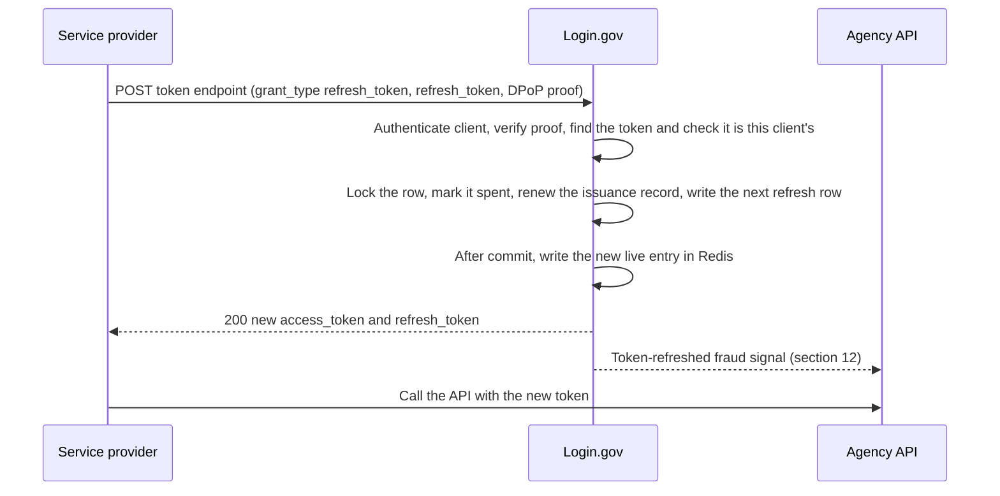

The response has the same shape as the exchange response, so a service provider handles both alike.

```json
{
  "access_token": "…",
  "issued_token_type": "urn:ietf:params:oauth:token-type:access_token",
  "token_type": "DPoP",
  "expires_in": 300,
  "scope": "token_exchange:housing_records",
  "refresh_token": "…",
  "refresh_token_expires_in": 13500
}
```

Notice that both tokens are new, that `refresh_token_expires_in` has shrunk by the time elapsed since the exchange (the family end never moves), and that the earlier access token keeps its own remaining lifetime.

The refresh checks run in a fixed order and stop at the first failure:

1. `code_verifier` must be absent (`invalid_request`, `code_verifier_not_allowed`).
2. The client is identified or authenticated exactly as at the exchange (`invalid_client` for every failure, including a client not approved for delegation).
3. The request shape: any `resource` is refused (`invalid_request`, `resource_not_allowed_on_refresh`), and `refresh_token` must be present and free of null bytes (`invalid_request`, `refresh_token_missing`).
4. For a public client whose record sets `dpop_required`, the proof is verified before the token is looked up (`invalid_dpop_proof`), so a caller without a valid proof learns nothing about the token.
5. The refresh token must be found by its digest and belong to this client (`invalid_grant`, `invalid_refresh_token`). A client holding another client's token gets the same answer as for a random string.
6. For a bound family, the proof's key thumbprint must equal the family's `dpop_jkt` (`invalid_dpop_proof`, `dpop_key_mismatch`). A client without `dpop_required` that presents a bound family is asked for a proof from that key at this point, because a bound token is never honored without its key.
7. `scope`, if given, must be exactly the family's scope (`invalid_scope`, `refresh_scope_mismatch`).

Then the row is re-read under a database row lock (`SELECT … FOR UPDATE`) and one of four things happens:

- The row is already spent (`rotated_at` set). This is reuse. The row's `used_at` is updated and, unless the family is already revoked, the whole family is revoked with reason `refresh_token_reuse`. The answer is `invalid_grant`.
- The row is revoked, or the family has reached its end. The answer is `invalid_grant` (`invalid_refresh_token`) and nothing changes.
- The approval no longer stands (it is revoked, its content is no longer current, or a remembered approval is past `remember_until`). The family is revoked with reason `approval_lapsed` and the answer is `invalid_grant`. A single-authorization approval stands for as long as its family does.
- The API is not `usable?` or its application no longer accepts this client. The answer is `invalid_grant` and nothing is revoked, so switching the record back on restores the family.

Otherwise the row is marked `used_at` and `rotated_at`, the issuance record is renewed, the next refresh row is written, and after commit the new live entry is written to Redis.

A spent refresh token presented again gets this answer.

```json
{
  "error": "invalid_grant",
  "error_description": "This refresh token was already used, so every token in its family has been revoked. Start a new exchange to continue."
}
```

Notice that after this answer every live access token of the family is gone from Redis, every refresh row and the issuance record of the family carry `revocation_reason: refresh_token_reuse`, the approval itself is untouched, and a further replay of any token of the family answers `invalid_grant` with the plain `invalid_refresh_token` wording without reporting the theft again.

To stop early, the service provider calls the RFC 7009 revocation endpoint. A public client whose record sets `dpop_required` sends a proof for POST to the revoke URL carrying `ath` over the presented token.

```http
POST /api/openid_connect/revoke
Content-Type: application/x-www-form-urlencoded
DPoP: eyJ0eXAiOiJkcG9wK2p3dCIsImFsZyI6IkVTMjU2IiwiandrIjp7…

client_id=urn:gov:gsa:openidconnect:sp:sinatra_sts
&token=…
&token_type_hint=refresh_token
```

A confidential client sends `client_assertion_type` and `client_assertion` with `aud` equal to the revoke endpoint URL. Once the caller has authenticated, the answer is always HTTP 200 with an empty object, whatever the token turned out to be.

```json
{}
```

Notice that the same answer covers a refresh token of this client's (the whole family is revoked with reason `client_revoked`), a live delegated token of this client's (that token alone is removed and its issuance record marked, the family untouched), the client's own sign-in token, an unknown token, another client's token, an already revoked token and a token bound to another key (nothing is acted on). `token_type_hint` only orders the two lookups; a wrong or unknown hint is not an error. Only three things fail: a caller that does not authenticate or is not approved for delegation (`invalid_client`, HTTP 401), a missing `token` (`invalid_request`, HTTP 400) and, for a `dpop_required` client, a proof that is missing or does not verify (`invalid_dpop_proof`, HTTP 400). With `token_exchange_enabled` off the route answers 404.

```json
{
  "error": "invalid_request",
  "error_description": "token is required."
}
```

The stored state of a family is split between Redis and Postgres. The live access tokens are Redis entries exactly as in section 6, each with its own time to live (TTL), and every entry of a family carries the same `refresh_family_id` and the same `issuance_id`. In Postgres a family has one issuance record and one refresh-token row per rotation.

```yaml
# token_exchange_tokens: the one issuance record of the family, renewed by each refresh
refresh_family_id: "…"
issued_at: 2026-10-13 12:00:00      # the first token's
expires_at: 2026-10-13 12:05:00     # the first token's
refresh_count: 3
last_refreshed_at: 2026-10-13 12:14:30
revoked_at: null
revocation_reason: null

# token_exchange_refresh_tokens: one row per rotation, same family_id and expires_at on every row
token_digest: "…"                   # hex SHA-256 of the refresh token; the plaintext is never stored
family_id: "…"                      # equals the issuance record's refresh_family_id
grant_id: 1
token_exchange_token_id: 1          # the issuance record above
resource_server_id: 1
service_provider_id: 1
user_id: 1
scope: token_exchange:housing_records
dpop_jkt: "…"                       # null for a bearer family
expires_at: 2026-10-13 16:00:00     # the family's absolute end
used_at: 2026-10-13 12:14:30        # last presentation, reuse attempts included
rotated_at: 2026-10-13 12:14:30     # set means spent
revoked_at: null
revocation_reason: null
```

Notice that `refresh_count` plus one is the number of access tokens the family has produced, that `last_refreshed_at` is the instant of the latest successful refresh, and that the refresh rows are the only place a replay can be detected, which is why they are kept for the whole family lifetime plus one day.

The lifetimes come from configuration and two optional columns that can only shorten them.

```yaml
# config/application.yml.default
token_exchange_access_token_ttl_seconds: 900      # one access token
token_exchange_refresh_token_ttl_seconds: 43200   # one family, counted from the exchange

# config/delegated_access.localdev.yml (excerpt): the read-write API shortens both
token_exchange_resource_servers:
  - identifier: 'https://records-api.housing.example.gov'
    token_format: 'oauth'
    max_access_token_seconds: 300
    max_family_seconds: 14400

# service_providers.delegation_max_family_seconds   per service provider, set by Login.gov
```

Notice that the family end is the lowest of the default, the API's `max_family_seconds` and the service provider's `delegation_max_family_seconds`, counted from the exchange, and never later than the approval's `remember_until`. A value above the default has no effect. An access token's lifetime is the lowest of the default, the API's `max_access_token_seconds` and the seconds left in the family, so no access token outlives its family.

The nightly cleanup is one scheduled job.

```text
expire_delegated_refresh_tokens   ExpireDelegatedRefreshTokensJob   cron_24h_and_a_bit
  deletes token_exchange_refresh_tokens where expires_at < 1.day.ago, in batches
  logs delegated_refresh_tokens_expired(deleted_count)
```

Notice that the issuance records are never purged by this job: their retention follows `sp_return_logs`.

## Functional requirements

| Id | Requirement |
|---|---|
| **FR-TOK-10** | Login.gov MUST allow the service provider to obtain a fresh delegated token for the same API without involving the person, for a bounded total period after issuance (12 hours by default, absolute, not extended by use). A refresh renews the issuance record the exchange opened (`refresh_count`, `last_refreshed_at`) rather than writing a new one, and refresh-token rows are purged a day after the family end (D79). |
| **FR-TOK-11** | The total period MUST never extend past the person's remembered-approval period, and for a non-remembered approval MUST end no later than 12 hours after issuance. A refresh renews the opening issuance record and refresh-token rows are purged a day after the family end, so the stored state of a family ends with the period (D79). |
| **FR-TOK-12** | Each renewal MUST retire the renewal credential used. Reuse of a retired renewal credential MUST end all access under that issuance and MUST be reported to the agency as a possible theft, so a stolen renewal credential ends access rather than extending it. |
| **FR-TOK-13** | A renewed token MUST have the same API, access and delegation identifier as the original. The service provider MUST NOT be able to change them at renewal. |
| **FR-TOK-14** | The service provider MUST be able to end its access early (Token Revocation, RFC 7009). |
| **FR-TOK-15** | Continued access MUST NOT depend on the person's browser session with Login.gov remaining open. |
| **FR-TOK-16** | Login.gov MUST be able to set a shorter total period for a specific service provider or for agencies whose APIs can make changes, but never a longer one. |
| **FR-TOK-18** | Renewal credentials MUST be stored in a form from which the credential cannot be recovered. Delegated tokens MUST be stored the same way and held only for their own lifetime. The renewal credentials and a record of each issuance (which contains no credential) MUST be kept durably, so that revocation, reporting and the person's account page do not depend on a token still being live. |
| **FR-CEN-13** | Revoking an approval, by the person or by Login.gov, MUST immediately invalidate every token issued under it and MUST be reported to the agency (section 12). |

Rows owned by other sections that this branch carries a part of: **FR-TOK-20** (section 6; this branch carries the renewal half: no ceiling refuses a refresh, and every refresh and failure is logged with the issuer and error code) and **FR-CEN-15** (section 3; this branch carries the suspension and deletion half: suspension revokes every approval with reason `account_suspended`, deletion from the account page or an account reset revokes every approval with reason `account_deleted`, and sign-out touches nothing).

## Protocol rows

| Id | Requirement |
|---|---|
| **REF-1** | The exchange response (EXC-7) includes a `refresh_token` and a `refresh_token_expires_in` measured from the issuance instant (RFC 8693 §2.2.1 permits it). Refresh tokens are issued only by the exchange and only for delegated tokens. |
| **REF-2** | Service providers refresh at `POST /api/openid_connect/token` with `grant_type=refresh_token` (RFC 6749 §6), authenticating by client type: a confidential client with `private_key_jwt`, a public client with `client_id` and, when its record sets `dpop_required`, a DPoP proof from the family's key. The refresh token must belong to the service provider that performed the exchange, or the request fails with `invalid_grant`. |
| **REF-3** | The refreshed token has the same `aud`, `scope`, `act`, approval, `delegation_id` and format as the family. A `scope` parameter, if present, must equal the family's scope exactly or the request fails with `invalid_scope`. A `resource` parameter is refused with `invalid_request`. A family bound to a key (EXC-9) stays bound: the refresh carries a `DPoP` proof signed by that key, verified before the refresh token is looked up, and the refreshed token inherits the binding. A missing proof or a different key fails with `invalid_dpop_proof` without rotating the family. An unbound family is refreshed without a proof and its tokens stay bearer tokens (D82). |
| **REF-4** | Every refresh rotates the refresh token (RFC 9700 §4.14.2). Presenting a refresh token that has already been rotated revokes the entire family (all access and refresh tokens from that exchange) through `TokenExchangeRefreshToken.revoke_family!`, which marks the approval's refresh rows and issuance records for that family through `TokenExchangeToken.revoke_rows!`, reports `delegated-access-revoked` with `reason: refresh_token_reuse` to the family's API (ATT-7), and logs an analytics event carrying the service provider, the API and the family id, so operations see the reuse without reading agency events. Reuse, `approval_lapsed` and `client_revoked` all report this way. Reuse detection keeps every rotation of the family within its lifetime. Keeping only the current and previous digest is an alternative that is considered and not adopted (D33, D79). |
| **REF-5** | Access tokens live 15 minutes (`token_exchange_access_token_ttl_seconds`, default 900). The refresh family has an absolute, non-sliding lifetime of 12 hours (`token_exchange_refresh_token_ttl_seconds`, default 43200) counted from the exchange that opens it, for every approval whether remembered or not, and never later than the approval's `remember_until`. A non-remembered approval's family does not end with the Login.gov session. An API's `max_family_seconds` and a service provider's `delegation_max_family_seconds` may lower the family lifetime, and an API's `max_access_token_seconds` may lower the access token lifetime. None may raise them (D32, D61). |
| **REF-6** | Delegated token validity does not depend on the person's Rails session. Sign-out at Login.gov does not revoke delegated families. Account suspension or deletion does, and approval revocation does. |
| **REF-7** | Refresh tokens are Postgres rows storing the SHA-256 digest only; the plaintext exists in the token response alone. Rows stay one per rotation while the family lives, for reuse detection. `ExpireDelegatedRefreshTokensJob` runs nightly and deletes the rows of a family one day after its `expires_at` (indexed). Issuance records are not purged; their retention follows `sp_return_logs` (D79). |
| **REF-8** | Login.gov exposes `POST /api/openid_connect/revoke` per RFC 7009 so a service provider can revoke a refresh token (and with it its family, reason `client_revoked`) or a single delegated token when the person's task ends early. The endpoint carries the token endpoint's CORS treatment so a public client revokes from the browser with its proof (D59). |
| **REF-9** | A refresh does not write a billing row (section 11) and emits `delegated-access-token-refreshed` (section 12) after the live entry is written. |
| **REF-10** | Rotation runs under a database row lock on the presented refresh token, so two concurrent refreshes with the same token cannot both succeed: the second sees `rotated_at` set and is treated as reuse. A family that is already revoked is not revoked or reported again on a further replay. |
| **REF-11** | A `resource` parameter on refresh is refused with `invalid_request` rather than ignored. The audience is fixed by the family, and a service provider that wants another API exchanges again. |
| **REF-12** | The refreshed access token's `expires_at` is the earlier of "now plus the access token lifetime" and the family's end, so no access token outlives its family. |
| **REF-13** | The refresh grant is not rate-limited per service provider. Refresh volume and error rate per service provider are monitored against configurable alert thresholds (D37). |
| **REF-14** | Storage split: live access tokens and SAML assertions are in Redis (keyed by digest, TTL equal to the lifetime, indexed per approval and per family); refresh tokens and issuance records are in Postgres. A refresh writes a new Redis entry and adds the new digest to the family's index set, but no new issuance row: the family keeps the one `token_exchange_tokens` row its exchange opened, and the refresh updates that row's `refresh_count` and `last_refreshed_at`. The live entry carries the opening record's id, so introspection, revocation and billing join the same record for every token of the family. The earlier access token keeps its own TTL (D26, D79). |

## As built

1. The refresh-token model. `TokenExchangeRefreshToken` on `token_exchange_refresh_tokens` (migration `20261009100800`) has these columns: `token_digest` (hex SHA-256, unique), `family_id` (the issuance record's `refresh_family_id`), `grant_id`, `token_exchange_token_id` (the issuance record the refresh token accompanies), `resource_server_id`, `service_provider_id`, `user_id`, `scope` and `dpop_jkt` copied from the family, `expires_at` (the family's absolute end, the same value on every row of the family), `used_at` (last presentation, reuse attempts included), `rotated_at` (set means spent), `revoked_at` and `revocation_reason`. It is indexed on the digest, family, approval, issuance record, user, service provider and, by migration `20261010100100`, `expires_at`. `.lookup` refuses null bytes and finds a row by digest. `.live` means unrotated, unrevoked and before the family end. `#key_bound?` means `dpop_jkt` is present. The family's token format is read from the issuance record (`token_exchange_token.saml?`).
2. The two lifetime rules. `TokenExchangeRefreshToken.family_end(from:, grant:, resource_server:, service_provider:)` is the lowest of `token_exchange_refresh_token_ttl_seconds` (43200, in `config/application.yml.default` and `lib/identity_config.rb`), `token_exchange_resource_servers.max_family_seconds` (migration `20261009100900`) and `service_providers.delegation_max_family_seconds` (migration `20261009101000`), counted from the exchange and never later than the approval's `remember_until`. A null column means the default applies, and a value above the default has no effect. `TokenExchangeToken.lifetime_seconds_for(now:, resource_server:, family_expires_at:)` is the single lifetime rule for every issued token: the lowest of the default access token lifetime, `max_access_token_seconds` and the seconds left in the family, and at least one second.
3. Shared plumbing. `DelegatedAccessClientHandling` (`app/forms/concerns/delegated_access_client_handling.rb`) carries `validate_client` for the exchange, refresh and revoke forms: a confidential client is authenticated by `client_assertion` through `ResourceServerAuthenticator` with `aud` equal to the endpoint being called, a public client is identified by `client_id` naming a `pkce` record, the two credentials are not interchangeable (`client_type_mismatch`), approval for delegation is checked last (`client_not_approved`), and every failure is `invalid_client`. The concern also carries `fail_with`, `error_code`, `error_response`, `url_options`, `validate_code_verifier_absent` (each form refuses `code_verifier` as `invalid_request` before the client is looked at) and `integration_errors` with a per-form `integration_error_event`. `OpenidConnect::DelegatedEndpointConcern` (`app/controllers/concerns/openid_connect/delegated_endpoint_concern.rb`) carries what the revoke and introspect controllers share: the `token_exchange_enabled` check (404 when off), the session-load, session-expiration and CSRF skips, the `options` action, `form_params` merging the `DPoP` header into the permitted body, and `log_integration_errors` feeding `sp_integration_errors_present`.
4. The exchange opens the family. `OpenidConnectTokenExchangeForm#issue!` writes the issuance record, the family's first refresh row and the approval's `first_exchanged_at` in one transaction, then the Redis entry. The response carries `refresh_token` and `refresh_token_expires_in`, both measured from the issuance record's `issued_at`.
5. The refresh grant. `OpenidConnect::TokenController#build_form` dispatches `grant_type=refresh_token` to `OpenidConnectRefreshTokenForm` while `token_exchange_enabled` is on, and otherwise to `OpenidConnectUnsupportedGrantForm`. The body permits `refresh_token` and `scope`. The checks run in order and stop at the first failure: `code_verifier` must be absent (`invalid_request`); the client (`invalid_client`); any `resource` is refused (`invalid_request`, `resource_not_allowed_on_refresh`) and `refresh_token` must be present without null bytes (`invalid_request`); for a public client whose record sets `dpop_required`, the proof for POST to the token URL with no `ath` is verified before the token is looked up (`invalid_dpop_proof`); the token must be found and be this client's, else `invalid_grant` (`invalid_refresh_token`); the proof's thumbprint must equal the family's `dpop_jkt` (`invalid_dpop_proof`, `dpop_key_mismatch`); and `scope`, if given, must be exactly the family's (`invalid_scope`).
6. Rotation and minting. `#rotate_and_mint!` re-reads the row under `SELECT … FOR UPDATE` (`TokenExchangeRefreshToken.lock.find`). An unspent row is refused `invalid_grant` if it is revoked or past the family end. If the approval no longer stands (`approval_stands?`: not revoked, `current_content?`, and a remembered approval still within `remember_until`; a single-authorization approval stands for as long as its family), the family is revoked with reason `approval_lapsed` and the refresh is refused. If the API is not `usable?` or the application no longer `accepts_delegation_from?` the client, the refresh is refused and nothing is revoked, so switching the record back on restores the family. Otherwise `used_at` and `rotated_at` are set and `#mint!` renews the family's opening `token_exchange_tokens` record through `TokenExchangeToken#record_refresh!(now:)` (one `UPDATE` adding 1 to `refresh_count` and setting `last_refreshed_at`; migration `20261010100000`), writes the next refresh row (same family id, same `expires_at`, drawn from `DelegatedAccess::OpaqueToken`) and, after commit, writes the live entry from `TokenExchangeToken#live_attributes(issued_at:, expires_at:)` with the renewed times and the opening record's id as `issuance_id`, added to the family's index set with a TTL equal to the lifetime. The next token keeps the family's registered format and `issued_token_type` reports it; in the integrated stack a SAML family's renewed assertion takes its `IssueInstant` and windows from the renewed times (section 9). `DelegatedAccessEvents.token_refreshed` is called after the live entry is written with the renewed expiry; the fraud-signals branch (section 12) supplies it.
7. Reuse. A spent row presented again has `used_at` updated and, unless the family is already revoked, `TokenExchangeRefreshToken.revoke_family!(family_id, grant:, reason: 'refresh_token_reuse')` runs: `DelegatedTokenStore.revoke_family` deletes the family's live entries and index set, and `TokenExchangeToken.revoke_rows!` marks that approval's refresh rows and issuance records for the family (rows already revoked keep their reason). The form's `report_family_revoked(reason:)` seam is where `DelegatedAccessEvents.access_revoked(grant:, reason:, resource_server:)` reports to the one API the family is for, so one theft is reported once; the fraud-signals branch (section 12) fills the seam, which is empty on this branch. The answer is `invalid_grant` (`refresh_token_reused`).
8. Analytics. `openid_connect_token_refresh(success, service_provider_issuer, resource_server_identifier, application_issuer, client_type, token_type, family_id, reuse_detected, expires_in, error_code, error_details)`; `delegation_refresh_token_reuse(service_provider_issuer, resource_server_identifier, family_id)` when reuse is detected; `openid_connect_revoke(success, service_provider_issuer, client_type, token_type_hint, revoked, error_code, error_details)` with `revoked` one of `refresh_token`, `access_token` or `none`; `delegated_refresh_tokens_expired(deleted_count)`; and `sp_integration_errors_present` fed with `oidc_token_refresh_request` and `oidc_revoke_request`. Nothing refuses for volume.
9. The revocation endpoint. `POST /api/openid_connect/revoke` and its OPTIONS route are served by `OpenidConnect::RevokeController` (which includes `DelegatedEndpointConcern`) and `OpenidConnectRevokeForm`. The checks are: the client (`invalid_client`, HTTP 401), `token` present (`invalid_request`, HTTP 400), and, for a public client whose record sets `dpop_required`, the proof for POST to the revoke URL with `ath` over the token (`invalid_dpop_proof`, HTTP 400). `token_type_hint` only orders the two lookups. A refresh token of this client's, bound to the proving key when the family is bound, ends its family through `revoke_family!` with reason `client_revoked`. A live delegated token of this client's is removed alone through `DelegatedTokenStore.revoke_token` (the entry and both index listings) and its issuance record is marked `client_revoked`, with the family untouched. The client's own sign-in access token, an unknown token, another client's token, an already revoked token or a token bound to another key is not acted on. Every authenticated outcome is HTTP 200 with `{}` (RFC 7009 §2.2). `config/application.rb` gives the path the token endpoint's `Rack::Cors` treatment.
10. Cascades. `TokenExchangeToken.revoke_rows!(relation, reason:, now:)` marks every unrevoked row of a relation of issuance records or refresh tokens. `TokenExchangeGrant#revoke!` calls it for the approval's two relations, and `#transfer_live_tokens_to!` re-points the refresh rows to the replacement approval so a refresh after re-approval issues under it. `TokenExchangeGrant.revoke_all_for_user!(user:, reason:)` revokes every live approval the person holds. `User#suspend!` calls it with `account_suspended`; `Users::DeleteController#delete_user` and `AccountReset::DeleteAccount#destroy_user` call it with `account_deleted` inside their transactions before the user row is destroyed (the approval, issuance and refresh rows stay as the record). Sign-out calls nothing.
11. The purge. `TokenExchangeRefreshToken.expired_for_purge` (`expires_at < 1.day.ago`) and `ExpireDelegatedRefreshTokensJob` (`queue_as :low`, `in_batches.delete_all`) are scheduled with `cron_24h_and_a_bit` in `config/initializers/job_configurations.rb` as `expire_delegated_refresh_tokens`. A replay inside the day after the family end still revokes the family; after the purge it is refused as unknown.
12. Locale keys and fixture. The keys `openid_connect.token.errors.invalid_refresh_token`, `refresh_scope_mismatch`, `refresh_token_missing`, `refresh_token_reused`, `resource_not_allowed_on_refresh` and `openid_connect.revoke.errors.token_missing` exist in en, es, fr and zh. In `config/delegated_access.localdev.yml` the Housing Assistance Records API carries `max_family_seconds: 14400` beside `max_access_token_seconds: 300` as the read-write example.
13. Verified. `spec/requests/openid_connect/token_refresh_spec.rb` (75 examples), `spec/requests/openid_connect/token_exchange_spec.rb` (117), `spec/requests/openid_connect/revoke_spec.rb`, `spec/models/token_exchange_refresh_token_spec.rb`, `spec/models/token_exchange_grant_spec.rb`, `spec/models/user_spec.rb`, `spec/controllers/users/delete_controller_spec.rb`, `spec/services/account_reset/delete_account_spec.rb`, `spec/services/delegated_token_store_spec.rb`, `spec/jobs/expire_delegated_refresh_tokens_job_spec.rb`, the job-configuration spec and `spec/requests/openid_connect_cors_spec.rb`; the i18n spec (65 examples); the delegated-access set at the top of the stack, 2,055 examples, 0 failures; rubocop, the analytics and tracker lints and gitleaks clean.

## Decisions

- **D26** Token storage is hybrid: live tokens in Redis by digest with per-approval and per-family index sets, and refresh tokens and issuance records in Postgres.
- **D27** The delegated token lifetime is 15 minutes by default, shortened per API by `max_access_token_seconds`, and applied at every refresh.
- **D32** The refresh family's absolute lifetime is 12 hours for every approval, never past `remember_until`; the alternatives of ending with the Login.gov session and of a 4-hour default are rejected.
- **D33** Refresh token reuse revokes the whole family, reports `refresh_token_reuse` to the agency and logs its own analytics event.
- **D37** There is no per-caller ceiling on refresh; volumes and error rates are monitored against alert thresholds.
- **D59** The revocation endpoint carries the token endpoint's CORS treatment so a public client revokes from the browser.
- **D61** The family clock starts at the exchange that opens the family, and each exchange opens its own family.
- **D79** A refresh renews the opening issuance record (`refresh_count`, `last_refreshed_at`), refresh-token rows are purged nightly a day after the family end, and issuance records are kept as billing evidence.

## How to review

- Diff against `delegated-access-token-exchange`.
- Check first `TokenExchangeRefreshToken.family_end` and `TokenExchangeToken.lifetime_seconds_for` (no token outlives its family, and no column can lengthen a lifetime); `#rotate_and_mint!` under the row lock and its three refusal paths (revoked or ended, approval lapsed, API or application switched off, of which only the second revokes); the reuse path through `revoke_family!` (one report per theft, and a family already revoked is not reported again); `#record_refresh!` (one issuance record per exchange, with the live entry carrying the opening record's id); the `OpenidConnectRevokeForm` outcomes (always HTTP 200 with `{}` once authenticated, with ownership and key binding checked before any action); `User#suspend!` and the two deletion call sites; and the purge scope and the job's schedule.
- Specs that prove it: `token_refresh_spec.rb`, `revoke_spec.rb`, `token_exchange_spec.rb` (the refresh token on the exchange response), the refresh-token model spec, the grant, user and deletion specs, `expire_delegated_refresh_tokens_job_spec.rb`, and the CORS spec.
- Must not change for existing clients: `grant_type=refresh_token` is dispatched to the delegated form only while `token_exchange_enabled` is on (otherwise `unsupported_grant_type` as before); the authorization-code grant's responses are unchanged; account deletion and suspension for a person with no approvals behave as before.
- Open items: a `User` deletion callback for the approval cascade in place of the two call sites, and `ServiceProviderIdentity#session_live?`, are held until the harness run (Appendix D). The performance findings on the shared Redis pool, the per-address throttle and the ordering of Redis and database writes under partial failure are recorded in Appendix D and not implemented.

# 8. `delegated-access-introspection`: agency verification of delegated tokens

**Stack position** 8 of 14, on `delegated-access-token-lifecycle`.

## Objective

A delegated token is an opaque random string. It means nothing on its own, so an agency API must ask Login.gov what the token stands for before it relies on it. This branch adds the standard Token Introspection endpoint of RFC 7662, `POST /api/openid_connect/introspect`, for that question.

The agency API named as the token's audience authenticates with its own key, using a `private_key_jwt` client assertion signed with a certificate on its registry record. For a live token it receives everything it needs to act: who issued the token, the person's identifier for that agency (the same pairwise identifier a direct sign-in produces, assigned on the spot if the person has never used the agency, without creating a connection to the agency's application), the approved access, the service provider acting for the person (the `act` claim), the assurance levels of the sign-in, when the person last authenticated, the token's issuance and expiry times, an identifier for this one token, and the delegation identifier shared by every token under the same approval. Together these are the elements NIST IR 8587 §5.2.1.1 requires of a token an agency relies on.

Identity attributes are released with the same answer, in the shape the agency already consumes from the user-information endpoint (`/api/openid_connect/userinfo`), and limited to the attribute bundle registered for that agency's application. The service provider never chooses what the agency learns. While the person's sign-in to the service provider is live, the whole bundle is released. After it ends, only the person's identifier, the delegation identifier and the email address are released, and the response says which case applies with the `session_live` member.

The agency has to authenticate because the service provider also holds the token. If the token worked at the user-information endpoint as a bearer credential, the service provider could present it there and receive attributes the person never approved for the service provider. That is why delegated tokens are refused at the user-information endpoint with or without a key-possession proof. A public-client service provider may ask about its own token: it proves possession of the key the token is bound to and learns only the token's status and what its own sign-in already told it. Every other caller receives a bare "not active" with no reason, so the endpoint cannot be used to probe tokens.

Login.gov publishes no cache window and imposes no per-agency ceiling. An agency verifies on every call, so a revocation takes effect at the agency's next call. Volumes and error rates are monitored rather than refused.

## How it works

The sequence below is the common case: the service provider calls the agency API with a delegated token, and the agency API confirms the token with Login.gov before it answers.

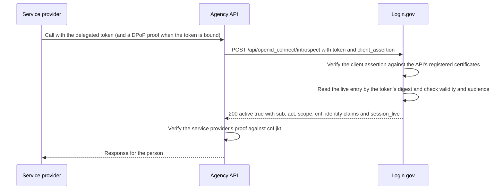

**The agency API's request.** The API sends the token and a `private_key_jwt` client assertion. Using the fixture values, Housing Assistance Records (the Department of Housing Support) asks about a token MyBenefits Assistant obtained for its API.

```http
POST /api/openid_connect/introspect HTTP/1.1
Host: idp.example.gov
Content-Type: application/x-www-form-urlencoded

token=2YotnFZFEjr1zCsicMWpAA…
&client_assertion_type=urn%3Aietf%3Aparams%3Aoauth%3Aclient-assertion-type%3Ajwt-bearer
&client_assertion=eyJhbGciOiJSUzI1NiJ9…
```

Notice that there is no `Authorization` header and no `client_id`: the client assertion is the whole credential, and `token_type_hint` is accepted but not needed.

The client assertion is a signed JWT whose payload names the API twice and this endpoint once (the host `idp.example.gov` stands for Login.gov's own address):

```json
{
  "iss": "https://records-api.housing.example.gov",
  "sub": "https://records-api.housing.example.gov",
  "aud": "https://idp.example.gov/api/openid_connect/introspect",
  "iat": 1760371200,
  "exp": 1760371500,
  "jti": "7c1e6a0b-…"
}
```

Notice that `iss` and `sub` are both the resource server identifier from the registry, `aud` is the introspection URL and not the token endpoint, `exp` is at most five minutes after `iat`, and `jti` is single use.

**The active response to the agency API while the sign-in is live.** This example assumes the application's bundle holds `email`, `first_name` and `last_name`. (The fixture's Housing Assistance Records bundle holds `email` alone, so its real response carries `email` and `email_verified` and no name claims.)

```json
{
  "active": true,
  "iss": "https://idp.example.gov/",
  "aud": "https://records-api.housing.example.gov",
  "scope": "token_exchange:housing_records",
  "client_id": "urn:gov:gsa:openidconnect:sp:sinatra_sts",
  "delegation_id": "4f0c9d2e-…",
  "token_type": "DPoP",
  "iat": 1760371200,
  "exp": 1760371500,
  "cnf": { "jkt": "0ZcOCORZNYy-DWpqq30jZyJGHTN0d2HglBV3uiguA4I" },
  "sub": "b2d9a7c4-…",
  "act": { "sub": "urn:gov:gsa:openidconnect:sp:sinatra_sts" },
  "jti": "9c56e1f0…",
  "acr": "urn:acr.login.gov:verified",
  "aal": "http://idmanagement.gov/ns/assurance/aal/2",
  "auth_time": 1760367600,
  "session_live": true,
  "email": "person@example.com",
  "email_verified": true,
  "given_name": "Pat",
  "family_name": "Example"
}
```

Notice four things. `sub` is the person's identifier for the Department of Housing Support, not the identifier MyBenefits Assistant knows. `act.sub` and `client_id` both name the service provider. `cnf.jkt` is present because the token is bound to a key, and `token_type` is `DPoP` to match. `exp` minus `iat` is 300 seconds because the fixture's `records-api` sets `max_access_token_seconds: 300`.

**The active response after the sign-in has ended.** The token members are the same; the identity claims shrink to the identifiers and email, and `session_live` says so.

```json
{
  "active": true,
  "iss": "https://idp.example.gov/",
  "aud": "https://records-api.housing.example.gov",
  "scope": "token_exchange:housing_records",
  "client_id": "urn:gov:gsa:openidconnect:sp:sinatra_sts",
  "delegation_id": "4f0c9d2e-…",
  "token_type": "DPoP",
  "iat": 1760371200,
  "exp": 1760371500,
  "cnf": { "jkt": "0ZcOCORZNYy-DWpqq30jZyJGHTN0d2HglBV3uiguA4I" },
  "sub": "b2d9a7c4-…",
  "act": { "sub": "urn:gov:gsa:openidconnect:sp:sinatra_sts" },
  "jti": "9c56e1f0…",
  "acr": "urn:acr.login.gov:verified",
  "aal": "http://idmanagement.gov/ns/assurance/aal/2",
  "auth_time": 1760367600,
  "session_live": false,
  "email": "person@example.com",
  "email_verified": true
}
```

Notice that `given_name` and `family_name` are absent rather than `null`, and that `all_emails` would still appear here if the bundle named it, because email addresses come from the account and not from the decrypted profile.

**The "not active" response.** Every token that is unknown, expired, revoked, issued for another API, or presented by a caller who is not entitled to ask receives exactly this body with HTTP 200:

```json
{"active": false}
```

Notice that there is no reason and no other member. A revoked token and a token that never existed look identical to the caller.

**The service provider's own introspection.** MyBenefits Assistant is a browser public client registered with `dpop_required`, so every token it holds is bound to a key it keeps in the browser. It names itself with `client_id` and proves possession with a DPoP proof in the `DPoP` header; the proof's `ath` is the hash of the `token` parameter. The call is cross-origin, so it carries the browser's `Origin`.

```http
POST /api/openid_connect/introspect HTTP/1.1
Host: idp.example.gov
Origin: https://mybenefits.example.gov
Content-Type: application/x-www-form-urlencoded
DPoP: eyJ0eXAiOiJkcG9wK2p3dCIsImFsZyI6IkVTMjU2IiwiandrIjp7…

token=2YotnFZFEjr1zCsicMWpAA…&client_id=urn%3Agov%3Agsa%3Aopenidconnect%3Asp%3Asinatra_sts
```

The proof's header and payload, decoded:

```json
{ "typ": "dpop+jwt", "alg": "ES256", "jwk": { "kty": "EC", "crv": "P-256", "x": "…", "y": "…" } }
{
  "jti": "e0b4…",
  "htm": "POST",
  "htu": "https://idp.example.gov/api/openid_connect/introspect",
  "iat": 1760371260,
  "ath": "fUHyO2r2Z3DZ53EsNrWBb0xWXoaNy59IiKCAqksmQEo"
}
```

Notice that `htu` is the introspection URL, so a proof minted for the token endpoint is refused here, and that the thumbprint of `jwk` must equal the `cnf.jkt` the token carries.

The limited response the service provider receives:

```json
{
  "active": true,
  "iss": "https://idp.example.gov/",
  "aud": "https://records-api.housing.example.gov",
  "scope": "token_exchange:housing_records",
  "client_id": "urn:gov:gsa:openidconnect:sp:sinatra_sts",
  "delegation_id": "4f0c9d2e-…",
  "token_type": "DPoP",
  "iat": 1760371200,
  "exp": 1760371500,
  "cnf": { "jkt": "0ZcOCORZNYy-DWpqq30jZyJGHTN0d2HglBV3uiguA4I" },
  "sub": "1a7e3f90-…"
}
```

Notice that `sub` is the service provider's own pairwise identifier for the person (the value its `id_token` already carries) and not the agency's, and that `act`, `jti`, `acr`, `aal`, `auth_time`, `session_live` and the agency's identity claims are all absent. A public client registered without `dpop_required` holds bearer tokens and makes this same call with `client_id` alone; its response has `token_type: "Bearer"` and no `cnf`.

**The two error responses.** A credential that is presented and fails is HTTP 401. For the agency API:

```http
HTTP/1.1 401 Unauthorized
Content-Type: application/json

{"error": "invalid_client", "error_description": "Could not validate assertion against any registered public keys. …"}
```

For the service provider, when its proof is missing or fails on its own terms:

```http
HTTP/1.1 401 Unauthorized
WWW-Authenticate: DPoP algs="ES256 RS256", error="invalid_dpop_proof", error_description="A DPoP proof is required: this client's tokens are bound to its key, so send a DPoP header signed by that key with the request (RFC 9449)."
Content-Type: application/json

{"error": "invalid_dpop_proof", "error_description": "A DPoP proof is required: this client's tokens are bound to its key, so send a DPoP header signed by that key with the request (RFC 9449)."}
```

Notice that neither error says anything about the token, and that the challenge header carries the description with quotation marks and backslashes stripped so the header stays well formed.

**The live entry Login.gov reads.** The token is never stored. Redis holds one entry under the key `delegated_token:<hex SHA-256 digest of the token>`, with a lifetime equal to the token's, written by the exchange or refresh that issued the token:

```json
{
  "aud": "https://records-api.housing.example.gov",
  "scope": "token_exchange:housing_records",
  "grant_id": 12,
  "delegation_id": "4f0c9d2e-…",
  "user_id": 7,
  "service_provider_id": 3,
  "resource_server_id": 1,
  "ial": 2,
  "aal": 2,
  "refresh_family_id": "c8a1…",
  "dpop_jkt": "0ZcOCORZNYy-DWpqq30jZyJGHTN0d2HglBV3uiguA4I",
  "token_type": "DPoP",
  "token_format": "oauth",
  "sp_rails_session_id": "…",
  "issued_at": 1760371200,
  "expires_at": 1760371500,
  "issuance_id": 41
}
```

Notice that the digest is also the response's `jti`, and that `sp_rails_session_id` is how Login.gov later decides whether the sign-in is still live.

**The decision logic.** The form `OpenidConnectIntrospectForm` decides in this order.

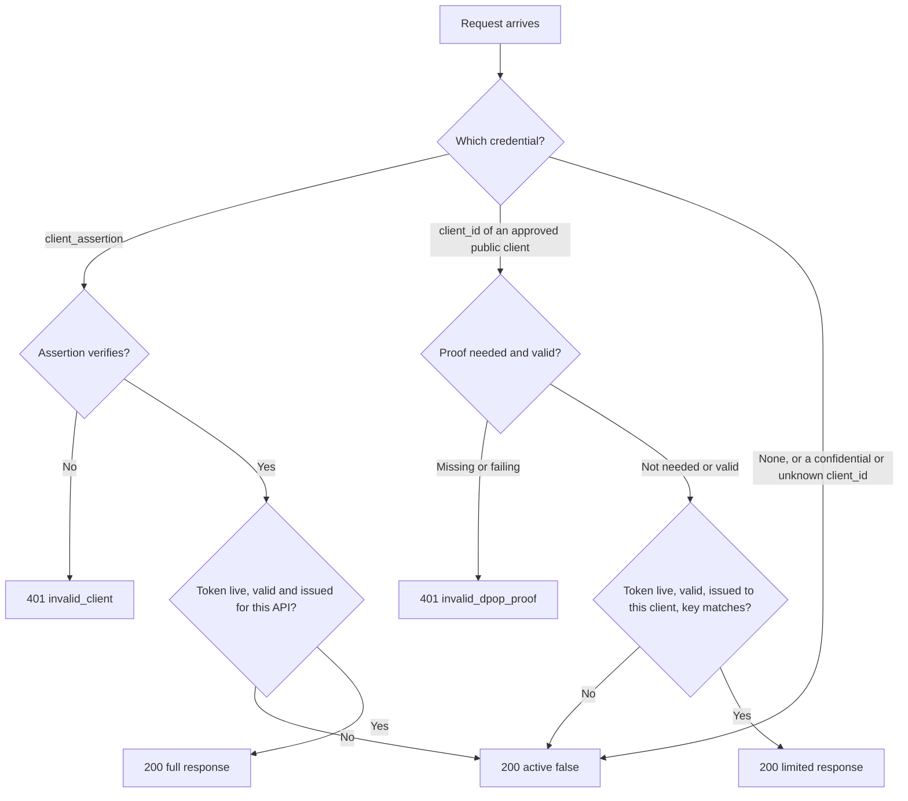

1. Identify the caller. A `client_assertion`, or even a `client_assertion_type` alone, means an agency API is authenticating. The assertion is checked by `ResourceServerAuthenticator` against the certificates on the `token_exchange_resource_servers` row named by `iss`; a failure is 401 `invalid_client`. A bare `client_id` that names a `pkce` service provider approved for delegation means the service provider is asking. A `client_id` naming a confidential or unknown client, or no credential at all, is not a credential: the answer is `{"active": false}` and the token is never examined.
2. Read the live entry. The `token` parameter is digested and looked up in Redis (`DelegatedTokenStore.read`); a value containing a null byte is not looked up. A missing entry means the token is not active.
3. Demand the service provider's proof when it is needed. A service provider registered with `dpop_required` must present a proof on every call, token found or not. One registered without it must present a proof only when the token it presents turns out to be bound. The proof is verified by `DpopProofVerifier` for `POST` to the introspection URL with `ath` over the `token` parameter; a missing proof, or one failing on type, algorithm, signature, `htm`, `htu`, `iat`, `ath` or a replayed `jti`, is 401 `invalid_dpop_proof` with the `WWW-Authenticate: DPoP` challenge.
4. Check validity (`#token_active?`). All of these must hold: the entry exists and its `expires_at` is in the future; the person exists and is not suspended; the approval exists and is valid now; the resource server is usable (its URL, its application and the application's agency are all active); the token's service provider is still approved for delegation and active. Any failure is "not active", with no reason.
5. Check entitlement (`#caller_entitled?`). An agency API is entitled when the entry's `resource_server_id` is its own. A service provider is entitled when the entry's `service_provider_id` is its own and, for a bound token, the proof's key thumbprint equals the entry's `dpop_jkt`; for a bearer token it is entitled only if it is not registered with `dpop_required`. A proof that verifies but comes from the wrong key fails entitlement and is answered "not active", never with an error, so a party holding a token without its key learns nothing.
6. Build the response. The agency API receives the token members, `sub`, `act`, `jti`, `acr`, `aal`, `auth_time`, `session_live` and the identity claims `DelegatedTokenClaims` releases for the application's bundle. The service provider receives the token members, its own `sub`, and any claim the application lists in `delegation_sp_shareable_attributes` that is also in the bundle.

Every call logs one analytics event, whatever the outcome:

```json
{
  "name": "openid_connect_introspect",
  "success": true,
  "caller_type": "resource_server",
  "resource_server_identifier": "https://records-api.housing.example.gov",
  "service_provider_issuer": null,
  "active": true,
  "error_code": null
}
```

Notice that `success` reports whether the credential verified and `active` reports what Login.gov said about the token; a "not active" answer to a well-authenticated caller is `success: true, active: false`. A failed credential from a caller that named itself also logs `sp_integration_errors_present` with `event: oidc_introspection_request`.

## Functional requirements

| Id | Requirement |
|---|---|
| **FR-VER-1** | A delegated token MUST be verified with Login.gov before an agency relies on it. Login.gov MUST provide the means for the agency API to do so. |
| **FR-VER-2** | The agency MUST prove its identity to Login.gov when verifying a token. Login.gov MUST confirm a token and release the person's identity attributes only to the agency API the token is issued for. The service provider that holds the token MAY ask Login.gov about its own delegated token by proving possession of the key the token is bound to. It then learns only whether the token is valid, its validity period, its API, its access, its delegation identifier and key binding, the identifier for the person it already holds from its own sign-in, and any attribute the agency has explicitly chosen to share with the service provider, and no other identity attribute. Any other caller MUST learn nothing. |
| **FR-VER-3** | A confirmed token MUST report: who issued it (Login.gov); the person's identifier for that agency (the same one a direct sign-in produces, assigned if the person has never used that agency, without creating any connection to it); the approved access; the acting service provider; the assurance levels of the sign-in; when the person last authenticated to the service provider; the issuance and expiry times; an identifier for this one token; and the delegation identifier shared by every token under the same approval. Together these are the elements NIST IR 8587 §5.2.1.1 requires of a token an agency relies on. |
| **FR-VER-4** | A confirmed token MUST also carry the identity attributes the agency is entitled to under its existing Login.gov agreement, in the same form a direct sign-in provides them, and nothing more. The set MUST be determined by the agency's agreement, never by the service provider. |
| **FR-VER-5** | Identity attributes MUST be available while the person's sign-in to the service provider is active. After it ends, verification MUST still confirm the token but MUST provide only the person's identifier, the delegation identifier and email, and MUST say so. |
| **FR-VER-6** | An invalid, expired, revoked, or foreign token MUST produce a plain "not valid" answer with no reason given. The same answer MUST be given to any caller that is neither the agency API the token is issued for nor the service provider proving possession of its own token. |
| **FR-VER-7** | Login.gov MUST NOT offer agencies a period during which an earlier confirmation may be relied on. An agency verifies the token on every call, so a revocation takes effect at the agency's next call. Login.gov's integration guide MUST say so. |
| **FR-VER-8** | Login.gov MUST NOT impose a hard per-agency ceiling on verification that refuses requests from a registered agency API. Login.gov MUST monitor verification volumes and error rates per agency API against configurable alert thresholds. Protection against a runaway caller belongs to the infrastructure layer. |

Rows owned by section 6 that this branch gives effect to: **FR-TOK-5** (the person, the acting service provider, the approved access and the delegation identifier are what the agency's verification reads from the live entry) and **FR-TOK-6** (a delegated token is refused at the user-information endpoint with or without a key-possession proof; the agency's attributes come only through introspection; the documented opening for an agency that cannot yet verify by introspection is INT-17 below and is not built, D83).

## Protocol rows

| Id | Requirement |
|---|---|
| **INT-1** | Login.gov exposes `POST /api/openid_connect/introspect` per RFC 7662. Two kinds of caller authenticate. A resource server authenticates with `private_key_jwt` using the certificates on its `token_exchange_resource_servers` row; a failed assertion is 401 `invalid_client`. The public-client service provider that holds a delegated token may introspect it with `client_id` and no client assertion. When its record sets `dpop_required`, or when the token itself is key-bound, it must also send a DPoP proof (RFC 9449 §4.3) whose `ath` is the hash of the `token` parameter and whose key thumbprint equals the token's `cnf.jkt`; a proof that is missing or fails on its own terms is 401 `invalid_dpop_proof` with `WWW-Authenticate: DPoP algs="ES256 RS256"`. A public-client service provider without the flag introspects a bearer token with `client_id` alone (D82). A request with no credential, or a `client_id` that is not a public client approved for delegation, receives 200 `{"active": false}`. `/api/openid_connect/userinfo` refuses a delegated token with or without a proof: `AccessTokenVerifier#load_identity` resolves a token against `identities` alone, and delegated tokens live in `DelegatedTokenStore`, so none is found there (EXC-6, EXC-18; D62, D83). |
| **INT-2** | The full active response is returned only when the caller is the token's resource server and all of the following hold: the live entry exists and `expires_at` is in the future; the approval is valid (CON-11, CON-12); the resource server is usable; the service provider is still approved for delegation; and the person's account is present and not suspended. When the caller is the service provider named in `act.sub` and the proof binds to the token, the response is the limited form of INT-14, under the same validity conditions. |
| **INT-3** | In every other case Login.gov returns exactly `{"active": false}` with HTTP 200 (RFC 7662 §2.2) and does not indicate why. The same answer is given when the service provider's proof verifies but its key is not the one the token is bound to. The key comparison is part of entitlement and is never a reason given to the caller (D62). |
| **INT-4** | The active response to the resource server includes `iss`, `aud`, `scope`, `sub`, `act`, `acr`, `aal`, `exp`, `iat`, `jti`, `auth_time`, `client_id` (the service provider) and `delegation_id`. `jti` is the hex SHA-256 digest of the token, the key the live entry is stored under; it identifies the one token and says nothing about issuance volume (D63). `delegation_id` identifies the consent and is shared by every token in the refresh family. `auth_time` is when the person last authenticated to the service provider, the sign-in the delegation rests on, and is the same instant the SAML `AuthnInstant` carries. `acr` carries the identity-assurance context and `aal` the authentication-assurance context as `userinfo` reports them. `act` is always present on delegated tokens. For a key-bound token the response also includes `cnf: { jkt: <thumbprint> }` (RFC 9449 §6, RFC 7800), the key the resource server must verify a proof against on the request it received. |
| **INT-5** | `sub` is the person's `AgencyIdentity` uuid for the resource server's owning agency, computed as `userinfo` computes it (`AgencyIdentityLinker`) and created at first introspection if the person has never used that agency. No `identities` row for the agency application is created or read (EXC-5; D35). |
| **INT-6** | The resource server's client assertion is validated per RFC 7523 §3 and RFC 8725 by `ResourceServerAuthenticator`: RS256 is pinned; `iss` equals `sub` equals the resource server identifier; `aud` is the introspection URL; `exp` is required and at most 5 minutes after `iat`, with a 10-second leeway for clock skew; the signature is verified before the `jti` is recorded through the shared replay guard, so an anonymous party cannot burn a legitimate caller's `jti` values; and `jti` must not have been seen within that window. |
| **INT-7** | Introspection is not rate-limited per resource server and never answers HTTP 429. Volume and error rate per caller are logged and monitored against configurable alert thresholds; runaway-caller protection is the infrastructure layer's (D37). |
| **INT-8** | Login.gov publishes no cache window. The integration guide states that a resource server introspects on every request and that revocation is therefore seen at the next request. `token_exchange_introspection_cache_seconds` is not introduced (D37). |
| **INT-9** | The active response includes `token_type` (`Bearer`, `DPoP` for a key-bound token, `N_A` for a SAML assertion) so a resource server can refuse a bound token presented with the wrong scheme. A failed credential answers HTTP 401 `invalid_client` (or `invalid_dpop_proof` for the service provider's proof, INT-1). |
| **INT-10** | The active response to the resource server also carries the identity claims the agency would receive from `userinfo` for a direct sign-in, with the claim names and formats `OpenidConnectUserInfoPresenter` produces (`email`, `email_verified`, `all_emails`, `given_name`, `family_name`, `birthdate`, `social_security_number`, `address`, `phone`, `phone_verified`, `verified_at`, `x509_*`; the assurance members `acr` and `aal` are token members of the same response), limited to the agency application's configured `attribute_bundle` and keyed by the agency's pairwise `sub`. Identity attributes come from the person's decrypted profile, which exists only while the service provider's Login.gov session is live (the same rule as SAML-5b). The member that states the session state is `session_live`, always present in the resource server's active response: `true` with the agency's bundle as written; `false` with `sub`, `delegation_id` and `email` (plus `email_verified`, and `all_emails` when bundled), the token members of INT-4 and no other identity claim. Delegated tokens remain unusable at `userinfo` (EXC-6; D34, D63). |
| **INT-11** | Claim release under INT-10 is decided by the agency application's bundle alone, never by the service provider's sign-in scopes: the person consented to the agency's bundle and to the service provider acting, not to the service provider choosing what the agency learns. `first_name` and `last_name` are filtered individually (OIDC's `profile:name` would release both); any address component in the bundle releases the whole composite `address` claim, as the SAML presenter already does. Claims absent from the bundle are omitted, never `null`; `locale` is never included. `auth_time` is not an identity claim and is carried as a token member (INT-4), not as part of the bundle. |
| **INT-12** | `ial` and `acr` carry the verified context only when the token's stored IAL is 2 (or IALmax) and the person holds an active profile; otherwise they carry the auth-only context with no proofed claims, so a resource server must not assume proofed claims are present merely because `active` is true. `aal` falls back to the identity's requested AAL, then the default classref, exactly as `userinfo` reports. `attributes: "identifiers_only"` is not emitted; `session_live` (INT-10) is the one member that states whether the bundle or identifiers only were released (D63). |
| **INT-13** | `email` is the address the person chose to share with the service provider (the identity's shared email, else the last sign-in address); a delegated-only person has no identity row at the agency to hold a separate choice. `verified_at` is an integer epoch (userinfo format), while the SAML assertion carries ISO 8601; each protocol keeps its own convention (E24). |
| **INT-14** | The active response to the service provider (INT-1) carries `active`, `exp`, `iat`, `aud`, `scope`, `delegation_id`, `token_type`, `cnf`, `iss` and the service provider's own pairwise `sub` (the value its `id_token` carries), plus any claim the application lists in `service_providers.delegation_sp_shareable_attributes` (an application-level list, empty by default, maintained with the consent content) intersected with the agency's bundle. It carries no `act`, no `jti`, no `auth_time`, no `acr` or `aal`, no `session_live` and no other identity attribute from the agency's bundle (D36). |
| **INT-15** | Introspection reads the live token from Redis by the digest of the `token` parameter (`DelegatedTokenStore.read`; EXC-7 as the live entry); a missing entry is `active: false`. The issuance record is not consulted for validity (D26). |
| **INT-16** | Document images and document metadata (the `document_images` attribute set) are never released by introspection or in a SAML assertion, whatever the agency's bundle says. They are reachable only at `/api/openid_connect/userinfo` with the service provider's own access token, and delegated tokens are refused there (EXC-6, EXC-18). |
| **INT-17** (documented, not built) | The opening for an agency that cannot implement introspection in time, recorded so it can be built with full context, and recommended against (D83). (a) Opt-in per API on the registry record: `token_exchange_resource_servers.userinfo_allowed` (boolean, default false) with a mandatory `userinfo_allowed_until` date, set in `identity-idp-config` and in the Dashboard once it has the fields (D7), never by request parameter; `oauth` APIs only, since a `saml2` API is issued assertions. (b) At userinfo, a bearer token that resolves to no `identities` row but to a live `DelegatedTokenStore` entry whose resource server has the opening in force receives, as the userinfo JSON, exactly what introspection releases to that agency (`DelegatedTokenClaims`: `sub` the agency's pairwise identifier, `act`, the application's bundle while the sign-in is live and identifiers and email afterwards with `session_live`), with `aud` and `delegation_id`; in every other case the refusal of today, with or without a proof. (c) The entry must be live, unrevoked and unexpired by the one Redis read (INT-15) and meet the validity conditions of INT-2, so revocation keeps propagating. (d) `openid_connect_bearer_token` gains `delegated: true` and the resource server identifier; an alert on any such use is recommended. (e) UINF-1 does not apply: the caller is the agency, not the service provider the token's identity belongs to, and an agency with a registered certificate can implement introspection with the same key; no encryption variant is designed. (f) `ServiceProviderSeeder` and `ServiceProviderUpdater` warn when `userinfo_allowed` is set without a date or past it; the opening lapses at the date. (g) Unchanged: the service provider's own tokens at userinfo (plain and UINF-1), DPoP enforcement for bound tokens (EXC-18), the refusal of delegated tokens for every API without the opening, the introspection path and its responses. |

Rows about the user-information endpoint that belong elsewhere: **UINF-1**, **UINF-2** and **UINF-3** (section 14) and **DOC-1** (section 15, the direct-service-provider document-images feature kept on the base).

## As built

1. The endpoint. The routes `POST /api/openid_connect/introspect` and its `OPTIONS` counterpart are added in `config/routes.rb`. `OpenidConnect::IntrospectController` includes `OpenidConnect::DelegatedEndpointConcern`, which answers 404 while `token_exchange_enabled` is off, loads no session and checks no CSRF token, provides the `options` action, reads the proof from the `DPoP` request header only (a `dpop_proof` body field is never permitted), and logs integration errors. The controller keeps only its `create` action and permits the parameters `client_assertion`, `client_assertion_type`, `client_id`, `token` and `token_type_hint`. `config/application.rb` gives the path the same `Rack::Cors` treatment as the token endpoint (`credentials: true`, any headers, `POST` and `OPTIONS`), so the browser public client can call it.
2. Caller identification. `OpenidConnectIntrospectForm` includes `DelegatedAccessClientHandling` and overrides three hooks: `client_key_source` returns `:resource_server`, so a client assertion is verified against the agency API's certificates rather than a service provider's; `confidential_client_authenticated(record)` keeps the authenticated `TokenExchangeResourceServer`; `integration_error_issuer` and `integration_exists?` attribute a failed call to the resource server identifier or to the service provider that named itself. A `client_assertion`, or its type alone, means a resource server is calling: `ResourceServerAuthenticator` runs with `key_source: :resource_server` and `aud` equal to the introspection URL, and a failure is 401 `invalid_client`. A bare `client_id` naming a `pkce` record that is `delegation_service_provider?` means the service provider is calling. Its `DPoP` proof for `POST` to the introspection URL, with `ath` over `token`, is required when the service provider is registered with `dpop_required` or when the presented token is bound; `DpopProofVerifier` checks it, and a missing proof or one failing on type, algorithm, signature, `htm`, `htu`, `iat`, `ath` or a replayed `jti` is 401 `invalid_dpop_proof` with `WWW-Authenticate: DPoP algs="ES256 RS256", error="…", error_description="…"`. A public client without `dpop_required` presenting a bearer token names itself with `client_id` alone and no proof is read. A `client_id` naming a confidential or unknown client, or no credential, is 200 `{"active": false}` without the token being examined; a proof signed by a key other than the token's is also `{"active": false}`.
3. Validity and entitlement. `#token_active?` requires all of: `DelegatedTokenStore.read(token)` finds an entry (a token containing a null byte is never looked up); the entry's `expires_at` is in the future; the person exists and is not suspended; the approval exists and is `valid_now?`; the resource server is `usable?` (its URL, its application and its agency are active); and the token's service provider is still `delegation_service_provider?`. `#caller_entitled?` requires the resource server to equal the entry's `resource_server_id`, or the service provider to equal the entry's `service_provider_id` and, when `dpop_jkt` is present on the entry, the proof's key thumbprint to equal it (a bearer token is answered only to a service provider not registered with `dpop_required`). The issuance record in Postgres is not consulted.
4. The full response to the resource server carries, in order: `active`, `iss` (the root URL), `aud`, `scope`, `client_id` (the service provider's issuer), `delegation_id`, `token_type`, `iat`, `exp`, `cnf: {jkt}` when the token is bound, `sub` (from `DelegatedTokenClaims#agency_sub`, which calls `AgencyIdentityLinker.for(user:, service_provider: application, skip_create: false).uuid`), `act: {sub: <service provider issuer>}`, `jti` (`DelegatedTokenStore.digest`), `acr`, `aal`, `auth_time` (`identities.last_authenticated_at`, else `iat`), `session_live`, and then the identity claims.
5. Claim selection. `DelegatedTokenClaims` (`app/services/delegated_token_claims.rb`) maps the application's `attribute_bundle` names to the OpenID Connect scopes that release the same claims (`BUNDLE_SCOPES`), builds every claim userinfo could produce, and filters the result through `OpenidConnectAttributeScoper`. `first_name` and `last_name` are kept one at a time; any address component releases the composite `address`; a claim whose source is unavailable is omitted. `#session_live?` is true while the entry's `sp_rails_session_id` still has a positive lifetime in `OutOfBandSessionAccessor`. While it is true the whole bundle is read from the session's decrypted profile and `session_live: true` is reported; afterwards only `sub`, `delegation_id` and `email` (with `email_verified`, and `all_emails` when bundled) are released with `session_live: false`. `email` is the identity's `email_address_for_sharing`, else the person's last sign-in address; `verified_at` is released only for an identity-verified (IAL2) application; `x509_*` claims are released only in a live PIV/CAC session.
6. The limited response to the service provider carries the common token members plus `sub` (`AgencyIdentityLinker.new(identity).link_identity.uuid`) and the claims named by `service_providers.delegation_sp_shareable_attributes` intersected with the application's `attribute_bundle`. That column is added by migration `20261009110000` as a string array, empty by default, and is seeded from the fixture key of the same name in `config/delegated_access.localdev.yml`.
7. One claim shape for two endpoints. `OpenidConnectClaimsFormatter#identity_proofing_claims` and `#x509_claims` hold the formatting moved out of `OpenidConnectUserInfoPresenter`: the `address` claim, `phone` in E.164, `birthdate` as an ISO 8601 date, `postal_code` cut to five digits, `phone_verified`, and the `x509_*` claims. The presenter now calls the formatter, so userinfo and introspection produce one claim shape.
8. Analytics. The event `openid_connect_introspect(success, caller_type, resource_server_identifier, service_provider_issuer, active, error_code, error_details)` is logged on every call, and `sp_integration_errors_present` is logged with `event: :oidc_introspection_request` for a failed credential from a caller that named itself. There is no cache guidance and no rate limit.
9. Key binding at userinfo. `AccessTokenVerifier.new(header, dpop_proof:, http_method:, http_url:)` reads both the `Bearer` and the `DPoP` authorization schemes. `#load_identity` looks up `identities` only, so a delegated token is never found there, with or without a proof. `#verify_key_binding` applies these rules: an identity without `dpop_jkt` is accepted under `Bearer` and refused under `DPoP` (`token_not_bound`); a bound identity presented as `Bearer` is refused (`bound_token_requires_dpop`); under `DPoP` the proof is verified for the request's method and URL with `ath` over the token and `expected_thumbprint: identities.dpop_jkt`. A key-binding refusal sets `#www_authenticate` to `DPoP algs="ES256 RS256", error="invalid_token"` (or `invalid_dpop_proof`), which `OpenidConnect::UserInfoController` and `OpenidConnect::DocumentImagesController` put on their 401. A confidential client's bearer request is unchanged byte for byte. The locale keys `openid_connect.user_info.errors.bound_token_requires_dpop` and `openid_connect.user_info.errors.token_not_bound` exist in en, es, fr and zh.
10. Verification. The six specs this branch touches pass together with 136 examples: `spec/requests/openid_connect/introspect_spec.rb` (60), `spec/forms/openid_connect_introspect_form_spec.rb`, `spec/services/delegated_token_claims_spec.rb`, `spec/requests/openid_connect_cors_spec.rb`, `spec/services/delegated_access_seeder_spec.rb` and `spec/services/service_provider_seeder_spec.rb`. The i18n spec (65 examples), rubocop and the analytics-events lint are clean.

## Decisions

- **D26** One Redis read by digest decides validity; the issuance record is never consulted.
- **D29** Delegated tokens are opaque references; agencies learn everything through introspection.
- **D34** Attributes are released by session state: the agency's bundle while the sign-in is live, identifiers and email afterwards, and the response says which.
- **D35** The agency's `sub` is the agency-level pairwise identifier, created if missing, with no `identities` row.
- **D36** Who may introspect: the audience with `private_key_jwt` gets the full response; the public client holding the token, with a proof from its key, gets the limited one; everyone else gets `active: false`.
- **D37** No per-caller ceiling and no cache window; agencies introspect on every call.
- **D59** The introspection endpoint carries the token endpoint's CORS treatment so the public client can introspect its own token from the browser.
- **D62** A proof that verifies but is signed by the wrong key, a request with no credential, or a non-public `client_id` answers `{"active": false}`, not 401.
- **D63** `jti` is the token's hex SHA-256 digest; `session_live` is the member that states the session state.
- **D82** A public-client service provider introspects its own delegated token with a key-possession proof only when its record sets `dpop_required` or the token is key-bound (section 5).
- **D83** Delegated tokens stay refused at userinfo; the opening for agencies that cannot yet introspect is documented (INT-17, section 15.6) and not built.

## How to review

- Diff against `delegated-access-token-lifecycle`.
- Check first: the caller rules in `OpenidConnectIntrospectForm`, in particular which outcomes are 401 and which are `active: false`, and when a service provider's proof is demanded (`#proof_required?`); `#token_active?` and `#caller_entitled?`, where the key comparison is part of entitlement and never a reason; the filtering in `DelegatedTokenClaims` (one claim at a time for names, the composite `address`, nothing released empty, `session_live` always present for the agency); the limited response's member set (no `act`, `jti`, `acr`, `aal`, `auth_time` or `session_live`); and `AccessTokenVerifier#load_identity` resolving `identities` only, with the comment not to add a second lookup path.
- Specs that prove it: `introspect_spec.rb` (60 examples), the introspect form spec, `delegated_token_claims_spec.rb`, the userinfo request spec and the CORS spec.
- Must not change for existing clients: userinfo's response shape is unchanged after the formatter extraction (the presenter spec and the userinfo request spec pin it); a confidential client's bearer request to userinfo is byte-identical with or without a stray `DPoP` header; the endpoint is 404 with the switch off.
- Open items: agencies verify by introspection and userinfo refuses delegated tokens (D83); because agencies do not support introspection today and need time, the design of a time-boxed, per-API opening (`userinfo_allowed` and `userinfo_allowed_until`, set only through identity-idp-config) is recorded in INT-17 and section 15.6 with the recommendation against it, since userinfo authenticates no caller and the agency holds no key a delegated token is bound to, so acceptance there is bearer acceptance, and under D82 some delegated tokens are already bearer tokens. If it is ever built it touches `AccessTokenVerifier#load_identity`, reuses `DelegatedTokenClaims` and `#token_active?`, marks the userinfo analytics event `delegated: true`, and reopens the fraud-signal privacy review, the NIST IR 8587 conformance summary and the security review; revisit when an agency asks and cannot implement introspection in time (Appendix D). The released `email` is the one shared with the service provider (INT-13) until decided otherwise. Whether agencies need to require a particular assurance level of the service provider's sign-in is undecided. `DelegatedTokenClaims` exposing identity, email and profile data to the SAML builder is held until the harness run (Appendix D). KMS decryption on the verification path and repeated certificate parsing are recorded in Appendix D and not implemented.

# 9. `delegated-access-saml-assertions`: SAML assertions as an issued token type

**Stack position** 9 of 14, on `delegated-access-introspection`.

## Objective

Some agency APIs consume SAML rather than OAuth. They already trust Login.gov's SAML signing certificate, validate assertions locally, and cannot add introspection quickly. RFC 8693 is written for exactly this case: one security token service issues whichever token format the target needs. For an agency API registered with `token_format: saml2`, the exchange and every refresh mint a signed SAML 2.0 assertion instead of an opaque token and return it in the same token response. The registered format decides. The service provider may name a format in `requested_token_type`, but a request that names none, or names the other format, is served in the registered format; the response states which format it issued and Login.gov logs the mismatch. Nothing is refused for a mismatch, because the format is a fact about the API that only the agency's registration knows.

The assertion is scoped to one API: its `Audience` and `Recipient` are the API's identifier and nothing else. It names the person by the same agency-level pairwise identifier introspection reports as `sub`, carries the agency's registered attribute bundle exactly as a direct sign-in would, and adds the delegation attributes `delegation_scopes`, `delegation_id` and `actor`. The acting party is an attribute, not SAML's Delegation Restriction condition, so an agency that is not delegation-aware still accepts the assertion while one that is can apply its own policy. The assertion is always signed with the current signing key and is encrypted to the agency's registered certificate when one exists. Both validity windows are five minutes, so a revoked approval is dead at every validator within five minutes and the service provider refreshes for a fresh assertion. As with introspection, once the person's sign-in has ended the assertion carries identifiers and email only, and the token response says so with `session_live: false`.

Everything else is unchanged. The request, client authentication, the `resource` parameter, the approval checks, the refresh family, revocation, billing and fraud-signal events all behave for a SAML family as they do for an OAuth one. The assertion is built through an adapter over the identity provider's own assertion builder, which is generalized in three places that are each a no-op for the browser sign-in flow and are pinned byte for byte by a spec. No second builder exists, and the existing SAML flow cannot drift.

## How it works

The service provider makes the same exchange it makes for an OAuth API. What changes is what comes back and how the agency API checks it.

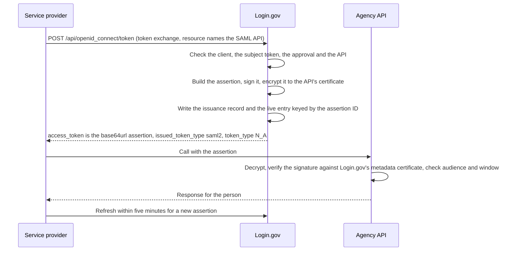

**The exchange request.** MyBenefits Assistant, the browser public client, exchanges its own access token for an assertion for the Retirement Benefits Portal's API. It names the API with `resource` and asks for the SAML format. The request carries `client_id` and a DPoP proof whose `ath` is over the subject token.

```http
POST /api/openid_connect/token HTTP/1.1
Host: idp.example.gov
Content-Type: application/x-www-form-urlencoded
DPoP: eyJ0eXAiOiJkcG9wK2p3dCIsImFsZyI6IkVTMjU2IiwiandrIjp7…

grant_type=urn%3Aietf%3Aparams%3Aoauth%3Agrant-type%3Atoken-exchange
&subject_token=2YotnFZFEjr1zCsicMWpAA…
&subject_token_type=urn%3Aietf%3Aparams%3Aoauth%3Atoken-type%3Aaccess_token
&requested_token_type=urn%3Aietf%3Aparams%3Aoauth%3Atoken-type%3Asaml2
&resource=https%3A%2F%2Fbenefits-api.retirement.example.gov
&client_id=urn%3Agov%3Agsa%3Aopenidconnect%3Asp%3Asinatra_sts
```

Notice that `requested_token_type` is optional. Omitting it, or sending `urn:ietf:params:oauth:token-type:access_token`, produces the same assertion because `benefits-api` is registered with `token_format: saml2`; only a value that is neither of the two known URNs is refused, with `invalid_request`.

**The response.** The assertion travels in `access_token`, base64url-encoded without padding, exactly as RFC 8693 §3 defines the `saml2` token type.

```json
{
  "access_token": "PHNhbWw6RW5jcnlwdGVkQXNzZXJ0aW9uIHhtbG5zOnNhbWw9InVybjpvYXNpcz…",
  "issued_token_type": "urn:ietf:params:oauth:token-type:saml2",
  "token_type": "N_A",
  "expires_in": 300,
  "scope": "token_exchange:retirement_benefits",
  "refresh_token": "8xLOxBtZp8…",
  "refresh_token_expires_in": 43200
}
```

Notice three things. `issued_token_type` names what Login.gov issued, whatever the request asked for. `token_type` is `N_A` because the assertion is not a credential at Login.gov's own endpoints. `expires_in` is 300 seconds, the assertion window, while the refresh token keeps the family's 12-hour lifetime.

**The decoded assertion.** The API decodes `access_token`, decrypts the `EncryptedAssertion` with its own key, and finds a signed `Assertion`. The sample below is shortened: the signature block, the `NameFormat` and `FriendlyName` attributes on each `Attribute`, and long values are elided.

```xml
<Assertion xmlns="urn:oasis:names:tc:SAML:2.0:assertion" ID="_5f0c2b1e-…" IssueInstant="2026-10-13T15:00:00Z" Version="2.0">
  <Issuer>https://idp.example.gov/api/saml</Issuer>
  <ds:Signature>…</ds:Signature>
  <Subject>
    <NameID Format="urn:oasis:names:tc:SAML:2.0:nameid-format:persistent">b2d9a7c4-…</NameID>
    <SubjectConfirmation Method="urn:oasis:names:tc:SAML:2.0:cm:bearer">
      <SubjectConfirmationData NotOnOrAfter="2026-10-13T15:05:00Z" Recipient="https://benefits-api.retirement.example.gov"/>
    </SubjectConfirmation>
  </Subject>
  <Conditions NotBefore="2026-10-13T14:59:55Z" NotOnOrAfter="2026-10-13T15:05:00Z">
    <AudienceRestriction>
      <Audience>https://benefits-api.retirement.example.gov</Audience>
    </AudienceRestriction>
  </Conditions>
  <AttributeStatement>
    <Attribute Name="uuid"><AttributeValue>b2d9a7c4-…</AttributeValue></Attribute>
    <Attribute Name="email"><AttributeValue>person@example.com</AttributeValue></Attribute>
    <Attribute Name="first_name"><AttributeValue>Pat</AttributeValue></Attribute>
    <Attribute Name="last_name"><AttributeValue>Example</AttributeValue></Attribute>
    <Attribute Name="verified_at"><AttributeValue>2026-01-15T12:00:00Z</AttributeValue></Attribute>
    <Attribute Name="aal"><AttributeValue>http://idmanagement.gov/ns/assurance/aal/2</AttributeValue></Attribute>
    <Attribute Name="ial"><AttributeValue>http://idmanagement.gov/ns/assurance/ial/2</AttributeValue></Attribute>
    <Attribute Name="delegation_scopes"><AttributeValue>token_exchange:retirement_benefits</AttributeValue></Attribute>
    <Attribute Name="delegation_id"><AttributeValue>4f0c9d2e-…</AttributeValue></Attribute>
    <Attribute Name="actor"><AttributeValue>urn:gov:gsa:openidconnect:sp:sinatra_sts</AttributeValue></Attribute>
    <Attribute Name="dpop_jkt"><AttributeValue>0ZcOCORZNYy-DWpqq30jZyJGHTN0d2HglBV3uiguA4I</AttributeValue></Attribute>
  </AttributeStatement>
  <AuthnStatement AuthnInstant="2026-10-13T14:00:00Z" SessionIndex="_5f0c2b1e-…">
    <AuthnContext>
      <AuthnContextClassRef>urn:acr.login.gov:verified</AuthnContextClassRef>
    </AuthnContext>
  </AuthnStatement>
</Assertion>
```

Notice the following. The `Issuer` is Login.gov's SAML metadata `entityID`, and the embedded certificate is the one the metadata publishes, so the API validates with what it already has. The `NameID` and the `uuid` attribute are the same value, the person's identifier for the National Retirement Administration. `SubjectConfirmationData` has no `InResponseTo`, because no request is being answered. Both `NotOnOrAfter` values are five minutes after `IssueInstant`, and `NotBefore` is five seconds before it. The attributes are the Retirement Benefits Portal's bundle (`email`, `first_name`, `last_name`, with `verified_at` because the application is identity-verified) plus the delegation attributes. `dpop_jkt` is present only because MyBenefits Assistant is a key-bound client. `AuthnInstant` is when the person signed in to the service provider, an hour before the assertion, and `AuthnContextClassRef` is the verified-identity context.

**The response once the sign-in has ended.** A refresh or exchange made after the person's sign-in to the service provider is over still issues an assertion, but the assertion carries only `uuid`, `email`, `aal`, `ial` and the delegation attributes (`all_emails` too, when bundled), and the token response adds one member:

```json
{
  "access_token": "PHNhbWw6RW5jcnlwdGVkQXNzZXJ0aW9u…",
  "issued_token_type": "urn:ietf:params:oauth:token-type:saml2",
  "token_type": "N_A",
  "expires_in": 300,
  "scope": "token_exchange:retirement_benefits",
  "refresh_token": "Q2hhbmdlZC…",
  "refresh_token_expires_in": 39600,
  "session_live": false
}
```

Notice that `session_live` appears only when it is `false`; a response without the member means the bundle is complete.

**A refresh.** The service provider refreshes every five minutes while it works. The refresh is the ordinary refresh grant; the family remembers that it issues assertions.

```http
POST /api/openid_connect/token HTTP/1.1
Host: idp.example.gov
Content-Type: application/x-www-form-urlencoded
DPoP: eyJ0eXAiOiJkcG9wK2p3dCIs…

grant_type=refresh_token&refresh_token=8xLOxBtZp8…&client_id=urn%3Agov%3Agsa%3Aopenidconnect%3Asp%3Asinatra_sts
```

The response has the same shape as the exchange response, with a new assertion (new `ID`, `IssueInstant` and windows, same `Audience` and `delegation_scopes`), a new refresh token, and `refresh_token_expires_in` counting down to the family's end. A refresh after the approval is revoked answers `invalid_grant`, and the previous assertion's live entry is gone.

**Introspection and revocation of an assertion.** An agency that wants to may still introspect. It presents the assertion `ID` it read from the XML as `token`, or the base64url- or base64-encoded plaintext assertion; Login.gov reads the `ID` out of the latter.

```http
POST /api/openid_connect/introspect HTTP/1.1
Host: idp.example.gov
Content-Type: application/x-www-form-urlencoded

token=_5f0c2b1e-…
&client_assertion_type=urn%3Aietf%3Aparams%3Aoauth%3Aclient-assertion-type%3Ajwt-bearer
&client_assertion=eyJhbGciOiJSUzI1NiJ9…
```

```json
{
  "active": true,
  "iss": "https://idp.example.gov/",
  "aud": "https://benefits-api.retirement.example.gov",
  "scope": "token_exchange:retirement_benefits",
  "client_id": "urn:gov:gsa:openidconnect:sp:sinatra_sts",
  "delegation_id": "4f0c9d2e-…",
  "token_type": "N_A",
  "iat": 1760367600,
  "exp": 1760367900,
  "cnf": { "jkt": "0ZcOCORZNYy-DWpqq30jZyJGHTN0d2HglBV3uiguA4I" },
  "sub": "b2d9a7c4-…",
  "act": { "sub": "urn:gov:gsa:openidconnect:sp:sinatra_sts" },
  "jti": "3b8f…",
  "acr": "urn:acr.login.gov:verified",
  "aal": "http://idmanagement.gov/ns/assurance/aal/2",
  "auth_time": 1760364000,
  "session_live": true,
  "email": "person@example.com",
  "email_verified": true,
  "given_name": "Pat",
  "family_name": "Example"
}
```

Notice that `token_type` is `N_A` and `jti` is the SHA-256 digest of the assertion `ID`. The encrypted encoded assertion cannot serve as `token`, because its `ID` is inside the ciphertext; Login.gov answers `{"active": false}` for it. Revocation at `POST /api/openid_connect/revoke` accepts the same two forms and ends that one assertion (`client_revoked` on its issuance record), leaving the family alive; revoking the refresh token ends the whole family.

**The configuration key.** The assertion window has its own default, separate from the opaque token's:

```yaml
token_exchange_saml_assertion_ttl_seconds: 300
```

The window is the smaller of this value, the API's `max_access_token_seconds` when set, and the time left until the family ends.

**The decision logic.**

1. The exchange validates the request as for any exchange. `requested_token_type`, when present, must be `urn:ietf:params:oauth:token-type:access_token` or `urn:ietf:params:oauth:token-type:saml2`; anything else is `invalid_request`. Client authentication, the subject token, the person's identity assurance, the `resource`, and the approval are checked exactly as in section 6, with the same error codes.
2. The resource server's `token_format` decides the format (`saml_issued?` is `resource_server.saml?`). A mismatch between the request and the registration is not an error; it is recorded on the exchange analytics event as `requested_token_type_mismatch: true`.
3. For a SAML API, `TokenExchangeToken.lifetime_seconds_for` takes `token_exchange_saml_assertion_ttl_seconds` as the default lifetime. A fresh assertion `ID` (`_<uuid>`) is chosen before anything is written, because its digest is the key of the live entry.
4. Inside one database transaction the issuance record is written with `token_format: saml2` and `token_type: N_A`, the assertion is built, signed and (when the API has a certificate) encrypted, and the refresh token row is written. A signing or encryption failure raises, the transaction rolls back, and no record, refresh token or live entry remains; the caller sees a server error rather than a token-endpoint error code.
5. After the transaction commits, the live entry is written to Redis under the digest of the assertion `ID`, with a lifetime equal to the window. The assertion XML is never stored.
6. The response is built; `session_live: false` is added only when the assertion carries identifiers only, because the service provider's sign-in no longer supplies the decrypted profile.
7. A refresh reads `token_format` from the family's issuance record and re-issues the same kind of token: a new assertion with the new token's times for a SAML family, an opaque token otherwise.

## Functional requirements

| Id | Requirement |
|---|---|
| **FR-TOK-9** | Login.gov MUST be able to issue a SAML 2.0 assertion instead of an OAuth token for an agency API that consumes SAML, with the same access, record-keeping and revocation behavior. The format is decided by the agency API's registration: the format registered for the API named in the request is the format issued. The service provider MAY name a format on the request. A request that names none is served, a request that names the registered format is served, and a request that names another format is served in the registered format, which the response states and Login.gov logs, rather than refused. An assertion is valid for five minutes, is always signed, and is encrypted to the agency's registered certificate when one exists. When an assertion is issued after the person's sign-in has ended, the response MUST say so with the same member the agency's verification uses (D45, D70, D73). |
| **FR-VER-9** | For SAML, the agency verifies the assertion locally against Login.gov's published signing certificate. The assertion MUST carry the same information as FR-VER-3 and FR-VER-4, and MUST be encrypted to the agency's certificate when one is registered. |

Rows owned by other sections that this branch gives effect to: **FR-TOK-23** (section 5; a key-bound assertion carries the thumbprint as the `dpop_jkt` attribute, and under D82 an assertion issued to a bearer public client carries none), **EXC-21** (section 6; `requested_token_type` is optional and the registered format is authoritative) and **FR-TOK-14** with **REF-8** (section 7; revocation by assertion `ID`).

## Protocol rows

| Id | Requirement |
|---|---|
| **SAML-1** | `requested_token_type` is OPTIONAL on the exchange (EXC-21). The resource server's registered `token_format` decides: `saml2` mints a SAML 2.0 assertion and `oauth` an OAuth token, whatever the request names or omits. A value that is neither `urn:ietf:params:oauth:token-type:access_token` nor `urn:ietf:params:oauth:token-type:saml2` fails with `invalid_request` (D70). |
| **SAML-2** | The response carries the base64url-encoded assertion without padding in `access_token` (not a `<samlp:Response>` wrapper; RFC 8693 §3 defines `saml2` as a base64url-encoded SAML 2.0 assertion), with `issued_token_type: urn:ietf:params:oauth:token-type:saml2`, `token_type: N_A`, `expires_in`, `scope`, `refresh_token` and `refresh_token_expires_in` per section 7, and `session_live: false` when SAML-5b applies. |
| **SAML-3** | The registered format is authoritative and a mismatch is not an error: a `saml2` request for an `oauth` API receives an OAuth token, an `access_token` request for a `saml2` API receives an assertion, `issued_token_type` states the format issued, and the exchange analytics record the requested value (D70). |
| **SAML-4** | `Conditions/@NotBefore` is the issuance instant minus 5 seconds. `Conditions/@NotOnOrAfter` and `SubjectConfirmationData/@NotOnOrAfter` are both the issuance record's lifetime counted from its `issued_at` (`token_exchange_saml_assertion_ttl_seconds`, 300, capped by the API's `max_access_token_seconds` and the family end), so no validator accepts an assertion past five minutes and the revocation delay of SAML-10 is bounded by the same figure. The assertion has: `Issuer` equal to Login.gov's SAML issuer; `Subject/NameID` in persistent format equal to the person's pairwise identifier for the agency; a bearer `SubjectConfirmation` whose `Recipient` is the resource server identifier; `Conditions/AudienceRestriction/Audience` equal to the resource server identifier and nothing else; and an `AuthnStatement` whose `AuthnContextClassRef` is the verified-identity ACR and whose `AuthnInstant` is the service provider sign-in's authentication time (the issuance instant if none). There is no `InResponseTo` (D45). |
| **SAML-5** | The `AttributeStatement` follows the existing SAML pattern: the attributes `AttributeAsserter` produces for the agency application's configured attribute bundle, exactly what that agency receives when the person signs in to it directly (`uuid`, `ial`, `aal`, and its bundled identity attributes such as email, name, address, date of birth and SSN where bundled), with `uuid` the agency-level identifier and `email` the address the person shares with the service provider, plus the delegation attributes `delegation_scopes` (the token's scope), `delegation_id` and `actor` (the service provider's issuer, the SAML counterpart of the OAuth `act` claim), and `dpop_jkt` for a key-bound family only (FR-TOK-23; a bearer public client's assertion carries none, D82). Nothing outside the agency application's bundle is ever included. |
| **SAML-5b** | Identity attributes come from the person's decrypted profile, which Login.gov holds only in the person's live session (`OutOfBandSessionAccessor#load_pii`, the same path `userinfo` uses). An assertion minted or refreshed while the service provider's Login.gov sign-in is live includes the bundled identity attributes. One minted once that sign-in has ended includes only `uuid`, `ial`, `aal`, `email`, `all_emails` and the delegation attributes, and the exchange or refresh response carries `session_live: false`, the member introspection uses (INT-10), present only then, so the service provider can send the person back through Login.gov if it needs attributes again (D73). |
| **SAML-6** | The assertion is always signed with the current `SamlEndpoint` key using the existing signature options, and is encrypted to the resource server's registered certificate when one is present, through the existing encryption path (SAML-13 governs the algorithm) (D45). |
| **SAML-7** | Every issued assertion is recorded as an issuance record in `token_exchange_tokens` with `token_format: saml2`, `token_type: N_A` and the same `aud`, `scope`, approval, `delegation_id`, actor and `expires_at` as an OAuth token; there is no `token_digest` column. The SHA-256 digest of `Assertion/@ID` keys the live Redis entry (`DelegatedTokenStore`), with a lifetime equal to the window; the assertion XML is never stored. Revocation (section 7) applies unchanged (D26). |
| **SAML-8** | `token_exchange_resource_servers.token_format` (`oauth` by default, or `saml2`) decides the issued format (SAML-1). SAML consumers validate assertions locally; no introspection is required or expected of them, though introspection by assertion `ID` remains available to any agency that wants it. |
| **SAML-9** | A refresh (section 7) re-issues an assertion with a new `ID`, `IssueInstant` and `NotOnOrAfter` when the family's issuance record carries `token_format: saml2`. It does not change `Audience` or `delegation_scopes`, and it re-checks the approval, so a revoked approval stops at the next refresh. Revocation (RFC 7009) accepts the assertion `ID`. With the five-minute window a service provider that works continuously refreshes every five minutes, up to 144 assertions over the 12-hour family; no rate limit refuses this (D37). |
| **SAML-10** | Each agency declares at onboarding whether its API treats a bearer assertion as single-use (SAML Profiles §4.1.4.5 replay protection; the reference resource server's default) or accepts reuse within the subject-confirmation window. A service provider treats assertions as single-use unless the agency says otherwise, refreshing before each call. A revoked approval's assertion already delivered to the API remains usable until its window ends, at most five minutes; revocation otherwise takes effect at the next refresh. |
| **SAML-11** | The assertion's `Issuer` equals the metadata `entityID` (`SamlIdp.config.base_saml_location`), the embedded `X509Certificate` is byte-identical to the metadata certificate, and no Condition type other than `AudienceRestriction` is emitted, because `ruby-saml`-based validators reject each of those. |
| **SAML-12** | Revocation and introspection accept either the assertion `ID` exactly as it appears in the XML (with its leading underscore, since that value is what is digested) or the encoded plaintext assertion as `token` (`DelegatedSamlAssertion.reference_for`). Revocation by either ends that assertion only, as for an opaque access token; the family is revoked by its refresh token. An encrypted encoded assertion cannot serve as the `token` because its ID is inside the ciphertext; the service provider revokes such a family by refresh token, or the assertion by the ID the resource server reads after decrypting (D69). |
| **SAML-13** | Encryption follows the agency application's `block_encryption` when it encrypts responses and `aes256-cbc` otherwise, with `rsa-oaep-mgf1p` key transport, through the existing encryption path. A registered certificate always means an encrypted assertion, and onboarding validates the certificate. |
| **SAML-14** | Identifiers-only (SAML-5b) keeps `uuid`, `ial`, `aal`, `email`, `all_emails` and the delegation attributes; `verified_at` is dropped with the bundle; `locale` and x509 attributes are never emitted. The `ial` and `aal` attributes use the legacy classref form the agency already receives at direct sign-in, while `AuthnContextClassRef` is the verified ACR. The token response states the case with `session_live: false` and no other member (D73). |
| **SAML-15** | The assertion is built inside the issuance-record transaction, so a signing or encryption failure (for example an unparseable resource-server certificate) leaves no record and no live entry; it surfaces as a server error rather than a token-endpoint error code. The prepended gem extension copies `AssertionBuilder#fresh`; a regression spec compares browser-flow output with the gem's method byte for byte so a `saml_idp` upgrade fails loudly instead of drifting silently. |

## As built

1. The builder extension. `lib/saml_idp_extensions/assertion_builder.rb` is prepended to `SamlIdp::AssertionBuilder` from `config/initializers/saml_idp.rb` and generalizes the gem in three ways. `SubjectConfirmationData/@InResponseTo` is emitted only when there is a request id, because the gem otherwise writes an empty one that relying parties reject. A `subject_confirmation_expiry:` keyword sets the bearer confirmation window in place of the gem's fixed three minutes. An `issue_instant:` keyword pins `IssueInstant`, so it and both `NotOnOrAfter` values agree to the second with the issuance record. The method `fresh` is the gem's method with one line changed, and `raw` is re-aliased to it so signing and encryption read the new version. `spec/lib/saml_idp_extensions/assertion_builder_spec.rb` compares browser-flow output with the gem's own method byte for byte.
2. The adapter. `DelegatedSamlAssertion` (`app/services/delegated_saml_assertion.rb`, `#initialize(issued:, assertion_id:, issued_at:, lifetime_seconds:)`) feeds the builder what an AuthnRequest and the browser session normally supply. `Issuer` is the metadata `entityID`. The persistent `NameID` comes from `DelegatedTokenClaims#agency_sub`. The bearer `SubjectConfirmation` has `Recipient` equal to the resource server identifier and no `InResponseTo`. `Audience` is the same identifier. Both `NotOnOrAfter` values are the issuance record's lifetime counted from `issued_at`. `AuthnInstant` is the sign-in's `identities.last_authenticated_at`, and `AuthnContextClassRef` is the verified-identity ACR. The attribute statement is `AttributeAsserter`'s output for the agency application's bundle (the asserter now accepts `authn_request: nil` together with the issuance record's `ial` and `aal`), with `uuid` re-pointed at the agency identifier, `email` at the shared address, `locale` dropped, and `delegation_scopes`, `delegation_id`, `actor` and, when `issued.key_bound?`, `dpop_jkt` added. While `DelegatedTokenClaims#session_live?` is true the decrypted profile is read through `OutOfBandSessionAccessor#load_pii`; otherwise `#identifiers_only?` is true and only `uuid`, `ial`, `aal`, `email`, `all_emails` and the delegation attributes remain. The assertion is signed with the current `SamlEndpoint` key and encrypted to `resource_server.ssl_certs.first` when a certificate is registered (`#encryption_opts` uses the application's `block_encryption` or `aes256-cbc`, with `rsa-oaep-mgf1p` key transport, through `builder.encrypt(sign: true)`); it is returned signed in the clear when no certificate is registered.
3. Issuance. In `OpenidConnectTokenExchangeForm#issue!`, when `resource_server.saml?` is true, whatever `requested_token_type` says or omits, the issuance record carries `token_format: saml2` and `token_type: N_A` for both client types, and the assertion is built inside the transaction. `DelegatedTokenStore` is keyed by the SHA-256 digest of the assertion `ID` (`_<uuid>`, from `DelegatedSamlAssertion.new_assertion_id`, chosen before the record is written) with a lifetime equal to the window; the XML is never stored. `TokenExchangeToken.lifetime_seconds_for(token_format:)` takes `token_exchange_saml_assertion_ttl_seconds` (300, declared in `lib/identity_config.rb` and `config/application.yml.default`) as the default for `saml2`, capped by `max_access_token_seconds` and the family end. The response carries `access_token` (the base64url assertion), `issued_token_type` (the saml2 URN), `token_type: N_A`, `expires_in`, `scope`, `refresh_token`, `refresh_token_expires_in`, and `session_live: false` only when `@assertion.identifiers_only?`.
4. Refresh. `OpenidConnectRefreshTokenForm#mint!` re-issues what the exchange issued. `TokenExchangeRefreshToken#token_format` and `#saml?` read the family's issuance record. A SAML family gets a new assertion with a new `ID`, `IssueInstant` and windows from the renewed times, for the same audience and access, after the usual approval checks. `token_type` is copied from the record, and the response carries `issued_token_type` saml2 and `session_live: false` once the sign-in has ended.
5. Referencing an assertion. `DelegatedSamlAssertion.reference_for(presented)` returns the `ID` of a base64url- or base64-encoded plaintext `<saml:Assertion>` (at most 64 KB, parsed strictly without network access, with the root element and namespace checked) and otherwise returns the presented value itself. `OpenidConnectIntrospectForm` and `OpenidConnectRevokeForm` therefore accept an assertion `ID` or the encoded assertion as `token`; an encrypted assertion hides its ID and is answered not active or not acted on. Introspection reports `token_type: N_A`, `cnf.jkt` for a bound family and `jti` equal to the digest of the ID. Revocation by ID or by encoded assertion ends that assertion alone (`client_revoked`).
6. Removals. This branch removes the exchange branch's refusal of a SAML API (`validate_token_format` and its `saml_not_available` locale string in en, es, fr and zh), because the exchange can now serve that API. The analytics property `requested_token_type_mismatch` stays: it records that a service provider asked for a format other than the API's registered one, which the exchange ignores (D70). There is no migration: `token_format` on `token_exchange_resource_servers` and `token_exchange_tokens` comes from the registry and exchange branches.
7. Fixture. The SAML API in `config/delegated_access.localdev.yml` (`https://benefits-api.retirement.example.gov`, `token_format: saml2`) keeps its encryption certificate; the assertion is encrypted when the certificate file is present locally and is returned signed in the clear when it is not.
8. Verification. The six specs this branch touches pass together with 407 examples. `spec/requests/openid_connect/saml_assertion_exchange_spec.rb` covers a bound public client, a bearer public client and a confidential client end to end: the encrypted and signed assertion checked as a relying party checks it, the attribute set with `dpop_jkt` for a bound public client, the configured window, refresh with identifiers only after the sign-in ends, introspection by ID and by encoded assertion, and revocation by ID, by encoded assertion and by refresh token. The others are `spec/services/delegated_saml_assertion_spec.rb`, `spec/lib/saml_idp_extensions/assertion_builder_spec.rb`, `spec/services/attribute_asserter_spec.rb`, `spec/models/token_exchange_token_spec.rb` and `spec/requests/openid_connect/token_exchange_spec.rb`. Rubocop is clean.

## Decisions

- **D44** A required `requested_token_type` with the service provider choosing the format; D70 supersedes this decision.
- **D45** Five-minute subject-confirmation and conditions windows; always signed; encrypted to the agency's registered certificate when one exists.
- **D69** Revoking a SAML assertion by ID ends that assertion only; the family is revoked by its refresh token.
- **D70** The agency's registered `token_format` decides the issued token type; `requested_token_type` is optional, and a mismatch is served in the registered format and logged, not refused.
- **D73** An assertion issued after the sign-in ended is signaled with `session_live: false` on the token response, present only when false.
- **D82** Key binding is a per-client setting; an assertion issued to a bearer public client carries no `dpop_jkt` attribute.

## How to review

- Diff against `delegated-access-introspection`.
- Check first: that the builder extension is a no-op for the browser flow (the byte-for-byte spec); the assertion's `Issuer`, `Audience`, `Recipient` and both `NotOnOrAfter` values against the issuance record; which attributes appear once the sign-in has ended, and that `session_live: false` appears only then; that `dpop_jkt` is present for a bound family and absent for a bearer one; the input limits of `reference_for` (64 KB, strict parsing, no network); and that `resource_server.saml?` alone decides the format while the response states it.
- Specs that prove it: `saml_assertion_exchange_spec.rb`, `delegated_saml_assertion_spec.rb`, `assertion_builder_spec.rb`, the attribute asserter spec and the token model spec.
- Must not change for existing clients: the SAML browser flow's assertions are byte-identical to the gem's own output; `AttributeAsserter` with an AuthnRequest behaves as before; the OAuth exchange and refresh responses for an `oauth` API are unchanged; a service provider itself signs in with OpenID Connect, and SAML is only the format issued for the agency API.
- Open items: revocation of an issued assertion is observed by the agency only at expiry, bounded to five minutes (D45); revoke-by-ID ending the assertion only, not the family, is recorded for review (D69); accepting the bare assertion `ID` as the RFC 7009 `token` is a Login.gov extension flagged for review (E14); `DelegatedTokenClaims` exposing identity, email and profile data to the builder, so that `DelegatedSamlAssertion` stops reading them itself, is held until the harness run (Appendix D); which agencies need SAML rather than OAuth, and whether any needs both, is unanswered.

# 10. `delegated-access-operations`: discovery metadata, monitoring, the fixture contract and the threat sweep

**Stack position** 10 of 14, on `delegated-access-saml-assertions`.

## Objective

This branch makes the delegated-access capability observable and switchable as one unit, and it fixes the contract between the identity provider and the three reference applications that partners use to integrate.

The discovery document at `/.well-known/openid-configuration` advertises the token-exchange and refresh grants, the introspection and revocation endpoints, the `none` client-authentication method for the browser public client, and the key-possession proof algorithms, but only while the master switch `token_exchange_enabled` is on. With the switch off, the document is, member for member and in the same order, the one Login.gov publishes without this work. A partner therefore never discovers an endpoint that would answer `unsupported_grant_type` or 404, and nothing about delegation is advertised when Login.gov has turned it off.

Monitoring is done from the analytics stream rather than from refusals. Every delegated-access event names the caller with one property: `service_provider_issuer` for a service provider and `resource_server_identifier` for an agency API. One filter therefore selects a caller across issuance, renewal, revocation, verification, consent and account-page events, and operations alarms apply volume and error-rate thresholds to that stream. No registered caller is refused for volume.

The local fixture `config/delegated_access.localdev.yml` is the single contract between the seeder, the reference applications and the end-to-end harness. Its header names the three applications, their fictitious operators and the environment variables that relocate them to a sandbox, and the seeder specification asserts everything the reference applications read from it. A change to an issuer, a scope value or an API identifier is therefore visibly a change to the reference applications.

A threat sweep pins the cross-cutting refusals end to end on the integrated endpoints: foreign tokens, replayed proofs, bearer presentation of a bound token, delegated tokens at the user-information endpoint, and exchange after revocation or deactivation. Each refusal is checked for the analytics event that operations alert on.

## How it works

**Discovery.** `OpenidConnectConfigurationPresenter` builds the document from a fixed baseline and adds the delegated-access members only when the switch is on.

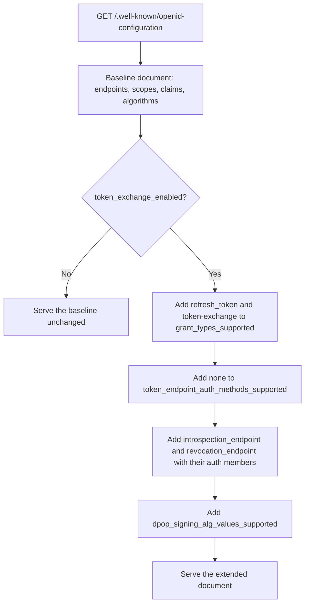

With the switch on, the document reads as follows. The members this branch adds or extends are the last seven and the two marked in `grant_types_supported` and `token_endpoint_auth_methods_supported`; everything else is the baseline. Long lists are shortened with `…`.

```json
{
  "acr_values_supported": ["urn:acr.login.gov:auth-only", "urn:acr.login.gov:verified", "…"],
  "claims_supported": ["iss", "sub", "email", "…"],
  "grant_types_supported": [
    "authorization_code",
    "refresh_token",
    "urn:ietf:params:oauth:grant-type:token-exchange"
  ],
  "response_types_supported": ["code"],
  "scopes_supported": ["email", "all_emails", "locale", "openid", "profile:verified_at", "…"],
  "subject_types_supported": ["pairwise"],
  "authorization_endpoint": "https://idp.example.gov/openid_connect/authorize",
  "issuer": "https://idp.example.gov/",
  "jwks_uri": "https://idp.example.gov/api/openid_connect/certs",
  "service_documentation": "https://developers.login.gov/",
  "token_endpoint": "https://idp.example.gov/api/openid_connect/token",
  "userinfo_endpoint": "https://idp.example.gov/api/openid_connect/userinfo",
  "end_session_endpoint": "https://idp.example.gov/openid_connect/logout",
  "id_token_signing_alg_values_supported": ["RS256"],
  "token_endpoint_auth_methods_supported": ["private_key_jwt", "none"],
  "token_endpoint_auth_signing_alg_values_supported": ["RS256"],
  "introspection_endpoint": "https://idp.example.gov/api/openid_connect/introspect",
  "introspection_endpoint_auth_methods_supported": ["private_key_jwt", "none"],
  "introspection_endpoint_auth_signing_alg_values_supported": ["RS256"],
  "revocation_endpoint": "https://idp.example.gov/api/openid_connect/revoke",
  "revocation_endpoint_auth_methods_supported": ["private_key_jwt", "none"],
  "revocation_endpoint_auth_signing_alg_values_supported": ["RS256"],
  "dpop_signing_alg_values_supported": ["ES256", "RS256"]
}
```

Notice that there is no `token_exchange_endpoint` (RFC 8693 uses the token endpoint, which is already advertised), that `scopes_supported` lists only the standard scopes and no `token_exchange:*` value, and that `none` appears on the token, introspection and revocation members because the browser public client calls all three with `client_id` and a key-possession proof and no client authentication. With the switch off, `grant_types_supported` is `["authorization_code"]`, `token_endpoint_auth_methods_supported` is `["private_key_jwt"]`, and the last seven members are absent.

**Monitoring.** Every delegated-access event carries the caller under one of two property names. Two events, as the analytics stream records them:

```json
{
  "name": "delegation_consent_submitted",
  "service_provider_issuer": "urn:gov:gsa:openidconnect:sp:sinatra_sts",
  "applications": ["urn:gov:gsa:openidconnect:sp:records_agency", "urn:gov:gsa:SAML:2.0.profiles:sp:sso:benefits_agency"],
  "remembered": false,
  "newly_approved_count": 2
}
```

```json
{
  "name": "openid_connect_introspect",
  "success": true,
  "caller_type": "resource_server",
  "resource_server_identifier": "https://records-api.housing.example.gov",
  "service_provider_issuer": null,
  "active": false,
  "error_code": null
}
```

Notice that a consent-screen event and an introspection event name the service provider with the same property, `service_provider_issuer`, and that the agency API appears as `resource_server_identifier`. A filter on either property selects one caller across every event kind. A refusal carries the RFC error code in `error_code`.

The alert thresholds live in the deployment's alarms over this stream, not in the application. The current values, per caller over a one-minute window, are:

```text
error rate            5 percent      on openid_connect_token_exchange, openid_connect_token_refresh,
                                     openid_connect_revoke and openid_connect_introspect
exchanges             1000 per minute
introspections        6000 per minute
refreshes             1000 per minute
```

Nothing in the application refuses a caller for volume, and no `token_exchange_alert_*` key exists in `lib/identity_config.rb` or `config/application.yml.default`.

**The fixture contract.** The header of `config/delegated_access.localdev.yml` states the contract and names the three reference applications:

```yaml
# This file is the one contract between the identity-idp seed task and the three reference
# applications with their end-to-end harness: the harness reads issuers, API identifiers, scope
# values, redirect URIs and hostnames from here and from nowhere else.
#
#   MyBenefits Assistant        the service provider the person signs in to; a browser public
#                               client (PKCE, DPoP, no secret) on :9292, relocated with
#                               DELEGATION_SP_URL
#   Housing Assistance Records  the Department of Housing Support's application with the OAuth
#                               API https://records-api.housing.example.gov (scope value
#                               housing_records), on :9393, relocated with
#                               DELEGATION_OIDC_AGENCY_URL
#   Retirement Benefits Portal  the National Retirement Administration's application with the
#                               SAML API https://benefits-api.retirement.example.gov (scope value
#                               retirement_benefits), on :4567, relocated with
#                               DELEGATION_SAML_AGENCY_URL
#
# A sandbox seeds this same file with those three variables set to its hostnames. The API
# identifiers are RFC 8707 resource indicators and never change with the hostname.
```

The records the header describes, shortened to the values the harness reads:

```yaml
service_providers:
  'urn:gov:gsa:openidconnect:sp:sinatra_sts':
    agency_id: 100
    friendly_name: 'MyBenefits Assistant'
    pkce: true
    dpop_required: true
    redirect_uris:
      - '<%= ENV.fetch("DELEGATION_SP_URL", "https://mybenefits.example.gov") %>/'
      - '<%= ENV.fetch("DELEGATION_SP_URL", "https://mybenefits.example.gov") %>/auth/result'
      - '<%= ENV.fetch("DELEGATION_SP_URL", "https://mybenefits.example.gov") %>/logout'
    token_exchange_enabled_sp: true
  'urn:gov:gsa:openidconnect:sp:records_agency':
    agency_id: 101
    friendly_name: 'Housing Assistance Records'
    delegation_scope_value: 'housing_records'
    allowed_delegation_service_providers: []
    token_exchange_resource_servers:
      - identifier: 'https://records-api.housing.example.gov'
        token_format: 'oauth'
  'urn:gov:gsa:SAML:2.0.profiles:sp:sso:benefits_agency':
    agency_id: 102
    friendly_name: 'Retirement Benefits Portal'
    acs_url: '<%= ENV.fetch("DELEGATION_SAML_AGENCY_URL", "https://portal.retirement.example.gov") %>/consume'
    delegation_scope_value: 'retirement_benefits'
    allowed_delegation_service_providers:
      - 'urn:gov:gsa:openidconnect:sp:sinatra_sts'
    token_exchange_resource_servers:
      - identifier: 'https://benefits-api.retirement.example.gov'
        token_format: 'saml2'
```

Notice that the service provider has `pkce: true`, `dpop_required: true` and no certificates, that the hosts come from environment variables while the two API identifiers do not, and that no API entry carries a `dpop_required` key: whether tokens are bound follows the service provider's client type alone.

**The threat sweep.** `spec/requests/openid_connect/delegated_access_threats_spec.rb` runs each scenario below through the real HTTP endpoints with MyBenefits Assistant as a bound browser public client, Housing Assistance Records as the API the token is issued for, and Retirement Benefits Portal as the API it is not. Each line states the attack, the answer, and the analytics evidence.

```text
A subject token that belongs to another client, in both directions
    -> invalid_grant at the exchange; no issuance record; openid_connect_token_exchange logged
       with service_provider_issuer and error_code for each presenter
A key-bound sign-in token presented as a bearer token at userinfo
    -> 401 with WWW-Authenticate: DPoP algs="ES256 RS256", error="invalid_token";
       accepted under the DPoP scheme with a proof
A delegated token at userinfo, with and without a proof
    -> 401 both times
A proof replayed at the exchange with the same jti
    -> accepted once, then invalid_dpop_proof (dpop_proof_replayed); one record only
A proof replayed at another endpoint (exchange, then introspection)
    -> 401 invalid_dpop_proof: the jti is spent for that key everywhere
A proof for another URL or method (introspection URL, userinfo URL, GET) at the exchange
    -> invalid_dpop_proof (dpop_proof_invalid); no record
An expired proof at the exchange and at userinfo
    -> invalid_dpop_proof at both; userinfo adds the DPoP challenge header
A refresh with a key other than the family's
    -> invalid_dpop_proof (dpop_key_mismatch); the refresh token is neither rotated nor revoked;
       the right key still refreshes; openid_connect_token_refresh logged with both caller
       properties and error_code
Introspection by an API the token is not issued for
    -> exactly {"active": false}, logged with active false; the right API still learns everything
An exchange after the approval is revoked
    -> consent_required naming token_exchange:housing_records; the earlier token is not active
An exchange after Login.gov withdrew its approval of the service provider
    -> invalid_client (client_not_approved); the earlier token is not active
An exchange after the API URL, or the application, is deactivated
    -> invalid_target (unknown_resource); the earlier token is not active
```

Notice that every refusal is checked twice: once for the HTTP answer and once for the analytics event, its caller property and its `error_code`, which is what the alarms above read.

## Functional requirements

| Id | Requirement |
|---|---|
| **FR-OPS-2** | Login.gov MUST monitor issuance, renewal, verification and revocation volumes and errors, approved-but-unused delegations, fraud-signal delivery completeness and billing correlation. The identity provider's part is the analytics stream: every delegated-access event names the caller with the same property (`service_provider_issuer` or `resource_server_identifier`) and carries the RFC error code on a refusal. Alert thresholds are deployment alarms over that stream, not application configuration, and no registered caller is refused for volume. Approved-but-unused delegations are reported by section 11 and fraud-signal completeness by section 12. |
| **FR-OPS-4** | Rollout MUST proceed from local and sandbox testing with reference applications, to one service provider and one agency in the sandbox, to fraud-signal and billing verification, to production, with a review gate at each step. The reference setup the identity provider carries is one fixture file that names the three reference applications and relocates them to a sandbox by environment variables, with the API identifiers unchanged by hostname. The service provider reference application is a browser-based public client that signs in with PKCE, holds its key-possession key in the browser only (non-extractable, a new key per sign-in) and makes the code exchange, token issuance, renewal, revocation and the agency API calls from the browser with key-possession proofs; its server serves static files and a non-secret configuration and holds no private key or shared secret (D57). The agency reference APIs and Login.gov's revocation and verification endpoints accept cross-origin browser calls so that client can reach them (D59; FR-TOK-14, FR-VER-6). |
| **FR-OPS-5** | Login.gov MUST provide working reference applications for both partner roles (service provider and agency API, OAuth and SAML) and an automated end-to-end test that partners can run against the sandbox. The harness reads issuers, API identifiers, scope values, redirect URIs and hostnames from the fixture file and from nowhere else (D51). The service provider reference is the browser public client of FR-OPS-4 (D57). Fraud-signal viewer code is carried only by the OAuth agency reference, which had it before this project, and the SAML agency's events can be observed through it (D58). |

Rows owned by other sections and referenced here: **FR-OPS-1** (the master switch, section 1; this branch delivers its discovery half, DISC-5). **FR-OPS-3** and **FR-OPS-6** (security review and partner guides) are delivered outside the repository (section 15). The removal of the per-API key-binding column is owned by section 5 (D64): **FR-TOK-22**, **FR-TOK-24**.

## Protocol rows

| Id | Requirement |
|---|---|
| **DISC-1** | `/.well-known/openid-configuration` advertises every new grant type and endpoint under the metadata names of OpenID Connect Discovery 1.0 and RFC 8414 §2. `grant_types_supported` adds `refresh_token` and `urn:ietf:params:oauth:grant-type:token-exchange`. `token_endpoint_auth_methods_supported` adds `none` beside `private_key_jwt` for the public-client service provider. `introspection_endpoint` is listed with `introspection_endpoint_auth_methods_supported` (`private_key_jwt`, `none`) and `introspection_endpoint_auth_signing_alg_values_supported` (`RS256`), and `revocation_endpoint` with the same two members. `none` appears on the introspection and revocation members because the public-client service provider calls both with `client_id` and a key-possession proof and no client authentication. |
| **DISC-2** | Discovery includes `dpop_signing_alg_values_supported` with `ES256` and `RS256` (RFC 9449 §5.1) while delegated access is enabled (D46). |
| **DISC-3** | No non-standard metadata key is added. There is no `token_exchange_endpoint`: RFC 8693 performs the exchange at the token endpoint, which is already advertised. |
| **DISC-4** | `scopes_supported` remains the static list of standard scopes. `token_exchange:*` values are per partner and are not enumerated in discovery; the developer documentation describes the prefix. |
| **DISC-5** | Every member above appears only when `token_exchange_enabled` is true, so the document never advertises something that returns `unsupported_grant_type` or 404. With the switch off the document equals the pre-delegation document member for member and in key order (D48). |

## As built

1. Discovery. `OpenidConnectConfigurationPresenter` adds, only while `token_exchange_enabled` is on: `refresh_token` and `OpenidConnectTokenExchangeForm::GRANT_TYPE` in `grant_types_supported`; `none` in `token_endpoint_auth_methods_supported`; `introspection_endpoint` and `revocation_endpoint`, each with `*_auth_methods_supported` (`private_key_jwt`, `none`) and `*_auth_signing_alg_values_supported` (`RS256`); and `dpop_signing_alg_values_supported` taken from `DpopProofVerifier::ALLOWED_ALGORITHMS`. There is no `token_exchange_endpoint`, and `scopes_supported` stays static. `spec/presenters/openid_connect_configuration_presenter_spec.rb` (11 examples) holds the off-state document as a literal and asserts member and key-order equality.
2. One caller property. The delegated-access analytics events `delegation_consent_submitted` (`app/controllers/sign_up/completions_controller.rb`), `delegation_account_approved` (`app/controllers/accounts/delegated_access/approvals_controller.rb`) and `delegation_account_revoked` (`app/controllers/accounts/delegated_access/revocations_controller.rb`) log the service provider as `service_provider_issuer`, as `openid_connect_token_exchange`, `openid_connect_token_refresh`, `openid_connect_revoke` and `openid_connect_introspect` already do. Agency callers are named by `resource_server_identifier`. The docstrings in `app/services/analytics_events.rb` describe each property.
3. Alert thresholds live in the deployment's alarms over the analytics stream, per caller over a one-minute window: an error rate of 5 percent on the four token events, 1000 exchanges per minute, 6000 introspections per minute and 1000 refreshes per minute. No `token_exchange_alert_*` key exists in `lib/identity_config.rb` or `config/application.yml.default`, and nothing in the application refuses a caller for volume.
4. The fixture contract. The header of `config/delegated_access.localdev.yml` names the three reference applications and their fictitious operators, with the variable that relocates each: `DELEGATION_SP_URL` for the browser public client MyBenefits Assistant of the Office of Benefits Coordination on port 9292; `DELEGATION_OIDC_AGENCY_URL` for Housing Assistance Records of the Department of Housing Support, with the OAuth API `https://records-api.housing.example.gov` and scope value `housing_records`, on port 9393; and `DELEGATION_SAML_AGENCY_URL` for Retirement Benefits Portal of the National Retirement Administration, with the SAML API `https://benefits-api.retirement.example.gov` and scope value `retirement_benefits`, on port 4567. `spec/services/delegated_access_seeder_spec.rb` asserts the service provider's issuer, friendly name, agency, identity-verified level (IAL2), `pkce` with no certificates and no Attempts API credentials, its three redirect URIs and its per-client `dpop_required: true`; each application's agency, scope value, accepted service providers, API identifier (an RFC 8707 resource indicator, unchanged by hostname), token format and active state; the relocation of all three hosts, redirect URIs, ACS URL and learn-more URLs from the environment; and that no API entry carries a `dpop_required` key.
5. The threat sweep. `spec/requests/openid_connect/delegated_access_threats_spec.rb` (13 examples) runs on the integrated endpoints: a subject token belonging to another client, in both directions; a key-bound sign-in token presented as a bearer token at the user-information endpoint (refused with the `DPoP` challenge, accepted with the proof); a delegated token at the user-information endpoint with and without a proof; a replayed `jti` at the same endpoint and at another; a proof for another URL; an expired proof at the exchange and at the user-information endpoint; a refresh with a key other than the family's (the family stays intact for the right key); introspection by an API the token is not issued for (`active: false`); and an exchange after the approval is revoked, after Login.gov withdraws its approval of the service provider (`invalid_client`), and after the API URL or the application is deactivated (`invalid_target`), each with the earlier token dead. Every refusal is checked for its analytics event, caller property and `error_code`.
6. Migrations: none. Configuration: the `config/delegated_access.localdev.yml` header and contract. Verification: the threat sweep (13 examples), the presenter spec (9), the touched specs together (94: presenter, seeder, the three controller specs and the sweep), the i18n spec (65); rubocop and the analytics-events lint are clean.

## Decisions

- **D37** Monitoring thresholds alert; nothing refuses a registered caller for volume (full entry in section 16).
- **D46** Key-possession proof algorithms are `ES256` and `RS256`, advertised in discovery.
- **D48** Discovery advertises the delegation metadata only while `token_exchange_enabled` is on.
- **D51** One fixture file is the contract between the seeder and the end-to-end harness.
- **D57** The service provider reference application is a browser-based public client.
- **D58** Fraud-signal viewer code stays only in the OAuth agency reference.
- **D59** Cross-origin browser calls are accepted at the agency reference APIs and at revocation and verification.
- **D64** The discovery members stay on this branch because the presenter names routes that exist only from the lifecycle and introspection branches on; the per-API key-binding removal belongs to section 5.

## How to review

- Diff against `delegated-access-saml-assertions`.
- Check first: that the presenter's off-state literal equals the document Login.gov publishes today, member for member and in order; the on-state members against RFC 8414 §2 and RFC 9449 §5.1; and the fixture header against what the three reference applications read. Then read the threat sweep as the integrated acceptance test for sections 5 to 9: each example names the requirement it pins and the analytics event operations alert on.
- Specs that prove it: `spec/presenters/openid_connect_configuration_presenter_spec.rb` (9), `spec/requests/openid_connect/delegated_access_threats_spec.rb` (13), `spec/services/delegated_access_seeder_spec.rb` (the contract examples), and the three controller specs for the caller property.
- Must not change for existing clients: with the switch off the discovery document is unchanged; the analytics property change touches only the three delegated-access events; `scopes_supported` is unchanged in both states.
- Open items: the browser client's scope names are out of contract with `token_exchange:housing_records` and `token_exchange:retirement_benefits`, and the client, not the fixture, is being corrected; the passport agency's direct-service-provider record for the document-images allow-list is not in the fixture (section 15.1); four pre-existing environment failures in the full suite (three browser specs needing the sample service provider's port, one layout spec needing undigested asset names) recur on every branch above; FR-OPS-3 and FR-OPS-6 are outside this repository.

# 11. `delegated-access-billing-reporting`: billing delegated use to the agency and reporting on delegation outcomes

**Stack position** 11 of 14, on `delegated-access-operations`.

## Objective

This branch makes delegated use billable to the agency whose API received the delegated token, using the same billing table and the same invoice reports that direct sign-ins already flow through. It also gives Login.gov a monthly view of what is requested, approved and used.

When a service provider exchanges its own sign-in for a delegated token, the exchange writes one billing row to `sp_return_logs` under the agency API's billing issuer. The row is marked `delegated` and carries the identity assurance level the sign-in is billed at. The first exchange under an approval is the billable row; later exchanges under the same approval are recorded as a non-billable trail; renewals with a refresh token write nothing. The billing table gains exactly one new column. The acting service provider, the API and whether the person verified identity during that sign-in are not stored on the billing row. Reports read them by joining from the billing row, through an append-only adjustment row, to the token issuance record. That keeps the invoice history reproducible: the billing table is never rewritten.

The service provider is billed for its own sign-in by default, like any customer. When a delegated token is issued for that sign-in, the sign-in's charge is waived, because the agencies receiving the tokens are billed instead. The waiver never modifies the sign-in's row. At the handoff, Login.gov writes a short-lived Redis link, keyed by the digest of the service provider's access token and held for one hour, pointing at the sign-in's billing row. At the first exchange, Login.gov follows that link, or when the link has lapsed, searches its own records, and appends an adjustment row that excludes the sign-in row from the invoice queries. The exchange is never refused or delayed for billing reasons.

Billing in this repository has a data team that owns the invoice rules. Where this document disagrees with the repository billing skill, the skill governs. The questions the data team has not yet answered stand as built (D75) and are listed under How to review.

## How it works

The decision an exchange makes about billing, in order:

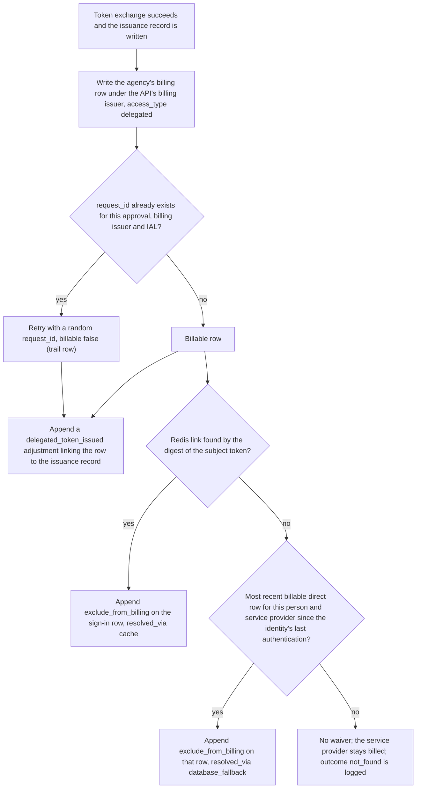

A renewal with a refresh token never reaches this flow and writes nothing. Every write runs inside a savepoint in the exchange's transaction and every error is reported and swallowed, so billing can never fail an exchange.

At the handoff of a sign-in to a service provider approved for delegation, Login.gov writes the link that the exchange later follows. The key is the SHA-256 digest of the access token the service provider is about to receive; the value is the id of the sign-in's billable billing row; the entry lives for `token_exchange_billing_waiver_cache_seconds` (3600 seconds by default).

```text
Redis key    delegated-access-sign-in-return:3f9a…c21e
Redis value  "48213"
TTL          3600 seconds
```

What to notice: only the token's digest is stored, never the token, so the entry is useless without the token itself, and the value is nothing more than a row id.

The agency's billing row, with the columns of `sp_return_logs` as the migrations define them. Here MyBenefits Assistant exchanged a verified sign-in for a token addressed to the Housing Assistance Records API. The fixture sets no `billing_issuer` on that API, so the billing issuer defaults to the application's own issuer.

```yaml
id: 48214
request_id: "tx:dlg_Qm3x…:urn:gov:gsa:openidconnect:sp:records_agency:2"
user_id: 1021
billable: true
ial: 2
issuer: "urn:gov:gsa:openidconnect:sp:records_agency"
profile_id: 377
profile_verified_at: "2026-09-02T14:07:11Z"
profile_requested_issuer: "urn:gov:gsa:openidconnect:sp:sinatra_sts"
returned_at: "2026-10-13T15:31:04Z"
access_type: "delegated"
```

What to notice: `request_id` is deterministic (`tx:<delegation_id>:<billing issuer>:<ial>`), so the existing unique index on `request_id` is what makes the first exchange under an approval the only billable one. `access_type` is the only column this branch adds; nothing names the service provider or the API on the row itself.

The two adjustment rows the same exchange appends to `sp_return_log_billing_adjustments`. The first links the agency row to the issuance record; the second waives the service provider's own sign-in row (id 48213, found through the Redis link).

```yaml
- id: 901
  sp_return_log_id: 48214          # the agency's delegated row
  adjustment_type: 2               # delegated_token_issued
  delegated_return_log_id: null
  token_exchange_token_id: 5102
  resolved_via: null
  created_at: "2026-10-13T15:31:04Z"
- id: 902
  sp_return_log_id: 48213          # the service provider's sign-in row
  adjustment_type: 1               # exclude_from_billing
  delegated_return_log_id: 48214
  token_exchange_token_id: 5102
  resolved_via: 1                  # cache (2 would be database_fallback)
  created_at: "2026-10-13T15:31:04Z"
```

What to notice: the sign-in row is untouched; the invoice queries exclude it with a `NOT EXISTS` on this table, and `resolved_via` records whether the link or the database fallback found it.

The analytics event the waiver step always logs, whatever the outcome:

```json
{
  "event": "delegated_billing_waiver",
  "outcome": "cache_hit",
  "already_waived": false,
  "service_provider_issuer": "urn:gov:gsa:openidconnect:sp:sinatra_sts",
  "billing_issuer": "urn:gov:gsa:openidconnect:sp:records_agency"
}
```

What to notice: `outcome` is `cache_hit`, `db_fallback` or `not_found`; `not_found` is the alert that a service provider remains billed for a sign-in that an agency is also billed for.

The monthly delegation outcomes report writes two CSV files. The first has one row per service provider, agency and API:

```text
Service provider issuer, Agency, Resource server, Billing issuer has agreement, Requested, Withdrawn before use, Consented, not exchanged, Exchanged, Proofed in session, not exchanged
urn:gov:gsa:openidconnect:sp:sinatra_sts, Department of Housing Support, https://records-api.housing.example.gov, true, 6, 1, 2, 2, 1
```

The second has one row per delegating service provider:

```text
Service provider issuer, Sign-ins billed to the service provider, Sign-ins waived (delegated token issued)
urn:gov:gsa:openidconnect:sp:sinatra_sts, 2, 1
```

Both are saved to S3 under the report month and emailed when recipients are configured:

```text
<env>/delegation-outcomes-report/2026/2026-08.delegation-outcomes-report.csv
<env>/delegation-sign-ins-report/2026/2026-08.delegation-sign-ins-report.csv
```

What to notice: `Requested` can exceed the sum of the four outcome columns, because an approval that is still current and unexchanged at report time counts only as requested. There is no "declined" column: a cancelled consent screen writes no record, so the nearest recorded refusal is a withdrawal before use.

The two configuration keys, with their defaults from `config/application.yml.default`:

```yaml
token_exchange_billing_waiver_cache_seconds: 3600
delegation_outcomes_report_emails: '[]'
```

The decision logic in words. At the handoff of a sign-in, if the service provider is approved for delegation, Login.gov keeps the id of the session's billable sign-in row in the user session and writes the Redis link from the digest of the service provider's access token to that id; a failure to write the link is reported and does not affect the handoff. At an exchange, after the issuance record is written, Login.gov writes the agency's row through the shared writer with the deterministic `request_id`; on a unique-index collision the row is retried once with a random `request_id` and `billable: false`. It then appends the `delegated_token_issued` adjustment. If the row is billable, it reads the Redis link by the digest of the subject token; if the link names a row of the same person, that row is waived with `resolved_via: cache`. Otherwise it searches for the most recent billable direct row for the same person and the service provider's issuer with `returned_at` at or after the identity's `last_authenticated_at`; a match is waived with `resolved_via: database_fallback`, and no match leaves the service provider billed. In every case the `delegated_billing_waiver` event is logged. A later exchange under the same approval produces a trail row and no new waiver; a refresh produces nothing.

## Functional requirements

| Id | Requirement |
|---|---|
| **FR-BIL-1** | Each delegated use MUST be attributed to the agency whose API was used, at the identity assurance level of the person's sign-in, and recorded in the same billing record as direct use, marked as delegated. The billing record carries only the delegated marker; the acting service provider, the API and whether the person verified identity in that sign-in are recorded on the token issuance record the billing record points to, and reports read them from there (D40). |
| **FR-BIL-2** | The first use under each approval per sign-in MUST be billable; later uses and renewals MUST be recorded but not billable. |
| **FR-BIL-3** | A person who uses an agency both directly and through delegation in one month MUST be billed to that agency once. |
| **FR-BIL-4** | Existing invoices and reports MUST include delegated use in their totals and SHOULD add a direct/delegated breakdown. |
| **FR-BIL-5** | Login.gov MUST produce a monthly delegation outcomes report, per service provider and agency: delegations requested; withdrawn before use (the nearest recorded refusal, since requested applications are take-it-or-cancel and a cancelled screen writes no record); approved but never used; and used. It MUST also report identity verifications that occurred in a service provider sign-in that led to no billable agency use (D68). |
| **FR-BIL-6** | The record of which service provider initiated a person's identity verification MUST NOT be changed by delegation. How verification cost is shared between the service provider's and the agency's agreements is a reporting rule, not runtime behavior. |
| **FR-BIL-7** | Billing MUST NOT rely on storing token values. |
| **FR-BIL-8** | The service provider is billed for its own sign-in by default, like any customer. When at least one delegated token is issued for that sign-in, the sign-in MUST become non-billable, because the agencies receiving the tokens are billed instead; this MUST happen together with the first agency charge so that no sign-in is ever billed twice or to no one. A sign-in for which no delegated token is ever issued stays billable to the service provider. A consent screen the person cancels completes no sign-in and is billed to no one, as for every service provider today. Reports MUST show, per service provider and month, how many sign-ins were billed and how many were waived because tokens were issued. When the person verified identity during such a sign-in, every agency that received a delegated token is billed for it, the identity verification included; the service provider is not billed for that sign-in (D43). The waiver is recorded as a separate adjustment, never by changing the sign-in's record; the link from the sign-in to the exchange is held for one hour (D41), and when it has lapsed Login.gov MUST find the sign-in from its own records rather than refuse the issuance (D42). |
| **FR-BIL-9** | Reports MUST never count a person twice for one agency in one month because they arrived both directly and by delegation, and MUST NOT treat a person already seen directly as new when they later arrive by delegation. The delegated-only share of an agency's billed users MUST be reported alongside the totals. |
| **FR-BIL-10** | Onboarding MUST warn when an agency API's billing identity is not tied to a partner agreement, since delegated use of it would be recorded but never invoiced, and the delegation outcomes report MUST show that status per API. |

## Protocol rows

| Id | Requirement |
|---|---|
| **BIL-1** | Each successful exchange writes an `sp_return_logs` row for the agency. Its `issuer` is the API's `billing_issuer`; its `ial` is derived as for direct access (2 when the person is verified and the service provider asserted IAL2 or IALmax, never the raw stored value); its `returned_at` is the exchange time; and its profile columns are set as the direct writer sets them. The billing issuer must be a real service provider issuer wired into the agency's agreement for the row to be invoiced. |
| **BIL-2** | `billable` is true for the first exchange per approval per `billing_issuer` per IAL and false afterwards. Refreshes write nothing. |
| **BIL-3** | The billable row's `request_id` is deterministic, `tx:<delegation_id>:<billing issuer>:<ial>`, so the existing unique index deduplicates. On a collision the row is retried with a random `request_id` and `billable: false`, so the non-billable trail is kept. Session flags are not used, because the exchange runs outside the browser session. |
| **BIL-4** | `sp_return_logs` gains one column only: `access_type` (`direct` default, `delegated`; nullable, `sensitive=false`). No `actor_issuer`, `resource_server_identifier`, `delegated_proofing` or issuance-record reference is added to the return log. The link to the issuance record is a `delegated_token_issued` row in `sp_return_log_billing_adjustments`, which reports join through (D40). |
| **BIL-5** | The direct and delegated row writers share one service so they cannot drift. |
| **BIL-6** | Every consumer of `sp_return_logs` is reviewed for delegated rows: `UniqueMonthlyAuthCountsByIaa`, `TotalMonthlyAuthCounts`, `TotalMonthlyAuthCountsWithinIaaWindow`, `NewUniqueMonthlyUserCountsByPartner`, `Reports::DailyAuthsReport` and `Reporting::IdentityVerificationOutcomesReport`. Totals continue to include delegated rows; reports add an `access_type` breakdown; any column naming the service provider, the API or in-session proofing joins the issuance record and its approval through the adjustment row. |
| **BIL-7** | The approval records allow reporting, per service provider, agency, API and month: requested; withdrawn before use; consented and never exchanged (`first_exchanged_at` null and the authorization ended); consented and exchanged. `proofed_in_session` is recorded at consent, in the browser, where the identity-verification session is available (D68). |
| **BIL-8** | `profiles.initiating_service_provider_issuer` is not changed for delegation. When `proofed_in_session` is true for the approval, every agency that received a delegated access token in that sign-in is billed for it, proofing attribution included (the partner report counts the person for each such agency's partner), and the service provider's sign-in is waived (BIL-13). The attribution is a reporting rule in the invoice supplement, read from the joined approval, not runtime logic (D43). |
| **BIL-9** | The delegated billing row is written inside a savepoint so a unique-index collision on `request_id` does not abort the exchange's enclosing transaction; the collision is retried as the non-billable trail row (BIL-3). |
| **BIL-10** | Report filters on delegated rows use `COALESCE(access_type, 'direct')`, because pre-existing rows are NULL. The outputs of `TotalMonthlyAuthCounts`, `TotalMonthlyAuthCountsWithinIaaWindow` and `UniqueMonthlyAuthCountsByIaa` keep their row shapes (delegated rows included; direct plus delegated for one person bills once); the access-type breakdown on `DailyAuthsReport` is a separate `results_by_access_type` array. |
| **BIL-11** | `NewUniqueMonthlyUserCountsByPartner` keys a person by (user, profile, profile age, upfront) only. How the person arrived is not part of the key, so a person with a direct and a delegated row under one partner in a month is one user event, and a person seen directly in one month is not new again by delegation later. The delegated facts are tallied alongside as `partner_ial2_unique_user_events_delegated_only` and `partner_ial2_unique_user_events_delegated_proofing`, the latter read from the joined approval's `proofed_in_session`. `UniqueMonthlyAuthCountsByIaa` reports `delegated_only_unique_users` per IAL and month. All three are trailing columns on the invoice supplement; each is a subset of a count to its left, never an addition. |
| **BIL-12** | In the delegation outcomes report, "authorization ended" means revoked, `remember_until` passed, or a single-authorization approval whose `rails_session_id` no longer matches the identity's. Approved, current, unexchanged approvals count only in `requested`. There is no `declined` column; `withdrawn_before_use` (revoked by the person with reason `user_revoked` before any exchange) takes its place, `consented_not_exchanged` counts the other ended-unexchanged cases, and `proofed_in_session_not_exchanged` counts approvals with in-session proofing and no exchange (D68). The report runs monthly over the calendar month, is saved to S3 as `<env>/delegation-outcomes-report/<year>/<YYYY-MM>.delegation-outcomes-report.csv` and is emailed to `delegation_outcomes_report_emails` (default `[]`). |
| **BIL-13** | `sp_return_logs` rows are never updated. At the handoff of a sign-in to a service provider approved for delegation, Login.gov writes a Redis entry `delegated-access-sign-in-return:<digest of the service provider's access token>` (`DelegatedAccess::OpaqueToken.digest`, the function the token store keys live entries with) holding the id of the sign-in's billable return-log row, with a lifetime of one hour (`token_exchange_billing_waiver_cache_seconds`, default 3600). The billable row's id is kept in the user session so a repeat handoff in the same session points the link at the invoiced row (D41). At the first exchange of a sign-in, in the transaction that writes the agency's billable row, Login.gov resolves the entry by the digest of the subject token and appends an `sp_return_log_billing_adjustments` row (`sp_return_log_id` the sign-in row, `delegated_return_log_id` the agency row, `token_exchange_token_id`, `adjustment_type` integer enum `exclude_from_billing` 1 / `delegated_token_issued` 2, `resolved_via` integer enum `cache` 1 / `database_fallback` 2). Invoice queries exclude a sign-in row that has an `exclude_from_billing` adjustment with `NOT EXISTS`; the waived count per service provider and month comes from the adjustments table. |
| **BIL-14** | Onboarding warns when an API's billing issuer is not an `integrations.issuer` (no partner agreement), through `TokenExchangeResourceServer#warn_if_unbillable`, called by `ServiceProviderSeeder` and `ServiceProviderUpdater`; the delegation outcomes report shows per API whether the billing issuer has an agreement. |
| **BIL-15** | On a cache miss the exchange falls back to the database: the most recent billable `direct` return-log row for the same user and the subject token's service provider issuer with `returned_at >= identities.last_authenticated_at`, and writes the adjustment from it with `resolved_via: database_fallback`. The exchange is never refused or delayed for billing. A miss with no row found is the `not_found` outcome of the `delegated_billing_waiver` analytics event (`outcome`, `already_waived`, `service_provider_issuer`, `billing_issuer`), which is the alert. The fallback can over-bill the service provider (row not found) or under-bill it (wrong row matched when the person signed in to the service provider more than once in the window); the match rule is under review by the data team and stands as built until it answers (D42, D75). |
| **BIL-16** | Later exchanges of the same sign-in find an existing adjustment for the sign-in row and write nothing; refreshes write nothing. The subject token's sign-in must still be live at the first exchange, and the fallback covers an exchange made after the hour. |

## As built

1. Two migrations. `20261009130000_add_access_type_to_sp_return_logs` adds `access_type` to `sp_return_logs` as a nullable string with default `direct` and the comment `sensitive=false`; every report filter reads `COALESCE(access_type, 'direct')`, so the table is not rewritten. `20261009130100_create_sp_return_log_billing_adjustments` creates the append-only adjustments table (`SpReturnLogBillingAdjustment#readonly?` is true once a row is persisted) with `adjustment_type`, `resolved_via`, and references to the sign-in row, the delegated row and the issuance record, plus indexes on (`sp_return_log_id`, `adjustment_type`), on `delegated_return_log_id` and on `token_exchange_token_id`.
2. One writer for every billing row. `Billing::SpReturnLogWriter.write(user:, issuer:, ial:, request_id:, billable:, access_type:, retry_on_collision:)` is the only place an `sp_return_logs` row is created. The direct path, `BillableEventTrackable#create_sp_return_log`, calls it with the direct row's columns unchanged. The insert runs in a savepoint, and `retry_on_collision: true` retries a billable collision once as a non-billable trail row.
3. The link from a sign-in to its later exchange. `Billing::SignInWaiverLink` (`KEY_PREFIX = 'delegated-access-sign-in-return:'`, `digest` through `DelegatedAccess::OpaqueToken.digest`) writes the Redis link at the handoff from `BillableEventTrackable#link_sign_in_for_delegated_billing` for a service provider approved for delegation, with lifetime `token_exchange_billing_waiver_cache_seconds`. The token is never stored, and a failure to write the link never affects the handoff.
4. The recorder that bills the agency and waives the sign-in. `Billing::DelegatedReturnRecorder#call` runs at the end of the transaction in `OpenidConnectTokenExchangeForm#issue!`, in its own savepoint, with every error reported and swallowed. It writes the agency's row under `resource_server.billing_issuer_value` with `access_type: 'delegated'`, `ial` from `IalContext#bill_for_ial_1_or_2`, the profile columns as a direct row carries them and `request_id` `tx:<delegation_id>:<billing issuer>:<ial>`; it appends the `delegated_token_issued` adjustment linking the row to the issuance record; and for a billable row it appends the `exclude_from_billing` adjustment on the sign-in row found by the cache link or the database fallback, or appends nothing and the service provider stays billed. The outcome is logged as `delegated_billing_waiver(outcome: cache_hit | db_fallback | not_found, already_waived, service_provider_issuer, billing_issuer)`.
5. The invoice queries and reports. `UniqueMonthlyAuthCountsByIaa`, `TotalMonthlyAuthCountsWithinIaaWindow` and `NewUniqueMonthlyUserCountsByPartner` exclude waived sign-in rows with `NOT EXISTS` (`SpReturnLogBillingAdjustment.not_excluded_sql`). `UniqueMonthlyAuthCountsByIaa` adds `delegated_only_unique_users` per IAL and month. `NewUniqueMonthlyUserCountsByPartner` adds two partner columns using `SpReturnLogBillingAdjustment.proofed_in_session_sql` beside an unchanged per-user key, and classifies a delegated row whose approval records in-session proofing as upfront for the agency's partner. `CombinedInvoiceSupplementReportV2` adds `iaa_ial2_delegated_only_unique_users`, `partner_ial2_unique_user_events_delegated_only` and `partner_ial2_unique_user_events_delegated_proofing` as trailing columns. `TotalMonthlyAuthCounts` is unchanged. `DailyAuthsReport#results_by_access_type` is added beside its unchanged `results`. `Reporting::IdentityVerificationOutcomesReport` leaves delegated rows out of an agency's IAL2 proofing data.
6. The outcomes report. `Reports::DelegationOutcomesReport` runs monthly (`config/initializers/job_configurations.rb`) and writes two CSVs. The first is per service provider issuer, agency and API over the month's approvals (an approval that a later re-approval of the same application supersedes is left out), with the columns `billing_issuer_has_agreement`, `requested`, `withdrawn_before_use`, `consented_not_exchanged`, `exchanged` and `proofed_in_session_not_exchanged`. The second is per service provider, counting the sign-ins still billed to it and those waived, from the adjustments table. They are saved under `delegation-outcomes-report` and `delegation-sign-ins-report` in S3 and emailed to `delegation_outcomes_report_emails` when that list is set.
7. The onboarding warning. `ServiceProviderSeeder` and `ServiceProviderUpdater` call `TokenExchangeResourceServer#warn_if_unbillable` (which uses `#billing_issuer_has_agreement?`) after writing an API record.
8. Configuration and analytics. `token_exchange_billing_waiver_cache_seconds` (integer, 3600) and `delegation_outcomes_report_emails` (json, `[]`) are added to `lib/identity_config.rb` and `config/application.yml.default`. The analytics event `delegated_billing_waiver` is defined in `app/services/analytics_events.rb`. Migrations: the two above. Locale keys: none.
9. Things a reviewer will not find, because the design does not use them: an `sp_return_logs.identity_id` column, a `delegating_sign_in` access type, in-place waiving of a return log, and `bill_target` or `billing_request_id` attributes on the exchange form. The deduplication key is the approval, and the row carries the agency's billing issuer.
10. Specs: `spec/services/billing/{sp_return_log_writer,sign_in_waiver_link,delegated_return_recorder}_spec.rb`, `spec/models/sp_return_log_billing_adjustment_spec.rb`, `spec/controllers/concerns/billable_event_trackable_spec.rb`, `spec/services/db/monthly_sp_auth_count/*_spec.rb`, `spec/jobs/reports/{delegation_outcomes_report,combined_invoice_supplement_report_v2,daily_auths_report}_spec.rb`, `spec/lib/reporting/identity_verification_outcomes_report_spec.rb`, `spec/requests/openid_connect/token_exchange_spec.rb`, and the seeder and updater specs. They are verified with the integrated stack; rubocop and the analytics-events lint are clean.

## Decisions

- **D40** The billing row carries one marker column; the service provider, the API and in-session proofing are read by join through the issuance record (full entry in section 16).
- **D41** The sign-in waiver link lives one hour, not the lifetime of the session.
- **D42** A cache miss at exchange falls back to the database and never blocks the exchange.
- **D43** Every agency that received a token in a proofed sign-in is billed for the verification, and the service provider's sign-in is waived.
- **D68** The outcomes report counts withdrawals before use in place of declines.
- **D75** The items flagged for the data team stand as built with the current defaults until it answers.

## How to review

- Diff against `delegated-access-operations`. Billing changes follow the repository skill `.claude/skills/login-billing`; where a document disagrees with its checklist, the checklist wins.
- Check first: that `Billing::SpReturnLogWriter` is called by the direct path with exactly its former columns (the direct row must not change); that `sp_return_logs` is append-only and no code path updates a return log; that the recorder's savepoint and error swallowing mean billing can never fail an exchange; the `request_id` shape; the `NOT EXISTS` in the three invoice queries and that `TotalMonthlyAuthCounts` is untouched; `SpReturnLogBillingAdjustment#readonly?`; and that `access_type` is the only new return-log column.
- Specs that prove it: the three `Billing::*` specs, the adjustment model spec, the trackable concern spec, the three invoice query specs, the outcomes report spec, the supplement and daily report specs, the identity-verification outcomes report spec, and the exchange request spec.
- Must not change for existing clients: rows written before the column exists read as direct; a service provider not approved for delegation never writes a waiver link; invoice totals for a partner with no delegated rows are identical; `TotalMonthlyAuthCounts` output is unchanged.
- Known open items for the data team (D75; their review is still needed and nothing changes ahead of their answer). (1) The cache-miss fallback matching rule (user, service provider issuer, `returned_at >= identities.last_authenticated_at`) can match the wrong row for a person who signed in to the service provider more than once in the window, and finds no row when the row predates the re-linking of the identity; the data team's original recommendation is no adjustment on a miss, so the decision to fall back needs their review, and `resolved_via` makes fallback use measurable. (2) Proofing attribution mechanics: confirm how the invoice supplement classifies a delegated row as upfront for each agency through `token_exchange_grants.proofed_in_session`, reached from the `delegated_token_issued` adjustment when `profile_requested_issuer` is the service provider, and how `access_type` keeps the service provider's agreement clear of that charge. (3) A lapsed agreement for an agency API: delegated rows are recorded and not invoiced, flagged by `billing_issuer_has_agreement`; confirm the report flag is sufficient. (4) Whether the service provider pays anything for delegated use beyond its unwaived sign-ins, and who onboards its partner agreement. (5) The recipients of the delegation outcomes report (`delegation_outcomes_report_emails`), and whether agencies and the service provider see it.
- Also handed over as built: a `not_found` outcome leaves the service provider billed for a sign-in that an agency is also billed for, and `delegated_billing_waiver` counts those cases; `TotalMonthlyAuthCounts` and `DailyAuthsReport` keep counting waived sign-ins, so they do not reconcile with the invoice queries for a delegating service provider; the supplement's three delegated columns are subsets of counts to their left and must not be added to them; the `access_type` backfill is implicit (`NULL` reads as `direct`), so a downstream extract reading the column raw must apply the same `COALESCE`.
- Held until the harness run: a durable link from identities to return-log rows that would take the place of the Redis waiver link (a billing change under the `login-billing` skill).

# 12. `delegated-access-fraud-signals`: fraud-signal delivery to agencies through the Attempts API

**Stack position** 12 of 14, on `delegated-access-billing-reporting`.

## Objective

An agency that accepts delegated access on a person's behalf never saw the person sign in. Without this branch it would receive none of the fraud signals it gets when the person signs in to it directly. This branch gives the agency the same picture. While a delegation request is in flight, the sign-in session's Attempts API events (sign-in, multi-factor, rate-limit and identity-verification events) are buffered in the KMS-encrypted part of the session, whether or not the service provider is itself enrolled in the Attempts API. When the person approves an application, the buffered events are released to that application's enrolled agency under the person's identifier at that agency, together with a consent event and the person's stored identity-verification history, and later events of the browser session are forwarded live. Token issuance, renewal and revocation are reported to the agency as they happen. Every delivered event carries the delegation identifier that the agency's token verification also returns, and names the acting service provider, so the agency can join signals to API calls.

Nothing is delivered to, and no identifier is created at, an agency the person declined. A remembered approval reused without the consent screen still releases that sign-in's events, with a consent event marked as remembered. The gate for each recipient is Attempts API enrollment: the agency must be listed as a provider with a usable encryption key. An agency that is not enrolled receives nothing and needs no change, and existing integrations receive their existing events unchanged. Delivery is on by default (D74), because enrollment is the agency's deliberate act and is already the gate for its direct events; the privacy-review questions remain open and are that review's agenda. Server-side events written for the agency carry no network information, and the person's Login.gov session appears only as the same opaque hash the sign-in's events carry.

## How it works

The path from a sign-in to the agency's poll, for MyBenefits Assistant acting at Housing Assistance Records (Department of Housing Support):

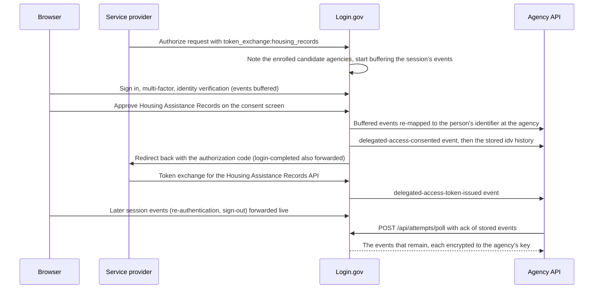

The events are written to the agency's Attempts API queue, which the agency drains with the existing poll endpoint. Every event in the queue is a JWE encrypted to the recipient's key; each carries one Security Event Token (RFC 8417) payload. A `delegated-access-consented` event, decrypted, looks like this:

```json
{
  "jti": "a1c2…",
  "iat": 1760369464,
  "iss": "https://…/",
  "aud": "urn:gov:gsa:openidconnect:sp:records_agency",
  "events": {
    "https://schemas.login.gov/secevent/attempts-api/event-type/delegated-access-consented": {
      "subject": { "subject_type": "session", "session_id": null },
      "occurred_at": 1760369464.21,
      "user_uuid": "7e0b…",
      "delegation_id": "dlg_Qm3x…",
      "actor_issuer": "urn:gov:gsa:openidconnect:sp:sinatra_sts",
      "application_url": null,
      "language": "en",
      "aws_region": "us-west-2",
      "unique_session_id": "9f2c…",
      "application": "urn:gov:gsa:openidconnect:sp:records_agency",
      "scope": "token_exchange:housing_records",
      "remembered": false,
      "source": "consent_screen",
      "consented_at": 1760369464.21
    }
  }
}
```

What to notice: `user_uuid` is the person's identifier at the Department of Housing Support, not the identifier MyBenefits Assistant knows; `delegation_id` is the join key the agency also receives from introspection; `actor_issuer` names the service provider; `subject.session_id` is null because Login.gov's server wrote this event, not the agency's own sign-in; and there is no IP address or user agent.

The event written at each exchange, `delegated-access-token-issued` (the renewal event `delegated-access-token-refreshed` has the same fields):

```json
{
  "https://schemas.login.gov/secevent/attempts-api/event-type/delegated-access-token-issued": {
    "subject": { "subject_type": "session", "session_id": null },
    "occurred_at": 1760369531.07,
    "user_uuid": "7e0b…",
    "delegation_id": "dlg_Qm3x…",
    "actor_issuer": "urn:gov:gsa:openidconnect:sp:sinatra_sts",
    "application_url": null,
    "language": "en",
    "aws_region": "us-west-2",
    "unique_session_id": "9f2c…",
    "application": "urn:gov:gsa:openidconnect:sp:records_agency",
    "resource": "https://records-api.housing.example.gov",
    "scope": "token_exchange:housing_records",
    "ial": 2,
    "aal": 2,
    "token_type": "DPoP",
    "token_format": "oauth",
    "expires_at": 1760369831
  }
}
```

What to notice: the event describes the token (its API, scope, assurance levels, presentation type, format and expiry) but never carries the token or anything derived from it. `token_type` is `Bearer`, `DPoP` or `N_A` (for a SAML assertion); `token_format` is `oauth` or `saml2`.

The event written when access ends, `delegated-access-revoked`:

```json
{
  "application": "urn:gov:gsa:openidconnect:sp:records_agency",
  "resource": null,
  "reason": "user_revoked"
}
```

What to notice: `resource` is null when the whole approval ended (the person revoked it, the person disconnected the service provider, or the account is suspended or deleted) and names the one API when a single refresh family ended (`refresh_token_reuse`, `client_revoked`). The shared members shown above (`user_uuid`, `delegation_id`, `actor_issuer`, `unique_session_id`) are present as well.

A session event forwarded to the agency is a re-mapped copy of the event Login.gov recorded for the service provider's session. The copy keeps the event type, `jti`, timestamps, `subject.session_id` (still the value the service provider supplied in `attempts_api_session_id`), the IP address, user agent, device id, `application_url` and every event-specific field. It replaces `user_uuid` with the person's identifier at the agency, drops the service provider's Google Analytics cookies, and adds `delegation_id` and `actor_issuer`.

The agency drains its queue through the existing poll endpoint (RFC 8936), acknowledging the events it has stored so that later polls return only new ones:

```http
POST /api/attempts/poll HTTP/1.1
Authorization: Bearer <the agency's Attempts API request token>
Content-Type: application/json

{"maxEvents": 1000, "ack": ["a1c2…", "b3d4…"]}
```

```json
{
  "sets": {
    "c5e6…": "eyJ0eXAiOiJzZWNldmVudCtqd2UiLCJ6aXAiOiJERUYiLCJhbGciOiJSU0EtT0FFUCIsImVuYyI6IkEyNTZHQ00iLCJraWQiOiI…"
  }
}
```

What to notice: the endpoint first deletes exactly the events named in `ack`, then returns what remains, keyed by `jti`; a caller that never acknowledges re-receives the whole retention window (`attempts_api_event_ttl_seconds`) on every poll. Delegated events arrive through the same endpoint as the agency's direct events.

The two properties this branch adds to the shared event schema, as `docs/attempts-api/schemas/events/shared/EventProperties.yml` defines them:

```yaml
actor_issuer:
  type: string
  description: |
    Present only on events delivered to an agency for a delegated session: the issuer of the service provider acting for the user. …
delegation_id:
  type: string
  description: |
    Present only on events delivered to an agency for a delegated session: the identifier of the user's approval of the application for the acting service provider. Token verification returns the same value, so the agency can join API calls to these events.
```

The switch, from `config/application.yml.default`:

```yaml
token_exchange_attempts_delivery_enabled: true
```

The decision logic in words. Capture, release and fan-out run only when `token_exchange_attempts_delivery_enabled`, `token_exchange_enabled` and `attempts_api_enabled` are all on (`DelegatedAccessEvents.enabled?`). At an authorize request that carries delegation scopes from a service provider approved for delegation, Login.gov records in the session a delegation context: the service provider's request id, its issuer, and the requested applications' Attempts recipients that are enrolled with a usable key. A request whose recipients are all unenrolled records no candidates and captures nothing. While the context is active, `Tracker#track_event` copies each event into the session buffer (at most 200 events; the earliest are kept), with `user_uuid` and the analytics cookies removed, and forwards the event at once to each agency already approved in this session. At consent (or at the handoff when remembered approvals skipped the consent screen, or at an account-page approval), for each recipient of an approved application that is enrolled, Login.gov creates the person's `AgencyIdentity` at that agency if missing, forwards the buffer once per recipient per session, writes one `delegated-access-consented` event per approval (`remembered: true` and the original `consented_at` for a reused approval), releases the stored `idv-*` history under the once-per-recipient rule, and, when the current sign-in is to the service provider these approvals are for, marks the recipient for live fan-out. The released-once guard is the service provider's request id, so the handoff after a shown consent screen releases nothing and a later authorization in the same session releases again. An agency that is not enrolled, or is listed without a usable key, is skipped with `skipped_reason: recipient_not_enrolled` and no error; a failing recipient is reported and the others continue; the person is never blocked.

## Functional requirements

| Id | Requirement |
|---|---|
| **FR-FRD-1** | When a service provider requests delegation, Login.gov MUST retain the sign-in session's fraud-signal events (sign-in, multi-factor, rate-limit, identity-verification) for possible delivery, whether or not the service provider itself receives such events. |
| **FR-FRD-2** | When the person approves an agency, Login.gov MUST deliver those events to that agency through the existing Attempts API, attributed to the person's identifier at that agency, together with a consent event and the person's identity-verification history (once per agency, as today). |
| **FR-FRD-3** | Nothing MUST be delivered to, and no record of the person MUST be created at, an agency the person declined. |
| **FR-FRD-4** | While the person's sign-in to the service provider remains active, later events (re-authentication, multi-factor change, sign-out, timeout, rate limits) MUST also be delivered to each approved agency. |
| **FR-FRD-5** | Login.gov MUST deliver an event to the agency when a delegated token is issued, when it is renewed, and when access is revoked (with the reason). |
| **FR-FRD-6** | Every delivered event MUST carry the delegation identifier so the agency can join events to API calls, and MUST identify the acting service provider. |
| **FR-FRD-7** | When a remembered approval is reused without showing the consent screen, the agency MUST still receive the events for that sign-in and a consent event marked as remembered. |
| **FR-FRD-8** | Existing Attempts API integrations MUST continue to work unchanged; the new events are additive. Delivery of the new events is on by default and reaches only an agency enrolled in the Attempts API (listed as a provider, with a usable encryption key); an agency that is not enrolled receives nothing and needs no change. The privacy-review questions stay open and are that review's agenda (D74). |
| **FR-FRD-9** | Retained events MUST be encrypted while held and MUST be discarded when the session ends. |

Rows owned by other sections and reported to the agency by this branch: **FR-CEN-13** (every approval revocation is reported with its reason; section 7) and **FR-TOK-12** (reuse of a retired renewal credential is reported as `refresh_token_reuse`; section 7).

## Protocol rows

| Id | Requirement |
|---|---|
| **ATT-1** | When a delegation-enabled service provider's authorization request carries `token_exchange:*` values, Login.gov captures the sign-in session's Attempts events (sign-in, MFA, rate-limit, `idv-*`) into a buffer in the user session that the session encryptor protects, regardless of whether the service provider is enrolled in the Attempts API. The buffer holds at most 200 events (the earliest, the sign-in itself, are kept) and lives only as long as the session. Capture, release and fan-out run when `token_exchange_attempts_delivery_enabled` (default `true`), `token_exchange_enabled` and `attempts_api_enabled` are all on; the per-agency gate is enrollment (ATT-17), not the switch (D74). |
| **ATT-2** | At consent, for each approved application whose recipient is enrolled, Login.gov (a) creates the person's `AgencyIdentity` for that agency if missing (never an `identities` row); (b) delivers the buffered events re-mapped for that agency; (c) delivers one `delegated-access-consented` event per approval with `application`, `scope`, `remembered`, `source` (`consent_screen` or `account_page`) and `consented_at` (epoch seconds); (d) releases the historical `idv-*` events to that agency under the existing once-per-recipient rule. |
| **ATT-3** | Re-mapping sets `user_uuid` to the agency's `AgencyIdentity` UUID, removes `google_analytics_cookies`, keeps `application_url` (the service provider's redirect URI), keeps the IP address, user agent, device id and all event-specific fields, and adds `delegation_id` and `actor_issuer`. `subject.session_id` remains the value the service provider supplied in `attempts_api_session_id` (or null), per the published schema, so the agency's joins on that field keep their meaning. |
| **ATT-4** | Nothing is delivered to, and no `AgencyIdentity` is created for, an agency the person declined; `user_uuid` resolution is deferred until consent. |
| **ATT-5** | When consent is skipped because remembered approvals cover the request, ATT-2 runs at the handoff instead, and the `delegated-access-consented` event carries `remembered: true` and the original `consented_at`. |
| **ATT-6** | `login-completed` at the handoff is also delivered to each approved agency, re-mapped; on the remembered path the release happens before that event is recorded so the agency receives it. |
| **ATT-7** | Each exchange emits `delegated-access-token-issued`; each refresh emits `delegated-access-token-refreshed`, written from the refresh grant after the live token is written; each approval or family revocation emits `delegated-access-revoked` with a `reason` (`user_revoked`, `sp_disconnected`, `refresh_token_reuse`, `account_suspended`, `account_deleted`, `approval_lapsed`, `client_revoked`), a family's end being written from `TokenExchangeRefreshToken.revoke_family!` to the one API's recipient. Every delegated event is written through the `TrackerEvents` method its schema is generated from (`AttemptsApi::DelegatedEventWriter` includes `TrackerEvents`). Server-side events carry no IP address, user agent, port or device. `superseded_by_new_consent` is never reported, because a re-approval carries the live tokens over and nothing ended for the agency. |
| **ATT-8** | While the service provider's browser session is live, re-authentication, MFA change, logout, timeout and rate-limit events are also delivered to each approved agency. A recipient enters live fan-out only when the sign-in under way is to the service provider its approvals are for; an advance approval on the account page releases the consent event and the history but does not start forwarding the account session's events (D66). |
| **ATT-9** | Introspection returns `delegation_id` (INT-4) so the agency can join API calls to these events. |
| **ATT-10** | The new event types and the `delegation_id` and `actor_issuer` properties are defined in `app/services/attempts_api/tracker_events.rb` and in the OpenAPI schemas under `docs/attempts-api/schemas/events/` (`DelegationEvents.yml` referenced from `AllEvents.yml`, the four files under `delegated-access/`, the two properties in `shared/EventProperties.yml`). |
| **ATT-11** | The delegation context and the event buffer live at the Rails session root, not in the Devise user session, so sign-in events recorded before a user session exists are captured. The buffer is protected as part of the session through `SessionEncryptor::SENSITIVE_PATHS` (one KMS operation per save), not by a KMS call per event; its content and cap are unchanged by that choice. Buffering does not change `Tracker#track_event`'s return value and creates no `AgencyIdentity` at the service provider's agency. |
| **ATT-12** | Candidate agencies are the requested applications' recipients that are enrolled at authorize time; a request whose recipients are all unenrolled captures nothing. The buffer persists for the whole session and is delivered at most once per agency; an agency approved later in the session receives the full session history, and an agency re-approved receives a new consented event only. |
| **ATT-13** | The remembered path emits one `delegated-access-consented` (`remembered: true`) per authorization (per service provider request id), not per session: the released-once guard is the service provider request id recorded in the delegation context (`mark_released`, `released_for?`), so the handoff after a shown consent screen releases nothing and a later authorization in the same session releases again (D67). A revocation during the session ends the tokens but does not remove the recipient from live fan-out; it keeps receiving the session's events until the browser session ends. A later authorize request without delegation scopes leaves agencies approved earlier in the session receiving live events for the rest of the browser session. |
| **ATT-14** | `delegation_id` in events is the agency's earliest approved approval's id, the same choice the exchange and introspection make, so events and introspection agree; re-mapped copies and released historical `idv-*` events carry both `delegation_id` and `actor_issuer`. |
| **ATT-15** | Delegated historical release requires `historical_attempts_api_enabled` and a verified person, but not that the service provider's request be an identity-verification request: a delegation request is always identity-proofed, and the agency did not make the request. When the stored history is empty (remember-device or PIV/CAC sign-in) nothing is released and the once-only flag stays unset. |
| **ATT-16** | Every event schema under `docs/attempts-api/schemas/events` has a `TrackerEvents` method whose keyword parameters equal the event's properties (checked by `tracker_events_spec.rb` against the compiled bundle); the four delegated events have such methods and are written through them; the consented event carries `consented_at` (epoch seconds). |
| **ATT-17** | For delegated delivery, an agency counts as enrolled only if it is listed in `allowed_attempts_providers`, belongs to an agency, and a usable public key exists to encrypt events to (an explicit key in that configuration or the record's certificate): `ServiceProvider#attempts_api_deliverable?`. An agency listed without a usable key is treated as not enrolled and receives nothing; no error is raised and the person is not affected. Enrollment is the gate for delegated delivery (D74); the direct sign-in flow's behavior is unchanged. |
| **ATT-18** | Delegated events are delivered through the existing poll endpoint (`POST /api/attempts/poll`, RFC 8936) and inherit its acknowledge-to-drain contract: the endpoint deletes exactly the events whose keys the caller lists in `ack`, then returns the events that remain. Unacknowledged events stay available until `attempts_api_event_ttl_seconds` expires. A polling agency MUST acknowledge each event once it is durably stored so later polls return only new events; a caller that never acknowledges re-receives the whole retention window on every poll. |

## As built

1. Configuration and the per-recipient gate. `token_exchange_attempts_delivery_enabled` (boolean, default `true`) is added to `lib/identity_config.rb` and `config/application.yml.default`; `DelegatedAccessEvents.enabled?` is that key together with `token_exchange_enabled` and `attempts_api_enabled`. Per recipient, `ServiceProvider#attempts_api_deliverable?` decides enrollment and `#delegation_attempts_recipients` lists the recipients (each active API URL's `attempts_recipient`, de-duplicated, or the application itself when none names one).
2. The delegation context and the buffer. `AttemptsApi::DelegationContext` lives at the Rails session root (`delegation_context`, and the buffer under `delegated_attempts_buffer`, the `BUFFER_KEY`; `MAX_BUFFERED_EVENTS = 200`; `mark_released`, `released_for?`). `OpenidConnect::AuthorizationController#start_delegation_context` starts it when the validated request carries delegation scopes and the service provider is approved for delegation. While the context is `active?`, `AttemptsApi::Tracker#track_event` copies each event into the buffer (`capture_for_delegation`, with `user_uuid` and `google_analytics_cookies` removed) as plain `AttemptEvent#as_json` data. `delegated_attempts_buffer` is listed in `SessionEncryptor::SENSITIVE_PATHS` (`lib/session_encryptor.rb`), events are rebuilt with `AttemptEvent.from_json` on read, `agency_uuid` skips `AgencyIdentity` creation for a buffer-only event, and the buffer is discarded with the session.
3. The release. `AttemptsApi::DelegatedRelease` runs at three points: `VerifySpAttributesConcern#record_delegation_consent`, `OpenidConnect::AuthorizationController#release_remembered_delegation` (before `login-completed` is recorded) and `Accounts::DelegatedAccess::ApprovalsController#create`. For each deliverable recipient it creates the `AgencyIdentity` if missing (`AgencyIdentityLinker.for(..., skip_create: false)`), forwards the buffer once per recipient per session (`buffer_delivered_to`), writes one `delegated-access-consented` per approval, releases the `idv-*` history under `AttemptsApi::HistoricalReleaseCheck` (shared with `Idv::HistoricalAttemptsConcern`, which keeps its own `idv_requested?` test; `Tracker.write_existing_user_events(extra_metadata:)` adds `delegation_id` and `actor_issuer`), and marks the recipient for live fan-out only when the current sign-in is to that service provider. A failing recipient is reported to error tracking and logged, the others continue, and the person is never blocked.
4. The writer. `AttemptsApi::DelegatedEventWriter` includes `AttemptsApi::TrackerEvents` and implements `track_event`. Its `forward` method re-maps a buffered or live copy (keeping the event type, `jti`, timestamps, `subject.session_id`, IP address, user agent, device id, `application_url` and the event fields; replacing `user_uuid`; dropping the analytics cookies; adding `delegation_id` and `actor_issuer`). A server-side event has `subject.session_id` null, `application_url: nil`, `language`, `aws_region`, no IP address, user agent, port or device, and `unique_session_id` as the SHA-1 hex digest the sign-in's events carry. Both paths encrypt to `recipient.attempts_public_key` and store through `AttemptsApi::RedisClient#write_event` under the recipient's issuer. Each delivery is logged as `delegated_access_attempts_delivery(event_type, recipient_issuer, actor_issuer, success, event_count, skipped_reason, exception)`; `skipped_reason` is `delivery_disabled` or `recipient_not_enrolled`.
5. The token and revocation events. `DelegatedAccessEvents.token_issued` (called from `OpenidConnectTokenExchangeForm#issue!` after the live entry is written), `.token_refreshed` (called from `OpenidConnectRefreshTokenForm` after the live token is written) and `.access_revoked(grant:, reason:, resource_server:)` (called from `TokenExchangeGrant#revoke!` and `TokenExchangeRefreshToken.revoke_family!`) call the generated `delegated_access_consented`, `delegated_access_token_issued`, `delegated_access_token_refreshed` and `delegated_access_revoked` methods. Token events carry `application`, `resource`, `scope`, `ial`, `aal`, `token_type` (`Bearer`, `DPoP` or `N_A`), `token_format` (`oauth` or `saml2`) and `expires_at`, never the token or anything derived from it; the revoked event carries `application`, `resource` (null when the whole approval ended) and `reason`.
6. The schemas. `docs/attempts-api/schemas/events/DelegationEvents.yml` (referenced from `AllEvents.yml`), `events/delegated-access/DelegatedAccessConsented.yml`, `DelegatedAccessTokenIssued.yml`, `DelegatedAccessTokenRefreshed.yml` and `DelegatedAccessRevoked.yml`; `actor_issuer` and `delegation_id` in `shared/EventProperties.yml`, each described as present only on events delivered to an agency for a delegated session; the compiled bundle rebuilt. No `token-exchange-login-completed` event, schema or tracker method exists: it would have reported a sign-in at the agency, which never happens.
7. Migrations: none. Locale keys: none. Specs: `spec/services/attempts_api/{delegation_context,delegated_release,delegated_event_writer,historical_release_check,tracker}_spec.rb`, `spec/services/delegated_access_events_spec.rb`, `spec/controllers/openid_connect/authorization_controller_spec.rb`, `spec/controllers/sign_up/completions_controller_spec.rb`, `spec/controllers/accounts/delegated_access/approvals_controller_spec.rb`, the service provider, grant and refresh token model specs, and `spec/requests/openid_connect/{token_exchange,token_refresh}_spec.rb`; 80 examples across the new and touched specs, and the tracker events spec at 44 examples; rubocop and the analytics-events lint are clean.

## Decisions

- **D33** Reuse of a retired renewal credential ends the family and is reported as `refresh_token_reuse` to the one API's recipient (full entry in section 16).
- **D38** The fraud-signal plan stands in full: buffer, release at consent under the agency's identifier with the consented event and the history, live forwarding, and token events with `delegation_id`.
- **D39** A remembered approval reused sends that sign-in's events and a consent event marked remembered, every time.
- **D58** The agency-role viewer that displays these events is the OAuth agency reference application's.
- **D66** Account-page approvals release the consent event and history but start live fan-out only when the current sign-in is to that service provider.
- **D67** The released-once guard is keyed by the service provider request id.
- **D74** Delivery is on by default and gated per recipient by Attempts API enrollment; the privacy-review items stay open.

## How to review

- Diff against `delegated-access-billing-reporting`.
- Check first: `Tracker#track_event` (its return value and `should_track?` are unchanged for the service provider's own event, and no `AgencyIdentity` is created for the buffer); the three release points and the once-only guards; that nothing names an application the person did not approve; the writer's two paths and what a server-side event omits; and that `SENSITIVE_PATHS` carries `delegated_attempts_buffer`. Run `make lint_tracker_events`.
- Specs that prove it: the four `spec/services/attempts_api/*` specs, `spec/services/delegated_access_events_spec.rb` (an unlisted agency, a listed agency without a key, and the switch off each receive nothing, without raising), the tracker spec, and the authorization controller spec for the remembered path.
- Must not change for existing clients: existing event types and members are unchanged (FR-FRD-8); a service provider's direct Attempts delivery is byte for byte as before; an environment with no enrolled agency delivers nothing even with delivery on.
- Known open items, the privacy review's agenda (FR-FRD-8): the buffer carries the whole sign-in, failed-password events with the typed email included; the hashed `unique_session_id` correlates the service provider's and the agency's events; a mid-session revocation ends tokens but not live fan-out; the `idv-*` history is released whether or not the service provider's request is an identity-verification request (ATT-15); whether the Privacy Impact Assessment and SORN cover delivery on the basis of a delegation approval; whether Attempts enrollment should be a condition of accepting delegated access; how long an agency keeps delegated events and whether `delegation_id` is new personal data at the agency.
- Held until the harness run: `AttemptsApi::HistoricalRelease` and `EventDelivery` extracted from `DelegatedRelease`.

# 13. `delegated-access-config-content`: consent content and the delegation registry seeded from the configuration repository

**Stack position** 13 of 14, on `delegated-access-fraud-signals`.

## Objective

The consent screen shows content written by agencies: each agency's public name, logo, description and learn-more link, and each application's display name, what it lets the service do, what information it provides, whether it is read-only or can make changes, and where to learn more. The partner Dashboard, the long-term home for partner content, does not yet have these fields. This branch gives the content, the applications with their logos and API URLs, and the list of service providers approved for delegation one production path now: a YAML file, `delegated_access.yml`, maintained by the Login.gov team in the shared configuration repository `identity-idp-config`, reviewed by pull request and seeded by `rake db:seed` in every environment, exactly as `service_providers.yml` and `agencies.yml` already are (D77). The pull request review is the content review, and the approval is recorded in the file beside the content it approves. No admin interface is built in the identity provider: a new authenticated staff surface would need its own authorization, audit and security review, and it would compete with the configuration repository as a second source of truth.

Environment safety comes from the file, not from the seeder refusing to run. The file is keyed by Rails environment, each entry may carry `restrict_to_deploy_env` with the meaning service providers already give it, and every fictitious entry is restricted to the sandbox, so production and staging write none of them. A missing file, or no section for the current environment, seeds nothing and raises nothing, which is what makes the order of merging the two repositories safe. Locally and in CI the same file shape is the fixture `config/delegated_access.localdev.yml`, whose `development` section remains the contract with the reference applications (section 10).

## How it works

What `rake db:seed` does with the file:

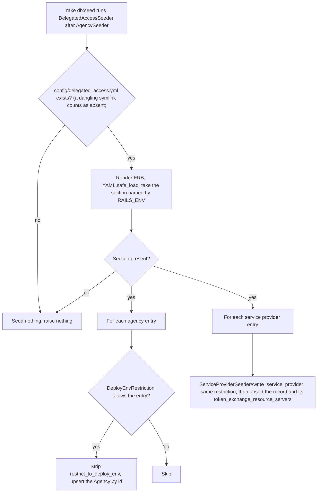

The shape of `delegated_access.yml`, taken from the fixture's `production` section. The top level is keyed by Rails environment; under each environment `agencies` is keyed by agency id (the shape of `agencies.yml`) and `service_providers` is keyed by issuer (the shape of `service_providers.yml`). The sample shows one agency with its consent content, one service provider approved for delegation and one application with its API URL; keys not shown are the ordinary service provider keys (`return_to_sp_url`, `redirect_uris`, `certs`, `attribute_bundle`) as the fixture carries them.

```yaml
production:
  agencies:
    101:
      restrict_to_deploy_env: 'sandbox'
      name: 'Department of Housing Support'
      abbreviation: 'DHSP'
      delegation_description:
        en: 'helps people find, keep and pay for housing.'
        es: 'ayuda a las personas a encontrar, conservar y pagar su vivienda.'
      delegation_learn_more_url: '<%= ENV.fetch("DELEGATION_OIDC_AGENCY_URL", "https://records.housing.example.gov") %>/'

  service_providers:
    'urn:gov:gsa:openidconnect:sp:sinatra_sts':
      restrict_to_deploy_env: 'sandbox'
      agency_id: 100
      ial: 2
      friendly_name: 'MyBenefits Assistant'
      logo: 'generic.svg'
      pkce: true
      dpop_required: true
      token_exchange_enabled_sp: true
      delegation_operator_legal_name: 'Office of Benefits Coordination'
      delegation_operator_type: 'federal'
      delegation_service_description:
        en: 'helps you find benefits you may qualify for and track your applications in one place.'
      delegation_data_handling_statement:
        en: 'used only while you are signed in and deleted when you sign out. Not shared outside the Office of Benefits Coordination.'
      delegation_privacy_policy_url: '<%= ENV.fetch("DELEGATION_SP_URL", "https://mybenefits.example.gov") %>/about'
      delegation_support_contact: 'help@mybenefits.example.gov'
      delegation_uses_ai: true
      delegation_ai_description:
        en: 'answer your questions and suggest benefits you may qualify for.'

    'urn:gov:gsa:openidconnect:sp:records_agency':
      restrict_to_deploy_env: 'sandbox'
      agency_id: 101
      ial: 2
      friendly_name: 'Housing Assistance Records'
      logo: 'generic.svg'
      delegation_application: true
      delegation_scope_value: 'housing_records'
      delegation_display_name:
        en: 'Housing Assistance Records'
        es: 'Registros de asistencia para la vivienda'
      delegation_description:
        en: 'check where your housing application is in review, whether anything is missing, and submit missing documents for you.'
      delegation_data_provided:
        en: ['Case number', 'Current status', 'Next step', 'Documents requested']
      delegation_access_type: 'read_write'
      delegation_learn_more_url: '<%= ENV.fetch("DELEGATION_OIDC_AGENCY_URL", "https://records.housing.example.gov") %>/'
      allowed_delegation_service_providers: []
      delegation_sp_shareable_attributes: []
      token_exchange_resource_servers:
        - identifier: 'https://records-api.housing.example.gov'
          token_format: 'oauth'
          max_access_token_seconds: 300
          max_family_seconds: 14400
          certs:
            - 'rs_records_demo'
```

What to notice: `restrict_to_deploy_env: 'sandbox'` on every entry is what keeps the fictitious records out of prod and staging; the key is stripped before writing because it is not a column. The hosts come from environment variables through ERB, while the API identifier `https://records-api.housing.example.gov` never changes with the hostname. `logo` is a filename under the identity provider's `sp-logos` assets, never a path or URL. The `development` section of the same file carries the same entries without the restriction.

How `restrict_to_deploy_env` is read, as `DeployEnvRestriction` applies it. It is consulted only when `RAILS_ENV=production`; in development and test every entry is written.

```text
restrict_to_deploy_env: 'prod'      written in prod only
restrict_to_deploy_env: 'staging'   written in staging only
restrict_to_deploy_env: 'sandbox'   written in every deployed environment except prod and staging
absent or blank                     written everywhere except prod
```

How the file gets into place. In a deployed environment the deploy links it from the configuration repository checkout beside the other seed files; locally `bin/setup` links the fixture; CI and the review-app image copy the fixture.

```text
deploy        <identity-idp-config checkout>/delegated_access.yml  ->  config/delegated_access.yml   (Deploy::Activate::FILES_TO_LINK)
bin/setup     ln -sv delegated_access.localdev.yml config/delegated_access.yml   (only when config/delegated_access.yml is absent)
CI            cp config/delegated_access{.localdev,}.yml
review app    COPY config/delegated_access.localdev.yml $RAILS_ROOT/config/delegated_access.yml
.gitignore    /config/delegated_access.yml
```

The decision logic in words. `db/seeds.rb` runs `DelegatedAccessSeeder` through `SeedRunner` after `AgencySeeder`. The seeder resolves `config/delegated_access.yml` with `Pathname#exist?`, which follows a symlink, so an absent file or a symlink to nothing seeds nothing and raises nothing. It renders the file as ERB (so hosts can come from the environment), parses it with `YAML.safe_load`, and takes the section named by the Rails environment; no section means nothing to seed. Each agency entry is checked with `DeployEnvRestriction#allows?`; an allowed entry has `restrict_to_deploy_env` removed and is created or updated by id with every other key passed through. Each service provider entry goes to `ServiceProviderSeeder#write_service_provider`, which applies the same restriction, strips the key, and upserts the record together with its nested `token_exchange_resource_servers` and certificate lookup, exactly as for every other service provider. An entry with `active: false` deactivates the record at the next seed. Running the seeder twice produces the same records. `rake delegated_access:seed` runs the same seeder on demand.

## Functional requirements

| Id | Requirement |
|---|---|
| **FR-ONB-3** | Owned by section 1. This branch delivers its content-maintenance amendment (D77): until the Dashboard gains the fields, the content, logos included, is maintained in `identity-idp-config` (`delegated_access.yml`) by the Login.gov team, reviewed by pull request and seeded in every environment, with the version pair set in that file. |
| **FR-ONB-5** | Owned by section 1. This branch delivers its amendment (D77): while content is maintained in `identity-idp-config`, the pull request review is the review, and the approval is recorded in the file (`consent_approved_at`, `consent_approved_by`) with the content it approves. |
| **FR-ONB-9** | Owned by section 1. This branch delivers its amendment (D77): the identity provider seeds the content with `rake db:seed` in every environment, production included; an entry's `restrict_to_deploy_env` decides where it is written, the fictitious entries are restricted to the sandbox, and the local fixture is the same file's development copy, linked in place by `bin/setup`. |

**FR-ONB-1**, **FR-ONB-2** and **FR-ONB-7** (section 1) are written through the same seeder and are unchanged in substance.

## Protocol rows

| Id | Requirement |
|---|---|
| **ONB-5** | Owned by section 1. This branch delivers its amendment (D77): the delegated-access content (agencies with their consent content, service providers approved for delegation, applications with their consent text, logos and API URLs) is managed through the same pipeline as every other service-provider record, with one more file, `delegated_access.yml` in `identity-idp-config`, linked to `config/delegated_access.yml` at deploy (`Deploy::Activate::FILES_TO_LINK`) and loaded by `DelegatedAccessSeeder` from `rake db:seed` in every environment. Edits are pull requests in that repository. No admin interface is built. |
| **ONB-12** | Until the Dashboard gains the fields, the content source is `identity-idp-config`, not a branch seed file. The file is keyed by Rails environment (`development`, `production`), each section holding `agencies` (keyed by agency id, the shape of `agencies.yml`) and `service_providers` (keyed by issuer, the shape of `service_providers.yml`, nested `token_exchange_resource_servers` included). A missing file, or no section for the current environment, seeds nothing. The seeder has no environment refusal; `rake delegated_access:seed` remains as a convenience that runs the same seeder. Locally `bin/setup` links the fixture `config/delegated_access.localdev.yml` to `config/delegated_access.yml`, CI and the review-app image copy it into place, and its `development` section stays the contract with the reference applications (D77). |
| **ONB-15** | Every agency and service provider entry in `delegated_access.yml` MAY carry `restrict_to_deploy_env`, read through `DeployEnvRestriction` (shared with `ServiceProviderSeeder#write_service_provider?`) only when `RAILS_ENV=production`: `prod` is written in prod only, `staging` in staging only, `sandbox` in every other deployed environment, and blank everywhere except prod. The key is stripped before writing because it is not a column. Every fictitious entry carries `sandbox`, in the configuration repository and in the fixture's `production` section, so prod and staging write none of them; the configuration repository's spec asserts it. An application's `logo` is a filename under `public/assets/images/sp-logos/` in `identity-idp-config` (never a path or URL), served from the identity provider's assets as every service-provider logo is; the spec asserts the file exists. |

## As built

1. The seeder. `DelegatedAccessSeeder` (`app/services/delegated_access_seeder.rb`, with a `yaml_path:` argument for specs) reads `config/delegated_access.yml`: ERB first, then `YAML.safe_load`, then `fetch(rails_env, {})`. A missing file or a dangling symlink (`Pathname#exist?`) seeds nothing and raises nothing. Entries under `agencies` are written when `restrict_to_deploy_env` allows, with that key stripped. Entries under `service_providers` go through `ServiceProviderSeeder#write_service_provider`, so nested `token_exchange_resource_servers`, certificate lookup and the restriction behave as for every other service provider. An `active: false` entry deactivates the record at the next seed.
2. The shared restriction rule. `DeployEnvRestriction` (`app/services/deploy_env_restriction.rb`) holds the rule that `ServiceProviderSeeder#write_service_provider?` applies, and that method delegates to it: the rule is read only when `RAILS_ENV=production`; `prod` is written in prod only, `staging` in staging only, `sandbox` in every deployed environment except prod and staging, and blank everywhere except prod; in development and test every entry is written.
3. Wiring. `db/seeds.rb` runs the seeder through `SeedRunner` after `AgencySeeder`. `delegated_access` is in `Deploy::Activate::FILES_TO_LINK` (`lib/deploy/activate.rb`), so the deploy links `<identity-idp-config checkout>/delegated_access.yml` to `config/delegated_access.yml` beside the other linked files. `bin/setup` links `config/delegated_access.localdev.yml` into place when `config/delegated_access.yml` is absent; `/config/delegated_access.yml` is in `.gitignore`; `.gitlab-ci.yml` and `dockerfiles/idp_review_app.Dockerfile` copy the fixture into place.
4. The rake task. `lib/tasks/delegated_access.rake` defines `rake delegated_access:seed`, which runs the same seeder on demand; its description names `config/delegated_access.yml` and says `db:seed` also runs it.
5. The fixture. `config/delegated_access.localdev.yml` is keyed by Rails environment. The `development` section is the reference-application contract (section 10). The `production` section repeats the entries with `restrict_to_deploy_env: 'sandbox'` and hosts from `DELEGATION_SP_URL`, `DELEGATION_OIDC_AGENCY_URL` and `DELEGATION_SAML_AGENCY_URL`, so a personal sandbox seeds the hosted reference applications; API identifiers never change with the hostname. The file header documents the keying, the restriction and both sections.
6. Comments. `AgencySeeder`, `ServiceProviderSeeder` and the registry migrations `20261009100000_add_delegation_content_to_agencies` and `20261009100300_add_delegation_service_provider_columns_to_service_providers` carry comments saying the fields are loaded from the delegated-access configuration file by `DelegatedAccessSeeder` in every environment and that the Dashboard does not have them. Migrations: none new. Locale keys: none. Analytics events: none.
7. The companion repository `identity-idp-config`, branch `delegated-access`: `delegated_access.yml` (`development` and `production` sections, every `production` entry `sandbox`-restricted, with a header explaining the keying, the restriction, logo filenames and hostname-independent identifiers); the three SVG logos `mybenefits-assistant.svg`, `housing-assistance-records.svg` and `retirement-benefits-portal.svg` under `public/assets/images/sp-logos/`; `spec/delegated_access_config_spec.rb` with 8 examples on the file's shape (it loads with `safe_load`, has no duplicate keys, is keyed by environment, has both maps in every environment, every service provider has a `friendly_name` and an agency in the same environment, every application has a scope value and resource servers with an identifier and an `oauth` or `saml2` format, every logo exists, every `production` entry is restricted to the sandbox); and a "Delegated access content" README section.
8. Specs. `spec/services/delegated_access_seeder_spec.rb` covers an absent file, a dangling symlink, a missing environment section, the `production` section in a sandbox and in prod and staging, `restrict_to_deploy_env` on an agency, idempotence, environment hosts and the reference-application contract; together with `spec/services/service_provider_seeder_spec.rb`, `spec/services/agency_seeder_spec.rb` and `spec/lib/deploy/activate_spec.rb` that is 56 examples, 0 failures across the four. Rubocop is clean on the changed files and gitleaks is clean on the commit range. Local check: with the configuration repository's file linked in place and `rake db:seed` run, the three applications' logos switch to the named SVGs and the identity provider serves `sp-logos/mybenefits-assistant.svg` with HTTP 200.

## Decisions

- **D77** Delegated-access content is edited as YAML in `identity-idp-config`, reviewed by pull request and seeded in every environment; no admin interface is built (full entry in section 16).
- **D10** The branch seed path stands as the local fixture, and per-entry restriction takes the place of an environment refusal.
- **D51** One fixture file is the contract with the reference applications; its `development` section is unchanged by this branch.

## How to review

- Diff against `delegated-access-fraud-signals`.
- Check first: `DeployEnvRestriction` against the rule `ServiceProviderSeeder#write_service_provider?` applies (the seeder spec and `service_provider_seeder_spec.rb` must agree); the seeder's handling of a missing file, a dangling symlink and `restrict_to_deploy_env`; that the `development` section of the fixture is unchanged (the harness contract); and that no code path refuses an environment.
- Then read the configuration repository's `delegated_access.yml` and `spec/delegated_access_config_spec.rb` (8 examples): every `production` entry is `sandbox`-restricted, every logo exists, and `logo` is a filename and never a path or URL.
- Specs that prove it: `spec/services/delegated_access_seeder_spec.rb` (56 examples together with the other three), `spec/services/service_provider_seeder_spec.rb`, `spec/services/agency_seeder_spec.rb` and `spec/lib/deploy/activate_spec.rb`.
- Must not change for existing clients: `service_providers.yml` and `agencies.yml` seeding is unchanged; a deploy without `delegated_access.yml` on the configuration repository's `main` seeds nothing new and raises nothing; records already seeded are upserted idempotently.
- Deployment order: the deploy clones `identity-idp-config` at `main`, so the configuration repository's branch is not deployable until merged. Either repository can go first, because identity-idp `main` never reads the file and this seeder treats a missing file as nothing to seed.
- Known open items: the configuration repository's pre-existing "has no invalid logos" example in `spec/service_provider_config_spec.rb` fails until it also counts the logos `delegated_access.yml` references (left unchanged by the product owner for now); 24 Dependabot alerts there have a conservative fix on branch `update-deps` awaiting that repository's owners; the Dashboard remains the longer-term content path, and `ServiceProviderUpdater` already writes the fields once it has them. Held until the harness run: `DelegatedAccessSeeder` reusing `AgencySeeder#write_agency`, and a resource-server upsert shared by the seeder and the updater.

# 14. `delegated-access-encrypted-userinfo`: user-information responses encrypted to the service provider's registered certificate

**Stack position** 14 of 14, on `delegated-access-config-content`.

## Objective

A confidential service provider that opts in on its record receives its user-information response as one encrypted object instead of plain JSON. The whole claims object the endpoint would have released for the granted scopes, document-metadata claims included, is returned as a single compact JWE (RFC 7516; RSA-OAEP-256 for key management, A256GCM for content encryption) with content type `application/jwt`, as OpenID Connect Core 1.0 §5.3.2 describes. The encryption key is the public key of the record's first registered certificate, the same certificate its `private_key_jwt` client assertions are verified against, so the partner decrypts with a key it already holds; nothing in the request names a key. The design exists for the passport agency's selfie and document data, which must be readable only by that agency and not by Login.gov's edge infrastructure, logs or any intermediary. Encrypting the whole object rather than one field gives that end-to-end property with the simplest shape.

Only confidential clients can be served this way. A public client holds no registered key, and its per-session key-possession (DPoP) key is a signing key, not an encryption key. Every record that has not opted in receives the plain response unchanged, and delegated tokens remain refused at the endpoint regardless (FR-TOK-6; sections 6 and 8), so nothing changes for agencies reached by delegation. The endpoint fails closed: an opted-in record without a usable key is refused with a server error and the failure is logged, never answered in the clear, and onboarding warns when it writes such a record. The feature serves one partner's need, so no fixture record opts in and no reference application decrypts; the public reference applications do not present it as a general feature (D81).

## How it works

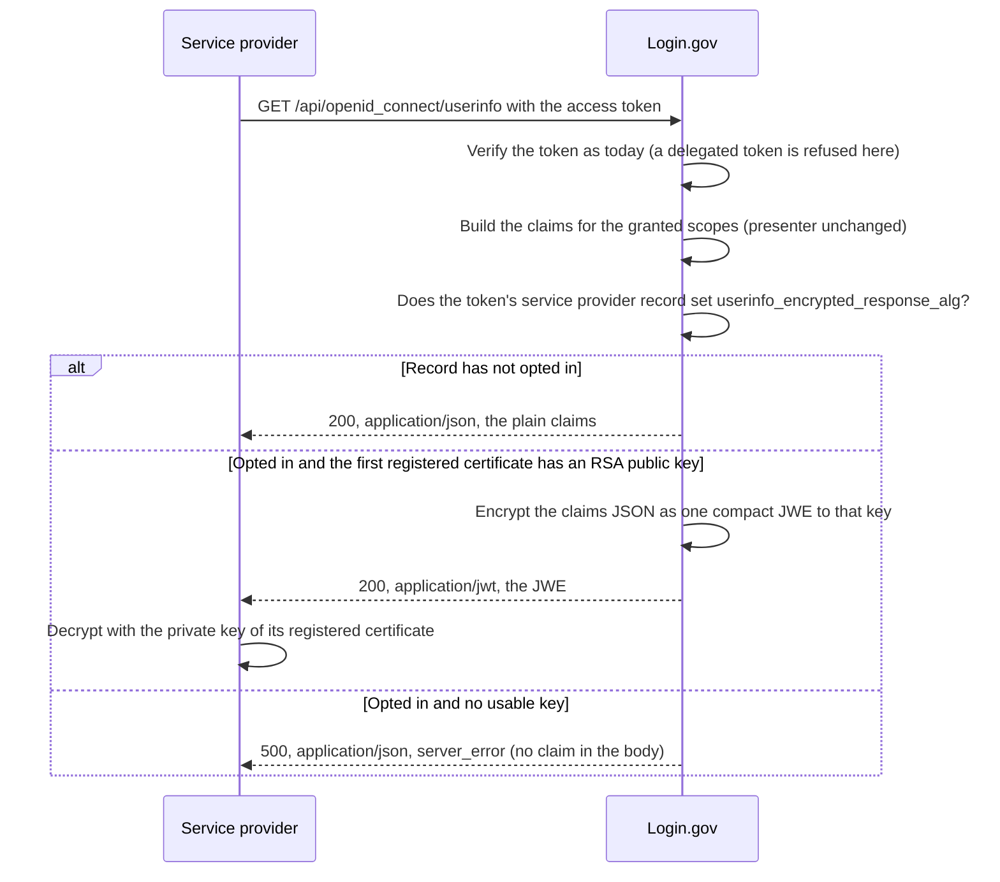

The request is the existing user-information request; nothing in it changes for an opted-in record:

```http
GET /api/openid_connect/userinfo HTTP/1.1
Authorization: Bearer 3f9a…
```

The plain response, for a record that has not opted in, with the scope `openid email`:

```http
HTTP/1.1 200 OK
Content-Type: application/json

{
  "sub": "b2d1…",
  "iss": "https://…/",
  "email": "person@example.com",
  "email_verified": true,
  "ial": "urn:acr.login.gov:auth-only",
  "aal": "urn:gov:gsa:ac:classes:sp:PasswordProtectedTransport:duo",
  "auth_time": 1760369464
}
```

The encrypted response, for a record that has opted in. The body is one compact JWE: five base64url parts separated by dots (protected header, encrypted content key, initialization vector, ciphertext, authentication tag).

```http
HTTP/1.1 200 OK
Content-Type: application/jwt

eyJhbGci….k3Qf….Z1x9….QmE4….7rTw…
```

The protected header, decoded:

```json
{"alg": "RSA-OAEP-256", "enc": "A256GCM"}
```

What to notice: the header carries only `alg` and `enc`. There is no `kid`, because the record holds exactly one registered certificate and the decrypting party is that key's owner; there is no signature inside, because the endpoint's TLS authenticates the origin as it does for the plain response. Decrypting the body with the private key of the registered certificate yields exactly the JSON the plain response would have carried, document-metadata claims included when the `document_images` scope is granted. No claim value appears anywhere in the clear.

The opt-in is one column on the service provider record, added by the migration:

```text
service_providers.userinfo_encrypted_response_alg   string, nullable, comment "sensitive=false"
  NULL            the plain JSON response (every existing record)
  'RSA-OAEP-256'  the encrypted response; the only value the model accepts
```

What to notice: there is no `enc` column; A256GCM is fixed. The key is always the record's own first certificate, so there is nothing else to configure.

The fail-closed error, when an opted-in record has no usable key (no certificate, a certificate that cannot be read, or a public client):

```http
HTTP/1.1 500 Internal Server Error
Content-Type: application/json

{
  "error": "server_error",
  "error_description": "This service provider is registered to receive encrypted userinfo responses, but no usable encryption key is registered for it: the response was not sent."
}
```

What to notice: no claim reaches the body, and the request is logged as `openid_connect_userinfo_encryption_failed` with `client_id` and the error class. The endpoint never falls back to plaintext.

Discovery advertises the fixed algorithm pair, whether or not any record has opted in:

```json
{
  "userinfo_encryption_alg_values_supported": ["RSA-OAEP-256"],
  "userinfo_encryption_enc_values_supported": ["A256GCM"]
}
```

The decision logic in words. The access token is verified exactly as before by `AccessTokenVerifier` (bearer or DPoP-bound, with a delegated token refused before any response is built), and the authentication is logged as `openid_connect_bearer_token` with a new `encrypted` property that is true for an opted-in record, false otherwise, and nil when the token did not authenticate. The presenter builds the claims for the granted scopes without knowing about encryption. If the token's service provider record has `userinfo_encrypted_response_alg` set, the controller asks the record for its encryption key: the public key of `ssl_certs.first`, or nil when the record is a public client (`pkce` true), has no certificate, or has a certificate that cannot be parsed. A key that is not an RSA key raises `NoUsableKeyError`. On success the claims JSON is encrypted with `JWE.encrypt(claims.to_json, public_key, alg: 'RSA-OAEP-256', enc: 'A256GCM')` and rendered as `application/jwt`. On `NoUsableKeyError` or any `OpenSSL::OpenSSLError` the controller logs the failure and answers HTTP 500 `server_error` with the locale description `openid_connect.user_info.errors.encryption_unavailable`. A record without the column value receives `render json:` of the same claims.

## Functional requirements

| Id | Requirement |
|---|---|
| **FR-DOS-12** | The selfie and document data released to the passport agency MUST be readable only by that agency and not by Login.gov's edge infrastructure, logs, the service provider or any intermediary. This is met at the user-information endpoint: a confidential service provider that opts in on its record (`userinfo_encrypted_response_alg`, `RSA-OAEP-256`) receives its whole user-information claims object as one JWE (RSA-OAEP-256, A256GCM) under `application/jwt`, encrypted to the public key of its registered certificate, the document-metadata claims of the document-images scope included, so the edge, logs and any intermediary see ciphertext. A record that opted in and has no usable key is refused with `server_error` and never answered in the clear. Everyone else receives the plain response unchanged, and delegated tokens remain refused. The claims are not also signed inside the encrypted response, the endpoint's TLS authenticating its origin as for the plain response; the whole object is encrypted, not the biometric alone; the image download endpoint of the direct document-images feature is unchanged. A separate encryption certificate and per-field encryption are documented for later (D81). |

Rows owned by other sections and relied on here: **FR-TOK-6** (delegated tokens are refused at the user-information endpoint; section 6), **INT-16** and **DOC-1** (document images and metadata are reachable only at the user-information endpoint with the service provider's own token; section 8 and section 15).

## Protocol rows

| Id | Requirement |
|---|---|
| **UINF-1** | A confidential service provider opts in with `service_providers.userinfo_encrypted_response_alg` (`RSA-OAEP-256` is the only value the model accepts; there is no `enc` column, A256GCM is fixed). `/api/openid_connect/userinfo` then returns the whole claims object `OpenidConnectUserInfoPresenter` released for the granted scopes, document-metadata claims under `document_images` included, as one compact JWE (RFC 7516; `alg` RSA-OAEP-256, `enc` A256GCM; the header carries only those two, no `kid`, no signature inside) with content type `application/jwt`, encrypted to the public key of the record's first registered certificate (`ssl_certs.first`), the one its `private_key_jwt` assertions verify against. The key comes from the token's own service provider record, never from the request. Every record that has not opted in receives the plain JSON response unchanged. A public client (`pkce`) has no usable key: it holds no registered certificate by definition and its key-possession key is a signing key, so `userinfo_encryption_key` is nil for it even with a certificate pasted on its record. Delegated tokens remain refused (EXC-6, EXC-18) (D81). |
| **UINF-2** | Fail closed: when an opted-in record has no usable RSA public key (no certificate, a certificate that cannot be read, or a public client), the endpoint answers HTTP 500 `{"error": "server_error", "error_description": …}` (locale `openid_connect.user_info.errors.encryption_unavailable`) with no claim in the body and logs `openid_connect_userinfo_encryption_failed` (`client_id`, `error`); it never falls back to plaintext. `ServiceProviderSeeder` and `ServiceProviderUpdater` log a warning (`ServiceProvider#warn_if_userinfo_encryption_unusable`) when they write such a record. `openid_connect_bearer_token` carries `encrypted` (nil when the token did not authenticate). |
| **UINF-3** | Discovery advertises `userinfo_encryption_alg_values_supported: ["RSA-OAEP-256"]` and `userinfo_encryption_enc_values_supported: ["A256GCM"]` unconditionally (OpenID Connect Discovery 1.0 §3); the members state the fixed algorithms, not whether any record has opted in. No reference application decrypts and no fixture record opts in; verification is by request specs that decrypt with the test certificate's key (D81). |

## As built

1. The migration `db/primary_migrate/20261010110000_add_userinfo_encrypted_response_alg_to_service_providers` adds `service_providers.userinfo_encrypted_response_alg` (string, nullable; nil keeps the plain JSON response). The record opts in by naming the algorithm; partner configuration lives on the record, and the registry already holds the certificate the response is encrypted to.
2. The model. `ServiceProvider::USERINFO_ENCRYPTED_RESPONSE_ALGS` (`%w[RSA-OAEP-256]`) with an inclusion validation that allows blank; `#userinfo_encrypted_response?`; `#userinfo_encryption_key`, which returns the public key of `ssl_certs.first` and nil for a `pkce` record, a missing certificate or one that cannot be parsed; and `#warn_if_userinfo_encryption_unusable`, which logs a warning naming the issuer and the reason when an opt-in cannot be honored.
3. The encryptor. `OpenidConnect::UserInfoEncryptor` (`ALG = 'RSA-OAEP-256'`, `ENC = 'A256GCM'`, `NoUsableKeyError`) turns the JSON of the claims hash into the plaintext of one compact JWE whose header carries only `alg` and `enc`; a key that is not `OpenSSL::PKey::RSA` raises `NoUsableKeyError`.
4. The controller. In `OpenidConnect::UserInfoController#show` the presenter is unchanged; an opted-in record (`current_identity.service_provider_record`) is rendered as `application/jwt`, everyone else as JSON. `NoUsableKeyError` and `OpenSSL::OpenSSLError` become HTTP 500 `server_error` with the locale description and the analytics event `openid_connect_userinfo_encryption_failed` (`client_id`, `error`); no claim reaches that response. The bearer-token check is unchanged, and `openid_connect_bearer_token` gains the `encrypted` property.
5. Discovery. `OpenidConnectConfigurationPresenter` adds `userinfo_encryption_alg_values_supported` (`[OpenidConnect::UserInfoEncryptor::ALG]`) and `userinfo_encryption_enc_values_supported` (`[OpenidConnect::UserInfoEncryptor::ENC]`), unconditionally.
6. Onboarding. `ServiceProviderSeeder` and `ServiceProviderUpdater` call `warn_if_userinfo_encryption_unusable` after every write.
7. Locale, analytics and configuration. The locale key `openid_connect.user_info.errors.encryption_unavailable` is added to `config/locales/{en,es,fr,zh}.yml`. The analytics event `openid_connect_userinfo_encryption_failed` and the `encrypted` property of `openid_connect_bearer_token` are added in `app/services/analytics_events.rb`. Configuration keys: none. The fixture and the reference applications are unchanged; no record opts in.
8. Specs. `spec/requests/openid_connect/user_info_encrypted_spec.rb` has 12 examples: one compact JWE under `application/jwt` with nothing in the clear; `alg` and `enc` fixed with the header carrying only those two; decryption with the test certificate's key yields exactly the plain claims; another key cannot decrypt; a `DPoP` header on a bearer token is ignored as for the plain response; `encrypted: true` on the bearer-token event; the document-metadata claims under `document_images` travel inside the JWE and nowhere in the clear; a record that did not opt in receives the plain response exactly as before; no certificate, a certificate naming a missing file, and a public client with a certificate pasted on its record each answer 500 `server_error` with no claim in the body and log the failure; and a delegated token is refused before any response is built. Also touched: `spec/models/service_provider_spec.rb`, `spec/presenters/openid_connect_configuration_presenter_spec.rb`, `spec/services/service_provider_seeder_spec.rb`, `spec/services/service_provider_updater_spec.rb`, `spec/requests/openid_connect_userinfo_spec.rb` and `spec/controllers/openid_connect/user_info_controller_spec.rb` (the `encrypted: false` property). 273 examples, 0 failures across the touched specs; rubocop and the analytics lints are clean; gitleaks is clean on the commit range. Full suite as the top of the stack: 16,890 examples, 7 failures, the four pre-existing environment failures of section 10 plus three identity-verification browser specs that pass alone.

## Decisions

- **D50** The encrypted user-information response is the whole bundle as a JWE to the certificate registered for the token's own service provider, never a key named in the request (full entry in section 16).
- **D81** Built as one JWE to the opted-in confidential client's registered signing certificate, failing closed; no fixture opt-in and no decrypting reference application; a separate encryption certificate and per-field encryption are documented, not built.

## How to review

- Diff against `delegated-access-config-content`.
- Start with the request spec: it decrypts the JWE with the test certificate's private key and compares the result with the plain response, checks that the header carries only `alg` and `enc`, and asserts that no claim value appears in the clear, including the document-metadata claims under `document_images`.
- Then the fail-closed cases: no certificate, a certificate naming a file that does not exist, and a public client with a certificate pasted on its record each answer 500 `server_error` with no claim in the body and log `openid_connect_userinfo_encryption_failed`; confirm the controller has no plaintext fallback path.
- Then: a delegated token is still refused before any response is built (FR-TOK-6); a record that did not opt in receives the plain response exactly as before; discovery carries the two members with the fixed values in both switch states; and the model validation refuses any algorithm other than `RSA-OAEP-256`.
- Specs that prove it: `spec/requests/openid_connect/user_info_encrypted_spec.rb` (12), `spec/models/service_provider_spec.rb`, `spec/presenters/openid_connect_configuration_presenter_spec.rb`, and the seeder and updater specs for the warning.
- Must not change for existing clients: the plain response, byte for byte, for every record without the column value; the bearer and key-possession checks of `AccessTokenVerifier`; the document-images download endpoint.
- Known open items: a separate registered encryption certificate, so the decrypting key is not the client-assertion signing key (key separation; documented, not built); per-field encryption (documented, not built, and constrained not to conflict with per-site keys, section 4, or the document-image attributes for specific relying parties, section 15); and the end-to-end harness does not exercise the feature by design, so coverage is the request spec only.

# 15. The base branch and work outside this repository

Branch `login-delegated-access` is the base of the stack. It carries the foundation with `main` merged (Appendix E), this document, `CLAUDE.md`, `AGENTS.md` and the repository skill. One feature lives on the base itself rather than on a branch: the foundation's document-image sharing for a direct service provider (15.1). Four more parts of the work live outside this repository or are not code at all. Third-party-initiated login lives in the reference applications (15.2). The reference applications and the end-to-end harness are their own repositories (15.3). The configuration repository holds the production content (15.4). Two designs are recorded and not built: the account-page history view (15.5) and delegated tokens at the user-information endpoint for agencies that cannot yet introspect (15.6). 15.7 records the enhancements documented for the encrypted user-information response, and 15.8 gives the current state of every functional requirement row that no branch owns.

## 15.1 Document-image sharing for a direct service provider

### Objective

The Department of State wants fully online passport enrollment. That needs a fresh selfie, captured under facial-match verification, for manual adjudication. A stored selfie cannot be reused for it, and the biometric must never pass through the service provider the person signed in to. Login.gov meets the need in this phase with the foundation's document-images feature for a service provider the person signs in to directly. The feature is kept on the base and is enabled only in the sandbox. In that arrangement the Department of State is registered as a direct service provider on the document-images allow-list, the person gives a purpose-specific biometric consent, and the selfie and document data are released only at the user-information endpoint to that service provider's own sign-in (D49). Nothing obtained by delegation can reach an image: delegated tokens are refused at the user-information endpoint (FR-TOK-6), introspection and SAML assertions never carry document images or metadata (INT-16), and a delegated token never sets the consent that unlocks the artifacts. The STS still applies to any other State API the service provider uses.

The design that delivers the biometric to the agency through the agency verification channel is not built. The recommendation is to decide it with the agency before any release beyond the sandbox. The SP 800-63-4 analysis under `docs/proofing/` on the base concludes that the feature should not be enabled in production before its remediations, and FR-DOS-15 stands as the open constraint on the artifact store. The encrypted user-information response (section 14) gives the released attributes their end-to-end property for a confidential service provider that opts in.

The flow below is what the base's controllers, presenter and specs implement. The service provider in the diagram is the direct service provider on the allow-list; it is never a delegated caller.

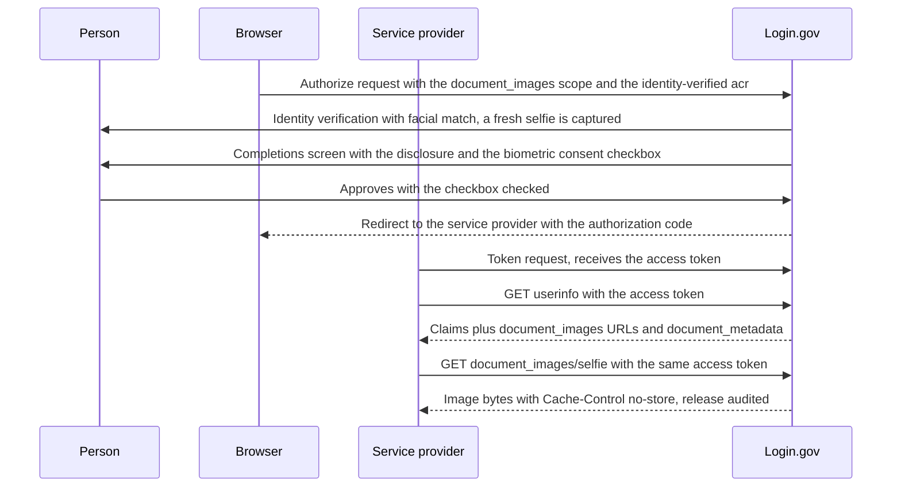

The authorize request names the `document_images` scope. `OpenidConnectAuthorizeForm#validate_document_images_scope` refuses the scope with `no_valid_scope` unless the service provider's issuer is on the allow-list and the switch is on (`ServiceProvider#document_images_sharing_allowed?`).

```http
GET /openid_connect/authorize?client_id=urn:gov:gsa:openidconnect:sp:…
    &response_type=code
    &scope=openid+email+profile+document_images
    &acr_values=urn:acr.login.gov:verified
    &redirect_uri=https://…/auth/result
    &state=…&nonce=… HTTP/1.1
Host: idp.example.gov
```

What to notice: `document_images` is an ordinary scope value, and the request asks for an identity-verified sign-in; the download endpoint refuses a sign-in that did not request identity proofing even when the person has a verified profile. The `client_id` must be an issuer listed in `document_images_sharing_service_providers`; the local fixture lists none.

On the completions screen the person sees the disclosure (locale key `help_text.requested_attributes.document_images_html`) and the required checkbox `idv_form[biometric_sharing_consent]` with the label `sign_up.document_images_sharing_consent_label`. Submitting without the checkbox re-renders the screen with status 422 and the message `sign_up.document_images_sharing_consent_required`, and records the analytics event `biometric_sharing_consent_declined`. Submitting with it checked records `biometric_sharing_consent_at` on the identity for that service provider and the event `biometric_sharing_consent_granted`.

The user-information response then carries two extra claims. Each value under `document_images` is a URL the same access token fetches.

```http
GET /api/openid_connect/userinfo HTTP/1.1
Host: idp.example.gov
Authorization: Bearer …
```

```json
{
  "sub": "…",
  "iss": "https://idp.example.gov/",
  "email": "…",
  "email_verified": true,
  "given_name": "…",
  "family_name": "…",
  "document_images": {
    "front": "https://idp.example.gov/api/openid_connect/document_images/front",
    "back": "https://idp.example.gov/api/openid_connect/document_images/back",
    "selfie": "https://idp.example.gov/api/openid_connect/document_images/selfie"
  },
  "document_metadata": {
    "document_number": "…",
    "document_issued": "2020-03-03",
    "document_expiration": "2030-03-03"
  },
  "ial": "urn:acr.login.gov:verified",
  "aal": "…",
  "auth_time": 1760000000
}
```

What to notice: the two claims are present only when sharing is authorized for this identity (scope requested, allow-list, identity-verified request, valid consent). When it is authorized but the retrieval job has not persisted the artifacts yet, both claims are present and empty (`{}`), which tells the service provider to retry; when it is not authorized the claims are absent. The image types are `front`, `back`, `passport` and `selfie` (`DocumentArtifact::IMAGE_TYPES`), and the metadata fields are `document_number`, `document_issued` and `document_expiration` (`DocumentMetadata::FIELDS`). The other claims of the response are unchanged and are elided here.

The download is a second request with the same access token.

```http
GET /api/openid_connect/document_images/selfie HTTP/1.1
Host: idp.example.gov
Authorization: Bearer …
```

```http
HTTP/1.1 200 OK
Content-Type: image/jpeg
Content-Disposition: inline
Cache-Control: no-store
Pragma: no-cache
X-Content-Type-Options: nosniff

<image bytes>
```

What to notice: the body is the decrypted image and nothing else, and the response forbids caching anywhere downstream. Every request to this endpoint, released or refused, writes the analytics event `document_image_release` with `success`, `image_type`, `issuer`, `profile_id` and `denial_reason`, never the image.

The refusals, in the order `OpenidConnect::DocumentImagesController#show` checks them:

1. No `Authorization` header, a header that is not `Bearer <token>`, or a token that matches no `identities` row with a live session: status 401 with the body `{"error": "<message>"}`, where the message is the locale text `openid_connect.user_info.errors.no_authorization`, `openid_connect.user_info.errors.malformed_authorization` or `openid_connect.user_info.errors.not_found`. This is `AccessTokenVerifier`, the same check the user-information endpoint uses.
2. The token's scope does not include `document_images`, or sharing is not authorized for this identity (no active profile, the sign-in did not request identity proofing, the service provider is not on the allow-list, or the consent is missing, revoked, older than one year or older than the person's latest verification): status 403 with the body `{"error": "document_images sharing is not authorized"}` and `denial_reason: not_authorized`.
3. No retained artifact of the requested type (the row is absent or older than `document_images_retention_days`, 90 days): status 404 with an empty body and `denial_reason: artifact_not_found`.
4. The stored key cannot unwrap or the object cannot be read: status 404 with an empty body and `denial_reason: object_unavailable`, never a 500.

### Functional requirements

| Id | Requirement |
|---|---|
| **FR-DOS-1** | The Department of State case uses the STS for any State API the service provider calls on the person's behalf, and all general STS requirements apply. The selfie and document data are not delivered through the STS in this phase. They are released only at Login.gov's user-information endpoint to the Department of State as a direct service provider on the document-images allow-list, with the purpose-specific biometric consent (D49). |
| **FR-DOS-2** | The biometric MUST NOT be included in the delegated token, in anything returned to the service provider, in a verification response, in a SAML assertion, or in any response to a party other than State. It is released only at the user-information endpoint to State's own direct sign-in. Delegated tokens are refused at that endpoint (FR-TOK-6), so a delegated token can never fetch it (D49). |
| **FR-DOS-3** | Because a delegated token never carries higher assurance than the sign-in it came from (FR-FIT-5), the person's sign-in to the service provider MUST itself include the facial-match verification State requires whenever State's passport API is requested. Login.gov MUST perform that verification during the sign-in, before consent, rather than relying on an earlier verification. |
| **FR-DOS-4** | State's passport API MUST be registered as its own agency API whose consent content states, in State's words, that approving the Department of State releases the fresh selfie to State for passport adjudication. |
| **FR-DOS-5** | When a sign-in requests State's passport API, Login.gov MUST capture a fresh selfie in that sign-in, even for a person who has already verified their identity with Login.gov. A selfie captured in an earlier verification MUST NOT be reused for State. |
| **FR-DOS-6** | Login.gov MUST tell the person, before capture, that the selfie will be released to the Department of State for passport adjudication, who will see it, how long each party keeps it, and that declining means they cannot continue this process online. This notice MUST be specific to the biometric and MUST appear in addition to the consent screen. |
| **FR-DOS-7** | If the person declines the Department of State on the consent screen, the selfie MUST NOT be released and the rest of the sign-in MUST proceed normally. |
| **FR-DOS-8** | Capture MUST meet the same liveness and quality standards as Login.gov's existing facial-match verification, and MUST meet Login.gov's accessibility requirements, including an alternative path for people who cannot complete selfie capture. |
| **FR-DOS-9** | Login.gov MUST record the capture, the consent, and each release as auditable events. |
| **FR-DOS-10** | The selfie is released only at the user-information endpoint, to the Department of State's registered direct service provider on the document-images allow-list, with the document-images scope and the person's biometric consent, and never through delegation (D49). |
| **FR-DOS-11** | The selfie MUST be released only if State's Login.gov agreement includes it as an attribute State is entitled to receive (FR-VER-4). No other agency agreement MAY include it, and the service provider's own agreement MUST NOT. |
| **FR-DOS-12** | Owned by section 14 (encrypted user-information responses). |
| **FR-DOS-13** | The release MUST include enough context for adjudication: the time of the selfie capture, the verification outcome, the assurance level, the person's identifier for State, and the delegation identifier. |
| **FR-DOS-14** | The selfie MUST be available for release only while the person's sign-in to the service provider is active (FR-VER-5). After the sign-in ends, verification MUST still confirm the token but MUST NOT include the selfie, and MUST say so. |
| **FR-DOS-15** | Login.gov MUST NOT retain the selfie beyond its existing identity-verification retention rules because of this release, and MUST NOT create a new store of biometric images for the purpose of release. The direct feature kept on the base has an artifact store and is enabled in the sandbox only. This row is the open constraint for any wider release (D49). |
| **FR-DOS-16** | State MUST be able to decrypt, verify, and view the image with tooling it controls. Login.gov SHOULD provide a reference decryption and verification example in the reference agency API (FR-OPS-5). |
| **FR-DOS-17** | Every release MUST be logged with the person's identifier for State, the delegation identifier, the time, and the key used, without logging the image. |
| **FR-DOS-18** | Fraud-signal delivery (section 12) and billing (section 11) for State MUST work exactly as for any other agency API. The biometric adds no exception. |
| **FR-DOS-19** | If State chooses to capture the selfie through its own identity-proofing vendor rather than receive it from Login.gov, FR-DOS-5 to FR-DOS-17 do not apply. The STS still applies to any other State API the service provider uses, and Login.gov's role in the passport case is limited to ordinary sign-in and identity verification of the person. |

FR-TOK-6 (section 8), FR-VER-4 and FR-VER-5 (section 8) govern what a delegated token and introspection can release.

### Protocol rows

| Id | Requirement |
|---|---|
| **DOC-1** | The direct-service-provider document-images feature (the `document_images` scope, the `document_images_sharing_service_providers` allow-list, the biometric consent checkbox on the completions screen, the `document_artifacts` store, the download endpoint and the 90-day expiry job) is kept as built and is enabled (`document_images_sharing_enabled: true`) in the sandbox only. It is off in every other environment. The Department of State is registered there as a direct service provider on the allow-list. No delegated channel for images is built. |

INT-16 (section 8) states that document images and metadata are never released by introspection or in a SAML assertion.

### As kept on the base

1. The `document_images` scope is honored for service providers listed in `document_images_sharing_service_providers`, behind the switch `document_images_sharing_enabled`. Both keys keep their defaults of `false` and `[]` in `config/application.yml.default` and are set only in the sandbox (Appendix C). `OpenidConnectAuthorizeForm#validate_document_images_scope` refuses the scope for any other service provider, and `OpenidConnectAttributeScoper` maps the scope to the two claims `document_images` and `document_metadata`.
2. The biometric consent checkbox on the completions screen (`app/views/sign_up/completions/_biometric_sharing_consent.html.erb`) is purpose-specific and is asked again after re-proofing. The person's consent is recorded as `biometric_sharing_consent_at` on the identity for that service provider. `ServiceProviderIdentity#biometric_sharing_consented?` treats the consent as valid only while it is present, not revoked, younger than one year (`CONSENT_EXPIRATION`) and not older than the active profile's `verified_at`. A delegated token never sets it. `VerifySpAttributesConcern#biometric_consent_needed?` sends the person back to the completions screen when an allow-listed service provider requests the scope and no valid consent exists.
3. `document_artifacts` and `document_metadata` are encrypted rows linked to the profile through the capture session. `DocumentArtifact` stores each image's key encrypted with the durable attribute encryptor so it survives key rotation; `DocumentMetadata` stores `document_number`, `document_issued` and `document_expiration` the same way. `SocureImageRetrievalJob#persist_document_artifacts` writes the rows under a row lock so two workers cannot race. `ExpireDocumentArtifactsJob`, scheduled daily in `config/initializers/job_configurations.rb`, deletes rows older than `document_images_retention_days` (90) and records `document_artifacts_expired`.
4. `GET /api/openid_connect/document_images/:image_type` (`OpenidConnect::DocumentImagesController#show`, route name `api_openid_connect_document_image`, `image_type` constrained to `front`, `back`, `passport` or `selfie`) streams one image. The download is authenticated by the service provider's own access token through `AccessTokenVerifier`; on the key-binding branch (section 5) a bound client presents the same `DPoP` proof it presents at the user-information endpoint. The document number and dates are read from the user-information response, not from this endpoint. Each release and each refusal is audited with `document_image_release`, which never logs the image (FR-DOS-9, FR-DOS-17). Responses are served with `Cache-Control: no-store`.
5. The mobile driver's license exemption: `SocureImageRetrievalJob` returns before fetching images when the capture session has `mdl_requested?`, so no artifacts are persisted for those sessions and the user-information claims stay empty for them.
6. Two design documents live under `docs/proofing/`: `nist-800-63-4-compliance.md`, the SP 800-63-4 analysis that is the precondition for any release beyond the sandbox, and `socure-identity-artifacts.md`.
7. The Department of State is the subject of the business case and not a fixture. `config/delegated_access.localdev.yml` and the configuration repository's `delegated_access.yml` carry no record for it, and `document_images_sharing_service_providers` is empty in the local fixture and in `config/application.yml.default`. The sandbox's allow-list entry is environment configuration (Appendix C).
8. Differences from the rows above that remain open with the agency: the feature ships the document front, back or passport image and the document number and dates as well as the selfie; declining the biometric consent blocks the person on the completions screen with status 422 instead of withholding the image and continuing (FR-DOS-7); the download endpoint serves the image over TLS, while the end-to-end encryption of FR-DOS-12 is the encrypted user-information response of section 14, which covers the metadata claims and not the download endpoint.

Specs: `spec/controllers/openid_connect/document_images_controller_spec.rb` (the 401, 403, 404 and 200 paths, the caching headers and the audit event), `spec/presenters/openid_connect_user_info_presenter_spec.rb` (the two claims, the empty-but-authorized case, the omitted-when-unauthorized cases and consent expiry), `spec/forms/openid_connect_authorize_form_spec.rb` (the scope refused off the allow-list), `spec/controllers/sign_up/completions_controller_spec.rb` and `spec/controllers/concerns/verify_sp_attributes_concern_spec.rb` (the checkbox), `spec/models/document_artifact_spec.rb`, `spec/models/document_metadata_spec.rb`, `spec/jobs/expire_document_artifacts_job_spec.rb` and `spec/jobs/socure_image_retrieval_job_spec.rb`.

### Decisions

- **D49** Document images stay a direct-service-provider feature, at the user-information endpoint only, enabled in the sandbox only.
- **D50** Encrypted user-information responses are the end-to-end encryption route, built under D81 (section 14).
- **D83** Delegated tokens stay refused at the user-information endpoint.

## 15.2 Third-party-initiated login (the alternative pattern)

### Objective

A service provider can send a signed-in person to an agency's own service. The agency signs the person in through Login.gov without asking for credentials again, and the person returns to the service provider. No delegated token is involved (OpenID Connect Core 1.0 §4). The pattern fits when the agency must interact with the person directly in its own service, require its own assurance level, or run its own workflow with the person present. The STS fits when the service provider calls agency APIs from the person's browser with its own tokens, combines agencies, continues through refresh while the person is away from the agency, or passes attributes the service provider itself must not see. A business case may use both. The Department of State case uses the STS.

Three things do not change under this pattern. Billing: the agency's sign-in is a direct sign-in to the agency and is billed to the agency exactly as one; the initiating service provider is not billed for it. Consent: the person sees Login.gov's existing consent screen for the agency's own attributes; nothing is delegated, so the delegated-access consent (sections 2 and 3) is not involved. Fraud signals: the agency receives the Attempts API events of a direct sign-in, and both applications log the hand-off (start, return, status) with a correlation hint that carries no identity.

Login.gov itself needs no change. The pattern runs against the unchanged identity provider and is implemented in the three reference applications, so partners can see both patterns side by side. It can be exercised in the sandbox as soon as the agency reference applications are registered there as ordinary service providers. One operational note: with all reference applications on one host, each must use its own session cookie name, because browsers scope cookies by host and not by port.

The flow below is what the reference applications build. The person has already signed in to MyBenefits Assistant through Login.gov, so Login.gov has a live session for them.

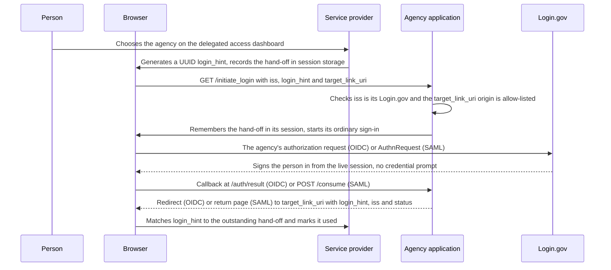

The initiation request the browser builds (`initiationUrl` in `public/assets/js/third-party-login.js` of the service provider reference) is a GET with exactly the three §4 parameters. `iss` is Login.gov's issuer (`idp_url` from `/config.json`), `login_hint` is a fresh `crypto.randomUUID()`, and `target_link_uri` is the configured return route.

```http
GET /initiate_login?iss=https%3A%2F%2Fidp.example.gov
    &login_hint=3f1c9b2e-7d4a-4c58-9e21-0b6f5a8d2c71
    &target_link_uri=https%3A%2F%2Fmybenefits.example.gov%2Fthird_party%2Freturn HTTP/1.1
Host: records.housing.example.gov
```

What to notice: nothing in the request identifies the person. The agency learns who the person is only from its own Login.gov sign-in, and the hint is the only thing it will echo back.

Before the browser leaves, the service provider records the hand-off under its hint in the browser's session storage (`storage.js`, key `third_party`), with a ten-minute lifetime (`HANDOFF_TTL_SECONDS = 600`). Stale entries are dropped on every write.

```json
{
  "pending": {
    "3f1c9b2e-7d4a-4c58-9e21-0b6f5a8d2c71": {
      "loginHint": "3f1c9b2e-7d4a-4c58-9e21-0b6f5a8d2c71",
      "target": "Department of Housing Support",
      "issuer": "urn:gov:gsa:openidconnect:sp:records_agency",
      "startedAt": "2026-10-13T15:04:05.000Z",
      "returnedAt": null,
      "returnedIss": null,
      "status": null
    }
  },
  "last": null,
  "lastReturnError": null
}
```

What to notice: the record holds the agency's expected issuer, so the dashboard can show when the `iss` reported on return differs from the configured one.

The agency's checks run in a fixed order, the issuer first, because a request for an untrusted identity provider must not be acted on at all. A failing request is refused with status 400 and nothing is stored or redirected. The OIDC agency (`ThirdPartyLogin#validate_third_party_initiation!` in `identity-oidc-sinatra`) answers in plain text, and the SAML agency (`verify_third_party_issuer!` and `verify_target_link_uri!` in `identity-saml-sinatra`) answers with JSON.

```http
HTTP/1.1 400 Bad Request
Content-Type: text/plain

Cannot start sign-in: target_link_uri is not an allowed return location
```

```json
{
  "error": "invalid_request",
  "error_description": "iss must name the Login.gov issuer this service trusts"
}
```

The checks are: `iss` must equal the agency's configured Login.gov issuer, with a trailing slash as the only tolerated difference; `target_link_uri` must be an absolute `http` or `https` URL whose origin (scheme, host and non-default port) is one of the configured exact origins, with no wildcards, and the SAML agency honors a plain-`http` origin only for `localhost` and `127.0.0.1`; `login_hint` is optional, is trimmed and may be at most 128 characters (`LOGIN_HINT_MAX_LENGTH`, `THIRD_PARTY_LOGIN_HINT_MAX_LENGTH`). On success the agency stores the hint and the validated `target_link_uri` in its session (`third_party_login_hint` and `third_party_target_link_uri` in the OIDC agency, `third_party_login` in the SAML agency) and starts its ordinary sign-in with `prompt=select_account` and the scopes of a direct sign-in at its configured level (`THIRD_PARTY_SIGN_IN_IAL`, default `2`). The hint is not forwarded to Login.gov.

When the sign-in completes, the OIDC agency redirects from its `/auth/result` callback and the SAML agency answers the `POST /consume` with its own page. Both append the same three parameters to the remembered `target_link_uri`, keeping any query string already on it, and delete the hand-off from the session so it cannot be used twice.

```http
HTTP/1.1 302 Found
Location: https://mybenefits.example.gov/third_party/return?login_hint=3f1c9b2e-7d4a-4c58-9e21-0b6f5a8d2c71&iss=urn%3Agov%3Agsa%3Aopenidconnect%3Asp%3Arecords_agency&status=signed_in
```

What to notice: `iss` is now the agency's own identifier (its `client_id`, or its SAML issuer `urn:gov:gsa:SAML:2.0.profiles:sp:sso:benefits_agency`), `status` is `signed_in` or `failed`, and no identity data travels with the return. A failed sign-in also ends the hand-off, with `status=failed` instead of the agency's error page.

The SAML agency cannot redirect from its assertion consumer. Login.gov's SAML POST-binding page carries `Content-Security-Policy: form-action 'self' <the agency's consumer URL>`, and Chrome applies `form-action` to the redirects that follow a form submission, so a cross-origin redirect from `/consume` is blocked and the person is left on Login.gov's page. The agency therefore answers the POST with `views/third_party_return.erb`, a page of its own that continues under its own policy.

```text
<meta http-equiv="refresh" content="0;url=https://mybenefits.example.gov/third_party/return?login_hint=…&iss=urn:gov:gsa:SAML:2.0.profiles:sp:sso:benefits_agency&status=signed_in">
Signed in. Returning you to the service that sent you here.
[Return link to the same URL, id third-party-return-link]
```

Back at the service provider, `matchReturn` accepts the return only when `login_hint` is present, names a hand-off this browser session issued, that hand-off has not expired and has not been answered before. A return that fails any of these records only the refusal reason (`no login_hint`, `unknown or already used login_hint`, `login_hint expired`) and `iss` and `status` are ignored, so a guessed or replayed hint cannot mark a hand-off as signed in. The agency's signed-in page states that the session started from a third party: the OIDC agency shows the host of `target_link_uri` (`third_party_initiated_from`), the SAML agency shows the hint.

The service provider's non-secret configuration carries the targets and the return route. The defaults name the two local reference agencies; `THIRD_PARTY_LOGIN_TARGETS` (a JSON array) and `THIRD_PARTY_RETURN_URI` override them.

```json
{
  "third_party_return_uri": "https://mybenefits.example.gov/third_party/return",
  "third_party_login_targets": [
    {
      "name": "Department of Housing Support",
      "initiate_login_uri": "https://records.housing.example.gov/initiate_login",
      "issuer": "urn:gov:gsa:openidconnect:sp:records_agency"
    },
    {
      "name": "National Retirement Administration",
      "initiate_login_uri": "https://portal.retirement.example.gov/initiate_login",
      "issuer": "urn:gov:gsa:SAML:2.0.profiles:sp:sso:benefits_agency"
    }
  ]
}
```

What to notice: only a configured agency can be a destination, so the dashboard form cannot be turned into an open redirect. On the agency side the allow-list is `THIRD_PARTY_TARGET_LINK_ALLOWLIST`, a space- or comma-separated list of origins that defaults to `https://mybenefits.example.gov`.

### Functional requirements

| Id | Requirement |
|---|---|
| **FR-TPL-1** | The pattern MUST follow OpenID Connect Core 1.0 section 4 (Initiating Login from a Third Party): the service provider sends the person's browser to the agency's published login-initiation address, identifying Login.gov as the identity provider and the page the person should land on. |
| **FR-TPL-2** | The agency MUST sign the person in through its own Login.gov integration, with its own assurance requirements, attribute agreement, consent screen, fraud-signal enrollment, and billing. Login.gov MUST treat this sign-in exactly as any direct sign-in to the agency. |
| **FR-TPL-3** | When the person has an active Login.gov session, Login.gov MUST NOT ask for credentials again unless the agency requires it or a higher assurance level requires further verification. |
| **FR-TPL-4** | The agency MUST refuse an initiation request unless `iss` names the Login.gov it is configured to use, and unless `target_link_uri` matches an allow-list of exact origins the agency approved. These are the two checks OpenID Connect Core §4 requires of the relying party: a forged `iss` would send the person to an attacker's identity provider, and an unchecked `target_link_uri` is an open redirect. |
| **FR-TPL-5** | The service provider MUST send `iss` (Login.gov), `login_hint` and `target_link_uri`. `login_hint` MUST be a correlation identifier the service provider generates for this hand-off (a UUID), recorded on its side, single-use, and short-lived (ten minutes in the reference). It MUST carry no identity. The agency MUST remember it for the sign-in it starts and MUST treat the Login.gov sign-in as the only proof of who the person is. When the service provider needs the agency to trust task context or a return address beyond the allow-listed origin, it SHOULD add a signed, single-use statement. The correlation hint alone is sufficient for the flow to be correct. |
| **FR-TPL-6** | When its sign-in completes, the agency MUST send the person to `target_link_uri` with the same `login_hint`, its own identifier as `iss` (client_id or SAML entityID), and `status` (`signed_in` or `failed`), and MUST clear the hand-off so it cannot be replayed. The service provider MUST accept a return only when `login_hint` matches a hand-off it issued and still has outstanding in the same browser session, so a result cannot be attached to a different person's session. `iss` and `status` from an unmatched return MUST be ignored. The return MUST carry no identity data. |
| **FR-TPL-7** | The person MUST be told, at the hand-off, that they are leaving the service provider and which agency they are going to, and MUST be able to return to the service provider when done. |
| **FR-TPL-8** | Nothing in this pattern MAY require the service provider to hold a token for the agency or to call the agency's systems directly. |
| **FR-TPL-9** | A SAML agency MUST complete the return from a page of its own (an immediate refresh plus a visible link) rather than an HTTP redirect from its assertion consumer. Login.gov's SAML POST-binding page carries a Content-Security-Policy `form-action` limited to Login.gov and the agency's consumer URL, and Chrome applies `form-action` to the redirects that follow a form submission, so a cross-origin redirect from the consumer is blocked and the person is left on Login.gov's page. An OIDC agency's callback is reached by a GET redirect and MAY redirect directly. |
| **FR-TPL-10** | The agency's sign-in MUST be billed to the agency as a direct sign-in and MUST deliver the agency's ordinary Attempts API events. The service provider MUST NOT be billed for it. Both applications MUST log the hand-off's start, return and status with the correlation hint and no identity data. |

### Protocol rows

| Id | Requirement |
|---|---|
| **TPL-1** | The reference service provider MUST start the flow with a browser redirect to the agency's `initiate_login_uri` carrying `iss` = Login.gov's issuer URL, `login_hint` = a UUID the service provider generates for this hand-off, and `target_link_uri` = the service provider's own return URL (`/third_party/return`). |
| **TPL-2** | `login_hint` is a correlation identifier only. It MUST carry no identity, MUST be single-use, MUST expire (ten minutes in the reference), and the service provider MUST accept a return only when the hint matches an outstanding hand-off it recorded. The browser public client keeps that record in the browser's session storage, since it has no server session (D57). The agency learns who the person is only from its own Login.gov sign-in; neither party treats the hint as identity. |
| **TPL-3** | Each agency reference app MUST expose `GET /initiate_login`, MUST refuse the request unless `iss` equals the Login.gov issuer it is configured to use, and MUST refuse unless `target_link_uri` matches an allow-list of exact origins. No wildcards; `https` or the explicit local-development origins only. |
| **TPL-4** | On a valid initiation the agency MUST remember `login_hint` and the validated `target_link_uri` in its session and start its ordinary Login.gov sign-in: the OIDC agency its usual authorization code request, the SAML agency its usual AuthnRequest, with the scopes, attributes and ACR it uses for a direct sign-in. The hint is not forwarded to Login.gov. |
| **TPL-5** | When the agency's sign-in completes it MUST send the person to the remembered `target_link_uri` with `login_hint` (the same UUID), `iss` (the agency's own client_id or SAML entityID) and `status` (`signed_in` or `failed`), then clear the hand-off so it cannot be replayed. An OIDC agency MAY do this with an HTTP redirect from its callback. A SAML agency MUST NOT redirect to the third party straight from its assertion consumer, because of the `form-action` policy on Login.gov's SAML POST-binding page (FR-TPL-9); it answers the consumer POST with its own page that continues to `target_link_uri` (an immediate refresh plus a visible link). |
| **TPL-6** | The agency MUST show on its signed-in page that a third party started the session, and MUST NOT include any identity data in the return redirect. What the service provider learns is only that the hand-off it started completed. |
| **TPL-7** | The pattern is browser-only. The service provider MUST NOT hold a token for the agency, MUST NOT call the agency's systems directly, and the agency's Attempts API events, billing and consent are those of a direct sign-in. The reference apps MUST state this difference from delegated access in their user interface and documentation. |

The reference implementation uses the plain §4 parameters, with the two MUST-verify rules (TPL-3) and the single-use hint (TPL-2) as the controls. A signed hand-off statement carrying task context remains an option for a production integration (FR-TPL-5).

### Where it lives

| Repository | Implementation |
|---|---|
| `identity-sts-sinatra` (the browser public client) | Page code in `public/assets/js/third-party-login.js` and `ui.js`: the hint, the initiation URL, the hand-off record and its match in session storage (`storage.js`); the start is a form on the delegated-access dashboard (`onThirdPartyStart`) and `/third_party/return` is a page state of the shell; a dashboard section shows outstanding hand-offs, the last return and any refused return; `THIRD_PARTY_LOGIN_TARGETS` and `THIRD_PARTY_RETURN_URI` in the non-secret JSON configuration (`config.rb`); documentation in `docs/delegated-access.md`; `spec/js/third-party-login.spec.js` and `spec/e2e/third_party_login_spec.rb`. |
| `identity-oidc-sinatra` (OIDC agency) | `GET /initiate_login` with the `iss` and allow-list checks in `third_party_login.rb`, the hand-off stored in session, the redirect after `/auth/result` (and after a failed sign-in, with `status=failed`), `THIRD_PARTY_TARGET_LINK_ALLOWLIST` and `THIRD_PARTY_SIGN_IN_IAL`, the origin shown on the signed-in page; `spec/third_party_login_spec.rb`. |
| `identity-saml-sinatra` (SAML agency) | The same checks in `app.rb`, except that `POST /consume` answers with the agency's own return page `views/third_party_return.erb` (refresh plus link) instead of a redirect; the hint shown on `views/success.erb`. |
| `identity-idp` | None. |

### Decisions

- **D57** The service provider reference application is a standards-based browser public client, so the initiator is page code.

## 15.3 The reference applications and the end-to-end harness

### Objective

Everything in sections 1 to 14 puts new obligations on partners. A service provider must exchange with a proof, rotate refresh tokens and revoke; an agency API must introspect, enforce scope, verify proofs and join Attempts events on `delegation_id`. Without working examples each partner would interpret the standards differently and Login.gov would debug the same mistakes agency by agency. Three reference applications and a live end-to-end harness are therefore part of the capability. They are how the design is validated with the first partner agencies, how later agencies onboard without a support engagement, and the acceptance test for every branch from the exchange onward.

The three repositories and the branches that carry the work: the service provider reference `GSA-TTS/identity-sts-sinatra`, branch `main`, a browser public client; the OIDC agency reference `18F/identity-oidc-sinatra` and the SAML agency reference `18F/identity-saml-sinatra`, branch `login-delegated-access`. The contract between them and this repository is the `development` section of `config/delegated_access.localdev.yml` (one delegation scope per application, issuers, resource identifiers, redirect URIs, hostnames) plus the harness. The harness reads issuers, identifiers, scope values and hostnames from that file and from nowhere else (D51). One side is changed only together with the other.

Locally every process shares one host, so the URLs in the fixture, in the reference applications' defaults and in the harness are the same from the browser, from each container and from the spec process. `docker-compose.e2e.yml` in the service provider reference runs all of them with host networking.

| Process | Local address | Where the value comes from |
|---|---|---|
| Login.gov (identity-idp, plain HTTP) | `http://localhost:3000` | `E2E_IDP_URL` for the harness; `idp_url` for every reference application; `DOMAIN_NAME` in the compose file |
| MyBenefits Assistant (service provider, `identity-sts-sinatra`) | `http://localhost:9292` | `DELEGATION_SP_URL` in the fixture; `redirect_uri` and `THIRD_PARTY_RETURN_URI`; `E2E_SP_URL`; `PORT ?= 9292` |
| Housing Assistance Records (OIDC agency, `identity-oidc-sinatra`) | `http://localhost:9393` | `DELEGATION_OIDC_AGENCY_URL` in the fixture; `RESOURCE_SERVER_URL`; `E2E_RS_URL`; `PORT ?= 9393` |
| Retirement Benefits Portal (SAML agency, `identity-saml-sinatra`) | `http://localhost:4567` | `DELEGATION_SAML_AGENCY_URL` in the fixture; `SAML_RESOURCE_SERVER_URL`; `E2E_SAML_RS_URL`; `PORT ?= 4567` |
| Redis | `redis://localhost:6379/0`, `/1` (throttling), `/2` (Attempts API) | `REDIS_URL`, `REDIS_THROTTLE_URL`, `REDIS_IRS_ATTEMPTS_API_URL` in the compose file |
| PostgreSQL 16 | default port on the host | `POSTGRES_HOST: localhost` in the compose file |

The two API identifiers, `https://records-api.agency.localdev` and `https://benefits-api.agency.localdev`, are RFC 8707 resource indicators and never change with the hostname. The port 9292 is also the capybara-webmock proxy port of identity-idp's browser specs (item 4 below).

The harness is `spec/e2e/` in the service provider reference. Every example is skipped unless `E2E_IDP_URL` is set; the scenario titles below are the spec descriptions as written.

| File | Scenario | Gate beyond `E2E_IDP_URL` |
|---|---|---|
| `oauth_delegation_spec.rb` | 1. approves Housing Assistance Records, remember off; exchange; read and write both answer | none |
| `oauth_delegation_spec.rb` | 2. approves only the Retirement Benefits Portal: an exchange for the records API is refused with consent_required | none |
| `oauth_delegation_spec.rb` | 3. requests no delegation: no consent screen, token scope has no token_exchange:*; exchange fails consent_required | none |
| `oauth_delegation_spec.rb` | 4. remember on: the second authorization skips consent | none |
| `oauth_delegation_spec.rb` | 5. adding an application on the second authorization shows consent with the remembered one marked approved | none |
| `oauth_delegation_spec.rb` | 6. refresh rotates the refresh token and the new access token works | the wait for the old token to expire runs only with `E2E_WAIT_FOR_EXPIRY=true` |
| `oauth_delegation_spec.rb` | 7. replaying a rotated refresh token gets invalid_grant, revokes the family, and is reported | none |
| `oauth_delegation_spec.rb` | 8. revoking from Account → Delegated access makes the API refuse the token | waits `E2E_INTROSPECTION_CACHE_SECONDS` for the agency's introspection cache |
| `oauth_delegation_spec.rb` | 9. wrong caller: a token for one API is refused by the other, and this app cannot introspect | none |
| `oauth_delegation_spec.rb` | 12. the exchange binds the token to the session key: token_type DPoP, proof on every call | none |
| `oauth_delegation_spec.rb` | 13. the bound token is useless without the key: Bearer / no proof is refused with a DPoP challenge | none |
| `oauth_delegation_spec.rb` | 14. refresh with the same key keeps the family bound and the new token works with a proof | none |
| `oauth_delegation_spec.rb` | 15. an exchange without a proof is refused by the IdP for a public client | none |
| `saml_delegation_spec.rb` | issues a SAML assertion the benefits API accepts, with token_type N_A | none |
| `saml_delegation_spec.rb` | issues the registered format: asking saml2 for an API registered for OAuth tokens yields an access token | none |
| `saml_delegation_spec.rb` | a revoked grant is noticed at the next presentation: the refresh before it is refused | none |
| `saml_delegation_spec.rb` | binds the assertion to the session key and presents it with a proof; without the proof it is refused | none |
| `saml_delegation_spec.rb` | a refresh after the Login.gov session ended returns an identifiers-only assertion | none |
| `third_party_login_spec.rb` | hands the signed-in user to the OIDC agency, which signs them in without a credential prompt and returns them | the group is skipped with `E2E_THIRD_PARTY_LOGIN=false` |
| `third_party_login_spec.rb` | hands the user to the SAML agency the same way | the group is skipped with `E2E_THIRD_PARTY_LOGIN=false` |
| `third_party_login_spec.rb` | ignores a return whose login_hint it did not issue | the group is skipped with `E2E_THIRD_PARTY_LOGIN=false` |

The numbering in `oauth_delegation_spec.rb` has no 10 and 11; the Attempts-viewer and billing checks named in item 3 below live as request specs in the agency references and in `identity-idp`, not in `spec/e2e`.

### Protocol rows

| Id | Requirement |
|---|---|
| **REF-IMPL-1** | The reference service provider MUST request `token_exchange:*` scopes, display what the person approved, perform the exchange from the browser with a DPoP proof, call an agency API with the delegated token, refresh on a timer with rotation, and revoke on demand (D57). |
| **REF-IMPL-2** | A reference resource server MUST be provided that accepts delegated tokens, introspects them with its own `private_key_jwt` assertion, enforces `scope` per route, and shows every decision it made. As built the roles are separate repositories (one service provider, one OIDC resource server, one SAML resource server) rather than one role-switched application. |
| **REF-IMPL-3** | The OIDC resource server reference (`identity-oidc-sinatra`) MUST include an Attempts API viewer in the agency role that polls with the agency's credentials and joins events to API calls on `delegation_id`. The SAML agency's events are delivered by Login.gov and can be observed with that viewer configured for the SAML agency's credentials (D58). |
| **REF-IMPL-4** | All roles MUST run against a local identity provider with a single command, using the fixture `config/delegated_access.localdev.yml` shipped in `identity-idp`, and against the sandbox by changing environment variables only. The sandbox seeds the same file with hostnames from `DELEGATION_SP_URL`, `DELEGATION_OIDC_AGENCY_URL` and `DELEGATION_SAML_AGENCY_URL`. |
| **REF-IMPL-5** | An automated end-to-end test MUST drive the full flow (sign in, consent with remember on and off, exchange, API call, introspection, refresh, reuse detection, revocation, Attempts delivery) and MUST run in CI against a local identity provider. |
| **REF-IMPL-6** | The repositories MUST include a partner-facing guide: a sequence diagram, the exact requests and responses, the proof and assertion payloads, error handling, and a checklist for each role derived from the exchange, introspection and refresh rows, each item linking to the reference function and the RFC section. |
| **REF-IMPL-7** | Reference code MUST be written so that partners can copy it: one function per protocol step, standards cited in comments, no framework-specific cleverness. |
| **REF-IMPL-8** | The reference service provider keeps no token on a server. Tokens live in page memory for the duration of the sign-in, and the DPoP key, generated non-extractable, never leaves the browser, so a stolen token is unusable without it (D57). |
| **REF-IMPL-9** | The end-to-end harness MUST be skipped automatically when no identity provider is configured (`E2E_IDP_URL` unset) so unit CI passes without a stack. Scenarios that need a wait or a token read from the browser MUST be gated behind explicit environment variables and marked pending otherwise. |
| **REF-IMPL-10** | The Attempts API viewer in `identity-oidc-sinatra` MUST decode unsigned events as JSON as well as signed ones, and MUST poll once per page load, without acknowledging, so an operator refreshing the page keeps seeing the last hour of activity. A production agency acknowledges to advance the pointer (ATT-18). |
| **REF-IMPL-11** | Anything a reference resource server echoes back to the service provider from an introspection response MUST be filtered to the token members (`active`, `aud`, `scope`, `act`, `client_id`, `acr`, `iat`, `exp`, `token_type`, `delegation_id`, `session_live`). Identity claims MUST be consumed by the API exactly as user-information claims are, with the same SSN redaction, and MUST never be echoed unredacted to the service provider. |
| **REF-IMPL-12** | The reference service provider MUST treat a SAML assertion as single-use: it presents a given assertion to the agency API at most once and refreshes before any further call, unless the agency has declared that it accepts reuse (SAML-10). |
| **RS-DPOP-1** | A resource server whose tokens may be key-bound MUST verify the DPoP proof on every request per RFC 9449 §4.3, using `cnf.jkt` from introspection, and MUST refuse a bound token presented with the `Bearer` scheme. Whether a service provider's tokens are bound follows its record's `dpop_required` (D82); there is no per-API setting. Each agency confirms this verification before rollout. |

### As built

1. **The browser public client** (`identity-sts-sinatra`, `main`). It signs in with PKCE. It generates a DPoP key with WebCrypto, non-extractable, holds it as an IndexedDB `CryptoKey`, and uses a new key per sign-in. It sends `dpop_jkt` on the authorization request. The authorization-code exchange, the token exchange, refresh, revocation, its own introspection and the agency API calls are all made from the browser, each with a proof carrying `htm`, `htu`, `iat`, `jti` and `ath`, and it implements the `DPoP-Nonce` retry of RFC 9449 §8 although Login.gov issues no nonces. The server is static hosting plus a non-secret `/config.json` (issuer, `client_id`, redirect URI, agency API origins and resource identifiers, delegation scopes, third-party targets). It holds no private key, shared secret or token. Its `.gitleaks.toml` allow-lists the `PHNhbWw-assertion` placeholder (D76). Its service-provider record in the fixture sets `pkce: true`, `token_exchange_enabled_sp: true` and `dpop_required: true`.
2. **The agency references** (`identity-oidc-sinatra`, `identity-saml-sinatra`, `login-delegated-access`). Each introspects with `private_key_jwt`, enforces scope per route, verifies the DPoP proof against `cnf.jkt`, refuses a bound token under `Bearer`, keeps a decision log, and fails closed with status 503 when introspection errors or times out. Each allows CORS for the service provider's origin, with `Authorization`, `DPoP` and `Content-Type` allowed and `WWW-Authenticate` exposed so the browser can read a challenge (D59). The SAML agency refuses a second presentation of one assertion. The OIDC agency's Attempts viewer has a "Delegated sessions" join on `delegation_id`. Both expose `GET /initiate_login` for the alternative pattern (15.2).
3. **The harness** (`spec/e2e/` in `identity-sts-sinatra`, Capybara and Selenium, host networking in the compose file so every URL matches the local contract) drives the page through sign-in, consent, exchange, API call, refresh and revocation and reads tokens and the DPoP thumbprint from the page. The scenarios it covers: approve both applications with remember off, exchange each and call both APIs; approve one, call the other and receive `insufficient_scope`, exchange for it and receive `consent_required`; approve none and receive no `token_exchange:*` scope; remember on, so the second authorization skips consent and the agency receives `delegated-access-consented` with `remembered: true`; a second authorization adding an application shows the screen with the approved one already recorded; refresh, with the old token inactive after expiry (gated behind `E2E_WAIT_FOR_EXPIRY=true`); replay of a rotated refresh token, which receives `invalid_grant`, revokes the family, makes the API call refuse the token and emits `delegated-access-revoked` with `reason: refresh_token_reuse`; revocation from Account → Delegated access, with the API call refused at once; the wrong resource server introspecting and receiving `active: false` (a request spec against the agency references); the agency viewer showing the sign-in, MFA, consent and token-issued events under one `delegation_id` while the other agency's viewer shows nothing; and billing as a request spec in `identity-idp` (one `sp_return_logs` row per exchange with `access_type: delegated`, none on refresh, one user for direct plus delegated in a month). The harness is skipped unless `E2E_IDP_URL` is set.
4. **Running it.** The harness signs in as an identity-verified development user (`E2E_USER_EMAIL`; the primed `test2@test.com`, not the unverified default `test1@test.com`), or every scenario stops at `/verify/welcome`. The identity provider runs with `LAUNCHY_DRY_RUN=true` so development emails are written to `tmp/letter_opener/` and not opened. Each scenario empties the Attempts store (`attempts-api-events:*`) first, because the viewers poll without acknowledging. WebMock is disabled for the live run. The browser harness drives every page a real user can meet (rules of use, the second-MFA reminder, the first-visit authorization confirmation, the RP-initiated logout confirmation) and finds USWDS checkboxes with `visible: :all`. Servers are restarted after pulling commits, and the identity provider is re-seeded after a fixture certificate is added. Browser specs in `identity-idp` route through the capybara-webmock proxy on port 9292, which the reference service provider also uses, so they run with `Capybara::Webmock.port_number` set to a free port (Appendix C).
5. **Not demonstrated by design.** No reference application decrypts user-information responses and no fixture record opts in (section 14, D81): the feature serves one partner's need and the public references must not present it as general. The reference agency never calls the user-information endpoint with a delegated token.
6. **The partner guide** (REF-IMPL-6; FR-OPS-6) lives with the reference applications: the sequence diagram with the file and function behind each arrow, the service-provider and resource-server checklists, every request and response from the harness with placeholders including every error case, and the sandbox onboarding steps (what to send Login.gov and what to expect back).

### Decisions

- **D51** One fixture is the contract between the seeder and the harness.
- **D57** The service provider reference is a browser public client; there is no confidential-client reference and no server-side proof signing.
- **D58** The two references that have no Attempts API code upstream carry none; the Attempts API viewer lives in `identity-oidc-sinatra`.
- **D59** CORS is allowed for browser calls at the agencies and at the identity provider's revocation and introspection endpoints.
- **D76** Both repositories carry gitleaks allowlists.

## 15.4 The configuration repository

Production content for delegated access is configuration, not an admin interface (D77). The agencies' consent content, the service providers approved for delegation and the agency applications with their consent text, logos and API URLs are maintained by the Login.gov team as `delegated_access.yml` in `18F/identity-idp-config`, reviewed by pull request and seeded by `rake db:seed` in every environment, exactly as `service_providers.yml` and `agencies.yml` are. Section 13 describes the seeder; this subsection records the repository side.

1. Branch `delegated-access` of `identity-idp-config` carries `delegated_access.yml`, keyed by Rails environment with `development` and `production` sections. The file's header explains the keying, `restrict_to_deploy_env`, that `logo` is a filename under `public/assets/images/sp-logos/` and never a path or URL, and that resource identifiers do not change with the hostname. The branch also carries the three fictitious logos, `spec/delegated_access_config_spec.rb` (8 examples on the file's shape: `safe_load`, no duplicate keys, keyed by environment, both maps in every environment, every service provider with a `friendly_name` and an agency in the same environment, every application with a scope value and resource servers with an identifier and an `oauth` or `saml2` format, every logo present, every `production` entry restricted to the sandbox) and a "Delegated access content" section in the README. Every `production` entry is `restrict_to_deploy_env: 'sandbox'`, so `prod` and `staging` write none of the fictitious content. The reference browser client's entry sets `dpop_required: true`.
2. Deploy clones the configuration repository at `main` (`Deploy::Activate#clone_idp_config`), so the branch is not deployable until merged. Merging it ahead of this stack is safe because identity-idp `main` neither links nor reads the file. Deploying the stack first is safe because the seeder treats a missing file as nothing to seed.
3. Open items in that repository, with owners, are in Appendix D (items 13 and 24): the existing "has no invalid logos" example, the Dependabot update branch, and the Dashboard fields that would eventually let partners edit this content themselves.

## 15.5 Delegated-access history on the account page (planned, not built)

Account → Delegated access shows remembered approvals in their current state only, with an end-all action (D54). Past changes are visible through the account history events and emails that approvals and revocations write (D87). The follow-up, decided and not built (D55), is a per-service-provider history on that page: past approvals with their source (consent screen or account page) and whether each one carried a remembered approval; revocations with their reason (the person, service provider disconnect, material content change, account suspension or deletion, refresh token reuse); and token issuance and refresh events per application, each with its date. It is sourced from the grant rows, which are never deleted, and from the token issuance record (section 7, D26 and D79), not from a new table. The page shows 12 months, after which rows are still kept for billing and audit but no longer shown. It depends on section 3 (the page) and section 7 (the issuance record).

| Id | Requirement |
|---|---|
| **FR-CUX-15** | The page SHOULD offer, per service provider, a history of past approvals (with source and whether remembered), revocations (with reason: the person, service provider disconnect, material content change, account suspension or deletion, refresh token reuse) and token issuance and renewal events, each with its date, covering the last 12 months, built from the approval records and the token issuance record rather than a new store. Not built; the design is recorded here (D55). |

ACC-7 (the protocol row for the same view) is satisfied by the same design when built.

## 15.6 Delegated tokens at the user-information endpoint for agencies without introspection (documented, not built)

**What stands.** Agencies verify delegated tokens by introspection (RFC 7662), authenticated with their own key (`private_key_jwt`). The user-information endpoint refuses a delegated token with or without a proof (FR-TOK-6; EXC-6, EXC-18; INT-1). `AccessTokenVerifier#load_identity` resolves a token against `identities` alone, and delegated tokens live in `DelegatedTokenStore`, so none is ever found there; the comment on that method says not to add a second lookup path. D83 records this.

**Why a design is recorded.** Agencies do not support the introspection endpoint today and need time to add it. Login.gov may need to let an agency present a delegated token at the user-information endpoint as a bearer token during a transition, then withdraw the opening. The design is recorded so that, if the need arrives, it can be built with the context intact rather than improvised. The recommendation is to hold it until an agency asks and cannot implement introspection in time, and then to build only this.

The diagram shows the documented opening and, in the notes, how it differs from what is built. In section 8 the agency never presents the token to the user-information endpoint; it asks the introspection endpoint with its own key.

```mermaid
sequenceDiagram
    participant SP as Service provider
    participant API as Agency API
    participant LG as Login.gov
    SP->>API: API call with the delegated token
    Note over API,LG: As built (section 8), the agency introspects with its own key and never calls userinfo
    API->>LG: GET userinfo with the delegated token as a bearer token (documented, not built)
    LG->>LG: No identities row, a live DelegatedTokenStore entry, the API's userinfo_allowed in force
    LG-->>API: The claims introspection would release, as the user-information JSON
    Note over LG: Today this request is refused like any delegated token at userinfo
```

**Why it is not built, stated plainly.** The user-information endpoint is authenticated by nothing but the token, so whoever holds a delegated token would receive the person's attributes. The agency cannot present a DPoP proof for a delegated token, because the token is bound to the service provider's browser key and not to any key the agency holds, so acceptance there is bearer acceptance. A key-bound delegated token, useless without the key at the agency's API, would be usable without it at the user-information endpoint, and an unflagged public client's delegated tokens are already bearer tokens (D82). The attribute bundle would leave Login.gov to an unauthenticated caller, where introspection releases it only to the registered agency for that API. SAML delegated tokens are assertions and have no meaning at the user-information endpoint. The reference agency never calls it with a delegated token. Introspection is the strongest control in the design, and no agency has asked for the opening.

| Id | Requirement |
|---|---|
| **INT-17** | Documented, not built (D83). (a) Opt-in per agency API on the registry record: `token_exchange_resource_servers.userinfo_allowed` (boolean, default false) with a mandatory `userinfo_allowed_until` date, set through `identity-idp-config` and through the Dashboard once it has the fields (D7), never through a request parameter; `oauth` APIs only, since a `saml2` API is issued assertions. The opening lapses on its own at the date. (b) At the user-information endpoint, a bearer token that resolves to no `identities` row but to a live `DelegatedTokenStore` entry whose resource server has the opening in force receives, as the user-information JSON, exactly what introspection releases to that agency, built by `DelegatedTokenClaims`: `sub` as the agency's pairwise identifier, `act` naming the service provider, the application's attribute bundle while the person's sign-in is live and identifiers and email afterwards with `session_live`, and `aud` and `delegation_id`. In every other case the refusal is as today, with or without a proof. (c) The entry must be live, unrevoked and unexpired by the one Redis read, and held to the conditions introspection applies (`OpenidConnectIntrospectForm#token_active?`: the person present and not suspended, the grant `valid_now?`, the resource server `usable?`, the service provider still approved), so revocation keeps propagating. (d) `openid_connect_bearer_token` gains `delegated: true` and the resource server identifier; an alert on any such use is recommended. (e) The encrypted user-information response (section 14) does not apply: the caller is the agency, not the service provider the token's identity belongs to, and an agency with a registered certificate could as well implement introspection with the same key; no encryption variant is designed. (f) `ServiceProviderSeeder` and `ServiceProviderUpdater` warn when `userinfo_allowed` is set without a date or with a date already past; such a record has no opening. (g) Unchanged: the service provider's own tokens at the user-information endpoint, plain and encrypted; DPoP enforcement for bound tokens; the refusal of delegated tokens for every API without the opening; the introspection path, its callers and its responses. |

**Review items the opening would create.** Bearer exposure of the attribute bundle for up to the token lifetime (15 minutes by default, FR-TOK-4) at the agency and at any intermediary. No caller authentication, so `aud` cannot be checked against the caller and the opening is protected only by the record it is set on. The privacy review for fraud signals (Appendix D item 22) assumes introspection as the only release path to agencies. The NIST IR 8587 conformance summary and the security review would need updating in their sections on introspection and token protection. Not adopted: building it immediately; a permanent, undated opening; accepting delegated tokens at the user-information endpoint for all agencies.

## 15.7 Encrypted user-information responses: enhancements documented for later

Section 14 encrypts the whole claims object to the public key of the opted-in confidential client's first registered certificate, the one its `private_key_jwt` assertions are verified against. Two enhancements are documented and not built (D81): a separate registered encryption certificate, for key separation between signing and encryption (NIST IR 8587 §5.2.1.2); and encryption of specific fields rather than the whole object, which must not conflict with per-site keys (section 4) or with the document-image attributes released to specific relying parties (15.1). No reference application decrypts and no fixture record opts in, by design.

## 15.8 Functional requirements not owned by a branch

| Id | Requirement, and where it is satisfied |
|---|---|
| **FR-FIT-1** | The STS MUST be the default pattern. Login.gov MUST also be able to support a business case that uses third-party-initiated login, alone or alongside the STS. **Where:** the STS is the capability of sections 1 to 14; third-party-initiated login runs against the unchanged identity provider and is demonstrated by the reference applications (15.2). |
| **FR-FIT-2** | Each business case MUST be assigned to a pattern, with the reason recorded, before an integration date is committed. **Where:** this is a process obligation on the business owner and the product owner, outside this repository (Appendix D item 25). The fit criteria are FR-FIT-3 and FR-FIT-4. |
| **FR-FIT-3** | The STS MUST be used when the service provider calls an agency API from its own browser or server with its own tokens, combines information from several agencies, continues to act within a bounded window while the person is not present, or passes sensitive attributes to an agency that the service provider itself must not see (D57). **Where:** the capability of sections 1 to 14; the criteria are restated in 15.2. |
| **FR-FIT-4** | Third-party-initiated login MAY be used when the agency must interact with the person directly in its own service or run its own workflow with the person present. **Where:** 15.2. |
| **FR-FIT-5** | Neither pattern MAY raise the identity or authentication assurance of the person above what Login.gov established for the sign-in in question. Where an agency needs a higher level, the service provider's sign-in MUST be performed at that level (FR-DOS-3). **Where:** section 6 copies `ial` and `aal` from the sign-in onto the issuance record and the live entry, and a refresh copies them from the family (foundation item `ial_forwarded_never_elevated`, Appendix E); section 8 reports them in the introspection response and section 9 in the assertion; delegation scopes on a sign-in that is not identity-verified are refused with `invalid_scope` (section 2, D14). |
| **FR-CUX-15** | Planned, not built (15.5). |
| **FR-OPS-3** | The capability MUST pass GSA Cyber and the required external security review before production use. **Where:** a gate before production, not code; the review artifacts and the items that would reopen them are in Appendix D item 23. The SP 800-63-4 analysis on the base is the precondition for releasing document-image sharing beyond the sandbox (15.1). |
| **FR-OPS-6** | Login.gov MUST publish a partner guide for each role covering the requests, responses, error handling, and a checklist of obligations. **Where:** the partner guide with the reference applications (REF-IMPL-6; 15.3 item 6), with the service-provider and resource-server checklists derived from the exchange, introspection and refresh rows. |

# 16. Decisions log

## 2026-10-09 interview, section 1 (onboarding data model and configuration)

Decisions taken with the product owner, applied to this document, the functional requirements (amended rows and Appendix D) and the requirements document (§3.4, §4.8, Appendix E rows E37–E45).

1. **D1 — Application = agency SP record; consent per application.** An application is one agency-owned `service_providers` row with consent content, owning one or more resource servers (URLs). A person can approve one application at an agency and not another. Rationale: people think in applications, not agencies. Changes FR-CUX-3 and companion CON-7/CON-10 from agency-level to application-level.
2. **D2 — One scope per application.** The service provider requests `token_exchange:<application scope value>`; the application's URLs are listed for information; `resource` selects one at exchange. The `token_exchange_scopes` table is not built. Rationale: fewer boxes, matches how partners describe an integration.
3. **D3 — Content is edited in the Dashboard.** Agency and application consent content (and service provider content) are Dashboard fields synced by `ServiceProviderUpdater`; production via the seeder. The Dashboard change is a separate repository and an explicit dependency, called out in code comments and in the requirements documents. Until it lands, D10 applies.
4. **D4 — Account-page pre-approval is consent.** The account page lists every registered application that accepts the service provider, grouped by agency; turning one on creates a remembered grant for up to 12 months from that moment; the consent screen honors it.
5. **D5 — Requested applications are take-it-or-cancel.** Applications named in the request appear selected and locked; declining one means cancelling the sign-in, as for requested attributes today. Reverses FR-CUX-4/5 and FR-CEN-6; per-application declines are no longer recorded because none exist.
6. **D6 — The remember choice stays for requested applications.** "Remember my approvals for 12 months", unchecked by default; unchecked means this sign-in only. Account-page pre-approvals are always remembered. FR-CUX-7 and FR-CEN-11 stand.
7. **D7 — Opt-in and approval live on SP records.** `allowed_delegation_service_providers` on the application (empty means any approved service provider); `token_exchange_enabled_sp` on the service provider. The `token_exchange_service_providers` config key is removed; `token_exchange_enabled` remains the master switch.
8. **D8 — Grant key is (user, service provider, application).** One live row, with source, consent time, remember-until, content versions, delegation id, revocation. Not keyed to the service provider identity's session, because pre-approval happens outside any sign-in.
9. **D9 — Only material content changes re-ask.** Every content edit bumps a version; the editor marks it material or not; a material change invalidates remembered grants for that application (or for everything under that agency or service provider). Narrows FR-CEN-5 and CON-12.
10. **D10 — Branch seed file and env-guarded rake task** for local, review-app and sandbox data until the Dashboard fields exist; the dependency is stated explicitly in comments and documents.
11. **D11 — Full terminology sweep in section 1.** Every "broker" identifier, string and comment, and every public-client or browser-callable comment, is corrected in section 1 even in code later features delete.
12. **D12 — Agency-level content lives on `agencies`.** Localized description and learn-more URL alongside the existing name and logo, editable on the Dashboard's agency record.

**Effect on later features.** Sections 5 to 12 still describe scopes per API in places (for example "a grant for that API" in section 6 and `scope` handling in section 8). Each is reconciled with D1/D2 at that feature's own interview before implementation; the exchange still issues a token for exactly one resource server URL of an approved application.

## 2026-10-09 interview, section 2 (authorize request and the consent screen)

13. **D13 — Cancel returns the person to the service provider with `access_denied`.** The completions screen's existing cancel path; no sign-in completes and nothing is recorded. The service provider decides what to show. (FR-CUX-6, FR-CEN-6.)
14. **D14 — Delegation scopes on a sign-in that is not identity-verified are refused with `invalid_scope`.** The request is malformed for the capability; the service provider learns at once. (FR-CEN-2, FR-CEN-3.)
15. **D15 — Only OpenID Connect service providers can request delegation.** Delegation scopes ride on the OIDC `scope` parameter and approvals come back in the token response `scope`. SAML remains an agency-side token format; a SAML service provider cannot request delegation. (FR-CEN-1, FR-TOK-9.)
16. **D16 — The remember choice applies only to applications that lack a current remembered approval.** An existing remembered approval (from the account page or an earlier screen) is never downgraded by a later screen; it changes only by revocation or by a material content change that makes it stale. (FR-CUX-7, FR-CEN-11.)
17. **D17 — A requested application whose approval is stale after a material content change is shown locked with an "updated" badge** and the current content; approving re-records it at the new versions. Rows are otherwise badged "already approved" or "new". (FR-CUX-8, FR-CEN-5.)
18. **D18 — No content history table.** Approvals record version numbers only; the updated row shows today's content. A history of content versions can come later if audits need the text.

## 2026-10-09 interview, section 3 (account page)

84. **D84 — A dedicated Account → Delegated access page** replaces the inline controls under each connected service; the connected services page and the account navigation link to it. (FR-CUX-12, FR-CUX-14.)
85. **D85 — Advance approval is select-then-confirm.** The person checks one or more applications and the confirmation page shows them with the consent-screen content before one Allow records the grants. Approved rows show state, time and time remaining with a Revoke action; one Revoke-all per service provider. (FR-CUX-13.)
86. **D86 — Every revocation confirms** on its own page, single application or whole service provider, like disconnecting a service today.
87. **D87 — Approvals and revocations from the page write an account history event and send an email** naming the service provider and applications, with a disavowal link. (FR-CEN-17.)
23. **D23 — Every service provider approved for delegation is listed**, connected or not, so the person can approve before a first sign-in. Reverses the section 3 finding that deferred unconnected service providers. (FR-CUX-12.)
24. **D24 — Token activity on the page is deferred to section 7**, when token rows exist. (FR-CUX-12.)
25. **D25 — Agencies render as collapsible groups**, approved groups open first; no pagination. (FR-CUX-12.)

## 2026-10-09 interview, sections 6 to 8 and 12 (token exchange, lifecycle, introspection, fraud signals)

Decisions taken with the product owner, applied to sections 6 to 8 and 12, the functional requirements (amended rows, FR-TOK-26 and Appendix D) and the requirements document (§5.2, §5.6, §6.3, §6.4, §7.5, §7.6, §8.3, §10, §11, Appendix E rows E62–E75).

26. **D26 — Token storage is hybrid.** Delegated access tokens and SAML assertions are stored in Redis keyed by their digest with a TTL equal to their lifetime, plus per-grant and per-refresh-family index sets so revocation can cascade; refresh tokens (rotating, digest-only) and a secret-free issuance record (delegation id, grant, service provider, resource server, timestamps, token type, DPoP thumbprint, revocation) live in Postgres for durability, billing, Attempts and the account page. Rationale: short-lived tokens expire themselves and introspection is a hot lookup; refresh families (up to 12 hours, rotation, reuse detection) and reporting need durability. Rejected: Postgres-only (table growth, purge jobs) and Redis-only (loses refresh durability and issuance history). The companion's `token_exchange_tokens` table is read as the issuance record (§5.2 as amended). (FR-TOK-18, FR-VER-1.)
27. **D27 — Delegated access token lifetime is 15 minutes by default;** a resource server may configure a shorter maximum (for example a read-write API), never a longer one. (FR-TOK-4.)
28. **D28 — The service provider's Login.gov sign-in must be live for the first exchange.** Afterwards the refresh family carries access independent of the browser session. (FR-TOK-7 confirmed, FR-TOK-15.)
29. **D29 — Delegated tokens are opaque references** (random string, stored hashed); agencies learn everything through introspection. Rejected: signed JWTs, whose claims are visible to the service provider and which still need introspection for revocation. (FR-TOK-21.)
30. **D30 — Exactly one `resource` per exchange;** one token has one audience. (FR-TOK-3.)
31. **D31 — Refusals for a missing or lapsed approval are `consent_required`,** naming the `token_exchange:<value>` scope so the service provider can start a sign-in requesting it; given only after the caller is authenticated and the resource is registered. Every other resource problem is `invalid_target`. (FR-CEN-8, FR-TOK-26.)
32. **D32 — The refresh family's absolute lifetime is 12 hours from the first exchange** for every approval, remembered or not, never past the approval's `remember_until`. Rejected: ending the family with the Login.gov session for non-remembered approvals; a 4-hour default. (FR-TOK-10, FR-TOK-11.)
33. **D33 — Refresh token reuse revokes the whole family,** emits the Attempts event `delegated-access-revoked` with reason `refresh_token_reuse` and logs an analytics event (RFC 9700 §4.14.2). (FR-TOK-12.)
34. **D34 — Introspection releases attributes by session state.** While the person's Login.gov sign-in is live, the attributes the agency's registered attribute bundle allows, in userinfo shape; after the session ends, only `sub`, `delegation_id` and email, with the response stating that. (FR-VER-4, FR-VER-5 confirmed.)
35. **D35 — The agency's `sub` is the agency-level pairwise identifier** (the existing `AgencyIdentity` uuid), created if the person has never used that agency; no `identities` row is created. (FR-VER-3, FR-CEN-12.)
36. **D36 — Who may introspect.** The resource server named in `aud` (`private_key_jwt`) gets the full active response. The public-client service provider may also introspect its own delegated tokens, but only with a DPoP proof bound to the token (`ath`) and to the key the token is bound to; it receives the token status (`active`, `exp`, `iat`, `aud`, `scope`, `delegation_id`, `token_type`, `cnf`) plus the claims the `openid` scope conveys about the person (its own pairwise `sub`, `iss`) and any further attribute an agency explicitly marks as shareable with the service provider, and no other identity attribute. Any other caller gets `{"active": false}` with no reason (RFC 7662 §2.2). (FR-VER-2, FR-VER-6.)
37. **D37 — No hard rate limits and no cache guidance.** Exchange, refresh and introspection have no per-caller ceiling (no 429) for registered callers: nationwide use with several agencies per person in quick succession makes per-caller ceilings harmful. Volumes and error rates are monitored against configurable alert thresholds; runaway-caller protection is left to the infrastructure layer. Agencies introspect on every call, so revocation is seen immediately. Supersedes the 60-second cache window and the per-caller rate limits formerly in sections 6, 7 and 8. (FR-TOK-20, FR-VER-7, FR-VER-8.)
38. **D38 — The fraud-signal plan stands in full:** buffer the sign-in session's Attempts events while a delegation request is in flight; at consent release them to each approved agency under its pairwise identifier with a `delegation-consented` event and the identity-verification history (once per agency); forward later session events while the sign-in is live; emit token issued, refreshed and revoked events with `delegation_id`. Delivery stays behind the master switch pending privacy review. (FR-FRD-1 to FR-FRD-9.)
39. **D39 — A remembered approval reused on a later sign-in** sends the agency that sign-in's events and a consent event marked remembered, every time. (FR-FRD-7 confirmed.)

## 2026-10-09 interview, sections 5, 9 to 11 and 15 and cross-cutting (billing, SAML, DPoP, operations, document images, consent and account page follow-ups)

Decisions taken with the product owner, applied to sections 1 to 3, 5, 9 to 11, 14 and 15, the functional requirements (amended rows, FR-CUX-15 and Appendix D) and the requirements document (§3.4, §4.9, §5.4, §5.6, §6.5, §9.5, §10, §13, §14.5, §15.8, Appendix A, Appendix C, Appendix E rows E76–E91).

40. **D40 — Billing marker.** The token-exchange2 reviewer's recommendation is adopted: `sp_return_logs` gains one column, `access_type` (`direct`/`delegated`); the acting service provider, the resource server and proofing-in-session live on the token issuance record (D26) and every report joins to it. FR-BIL-1's "naming the acting service provider and API" is satisfied through the join. (FR-BIL-1, FR-BIL-4, FR-BIL-9.)
41. **D41 — The sign-in waiver cache entry lives one hour.** Written at the service provider's handoff, keyed by the digest of its access token, it expires after one hour rather than the 12-hour session lifetime; the database fallback of D42 covers the rest of the session. (FR-BIL-8.)
42. **D42 — Cache miss at exchange falls back to the database, never blocks.** When the waiver entry is absent, the exchange looks up the service provider's return-log row for that user's sign-in (the sign-in that produced the subject token), writes the adjustment from it and proceeds; the exchange is never refused for billing. Replaces "proceed and alert". The fallback and its over- or under-billing risk are flagged for review by the data team. (FR-BIL-8.)
43. **D43 — Proofing cost attribution.** When a person verifies identity during a delegated sign-in, every agency that receives a delegated access token is billed for that sign-in, proofing attribution included; the service provider is not billed for it. The outcomes report keeps showing `proofed_in_session`. (FR-BIL-5, FR-BIL-6, FR-BIL-8.)
44. **D44 — `requested_token_type` is REQUIRED on every exchange and the service provider chooses the format** (`urn:ietf:params:oauth:token-type:access_token` or `urn:ietf:params:oauth:token-type:saml2`); for now the agency API does not declare accepted formats, and the `token_format` registry field from section 1 stays informational as the basis of a possible later check. Flagged for review: keeping the choice on the service provider's side may be right, but Login.gov could pick the format from the configuration of the API named in `resource`. (FR-TOK-9.) **Replaced 2026-10-11 by D70:** the registered format decides and `requested_token_type` is optional.
45. **D45 — SAML assertions have a five-minute subject-confirmation and conditions window, are always signed, and are encrypted to the agency's registered certificate when one exists.** Confirms section 9. (FR-TOK-9, FR-VER-9.)
46. **D46 — DPoP proof algorithms are ES256 and RS256,** advertised in `dpop_signing_alg_values_supported`. (FR-TOK-22.)
47. **D47 — No `dpop_required` flag.** Binding follows the client type only: a public client's tokens are always bound, a confidential client's never. The per-resource-server column added by the registry migration is dropped by the DPoP feature's migration, with its seeder and localdev fixture key; the companion's ONB and EXC rows are amended. (FR-TOK-22 amended, FR-TOK-24 unchanged.)
48. **D48 — Discovery advertises the delegation metadata only when `token_exchange_enabled` is on:** `grant_types_supported` additions, `introspection_endpoint`, `revocation_endpoint`, `token_endpoint_auth_methods_supported`, `dpop_signing_alg_values_supported`. Confirms section 10. (FR-OPS-1.)
49. **D49 — Document images stay a direct-service-provider feature, at userinfo only, enabled in the sandbox only.** The selfie and document data for the Department of State are released only at the userinfo endpoint, to service providers on the `document_images_sharing` allow-list, with `sbx-taigrr`'s `document_images` scope, attribute set and biometric consent checkbox; delegated access tokens are refused at userinfo so they can never fetch them. The feature and its artifact store are kept and enabled in the sandbox only, off elsewhere. No delegated channel for images is built this phase. (FR-DOS-1, FR-DOS-2, FR-DOS-10, FR-DOS-12 amended; FR-DOS-15 noted; FR-TOK-6.)
50. **D50 — Encrypted userinfo responses are planned, not built** (section 14): the whole userinfo attribute bundle as a JWE (RFC 7516) encrypted to the client certificate registered for the service provider that the presented access token belongs to (OpenID Connect Core 5.3.2 `userinfo_encrypted_response_alg`/`enc`); the Department of State's attributes first. No code this phase. (FR-DOS-12.) Built 2026-10-10 under D81 (section 14).
51. **D51 — One fixture contract.** `config/delegated_access.localdev.yml` is the single contract between the identity-idp seed task and the `identity-sts-sinatra` end-to-end harness: one public-client service provider with DPoP, two agency applications with one oauth and one saml2 API, and the Department of State direct-service-provider record; the sandbox seeds the same file with hostnames from the environment. (FR-OPS-4, FR-OPS-5.)
52. **D52 — The maximum remember period stays one year for every application,** read-write included; read-write risk is handled by token and family lifetimes (D27, D32). (FR-CUX-7.)
53. **D53 — The consent screen states the access duration and says nothing about fraud signals.** One plain sentence in the service provider card states how long the service provider's access lasts per sign-in (up to 12 hours); no sentence about fraud-signal sharing is added (left to the privacy policy). Added on `delegated-access-consent` as a follow-up to section 2. (FR-CUX-2.)
54. **D54 — The account page shows remembered approvals only, current state only, with an end-all action.** Single-sign-in approvals are not listed; a page-level "End all delegated access" revokes everything across every service provider through a confirmation page; no history list and no usage (first or last token issuance) on the page; past changes are visible through account history events (D87). The planned follow-up is the history view of D55. (FR-CUX-12, FR-CUX-13.)
55. **D55 — A delegated-access history view is planned, not built** (section 15): a per-service-provider list of past approvals, revocations with reason and token issuance and refresh events, sourced from the grant rows and the token issuance record rather than a new table, 12 months of retention on the page; depends on sections 3 and 7. (FR-CUX-15.)

## 2026-10-09 ported feature and reference-application decisions

Decisions taken with the product owner, applied to section 4, sections 7, 8 and 10, Appendix D and Appendix C, the functional requirements (new section 12, section 10, Appendix D) and the requirements document (§5.3, §6.4, §7.6, §14, §16, §17, Appendix B, Appendix D, Appendix E rows E92–E96).

56. **D56 — Per-site keys pull requests #13618 and #13619 are ported as their own feature branch; the rest of the series follows later.** `delegated-access-site-keys` carries the sealing primitives and the per-user root custody as two cherry-picked commits at the top of the stack, independent of the delegation chain; nothing releases a site key yet. #13620 to #13622 (release on authorization, recovery after password reset, recovery with the personal key) are recorded as follow-ups and are not ported now. (FR-KEY-1 to FR-KEY-7.)
57. **D57 — The service provider reference application is a standards-based browser public client.** `identity-sts-sinatra` is rebuilt so that everything a client does happens in the browser: PKCE; a DPoP key generated non-extractable with WebCrypto and held in the browser (an IndexedDB `CryptoKey`, a new key per sign-in); the authorization-code exchange, the token exchange, refresh, revocation and the agency API calls, each with a DPoP proof, including the `DPoP-Nonce` retry loop of RFC 9449 §8 even though Login.gov defers nonces (D22), so the client is correct against an issuer or agency that does use them. The server is reduced to static hosting plus a non-secret JSON configuration; there are no private keys and no shared secrets anywhere in it. It is published as the rewritten `main` of `https://github.com/GSA-TTS/identity-sts-sinatra`; the earlier confidential-client history, which committed a demo private key, is not carried over. Rejected: a confidential client (contradicts the public-client baseline, D19), and a server that proxies DPoP proofs for the browser (a proof signed by a key the browser does not hold binds nothing). (FR-OPS-4, FR-OPS-5, FR-TOK-24, FR-TOK-25.)
58. **D58 — Attempts API code is removed from the reference applications that did not have it upstream before this project.** `identity-sts-sinatra` and `identity-saml-sinatra` lose their Attempts API viewers and polling; `identity-oidc-sinatra` keeps its viewer because upstream `main` already had one. The agency-role Attempts demonstration is carried by `identity-oidc-sinatra` alone; the SAML agency's events are still delivered by Login.gov (section 12) and can be observed with that viewer configured for the SAML agency's credentials. (FR-OPS-5, FR-FRD-1.)
59. **D59 — CORS for browser calls, at the agencies and at the identity provider.** The two agency reference APIs add CORS for calls from the service provider's page: `Authorization`, `DPoP` and `Content-Type` allowed as request headers, `WWW-Authenticate` exposed so the browser can read a `DPoP-Nonce` or `invalid_token` challenge. At the identity provider, the revocation endpoint (section 7) and the introspection endpoint (section 8) carry the same `Rack::Cors` treatment the token endpoint already has (origins limited to registered redirect URIs, any request header, `POST` and `OPTIONS`), so a public client can revoke and introspect its own tokens (D36) from the browser. Supersedes "both are called only by servers" in the companion (§5.3) and Appendix C here. (FR-TOK-14, FR-VER-6.)
60. **D60 — Process: vulnerabilities GitHub reports on the repository are fixed on the base branch when the fix does not change behavior;** a fix that would change behavior is reported to the product owner instead of being applied. Recorded as Appendix D item 11.

## 2026-10-10 implementation decisions, sections 7 and 8 (token lifecycle, introspection)

Taken while building the two features, recorded in the as-built blocks of section 7 and section 8, in Appendix E rows E99–E101 and in the amended rows of the requirements document §6.4.

61. **D61 — The refresh family's clock starts at the exchange that opens the family.** D32's "from the first exchange" is applied per family: every exchange opens its own family whose `expires_at` is `family_end` counted from that exchange, bounded by the approval's `remember_until`, and a later exchange under the same approval opens another family with its own 12 hours. Rejected: one clock per approval from its first exchange, under which a token issued late in an approval's life would expire within minutes with no way for the service provider to predict it. (FR-TOK-10, FR-TOK-11.)
62. **D62 — A service provider's introspection with a proof that verifies but is signed by the wrong key answers `{"active": false}`, not 401.** Only a proof that fails on its own terms (missing, malformed, wrong method or URL, no `ath`, replayed) is 401 `invalid_dpop_proof` with the `WWW-Authenticate: DPoP` challenge; whether the key is the token's is decided together with entitlement, so a party holding the token without the key cannot tell "wrong key" from "not a token". A request with no credential, or a `client_id` that is not a public client approved for delegation, is also `{"active": false}` rather than 401. Reading of D36, INT-1 and INT-3. (FR-VER-2, FR-VER-6.)
63. **D63 — `jti` in the active response is the token's hex SHA-256 digest,** the key the live entry is stored under. It identifies the one token, is not the token, says nothing about issuance volume and reveals nothing an agency does not already learn by receiving the token; INT-4's "never the digest itself" is amended. Rejected: a second random identifier per issuance, a column and a lookup for no added protection. The member that states the session state is `session_live`, replacing INT-10's `attributes: "identifiers_only"`. (FR-VER-3, FR-VER-5.)

## 2026-10-10 branch structure decisions

Taken with the product owner after section 10 was built, applied to sections 4 to 8 and 10, Appendix D, Appendix C and Appendix B and to Appendix E row E102 of the requirements document.

64. **D64 — The key-binding code lives in one feature branch, `delegated-access-dpop`,** placed in the stack right after `delegated-access-site-keys` and before `delegated-access-token-exchange`. It carries `DpopProofVerifier` and its spec helper, `dpop_jkt` on the authorization request and `identities.dpop_jkt` with its migration and the `dpop_proof_max_age_seconds` key, the DPoP-bound authorization-code exchange (`token_type: DPoP`), the `DPoP` scheme and proof at userinfo and the document images endpoint, and the removal of `dpop_required`. Exchange, refresh, revocation and introspection keep only their call sites and thumbprint comparisons; `ResourceServerAuthenticator` and the shared `DelegatedAccessClientHandling` concern stay with sections 6 and 7; the discovery members `dpop_signing_alg_values_supported` and `none` stay with section 10, because the presenter names the introspection and revocation routes, which do not exist at the DPoP branch's position; the CORS rules for those two endpoints stay with sections 7 and 8, which add the routes. The branch is built from commits originally made with sections 6, 8 and 10. Rationale: the whole proof-of-possession layer is one reviewable unit, read once against RFC 9449 instead of in pieces across three reviews, and the delegation branches become pure delegation logic. Rejected: leaving each piece on the branch that first needed it, which spread the verifier and the challenge over three branches and left section 5 a stub. Stack order: registry → consent → account-page → site-keys → dpop → token-exchange → token-lifecycle → introspection → fraud-signals → billing-reporting → saml-assertions → operations → document-images. (FR-TOK-22, FR-TOK-24, FR-TOK-25.)
65. **D65 — Documentation lives only on the base branch.** The three documents in `docs/` are committed on `login-delegated-access` alone; feature branches are code-only and rebase onto the base, so a rewrite of the stack never carries a documentation commit and the diff between adjacent feature branches is code alone. Appendix D item 8 is amended; the rule that the documents move with the code, in the same repository and the same unit of work, stands.

## 2026-10-10 implementation decisions, sections 9 and 11 and 12 (fraud signals, billing, SAML assertions)

Taken while building the three features, recorded in their as-built blocks, in Appendix E rows E104–E108 and in the amended rows of the requirements document §8, §9.5 and §15.8.

66. **D66 — Account-page approvals release the consent event and history but start live fan-out only when the current sign-in is to that service provider.** An advance approval on the account page delivers to the agency the session's buffered events (if any), the `delegated-access-consented` event with `source: account_page` and the identity-proofing history, but the recipient is marked for live forwarding only when the session's delegation context belongs to the same service provider, because the later events of the browser session belong to the sign-in under way, which may be to another service provider or to none. Rejected: forwarding the account session's events to an agency the person merely pre-approved. (FR-FRD-2, FR-FRD-4; ATT-8.)
67. **D67 — Released-once guard keyed by the SP request id.** `DelegationContext#mark_released` and `#released_for?` record the service provider request id of the authorization the consent screen released, and the handoff releases the remembered path only when that id is not yet marked, so one authorization produces one consent event per approval whether the screen was shown or skipped. Rejected: a per-session flag, which would suppress the consent event of a second authorization in the same session. (FR-FRD-7; ATT-13.)
68. **D68 — Outcomes report counts withdrawals before use instead of declines.** Requested applications are take-it-or-cancel (D5) and a cancelled consent screen writes no row, so there is no declined approval to count; `withdrawn_before_use` (revoked by the person with reason `user_revoked` before any exchange) is the nearest recorded refusal and replaces the `declined` column of BIL-7 and BIL-12 and the "requested and declined" of FR-BIL-5. Rejected: a declined column that is always zero; counting cancelled screens from analytics, which are not billing records. (FR-BIL-5.)
69. **D69 — Revoking a SAML assertion by ID ends that assertion only.** RFC 7009 revocation with an assertion `ID` or an encoded plaintext assertion as `token` removes that assertion's live entry and marks its issuance record `client_revoked`, exactly as for an opaque access token; the family continues until its refresh token is presented for revocation. SAML-12's wording that the service provider "revokes such a family" by the ID is narrowed: a family is revoked by its refresh token. Rejected: ending the family from the assertion, which would make the two token formats behave differently at the same endpoint. (FR-TOK-9, FR-TOK-14.)

## 2026-10-11 interview on the open items

Decisions taken with the product owner on the items left open by the as-built blocks and the code review of the same day, applied to sections 6, 9, 10, 11 and 12, Appendix D and Appendix C, the functional requirements (FR-TOK-9 and FR-FRD-8 amended, section 6 question 3, Appendix D) and the requirements document (§5, §8, §10, §15.8 amendment rows, Appendix E rows E109–E115).

70. **D70 — The agency's registered token format decides the issued token type.** `token_exchange_resource_servers.token_format` is authoritative. `requested_token_type` is optional (RFC 8693 §2.1) and, when sent, is honored only if it matches the registration; a mismatch is not an error: Login.gov issues the registered format, reports it in `issued_token_type` and logs the mismatch in the exchange analytics (`openid_connect_token_exchange` carries both `requested_token_type` and `token_type`). Rationale: the format is a fact about the API the agency built, only the agency's registration knows it, and a client that sends nothing works. Replaces D44 (whose entry carries a pointer here), EXC-21 (REQUIRED) and the `REQUESTED_FORMAT_MUST_MATCH_RESOURCE` predicate, which is removed with its strings. Rejected: refusing a mismatch with `invalid_target`, which makes a service provider fail for a fact it cannot know; keeping the parameter required, which makes every client restate what the registry already holds. (FR-TOK-9.)
71. **D71 — Unknown grant types answer `unsupported_grant_type`.** The RFC 6749 §5.2 code, as built in section 6, replaces the earlier joined validation message of `OpenidConnectTokenForm` for a malformed or unknown `grant_type`; working clients are unaffected, since the change is on an error path only and the authorization-code grant's responses are unchanged. (FR-TOK-1.)
72. **D72 — No scope narrowing on the exchange.** With one scope per application (D2) there is nothing to narrow: the exchange ignores a `scope` parameter and the issued scope is the application's value, as built in section 6. EXC-13 is withdrawn and E3 superseded. Rejected: refusing a `scope` parameter with `invalid_scope`, which would fail a client that echoes the scope it was granted. (FR-TOK-17.)
73. **D73 — A SAML assertion issued after the sign-in ended is signaled with `session_live: false`** in the token response, on the exchange and on refresh, replacing the ported `attributes: "identifiers_only"` member; the member is present only when false, so a response for a live sign-in carries nothing extra. Rationale: one name for one fact on both paths (introspection already uses `session_live`, D63), and a boolean the service provider can test rather than a string it has to compare. Rejected: keeping the ported string; dropping the member and leaving the service provider to infer the state from the assertion. (FR-TOK-9, FR-VER-9.)
74. **D74 — Fraud-signal delivery is on by default.** `token_exchange_attempts_delivery_enabled` defaults to true, and delivery is gated per recipient by Attempts enrollment: only an agency record listed in `allowed_attempts_providers` with a usable encryption key receives events (`ServiceProvider#attempts_api_deliverable?`); an environment in which no agency is enrolled delivers nothing. The privacy-review items recorded in section 12 (as built), item 11, stay open and are the review's agenda. Rationale: enrollment is the agency's deliberate act and already the gate for its direct events; a second switch that defaults off has to be remembered in every environment and hides the delivery path from the harness. Rejected: keeping the default false until the review concludes. (FR-FRD-1, FR-FRD-8.)
75. **D75 — Billing items go to the data team as built.** The five items in section 11 (as built), item 10 (the database fallback's matching rule, the `not_found` outcome, the unreconciled operational totals, the subset columns of the invoice supplement and the implicit `access_type` backfill) stand with the current defaults until the data team answers; nothing in section 11 is changed ahead of that answer. (FR-BIL-8.)
76. **D76 — gitleaks allowlists.** Both repositories carry a `.gitleaks.toml` extending the default rules with an allowlist for the known test placeholders (`saml_test_sp*_private_key` helper references in `identity-idp`; `PHNhbWw-assertion` in the browser client); scans are expected to run clean. Recorded as Appendix D item 12. Rejected: leaving the placeholders unlisted and reading past the same findings on every scan, which hides a real finding among known ones.

## 2026-10-10 content maintenance decision, section 13 (content seeded from identity-idp-config)

Taken with the product owner after the Dashboard survey of Appendix D, applied to Appendix E, section 13, Appendix D, Appendix C and Appendix B, to FR-ONB-3, FR-ONB-5 and FR-ONB-9 and Appendix D item 62 of the functional requirements, and to §3.5 and Appendix E row E116 of the requirements document.

77. **D77 — Delegated-access content is edited as YAML in identity-idp-config, not through an admin interface.** The agency consent content, the agency applications' names and consent text, their logos and API URLs, and the service providers approved for delegation are maintained by the Login.gov team in the shared configuration repository (`18F/identity-idp-config`) as `delegated_access.yml`, reviewed by pull request and seeded by identity-idp on every `rake db:seed` in every environment, exactly as `service_providers.yml` and `agencies.yml` are. The file is keyed by Rails environment; entries carry `restrict_to_deploy_env` with the same meaning as service providers (`prod`, `staging`, `sandbox`, blank for everything but prod), and the fictitious entries are `sandbox`, so they never reach prod or staging. Logos are filenames under the repository's `public/assets/images/sp-logos/`, linked into the application's assets at deploy like every other service-provider logo. Rationale: this is the production path every other service-provider content item already uses; the team already has the access and the review habit; one source of truth. Rejected: an admin content form inside identity-idp (the identity provider has no staff web interface; a new authenticated surface with its own authorization, audit and security review is a large footprint to save a pull request, and would compete with the configuration repository as a second source of truth); a Dashboard editing feature first (the Dashboard has none of the fields and no agency editing surface; it remains the longer-term path, Appendix D). Gating fact: deploy clones `identity-idp-config` at `main` (the branch name is fixed in `Deploy::Activate`), so a configuration-repository branch cannot be deployed; the file is safe to merge to `main` because identity-idp `main` never links or reads it, and the seeder treats a missing file as nothing to seed. (FR-ONB-3, FR-ONB-5, FR-ONB-9; ONB-5, ONB-12 as amended.)


## 2026-10-10 documentation, traceability and the repository skill

78. **D78 — The documentation gains a README, per-document traceability matrices and a repository skill.** `docs/delegated-access-README.md` summarizes what each of the three documents provides, the reading order and the branch stack. Each document carries a generated traceability matrix between markers (Appendix A of this document, functional requirements Appendix E, companion Appendix F) so a question, a review or an edit can be traced to the rows that motivated it. The skill at `.claude/skills/login-delegated-access` (twinned byte-identically under `.agents/skills`, with the interview and billing skills vendored beside it and a self-check script, `scripts/check.sh`, that fails when the twins differ, a generated file lacks its header or an index is stale; nothing is added to the repository's test suite, to keep CI fast) carries the generated indexes (requirements, traceability, branches, decisions), the foundation and per-branch context, RFC digests mapped to the code, the local runbook and scripts, and the update protocol: interview before a change, an informed opinion on whether it fits the design, rationale collected and recorded, the developer decides. Rationale: a developer and their agent get the context to make informed changes, including changes to the requirements themselves, without searching the code base; generated indexes with a staleness check keep the skill current as the code and the decisions evolve. Rejected: summaries at the top of each document (the README holds them); a user-level skill (it would not travel with the branch); vendored RFC texts (digests plus fetching the text on demand suffice). Rule for this public repository: nothing in the skill or its scripts carries secrets, proxy or certificate handling, personal names or paths. (Appendix B and Appendix A; `CLAUDE.md` sections 1 and 7.)

Taken with the product owner on 2026-10-10, applied to the README, Appendix B and Appendix A, the three matrices, `CLAUDE.md` and `AGENTS.md`, Appendix D item 63 of the functional requirements and Appendix E row E117 of the requirements document.

## 2026-10-10 performance review

Taken with the product owner after the review recorded in Appendix D, applied to Appendix D (the performance review and open items 14 to 18), FR-TOK-10 and FR-TOK-11 as amended, section 6 question 10 and Appendix D item 64 of the functional requirements, and to §7.6, §13 and Appendix E row E118 of the requirements document.

79. **D79 — Refreshes renew the opening issuance record and expired refresh-token rows are purged; the remaining performance findings are flagged, not implemented.** One `token_exchange_tokens` row per exchange, the billing evidence the adjustments table and the monthly reports join, with `refresh_count` and `last_refreshed_at` updated on each refresh; refresh-token rows stay one per rotation for reuse detection and are deleted by a nightly job a day after the family end (`ExpireDelegatedRefreshTokensJob`, index on `expires_at`); the live Redis entry keeps the opening record's id. Rationale: issuance records are billing evidence and must outlive the token; refresh rows are operational state whose only value ends with the family; this removes the unbounded growth without changing any protocol behavior or any client-visible response. Rejected for now: keeping only the current and previous refresh digest per family (bounds the live set further but changes reuse detection to one generation; needs its own decision); purging issuance records (billing needs them; retention follows `sp_return_logs`). The product owner directed that the other findings (KMS on the hot path, introspection caching, shared Redis and throttling, partial-failure ordering, load testing) be recorded with recommendations and left unimplemented pending a performance review. (FR-TOK-10, FR-TOK-11, FR-TOK-12; REF-4, REF-7, REF-14 as amended; Appendix D.)


## 2026-10-10 conflict resolution for the skill and the documents

80. **D80 — When the base is brought into a feature branch, the branch's own context wins and the base wins elsewhere.** The skill carries `references/conflict-resolution.md` and `scripts/skill_conflicts.sh`. A conflict in a generated reference or in the `.agents` twin is never resolved by hand: the base side is taken and the files are regenerated and synced. A conflict in an authored reference or in one of the three documents starts from the base version and re-applies only the hunks the feature branch added about its own code or decisions, identified from the branch's code commits, its `branch-context` file or plan section, and dated amendments and decision numbers (newer wins regardless of side); shared guidance, other branches' context and anything the base has since amended stay as the base has them. Every kept and dropped hunk is reported to the developer, and the branch's document and skill context is then moved to the base as its own commit so feature branches return to code-only. Rationale: the base is the authoritative home of the documents and the skill, but context recorded while a feature was built is the freshest account of that feature and must not be lost to an older copy. Rejected: always taking the base (loses feature context); always taking the feature branch (lets stale copies of shared guidance overwrite the base). (Appendix B; `CLAUDE.md` section 7.)

Taken with the product owner on 2026-10-10, applied to the skill, `CLAUDE.md` and `AGENTS.md`, Appendix D item 65 of the functional requirements and Appendix E row E119 of the requirements document.

## 2026-10-10 encrypted userinfo responses (section 14)

Taken with the product owner on 2026-10-10, applied to section 15, section 14, Appendix C and Appendix B, to FR-DOS-12 and Appendix D item 66 of the functional requirements, and to §6.5, §14.2 and Appendix E row E120 of the requirements document.

81. **D81 — Encrypted userinfo responses are built: the whole claims object as one JWE to the opted-in confidential client's registered signing certificate, failing closed.** section 14, planned under D50, is built now. The userinfo endpoint answers a service provider that opted in on its record (`service_providers.userinfo_encrypted_response_alg`; `RSA-OAEP-256` is the only accepted value) with one compact JWE (RFC 7516) of the whole claims object, content type `application/jwt`, per OpenID Connect Core 1.0 §5.3.2. The algorithms are fixed, RSA-OAEP-256 for key management and A256GCM for content, and discovery advertises them (`userinfo_encryption_alg_values_supported`, `userinfo_encryption_enc_values_supported`). The key is the public key of the record's first registered certificate (`ssl_certs.first`), the one its `private_key_jwt` assertions are verified against, so the partner decrypts with a key it already holds; the JWE header carries `alg` and `enc` only, and the claims are not also signed inside it. Scope: confidential clients that opt in; a public client is excluded because it holds no registered key and its per-session DPoP signing key is not an encryption key; every record that has not opted in receives the plain JSON response unchanged; delegated tokens remain refused at userinfo. Fail closed: an opted-in record without a usable RSA key (no certificate, an unparsable one, a public client) receives HTTP 500 `server_error` with a locale description and the analytics event `openid_connect_userinfo_encryption_failed`; plaintext is never a fallback; the seeder and the updater warn when they write such a record (`warn_if_userinfo_encryption_unusable`). Payload: the whole bundle the presenter released for the granted scopes, document-metadata claims under the `document_images` scope included, which is what gives FR-DOS-12 its end-to-end property. The feature serves one partner's need: no reference application decrypts and no fixture record opts in, so the public reference applications do not present it as a general feature; verification is by request specs that decrypt with the test certificate's key. Documented for later, not built: a separate registered encryption certificate (key separation, NIST IR 8587 §5.2.1.2); encrypting specific fields, which must not conflict with per-site keys (section 4) or with the document-image attributes released to specific relying parties (section 15). Rationale: the simplest shape that meets OpenID Connect Core 1.0 §5.3.2 with a key the registry already holds, and a refusal that can never leak a person's attributes because a record is misconfigured. Rejected: making `identity-oidc-sinatra` decrypt (tried and reverted; the reference applications would suggest a general feature); opting the Department of Housing Support's fixture record in (tried and reverted, same reason); a separate encryption certificate now; per-field encryption now; an `application.yml` allowlist of opted-in issuers (partner configuration lives on the record, D7). (FR-DOS-12; UINF-1 as amended, UINF-2, UINF-3.)

## 2026-10-13 per-client DPoP

Taken with the product owner on 2026-10-13, applied to Appendix E, section 5, Appendix D item 19 and Appendix C, to FR-TOK-19, FR-TOK-22, FR-TOK-24, FR-TOK-25 and Appendix D item 67 of the functional requirements, and to §5.5 (EXC-17, EXC-19 and EXC-19a), Appendix C and Appendix E row E121 of the requirements document.

82. **D82 — DPoP key binding is a per-client setting (`dpop_required`), independent of delegation approval.** A new boolean `service_providers.dpop_required` (default false) on the service-provider record, set through identity-idp-config, and through the Dashboard once it has the field, like the other partner settings (D7). `ServiceProvider#dpop_bound?` is `pkce` and `dpop_required`, and the flag alone decides: a public client approved for delegation is key-bound only when its record sets the flag. Public clients only: the flag is ignored on a confidential client, with a warning. Strict when set: a flagged client's authorize request without `dpop_jkt` is refused (`dpop_jkt_required`), and its code exchange, token exchange, refresh, userinfo and its own introspection require proofs as today. An unflagged public client is a bearer client end to end, at the token exchange included: a bearer subject token with `client_id` alone, bearer delegated tokens, no `cnf` on introspection, no `dpop_jkt` SAML attribute, no proof on refresh. The seeder and the updater warn when a delegation-approved public client lacks the flag ("its delegated tokens will be bearer tokens") and when the flag is set on a confidential client. The local fixture and the configuration repository set the flag on the reference browser client, so the harness keeps exercising DPoP. Rationale: onboarding flexibility. Some public clients that need delegation cannot implement DPoP yet; Login.gov onboards them with bearer tokens and tightens later by setting the flag. Security consequence, stated plainly: for an unflagged delegation client the exposure DPoP was adopted to close (D19 to D22, a token stolen from the browser replayed by whoever holds it) is accepted as an onboarding trade-off, mitigated by the 15-minute token lifetime, rotation with reuse detection, the revocation cascades and the seeder warning; the recommendation stands that every delegation-approved public client sets the flag before production (Appendix D item 19). Rejected: keeping DPoP mandatory for delegation-approved public clients with the flag only widening the set to other public clients (the recommendation; it preserved the guarantee that every delegated token held by a browser is sender-constrained); extending the flag to confidential clients (no partner need, a wider change); a soft mode that binds when a thumbprint is present and falls back to bearer otherwise (a downgrade by omission). (Appendix E and section 5 amended; FR-TOK-22 and FR-TOK-24 amended; EXC-17 and EXC-19 amended, EXC-19a added; D20 and D47 narrowed, not withdrawn: binding is still never per API.)

## 2026-10-13 delegated tokens at userinfo

Taken with the product owner on 2026-10-13, applied to section 8, section 15 (new), Appendix D item 20 and Appendix B, to FR-TOK-6, section 7 question 7 and Appendix D item 68 of the functional requirements, and to §6.6 (INT-1 confirmed, INT-17 documented) and Appendix E rows E56 and E122 of the requirements document.

83. **D83 — Delegated tokens stay refused at userinfo; the option of accepting them for agencies that cannot yet introspect is documented, not built.** FR-TOK-6 stands and current behavior is kept: agencies verify delegated tokens by introspection authenticated with their own key (RFC 7662, `private_key_jwt`), and the userinfo endpoint refuses a delegated token with or without a proof (`AccessTokenVerifier`, section 8). Rationale for documenting an opening: the onboarding reason behind D82. Agencies do not support the introspection endpoint today and need time; Login.gov may need to let an agency present a delegated token at userinfo as a bearer token during a transition, then withdraw it. Why it is not built now, stated plainly: userinfo is authenticated by nothing but the token, so whoever holds a delegated token would receive the person's attributes; the agency cannot present a DPoP proof for a delegated token, because the token is bound to the service provider's browser key, so acceptance at userinfo is bearer acceptance; after D82 some delegated tokens are already bearer tokens; the attribute bundle would leave Login.gov to an unauthenticated caller, where introspection releases it only to the registered agency for that API; SAML delegated tokens are assertions with no userinfo meaning; the reference agency never calls userinfo with a delegated token. The recommendation is against building it. The design is recorded in section 15 so it can be built later with full context: an opt-in per agency API on the registry record (`token_exchange_resource_servers.userinfo_allowed`, default false, with a mandatory `userinfo_allowed_until` date, set through identity-idp-config as every partner setting is, D7, never through a request parameter); at userinfo, a bearer token that resolves to a live entry in `DelegatedTokenStore` rather than to an `identities` row, whose resource server has the opening in force, receives exactly what introspection releases to that agency (`DelegatedTokenClaims`: the agency's pairwise `sub`, `act`, the application's bundle while the sign-in is live and identifiers afterwards, with `aud` and `delegation_id`), and every other case is refused as today; the entry must be live, unrevoked and unexpired by the one Redis read, so revocation keeps propagating; the userinfo analytics event gains `delegated: true` and the resource server identifier, with an alert on any such use recommended; encrypted userinfo (section 14) does not apply, because the caller is the agency, not the service provider the token's identity belongs to, and an agency with a registered certificate could as well implement introspection; the seeder and the updater warn when `userinfo_allowed` is set without a date or past it, and the opening lapses at the date; the service provider's own tokens at userinfo, DPoP enforcement for bound tokens, the refusal of delegated tokens for every API without the opening and the introspection path do not change. Review items the opening would create: bearer exposure of the bundle for up to the token lifetime (15 minutes by default) at the agency and any intermediary; no caller authentication, so `aud` cannot be checked; the privacy review for fraud signals assumed introspection; the NIST IR 8587 conformance summary and the security review on the shared drive would need amending in their sections on introspection and token protection. Rejected now: building it immediately (no agency has asked yet, and it weakens the strongest control in the design); a permanent, undated opening; accepting delegated tokens at userinfo for all agencies. (section 8 decisions honored and section 15 added; Appendix D item 20; Appendix B "not branches"; FR-TOK-6 confirmed; INT-1 confirmed, INT-17 added as documented; E56 confirmed, E122 added. D19 and D49 unchanged.)

## 2026-10-13 one document, and how it reads

Taken with the product owner on 2026-10-13, applied to the whole document, `docs/delegated-access-README.md`, `CLAUDE.md`, `AGENTS.md` and the skill.

88. **D88 — The implementation plan is removed; this document is the only record, and every branch section carries a plain-language walkthrough.** `docs/delegated-access-implementation-plan.md` had been kept as a historical file after the consolidation. It is deleted: everything it said that still matters is in the branch sections, the decisions log and the appendices, and the rest is in git history. Keeping it invited readers to trust a text that was no longer maintained. In the same decision the product owner asked that each branch section explain the branch to a reviewer who has not followed the work: a "How it works" part with a diagram (Mermaid, which GitHub renders in Markdown), sample requests and responses using the fictitious names, and the decision logic in words, and that the whole document prefer complete, easy-to-understand sentences over shorthand while keeping its level of detail. Rejected alternative: keeping the plan as a historical file with a banner, which is how it stood between the consolidation and this decision.

## 2026-10-09 baseline change: the service provider is a public client

Raised by the product owner after section 1 landed; replaces the confidential-client baseline of the morning. Decisions 19 to 22, confirmed by the product owner the same day.

19. **D19 — Public client with DPoP.** The service provider is a browser-based public client (PKCE, no `private_key_jwt`). Every token it holds is bound to a key it holds with DPoP: its own access token, the delegated tokens, and the refresh tokens. Login.gov verifies the proof at the code exchange, the token exchange, refresh and userinfo; agencies verify it on API calls using `cnf.jkt` from introspection. Confidential clients keep `private_key_jwt` and bearer tokens unchanged. Delegated tokens remain refused at userinfo, so an agency's attributes are reachable only through introspection, which the agency authenticates to.
20. **D20 — DPoP is mandatory for every public client approved for delegation** (a property of the service provider record, not a per-request option): the code exchange, the token exchange, refresh and userinfo all require a proof for such a client. Confirmed.
21. **D21 — The authorization code is bound to the key too**, through the `dpop_jkt` authorize parameter (RFC 9449 §10), so an intercepted code cannot be redeemed with another key. Confirmed.
22. **D22 — Server nonces (RFC 9449 §8) stay deferred** (E28), with the rationale below recorded for the risk-based decision. Confirmed.

**Rationale for deferring server nonces (D22), for the risk-based decision.** The threat a nonce addresses is a proof that is created ahead of time or captured and replayed within its validity window. The controls already in place bound that window tightly: a proof is accepted only if its `iat` is within 60 seconds past or 10 seconds future, its `jti` has not been seen at Login.gov in that window (single-use, kept in Redis), its `htm` and `htu` match the request, and its `ath` matches the token it accompanies; agencies apply the same checks on API calls. A captured proof is therefore usable only for the same method and URL, with the same token, within a minute, and only once at Login.gov. What remains is a proof pre-computed by code running in the service provider's page for a future request to a known URL; a server nonce would force that code to fetch a fresh nonce first, which it could also do if it controls the page, so the nonce raises the bar without closing the case. Against that, a nonce costs an extra round trip on every first request (`use_dpop_nonce`), nonce state and rotation at Login.gov and at every agency, and a second failure mode for partners to handle. Decision: defer; keep the 60-second window and single-use `jti`. As built, the acceptance window is `dpop_proof_max_age_seconds`, 300 seconds either side of the proof's `iat`, and the single-use `jti` record lasts twice that; the reasoning above holds at that width. Revisit if a partner's clock skew makes the window too tight, if a deployment shows pre-computed proofs in the wild, or if an agency asks for nonces on its API.

Effects: the public-client baseline (Appendix E) rewritten; FR-TOK-2, FR-TOK-6 and FR-TOK-19 rewritten and FR-TOK-24/25 added in the functional requirements; EXC-2 and REF-2 amended and EXC-17 to EXC-19 added in the requirements document (§5.5), with Appendix E rows E53 to E57. Sections 5, 6, 7 and 8 take the new shape described there; sections 2 and 3 are unaffected. The DPoP explainer on Drive predates this change and is not maintained.

**Implementation notes, 2026-10-09 (section 1 built):**

1. Configuration keys are introduced by the feature that reads them, not up front (see section 1). Section 10 of the requirements document keeps the full list; Appendix E row E46 records the ordering.
2. Comments carry no design history or forward references (Appendix E). Earlier drafts of the section 1 comments did, and were corrected before commit.
3. The development database shared by the worktrees was reset to this branch's schema (dump kept at `/tmp/lda-db-backup/`); the `token-exchange2` server and workers that still held connections were stopped.

**Open after the interview:** "approve all" control (not needed: requested applications are locked); whether the account page should offer applications under service providers the person has never connected to (deferred, section 3); the mockup revision for locked rows (section 2).

# Appendix A. Traceability matrix

Generated by `.claude/skills/login-delegated-access/scripts/build_index.py` from the sections above and
git: every functional requirement row, the section and branch that own it, the protocol rows that
implement it and the decisions that shaped it; then the protocol rows grouped by prefix, and the rows
satisfied by the foundation or outside this repository. Do not edit between the markers.

<!-- traceability:begin -->
**Functional requirement rows.** Section and branch that own the row; the protocol rows and the decisions listed are those of the owning section.

| FR row | Section and branch | Protocol rows | Decisions |
|---|---|---|---|
| `FR-BIL-1` | 11 `delegated-access-billing-reporting` | BIL-1..16 | D40..43, D68, D75 |
| `FR-BIL-2` | 11 `delegated-access-billing-reporting` | BIL-1..16 | D40..43, D68, D75 |
| `FR-BIL-3` | 11 `delegated-access-billing-reporting` | BIL-1..16 | D40..43, D68, D75 |
| `FR-BIL-4` | 11 `delegated-access-billing-reporting` | BIL-1..16 | D40..43, D68, D75 |
| `FR-BIL-5` | 11 `delegated-access-billing-reporting` | BIL-1..16 | D40..43, D68, D75 |
| `FR-BIL-6` | 11 `delegated-access-billing-reporting` | BIL-1..16 | D40..43, D68, D75 |
| `FR-BIL-7` | 11 `delegated-access-billing-reporting` | BIL-1..16 | D40..43, D68, D75 |
| `FR-BIL-8` | 11 `delegated-access-billing-reporting` | BIL-1..16 | D40..43, D68, D75 |
| `FR-BIL-9` | 11 `delegated-access-billing-reporting` | BIL-1..16 | D40..43, D68, D75 |
| `FR-BIL-10` | 11 `delegated-access-billing-reporting` | BIL-1..16 | D40..43, D68, D75 |
| `FR-CEN-1` | 2 `delegated-access-consent` | CON-1..26, CON-9a | D1..6, D9, D13..18, D52..53 |
| `FR-CEN-2` | 2 `delegated-access-consent` | CON-1..26, CON-9a | D1..6, D9, D13..18, D52..53 |
| `FR-CEN-3` | 2 `delegated-access-consent` | CON-1..26, CON-9a | D1..6, D9, D13..18, D52..53 |
| `FR-CEN-4` | 2 `delegated-access-consent` | CON-1..26, CON-9a | D1..6, D9, D13..18, D52..53 |
| `FR-CEN-5` | 2 `delegated-access-consent` | CON-1..26, CON-9a | D1..6, D9, D13..18, D52..53 |
| `FR-CEN-6` | 2 `delegated-access-consent` | CON-1..26, CON-9a | D1..6, D9, D13..18, D52..53 |
| `FR-CEN-7` | 2 `delegated-access-consent` | CON-1..26, CON-9a | D1..6, D9, D13..18, D52..53 |
| `FR-CEN-8` | 6 `delegated-access-token-exchange` | EXC-1..16, EXC-20..21 | D26..31, D37, D47, D57, D70..72, D82 |
| `FR-CEN-9` | 2 `delegated-access-consent` | CON-1..26, CON-9a | D1..6, D9, D13..18, D52..53 |
| `FR-CEN-10` | 2 `delegated-access-consent` | CON-1..26, CON-9a | D1..6, D9, D13..18, D52..53 |
| `FR-CEN-11` | 2 `delegated-access-consent` | CON-1..26, CON-9a | D1..6, D9, D13..18, D52..53 |
| `FR-CEN-12` | 2 `delegated-access-consent` | CON-1..26, CON-9a | D1..6, D9, D13..18, D52..53 |
| `FR-CEN-13` | 7 `delegated-access-token-lifecycle` | REF-1..14 | D26..27, D32..33, D37, D59, D61, D79 |
| `FR-CEN-14` | 3 `delegated-access-account-page` | ACC-1..6 | D23..25, D54..55, D84..87 |
| `FR-CEN-15` | 3 `delegated-access-account-page` | ACC-1..6 | D23..25, D54..55, D84..87 |
| `FR-CEN-16` | 6 `delegated-access-token-exchange` | EXC-1..16, EXC-20..21 | D26..31, D37, D47, D57, D70..72, D82 |
| `FR-CEN-17` | 2 `delegated-access-consent` | CON-1..26, CON-9a | D1..6, D9, D13..18, D52..53 |
| `FR-CUX-1` | 2 `delegated-access-consent` | CON-1..26, CON-9a | D1..6, D9, D13..18, D52..53 |
| `FR-CUX-2` | 2 `delegated-access-consent` | CON-1..26, CON-9a | D1..6, D9, D13..18, D52..53 |
| `FR-CUX-3` | 2 `delegated-access-consent` | CON-1..26, CON-9a | D1..6, D9, D13..18, D52..53 |
| `FR-CUX-4` | 2 `delegated-access-consent` | CON-1..26, CON-9a | D1..6, D9, D13..18, D52..53 |
| `FR-CUX-5` | 2 `delegated-access-consent` | CON-1..26, CON-9a | D1..6, D9, D13..18, D52..53 |
| `FR-CUX-6` | 2 `delegated-access-consent` | CON-1..26, CON-9a | D1..6, D9, D13..18, D52..53 |
| `FR-CUX-7` | 2 `delegated-access-consent` | CON-1..26, CON-9a | D1..6, D9, D13..18, D52..53 |
| `FR-CUX-8` | 2 `delegated-access-consent` | CON-1..26, CON-9a | D1..6, D9, D13..18, D52..53 |
| `FR-CUX-9` | 2 `delegated-access-consent` | CON-1..26, CON-9a | D1..6, D9, D13..18, D52..53 |
| `FR-CUX-10` | 2 `delegated-access-consent` | CON-1..26, CON-9a | D1..6, D9, D13..18, D52..53 |
| `FR-CUX-11` | 2 `delegated-access-consent` | CON-1..26, CON-9a | D1..6, D9, D13..18, D52..53 |
| `FR-CUX-12` | 3 `delegated-access-account-page` | ACC-1..6 | D23..25, D54..55, D84..87 |
| `FR-CUX-13` | 3 `delegated-access-account-page` | ACC-1..6 | D23..25, D54..55, D84..87 |
| `FR-CUX-14` | 3 `delegated-access-account-page` | ACC-1..6 | D23..25, D54..55, D84..87 |
| `FR-CUX-15` | 15.5 base branch / outside the repository | DOC-1, INT-17, REF-IMPL-1..12, RS-DPOP-1, TPL-1..7 | D49..51, D57..59, D76, D83 |
| `FR-DOS-1` | 15.1 base branch / outside the repository | DOC-1, INT-17, REF-IMPL-1..12, RS-DPOP-1, TPL-1..7 | D49..51, D57..59, D76, D83 |
| `FR-DOS-2` | 15.1 base branch / outside the repository | DOC-1, INT-17, REF-IMPL-1..12, RS-DPOP-1, TPL-1..7 | D49..51, D57..59, D76, D83 |
| `FR-DOS-3` | 15.1 base branch / outside the repository | DOC-1, INT-17, REF-IMPL-1..12, RS-DPOP-1, TPL-1..7 | D49..51, D57..59, D76, D83 |
| `FR-DOS-4` | 15.1 base branch / outside the repository | DOC-1, INT-17, REF-IMPL-1..12, RS-DPOP-1, TPL-1..7 | D49..51, D57..59, D76, D83 |
| `FR-DOS-5` | 15.1 base branch / outside the repository | DOC-1, INT-17, REF-IMPL-1..12, RS-DPOP-1, TPL-1..7 | D49..51, D57..59, D76, D83 |
| `FR-DOS-6` | 15.1 base branch / outside the repository | DOC-1, INT-17, REF-IMPL-1..12, RS-DPOP-1, TPL-1..7 | D49..51, D57..59, D76, D83 |
| `FR-DOS-7` | 15.1 base branch / outside the repository | DOC-1, INT-17, REF-IMPL-1..12, RS-DPOP-1, TPL-1..7 | D49..51, D57..59, D76, D83 |
| `FR-DOS-8` | 15.1 base branch / outside the repository | DOC-1, INT-17, REF-IMPL-1..12, RS-DPOP-1, TPL-1..7 | D49..51, D57..59, D76, D83 |
| `FR-DOS-9` | 15.1 base branch / outside the repository | DOC-1, INT-17, REF-IMPL-1..12, RS-DPOP-1, TPL-1..7 | D49..51, D57..59, D76, D83 |
| `FR-DOS-10` | 15.1 base branch / outside the repository | DOC-1, INT-17, REF-IMPL-1..12, RS-DPOP-1, TPL-1..7 | D49..51, D57..59, D76, D83 |
| `FR-DOS-11` | 15.1 base branch / outside the repository | DOC-1, INT-17, REF-IMPL-1..12, RS-DPOP-1, TPL-1..7 | D49..51, D57..59, D76, D83 |
| `FR-DOS-12` | 14 (also 15.1) `delegated-access-encrypted-userinfo` | UINF-1..3 | D50, D81 |
| `FR-DOS-13` | 15.1 base branch / outside the repository | DOC-1, INT-17, REF-IMPL-1..12, RS-DPOP-1, TPL-1..7 | D49..51, D57..59, D76, D83 |
| `FR-DOS-14` | 15.1 base branch / outside the repository | DOC-1, INT-17, REF-IMPL-1..12, RS-DPOP-1, TPL-1..7 | D49..51, D57..59, D76, D83 |
| `FR-DOS-15` | 15.1 base branch / outside the repository | DOC-1, INT-17, REF-IMPL-1..12, RS-DPOP-1, TPL-1..7 | D49..51, D57..59, D76, D83 |
| `FR-DOS-16` | 15.1 base branch / outside the repository | DOC-1, INT-17, REF-IMPL-1..12, RS-DPOP-1, TPL-1..7 | D49..51, D57..59, D76, D83 |
| `FR-DOS-17` | 15.1 base branch / outside the repository | DOC-1, INT-17, REF-IMPL-1..12, RS-DPOP-1, TPL-1..7 | D49..51, D57..59, D76, D83 |
| `FR-DOS-18` | 15.1 base branch / outside the repository | DOC-1, INT-17, REF-IMPL-1..12, RS-DPOP-1, TPL-1..7 | D49..51, D57..59, D76, D83 |
| `FR-DOS-19` | 15.1 base branch / outside the repository | DOC-1, INT-17, REF-IMPL-1..12, RS-DPOP-1, TPL-1..7 | D49..51, D57..59, D76, D83 |
| `FR-FIT-1` | 15.8 base branch / outside the repository | DOC-1, INT-17, REF-IMPL-1..12, RS-DPOP-1, TPL-1..7 | D49..51, D57..59, D76, D83 |
| `FR-FIT-2` | 15.8 base branch / outside the repository | DOC-1, INT-17, REF-IMPL-1..12, RS-DPOP-1, TPL-1..7 | D49..51, D57..59, D76, D83 |
| `FR-FIT-3` | 15.8 base branch / outside the repository | DOC-1, INT-17, REF-IMPL-1..12, RS-DPOP-1, TPL-1..7 | D49..51, D57..59, D76, D83 |
| `FR-FIT-4` | 15.8 base branch / outside the repository | DOC-1, INT-17, REF-IMPL-1..12, RS-DPOP-1, TPL-1..7 | D49..51, D57..59, D76, D83 |
| `FR-FIT-5` | 15.8 base branch / outside the repository | DOC-1, INT-17, REF-IMPL-1..12, RS-DPOP-1, TPL-1..7 | D49..51, D57..59, D76, D83 |
| `FR-FRD-1` | 12 `delegated-access-fraud-signals` | ATT-1..18 | D33, D38..39, D58, D66..67, D74 |
| `FR-FRD-2` | 12 `delegated-access-fraud-signals` | ATT-1..18 | D33, D38..39, D58, D66..67, D74 |
| `FR-FRD-3` | 12 `delegated-access-fraud-signals` | ATT-1..18 | D33, D38..39, D58, D66..67, D74 |
| `FR-FRD-4` | 12 `delegated-access-fraud-signals` | ATT-1..18 | D33, D38..39, D58, D66..67, D74 |
| `FR-FRD-5` | 12 `delegated-access-fraud-signals` | ATT-1..18 | D33, D38..39, D58, D66..67, D74 |
| `FR-FRD-6` | 12 `delegated-access-fraud-signals` | ATT-1..18 | D33, D38..39, D58, D66..67, D74 |
| `FR-FRD-7` | 12 `delegated-access-fraud-signals` | ATT-1..18 | D33, D38..39, D58, D66..67, D74 |
| `FR-FRD-8` | 12 `delegated-access-fraud-signals` | ATT-1..18 | D33, D38..39, D58, D66..67, D74 |
| `FR-FRD-9` | 12 `delegated-access-fraud-signals` | ATT-1..18 | D33, D38..39, D58, D66..67, D74 |
| `FR-KEY-1` | 4 `delegated-access-site-keys` | E92 | D19, D56, D64 |
| `FR-KEY-2` | 4 `delegated-access-site-keys` | E92 | D19, D56, D64 |
| `FR-KEY-3` | 4 `delegated-access-site-keys` | E92 | D19, D56, D64 |
| `FR-KEY-4` | 4 `delegated-access-site-keys` | E92 | D19, D56, D64 |
| `FR-KEY-5` | 4 `delegated-access-site-keys` | E92 | D19, D56, D64 |
| `FR-KEY-6` | 4 `delegated-access-site-keys` | E92 | D19, D56, D64 |
| `FR-KEY-7` | 4 `delegated-access-site-keys` | E92 | D19, D56, D64 |
| `FR-ONB-1` | 1 `delegated-access-registry` | ONB-1..8, ONB-10..11, ONB-13..14 | D1..3, D7..12, D77 |
| `FR-ONB-2` | 1 `delegated-access-registry` | ONB-1..8, ONB-10..11, ONB-13..14 | D1..3, D7..12, D77 |
| `FR-ONB-3` | 1 (also 13) `delegated-access-registry` | ONB-1..8, ONB-10..11, ONB-13..14 | D1..3, D7..12, D77 |
| `FR-ONB-4` | 1 `delegated-access-registry` | ONB-1..8, ONB-10..11, ONB-13..14 | D1..3, D7..12, D77 |
| `FR-ONB-5` | 1 (also 13) `delegated-access-registry` | ONB-1..8, ONB-10..11, ONB-13..14 | D1..3, D7..12, D77 |
| `FR-ONB-6` | 1 `delegated-access-registry` | ONB-1..8, ONB-10..11, ONB-13..14 | D1..3, D7..12, D77 |
| `FR-ONB-7` | 1 `delegated-access-registry` | ONB-1..8, ONB-10..11, ONB-13..14 | D1..3, D7..12, D77 |
| `FR-ONB-8` | 1 `delegated-access-registry` | ONB-1..8, ONB-10..11, ONB-13..14 | D1..3, D7..12, D77 |
| `FR-ONB-9` | 1 (also 13) `delegated-access-registry` | ONB-1..8, ONB-10..11, ONB-13..14 | D1..3, D7..12, D77 |
| `FR-OPS-1` | 1 `delegated-access-registry` | ONB-1..8, ONB-10..11, ONB-13..14 | D1..3, D7..12, D77 |
| `FR-OPS-2` | 10 `delegated-access-operations` | DISC-1..5 | D37, D46, D48, D51, D57..59, D64 |
| `FR-OPS-3` | 15.8 base branch / outside the repository | DOC-1, INT-17, REF-IMPL-1..12, RS-DPOP-1, TPL-1..7 | D49..51, D57..59, D76, D83 |
| `FR-OPS-4` | 10 `delegated-access-operations` | DISC-1..5 | D37, D46, D48, D51, D57..59, D64 |
| `FR-OPS-5` | 10 `delegated-access-operations` | DISC-1..5 | D37, D46, D48, D51, D57..59, D64 |
| `FR-OPS-6` | 15.8 base branch / outside the repository | DOC-1, INT-17, REF-IMPL-1..12, RS-DPOP-1, TPL-1..7 | D49..51, D57..59, D76, D83 |
| `FR-TOK-1` | 6 `delegated-access-token-exchange` | EXC-1..16, EXC-20..21 | D26..31, D37, D47, D57, D70..72, D82 |
| `FR-TOK-2` | 6 `delegated-access-token-exchange` | EXC-1..16, EXC-20..21 | D26..31, D37, D47, D57, D70..72, D82 |
| `FR-TOK-3` | 6 `delegated-access-token-exchange` | EXC-1..16, EXC-20..21 | D26..31, D37, D47, D57, D70..72, D82 |
| `FR-TOK-4` | 6 `delegated-access-token-exchange` | EXC-1..16, EXC-20..21 | D26..31, D37, D47, D57, D70..72, D82 |
| `FR-TOK-5` | 6 `delegated-access-token-exchange` | EXC-1..16, EXC-20..21 | D26..31, D37, D47, D57, D70..72, D82 |
| `FR-TOK-6` | 6 `delegated-access-token-exchange` | EXC-1..16, EXC-20..21 | D26..31, D37, D47, D57, D70..72, D82 |
| `FR-TOK-7` | 6 `delegated-access-token-exchange` | EXC-1..16, EXC-20..21 | D26..31, D37, D47, D57, D70..72, D82 |
| `FR-TOK-8` | 6 `delegated-access-token-exchange` | EXC-1..16, EXC-20..21 | D26..31, D37, D47, D57, D70..72, D82 |
| `FR-TOK-9` | 9 `delegated-access-saml-assertions` | SAML-1..15, SAML-5b | D44..45, D69..70, D73, D82 |
| `FR-TOK-10` | 7 `delegated-access-token-lifecycle` | REF-1..14 | D26..27, D32..33, D37, D59, D61, D79 |
| `FR-TOK-11` | 7 `delegated-access-token-lifecycle` | REF-1..14 | D26..27, D32..33, D37, D59, D61, D79 |
| `FR-TOK-12` | 7 `delegated-access-token-lifecycle` | REF-1..14 | D26..27, D32..33, D37, D59, D61, D79 |
| `FR-TOK-13` | 7 `delegated-access-token-lifecycle` | REF-1..14 | D26..27, D32..33, D37, D59, D61, D79 |
| `FR-TOK-14` | 7 `delegated-access-token-lifecycle` | REF-1..14 | D26..27, D32..33, D37, D59, D61, D79 |
| `FR-TOK-15` | 7 `delegated-access-token-lifecycle` | REF-1..14 | D26..27, D32..33, D37, D59, D61, D79 |
| `FR-TOK-16` | 7 `delegated-access-token-lifecycle` | REF-1..14 | D26..27, D32..33, D37, D59, D61, D79 |
| `FR-TOK-17` | 6 `delegated-access-token-exchange` | EXC-1..16, EXC-20..21 | D26..31, D37, D47, D57, D70..72, D82 |
| `FR-TOK-18` | 7 `delegated-access-token-lifecycle` | REF-1..14 | D26..27, D32..33, D37, D59, D61, D79 |
| `FR-TOK-19` | 5 `delegated-access-dpop` | EXC-17..19, EXC-19a | D19..22, D46..47, D64, D82 |
| `FR-TOK-20` | 6 `delegated-access-token-exchange` | EXC-1..16, EXC-20..21 | D26..31, D37, D47, D57, D70..72, D82 |
| `FR-TOK-21` | 6 `delegated-access-token-exchange` | EXC-1..16, EXC-20..21 | D26..31, D37, D47, D57, D70..72, D82 |
| `FR-TOK-22` | 5 `delegated-access-dpop` | EXC-17..19, EXC-19a | D19..22, D46..47, D64, D82 |
| `FR-TOK-23` | 5 `delegated-access-dpop` | EXC-17..19, EXC-19a | D19..22, D46..47, D64, D82 |
| `FR-TOK-24` | 5 `delegated-access-dpop` | EXC-17..19, EXC-19a | D19..22, D46..47, D64, D82 |
| `FR-TOK-25` | 5 `delegated-access-dpop` | EXC-17..19, EXC-19a | D19..22, D46..47, D64, D82 |
| `FR-TOK-26` | 6 `delegated-access-token-exchange` | EXC-1..16, EXC-20..21 | D26..31, D37, D47, D57, D70..72, D82 |
| `FR-TPL-1` | 15.2 base branch / outside the repository | DOC-1, INT-17, REF-IMPL-1..12, RS-DPOP-1, TPL-1..7 | D49..51, D57..59, D76, D83 |
| `FR-TPL-2` | 15.2 base branch / outside the repository | DOC-1, INT-17, REF-IMPL-1..12, RS-DPOP-1, TPL-1..7 | D49..51, D57..59, D76, D83 |
| `FR-TPL-3` | 15.2 base branch / outside the repository | DOC-1, INT-17, REF-IMPL-1..12, RS-DPOP-1, TPL-1..7 | D49..51, D57..59, D76, D83 |
| `FR-TPL-4` | 15.2 base branch / outside the repository | DOC-1, INT-17, REF-IMPL-1..12, RS-DPOP-1, TPL-1..7 | D49..51, D57..59, D76, D83 |
| `FR-TPL-5` | 15.2 base branch / outside the repository | DOC-1, INT-17, REF-IMPL-1..12, RS-DPOP-1, TPL-1..7 | D49..51, D57..59, D76, D83 |
| `FR-TPL-6` | 15.2 base branch / outside the repository | DOC-1, INT-17, REF-IMPL-1..12, RS-DPOP-1, TPL-1..7 | D49..51, D57..59, D76, D83 |
| `FR-TPL-7` | 15.2 base branch / outside the repository | DOC-1, INT-17, REF-IMPL-1..12, RS-DPOP-1, TPL-1..7 | D49..51, D57..59, D76, D83 |
| `FR-TPL-8` | 15.2 base branch / outside the repository | DOC-1, INT-17, REF-IMPL-1..12, RS-DPOP-1, TPL-1..7 | D49..51, D57..59, D76, D83 |
| `FR-TPL-9` | 15.2 base branch / outside the repository | DOC-1, INT-17, REF-IMPL-1..12, RS-DPOP-1, TPL-1..7 | D49..51, D57..59, D76, D83 |
| `FR-TPL-10` | 15.2 base branch / outside the repository | DOC-1, INT-17, REF-IMPL-1..12, RS-DPOP-1, TPL-1..7 | D49..51, D57..59, D76, D83 |
| `FR-VER-1` | 8 `delegated-access-introspection` | INT-1..17 | D26, D29, D34..37, D59, D62..63, D82..83 |
| `FR-VER-2` | 8 `delegated-access-introspection` | INT-1..17 | D26, D29, D34..37, D59, D62..63, D82..83 |
| `FR-VER-3` | 8 `delegated-access-introspection` | INT-1..17 | D26, D29, D34..37, D59, D62..63, D82..83 |
| `FR-VER-4` | 8 `delegated-access-introspection` | INT-1..17 | D26, D29, D34..37, D59, D62..63, D82..83 |
| `FR-VER-5` | 8 `delegated-access-introspection` | INT-1..17 | D26, D29, D34..37, D59, D62..63, D82..83 |
| `FR-VER-6` | 8 `delegated-access-introspection` | INT-1..17 | D26, D29, D34..37, D59, D62..63, D82..83 |
| `FR-VER-7` | 8 `delegated-access-introspection` | INT-1..17 | D26, D29, D34..37, D59, D62..63, D82..83 |
| `FR-VER-8` | 8 `delegated-access-introspection` | INT-1..17 | D26, D29, D34..37, D59, D62..63, D82..83 |
| `FR-VER-9` | 9 `delegated-access-saml-assertions` | SAML-1..15, SAML-5b | D44..45, D69..70, D73, D82 |

**Protocol rows by prefix.**

| Prefix | Rows | Section and branch |
|---|---|---|
| ACC | ACC-1..6 (6) | section 3 `delegated-access-account-page` |
| ATT | ATT-1..18 (18) | section 12 `delegated-access-fraud-signals` |
| BIL | BIL-1..16 (16) | section 11 `delegated-access-billing-reporting` |
| CON | CON-1..26, CON-9a (27) | section 2 `delegated-access-consent` |
| DISC | DISC-1..5 (5) | section 10 `delegated-access-operations` |
| DOC | DOC-1 (1) | section 15.1 base branch / outside the repository |
| E92 | E92 (1) | section 4 `delegated-access-site-keys` |
| EXC | 22 rows | EXC-1..16, EXC-20..21: section 6 `delegated-access-token-exchange`; EXC-17..19, EXC-19a: section 5 `delegated-access-dpop` |
| INT | INT-1..17 (17) | section 8 `delegated-access-introspection` |
| ONB | 14 rows | ONB-1..8, ONB-10..11, ONB-13..14: section 1 `delegated-access-registry`; ONB-12, ONB-15: section 13 `delegated-access-config-content` |
| REF | REF-1..14 (14) | section 7 `delegated-access-token-lifecycle` |
| REF-IMPL | REF-IMPL-1..12 (12) | section 15.3 base branch / outside the repository |
| RS-DPOP | RS-DPOP-1 (1) | section 15.3 base branch / outside the repository |
| SAML | SAML-1..15, SAML-5b (16) | section 9 `delegated-access-saml-assertions` |
| TPL | TPL-1..7 (7) | section 15.2 base branch / outside the repository |
| UINF | UINF-1..3 (3) | section 14 `delegated-access-encrypted-userinfo` |

**Rows owned by section 15** (the base branch and work outside this repository).

| Row | Section 15 subsection | Decisions cited |
|---|---|---|
| `DOC-1` | 15.1 Document-image sharing for a direct service provider | — |
| `FR-DOS-1` | 15.1 Document-image sharing for a direct service provider | D49 |
| `FR-DOS-2` | 15.1 Document-image sharing for a direct service provider | D49 |
| `FR-DOS-3` | 15.1 Document-image sharing for a direct service provider | — |
| `FR-DOS-4` | 15.1 Document-image sharing for a direct service provider | — |
| `FR-DOS-5` | 15.1 Document-image sharing for a direct service provider | — |
| `FR-DOS-6` | 15.1 Document-image sharing for a direct service provider | — |
| `FR-DOS-7` | 15.1 Document-image sharing for a direct service provider | — |
| `FR-DOS-8` | 15.1 Document-image sharing for a direct service provider | — |
| `FR-DOS-9` | 15.1 Document-image sharing for a direct service provider | — |
| `FR-DOS-10` | 15.1 Document-image sharing for a direct service provider | D49 |
| `FR-DOS-11` | 15.1 Document-image sharing for a direct service provider | — |
| `FR-DOS-13` | 15.1 Document-image sharing for a direct service provider | — |
| `FR-DOS-14` | 15.1 Document-image sharing for a direct service provider | — |
| `FR-DOS-15` | 15.1 Document-image sharing for a direct service provider | D49 |
| `FR-DOS-16` | 15.1 Document-image sharing for a direct service provider | — |
| `FR-DOS-17` | 15.1 Document-image sharing for a direct service provider | — |
| `FR-DOS-18` | 15.1 Document-image sharing for a direct service provider | — |
| `FR-DOS-19` | 15.1 Document-image sharing for a direct service provider | — |
| `FR-TPL-1` | 15.2 Third-party-initiated login (the alternative pattern) | — |
| `FR-TPL-2` | 15.2 Third-party-initiated login (the alternative pattern) | — |
| `FR-TPL-3` | 15.2 Third-party-initiated login (the alternative pattern) | — |
| `FR-TPL-4` | 15.2 Third-party-initiated login (the alternative pattern) | — |
| `FR-TPL-5` | 15.2 Third-party-initiated login (the alternative pattern) | — |
| `FR-TPL-6` | 15.2 Third-party-initiated login (the alternative pattern) | — |
| `FR-TPL-7` | 15.2 Third-party-initiated login (the alternative pattern) | — |
| `FR-TPL-8` | 15.2 Third-party-initiated login (the alternative pattern) | — |
| `FR-TPL-9` | 15.2 Third-party-initiated login (the alternative pattern) | — |
| `FR-TPL-10` | 15.2 Third-party-initiated login (the alternative pattern) | — |
| `TPL-1` | 15.2 Third-party-initiated login (the alternative pattern) | — |
| `TPL-2` | 15.2 Third-party-initiated login (the alternative pattern) | D57 |
| `TPL-3` | 15.2 Third-party-initiated login (the alternative pattern) | — |
| `TPL-4` | 15.2 Third-party-initiated login (the alternative pattern) | — |
| `TPL-5` | 15.2 Third-party-initiated login (the alternative pattern) | — |
| `TPL-6` | 15.2 Third-party-initiated login (the alternative pattern) | — |
| `TPL-7` | 15.2 Third-party-initiated login (the alternative pattern) | — |
| `REF-IMPL-1` | 15.3 The reference applications and the end-to-end harness | D57 |
| `REF-IMPL-2` | 15.3 The reference applications and the end-to-end harness | — |
| `REF-IMPL-3` | 15.3 The reference applications and the end-to-end harness | D58 |
| `REF-IMPL-4` | 15.3 The reference applications and the end-to-end harness | — |
| `REF-IMPL-5` | 15.3 The reference applications and the end-to-end harness | — |
| `REF-IMPL-6` | 15.3 The reference applications and the end-to-end harness | — |
| `REF-IMPL-7` | 15.3 The reference applications and the end-to-end harness | — |
| `REF-IMPL-8` | 15.3 The reference applications and the end-to-end harness | D57 |
| `REF-IMPL-9` | 15.3 The reference applications and the end-to-end harness | — |
| `REF-IMPL-10` | 15.3 The reference applications and the end-to-end harness | — |
| `REF-IMPL-11` | 15.3 The reference applications and the end-to-end harness | — |
| `REF-IMPL-12` | 15.3 The reference applications and the end-to-end harness | — |
| `RS-DPOP-1` | 15.3 The reference applications and the end-to-end harness | D82 |
| `FR-CUX-15` | 15.5 Delegated-access history on the account page (planned, not built) | D55 |
| `FR-FIT-1` | 15.8 Functional requirements not owned by a branch | — |
| `FR-FIT-2` | 15.8 Functional requirements not owned by a branch | — |
| `FR-FIT-3` | 15.8 Functional requirements not owned by a branch | D57 |
| `FR-FIT-4` | 15.8 Functional requirements not owned by a branch | — |
| `FR-FIT-5` | 15.8 Functional requirements not owned by a branch | D14 |
| `FR-OPS-3` | 15.8 Functional requirements not owned by a branch | — |
| `FR-OPS-6` | 15.8 Functional requirements not owned by a branch | — |

**Foundation items** (`.claude/skills/login-delegated-access/references/foundation.yml`): pieces the foundation branch already satisfied, and the section that keeps them.

| Foundation item | FR rows | Protocol rows | Kept by |
|---|---|---|---|
| `agency_opt_in` | FR-CEN-2 | ONB-5 | section 1 (`delegated-access-registry`) |
| `ial_forwarded_never_elevated` | FR-FIT-5 | EXC-4 | section 6 (`delegated-access-token-exchange`) |
| `act_claim` | FR-VER-3 | INT-4, SAML-7 | section 8 (`delegated-access-introspection`) |
| `analytics_on_every_decision` | FR-OPS-2 | EXC-8, EXC-10 | section 10 (`delegated-access-operations`) |
| `no_target_error_before_caller_cleared_gates` | FR-TOK-26 | EXC-3, EXC-11, INT-3 | section 6 (`delegated-access-token-exchange`) |
| `document_images_direct_sp` | FR-DOS-1, FR-DOS-10, FR-TOK-6 | DOC-1, INT-16 | section 15 (`login-delegated-access`) |
| `mdl_exemption` | — | — | section 15 (`login-delegated-access`) |
| `per_application_account_toggles` | FR-CUX-12, FR-CUX-13 | ACC-1, ACC-2 | section 3 (`delegated-access-account-page`) |
| `consent_per_application_grouped_by_agency` | FR-CUX-3 | CON-7, CON-10 | section 2 (`delegated-access-consent`) |
<!-- traceability:end -->

# Appendix B. The branch stack, merge order and review procedure

## The stack

Branch `login-delegated-access` is the base: the foundation `sbx-taigrr` with `main` merged (Appendix E), this document under `docs/`, `CLAUDE.md`, `AGENTS.md` and the repository skill. Every feature is a code-only branch stacked on the one before it, with a worktree of the same name under `~/coding/worktrees/`; the local pointer branch `delegated-access-integration` always names the top. All branches are on GitHub `18F/identity-idp`; the GitLab `lg/*` projects are pull mirrors and are never pushed to.

```
login-delegated-access                         base: main merge, this document, CLAUDE.md / AGENTS.md, the skill
 ├─  1. delegated-access-registry              section 1   onboarding data model and registry
 ├─  2. delegated-access-consent               section 2   authorize request and consent screen
 ├─  3. delegated-access-account-page          section 3   Account → Delegated access
 ├─  4. delegated-access-site-keys             section 4   per-site keys (ported)
 ├─  5. delegated-access-dpop                  section 5   public-client key binding (DPoP)
 ├─  6. delegated-access-token-exchange        section 6   RFC 8693 exchange at the token endpoint
 ├─  7. delegated-access-token-lifecycle       section 7   refresh rotation, revocation, suspension and deletion
 ├─  8. delegated-access-introspection         section 8   RFC 7662 introspection
 ├─  9. delegated-access-saml-assertions       section 9   SAML assertions as an issued token type
 ├─ 10. delegated-access-operations            section 10  discovery and operational metadata
 ├─ 11. delegated-access-billing-reporting     section 11  billing rows and reports
 ├─ 12. delegated-access-fraud-signals         section 12  Attempts API fraud signals
 ├─ 13. delegated-access-config-content        section 13  content seeded from identity-idp-config
 └─ 14. delegated-access-encrypted-userinfo    section 14  encrypted userinfo responses
```

| Branch (stack position) | Section; functional requirement rows; protocol rows |
|---|---|
| `delegated-access-registry` (1, on `login-delegated-access`) | Section 1. FR-ONB-1 to FR-ONB-9, FR-OPS-1. ONB-1 to ONB-8. |
| `delegated-access-consent` (2) | Section 2. FR-CEN-1 to 7, FR-CEN-9 to 12, FR-CEN-17; FR-CUX-1 to 11. CON-1 to CON-19. |
| `delegated-access-account-page` (3) | Section 3. FR-CUX-12 to 14; FR-CEN-14, FR-CEN-15 (sign-out). ACC-1 to ACC-6. |
| `delegated-access-site-keys` (4) | Section 4. FR-KEY-1 to FR-KEY-7; key-custody primitives with no delegation rows of their own. |
| `delegated-access-dpop` (5) | Section 5. FR-TOK-19, FR-TOK-22 to 25. EXC-17 to EXC-19, EXC-19a. |
| `delegated-access-token-exchange` (6) | Section 6. FR-TOK-1 to 8, 17, 19, 20 (exchange), 21, 26; FR-CEN-8, 10, 12, 16. EXC-1 to EXC-12. |
| `delegated-access-token-lifecycle` (7) | Section 7. FR-TOK-10 to 16, 18, 20 (refresh); FR-CEN-13, FR-CEN-15 (suspension, deletion). REF-1 to REF-9. |
| `delegated-access-introspection` (8) | Section 8. FR-VER-1 to 8; FR-TOK-5, FR-TOK-6. INT-1 to INT-11. |
| `delegated-access-saml-assertions` (9) | Section 9. FR-TOK-9, FR-VER-9. SAML-1 to SAML-15. |
| `delegated-access-operations` (10) | Section 10. FR-OPS-1, 2, 4, 5. DISC-1 to DISC-5. |
| `delegated-access-billing-reporting` (11) | Section 11. FR-BIL-1 to 10. BIL-1 to BIL-14. |
| `delegated-access-fraud-signals` (12) | Section 12. FR-FRD-1 to 9; FR-CEN-13 and FR-TOK-12 (reported to the agency). ATT-1 to ATT-18. |
| `delegated-access-config-content` (13) | Section 13. FR-ONB-3, 5, 9. ONB-5, ONB-12, ONB-15. |
| `delegated-access-encrypted-userinfo` (14) | Section 14. FR-DOS-12. UINF-1 to UINF-3. |

Appendix A carries the generated form of this table, with the foundation items each branch keeps.

**Not branches.** Document-image sharing is `sbx-taigrr` code kept on the base and enabled only in the sandbox (section 15.1); third-party-initiated login lives in the reference applications (section 15.2); the account-page history view is planned (section 15.5); delegated tokens at the user-information endpoint for agencies without introspection are documented and not built (section 15.6, D83). The key-binding code is one branch placed before the exchange, and SAML and operations come before billing and fraud signals (D64, D65); the content branch follows them (D77) and the encrypted-userinfo branch is on top (D81).

## How the stack is used

1. **Integration build.** `delegated-access-integration` always names the top of the stack and has no commits of its own. The identity provider, the three reference applications and the end-to-end harness run from its worktree, so the whole system is tested without merging anything.
2. **Fixes land in the owning branch.** A problem found in the exchange is committed on `delegated-access-token-exchange`; one `git rebase --update-refs` from the top re-stacks everything above it and the pointer follows. The branch under review and the tested build are always the same commits.
3. **Acceptance is a fast-forward.** When a branch is accepted, `login-delegated-access` fast-forwards to its head, in order. No cherry-picks and no second copy of a change; sibling branches are never merged into one another.
4. **Local before CI.** Pushing any branch to GitLab starts a pipeline and a review app, so no branch is pushed until it runs locally: its specs pass, rubocop, `spec/i18n_spec.rb` and the analytics and tracker lints are clean, the full suite passes on the top of the stack, and from the exchange onward the harness scenarios pass against the local identity provider. `gitleaks git --redact --log-opts="<base>..HEAD" .` runs on the commit range before every push and its result is reported with the push (D76).
5. **Feature branch heads are not stable** until fast-forwarded into `login-delegated-access`, because a change low in the stack rewrites the commits above it. Reviews read the diff between adjacent branches, which the rewrite does not change.
6. **Documents live on the base only** (D65). Feature branches carry no change under `docs/`; a branch's as-built record and decisions are committed on the base when its code is reviewed, in the same unit of work.

## Where to start a review

Read the front matter and Appendix A, then the section of the branch under review, then the rows it names. Review code as the diff between the branch and the branch directly below it (`git diff <below>..<branch>`), starting with `delegated-access-registry` against `login-delegated-access`. Accept and merge in the same order, bottom to top: a branch merged out of order carries the commits of every branch below it.

## Reviewing and merging once pull requests are open

The fourteen branches are reviewed as stacked pull requests on GitHub and accepted into `login-delegated-access` bottom-up by fast-forward. Repository facts these rules rest on: merge commits and squash merges are enabled, rebase-merge is disabled, merged head branches are deleted automatically, and `login-delegated-access` has no branch protection unless the ruleset below has been applied.

**Opening the pull requests.**

- One pull request per branch, with its base set to the branch directly below it (registry on `login-delegated-access`, consent on registry, and so on), so each shows only its own commits.
- The description is the branch's section of this document in brief (purpose, requirements, decisions, key files, how to review, open items) plus one line: "Stacked on #N; merge position K of 14; do not use the merge button (see merge procedure)".
- A pinned tracking issue lists the fourteen pull requests in merge order with their status.

**While a pull request is under review.**

- Address comments with new commits on the owning branch. No fixups, amends or rebases of that branch: reviewers must be able to read only what changed since their review.
- A fix on a lower branch does not need to be propagated at once; the pull requests above fall behind their base and their own diffs are unchanged.
- Propagate in announced sync waves: one `git rebase --update-refs` from the top, `git push --force-with-lease` on every rewritten branch, then `git range-diff <old>...<new>` posted in each affected pull request so reviewers see that only the expected hunks moved. Batch waves per review round, not per commit.
- Conflicts in the skill or this document during a wave follow the skill's `references/conflict-resolution.md` (D80): the branch's own context wins, the base wins elsewhere, generated files are regenerated rather than resolved by hand.

**Merging.**

- Merge bottom-up, one pull request at a time, when it is approved and the full suite is green on the stack top. The merging maintainer fast-forwards from the command line: `git push github <branch>:login-delegated-access`. GitHub marks the pull request merged because its head commits are now in the base; no new commit is created.
- Never use the merge button. A merge commit or a squash creates commits the branches above do not contain; every pull request above would then show duplicated changes and conflict.
- Let GitHub delete the merged head branch. When a pull request's base branch is deleted, GitHub retargets the child pull request to that branch's base, so the next pull request moves to `login-delegated-access` on its own. Local worktrees are unaffected.
- After each merge `delegated-access-integration` still names the top; nothing else moves.

**Branch protection on the base, as applied on 2026-10-13.** The repository admins created the ruleset "login-delegated-access base" on `login-delegated-access`: changes must come through a pull request with two approving reviews, history must stay linear (which blocks merge commits), and force pushes and deletions are blocked. The ruleset has no bypass list, which has two consequences until one is added. First, nothing can be pushed straight to the base, documentation included: every change to the base, this document among them, travels as a pull request from a short-lived branch. Second, the fast-forward acceptance below cannot be performed: with merge commits blocked and rebase-merge disabled in the repository settings, GitHub's merge button could only squash, and a squash would replace the branch's commits with one new commit and put every pull request above it into conflict. The request to the admins is therefore to add a bypass actor to this ruleset, a team that holds the merging maintainer or the `maintain` repository role, with bypass mode "always"; the maintainer then fast-forwards the base and pushes documentation directly, and everyone else still goes through a pull request. A second ruleset on `delegated-access-*` is still to be requested: block deletions; block force pushes for everyone except the maintainer, since sync waves need them. No required status checks: continuous integration runs on GitLab through the mirror and reports no GitHub status. The JSON below is the ruleset as it should read once the bypass actor is added.

```json
{
  "name": "login-delegated-access base",
  "target": "branch",
  "enforcement": "active",
  "conditions": { "ref_name": { "include": ["refs/heads/login-delegated-access"], "exclude": [] } },
  "rules": [
    { "type": "pull_request", "parameters": { "required_approving_review_count": 1, "dismiss_stale_reviews_on_push": false, "require_code_owner_review": false, "require_last_push_approval": false, "required_review_thread_resolution": false } },
    { "type": "required_linear_history" },
    { "type": "non_fast_forward" },
    { "type": "deletion" }
  ],
  "bypass_actors": [ { "actor_id": 0, "actor_type": "RepositoryRole", "bypass_mode": "always" } ]
}
```

Replace `actor_id` with the maintainer's team or the `maintain` repository role as the admins prefer.

# Appendix C. Environment-specific pieces

Everything below exists so the stack runs on a developer machine, in a review app or in a personal sandbox. None of it is needed in production, and each row says how it is switched off or left unused there. Add a row whenever a new local-only piece is introduced, so it can be removed or disabled deliberately.

| Piece | Where it applies, and how it is disabled or removed |
|---|---|
| `config/delegated_access.localdev.yml`, the fixture behind `config/delegated_access.yml` (read by `DelegatedAccessSeeder`, run by `db:seed` and by `rake delegated_access:seed`) | **Applies:** local development, where `bin/setup` links it to `config/delegated_access.yml`; CI and review apps, where it is copied into place. In a deployed environment `deploy/activate` links `config/delegated_access.yml` from the `identity-idp-config` checkout instead, and `db:seed` seeds that file everywhere (D77; section 13). **Disable:** nothing; the fixture is never linked in a deployed environment. Its `production` section, and every fictitious entry in the configuration repository's file, carry `restrict_to_deploy_env: 'sandbox'`, so `prod` and `staging` write none of them. Production records come from `identity-idp-config` and from the Dashboard once it has the delegation fields (D3, D10; Appendix D). The reference browser client's entry sets `dpop_required: true` in this fixture and in the configuration repository's file, so the harness keeps exercising key binding (D82). |
| The three fictitious application logos `mybenefits-assistant.svg`, `housing-assistance-records.svg` and `retirement-benefits-portal.svg` under `public/assets/images/sp-logos/` in `identity-idp-config` | **Applies:** local development and the sandbox only; referenced by `logo:` in `delegated_access.yml` entries that are all `sandbox`-restricted. **Remove:** the three files together with the fictitious entries when real content replaces them; the configuration repository's `delegated_access_config_spec.rb` checks that every referenced logo exists. |
| `identity-idp-config` branch `delegated-access` (`delegated_access.yml`, the three logos, the shape spec, the README section) | **Applies:** not deployable as a branch, because `Deploy::Activate` clones the configuration repository at `main`. **Resolve:** merge to `main` when the product owner decides (section 15.4; the pre-existing "has no invalid logos" example there needs to count the new file's logos first). identity-idp `main` never reads the file, and this stack's seeder treats a missing file as nothing to seed, so either repository can go first. |
| The certificate names in the fixture (`certs:` entries such as `sp_sinatra_demo`) | **Applies:** local development; a sandbox pastes an inline PEM string instead. **Remove:** nothing; a name is read from `certs/sp/<name>.crt` only when the file is present and skipped otherwise. |
| Encrypted userinfo responses (section 14) | **Applies:** nothing environment-specific. No fixture record opts in and no development `application.yml` key exists; a partner opts in through `userinfo_encrypted_response_alg` on its record in `identity-idp-config`, and discovery advertises the fixed algorithms in every environment (D81). **Remove:** nothing. |
| Development `config/application.yml` values: `token_exchange_enabled`, `token_exchange_attempts_delivery_enabled`, `document_images_sharing_enabled` and `document_images_sharing_service_providers` | **Applies:** the developer's `application.yml` and the sandbox's app-secrets file; `document_images_sharing_*` are on in the sandbox only (D49). Delivery (`token_exchange_attempts_delivery_enabled`, default `true`, D74) reaches only an agency enrolled in the Attempts API (`allowed_attempts_providers`) with a usable key. **Disable:** leave the keys at their `application.yml.default` values (`false` for the master switch, `true` for delivery, `'[]'` for the allow-list): the capability is off, discovery advertises nothing, no images are released; with the master switch on, an environment with no enrolled agency delivers nothing. |
| `allow_unsafe_migrations: true` for the `agroot` environment | **Applies:** `identity-devops`, `kitchen/environments/agroot.json`. A property of that sandbox, not of the stack: the stack's migrations use `safety_assured` where strong_migrations asks and need no setting elsewhere. |
| The capybara-webmock proxy port workaround (`Capybara::Webmock.port_number`, so browser specs and the reference service provider on :9292 run at once) | **Applies:** a developer machine running the spec suite beside the end-to-end harness. **Remove:** nothing in the repository; it is a file outside the repository passed with `rspec -r`. |
| The `identity-sts-sinatra` browser client's `/config.json` hosts | **Applies:** the reference service provider publishes the identity provider and agency API hosts from its own environment; the identity provider's fixture is relocated to the same hosts with `DELEGATION_SP_URL`, `DELEGATION_OIDC_AGENCY_URL` and `DELEGATION_SAML_AGENCY_URL` (fixture ERB), and the two sets must agree. **Set:** for a sandbox; unset for the local defaults (:9292, :9393, :4567). The identity provider reads the three variables only through the seeder. |

Not environment-specific, although it can look so:

- The `Rack::Cors` rules for `/api/openid_connect/token`, `/api/openid_connect/revoke` and `/api/openid_connect/introspect` (origins limited to registered redirect URIs, any request header, `POST` and `OPTIONS`) are required wherever the browser public client runs, production included (D59).
- The discovery metadata is gated by `token_exchange_enabled`, not by environment (D48).
- The alert thresholds of section 10 are not application configuration at all: they are written as `identity-devops` alarms over the analytics stream, per `service_provider_issuer` or `resource_server_identifier` over a one-minute window, with these values: error rate 5 percent on `openid_connect_token_exchange`, `openid_connect_token_refresh`, `openid_connect_introspect` and `openid_connect_revoke`; 1000 exchanges per minute; 6000 introspections per minute; 1000 refreshes per minute (D37).

# Appendix D. Performance review and open items

## D.1 Performance review

**Volume assumption.** The product owner gave the volume to plan for: tens of millions of users, several sign-ins a day each, on the order of 700 sign-ins per second sustained with peaks several times that. Each delegated sign-in is followed by one to three exchanges, a refresh every 15 minutes for up to 12 hours, and one introspection per agency API call. This exceeds anything the platform has been exercised at.

**Baseline.** A production sign-in today costs about 3 Postgres writes, about 9 Redis operations on the shared pool and 0 to 5 KMS calls, every hot lookup on a unique index, and `sp_return_logs` is append-only with no retention. Per request, the delegated paths cost a small multiple of that: an exchange is about 14 reads and 4 writes against a sign-in's about 19 reads and 3 writes. Replay protection is stricter than the baseline, which has no replay store for client assertions and makes the authorization code single-use by read-then-update; `ReplayGuard` closes both. Every delegated path fails closed without Redis.

**Findings and recommendations.**

| Finding | Where it is, why it fails at volume, what is recommended, and its status |
|---|---|
| 1. Postgres growth with no retention | **Where:** each refresh inserted an issuance record and a refresh-token row, and nothing deleted rows of `token_exchange_tokens`, `token_exchange_refresh_tokens`, `token_exchange_grants` or `sp_return_log_billing_adjustments`. **Why:** billions of rows a day, each table with six indexes, at the assumed volume. **Recommendation:** one issuance record per exchange (the billing evidence) with refreshes counted on it; refresh-token rows purged a day past the family end, with an index on `expires_at`; optionally only the current and previous digest per family, which bounds the live working set but changes reuse detection to one generation and needs its own decision. **Status:** implemented on `delegated-access-token-lifecycle` (D79; section 7): `refresh_count` and `last_refreshed_at` on the opening record, `ExpireDelegatedRefreshTokensJob` nightly. The one-generation option is flagged, not implemented. |
| 2. KMS on the hot path | **Where:** `DelegatedTokenClaims#load_pii` decrypts PII per introspection (1 to 2 KMS decrypts); the Attempts buffer under `SessionEncryptor::SENSITIVE_PATHS` adds a KMS decrypt and encrypt to every browser request of a delegated sign-in. **Why:** KMS request quotas become the ceiling at thousands of introspections a second. **Recommendation:** move the buffer out of the KMS-encrypted paths into Redis with a TTL; cache decrypted claims per token for a short window and recheck only the session-live TTL. **Status:** flagged for the performance review; not implemented (item 14). |
| 3. Introspection CPU and no caching | **Where:** `ResourceServerAuthenticator` and `TokenExchangeResourceServer#ssl_certs` read and parse PEM certificates per request and run one RSA verify per registered certificate. **Why:** no result caching, so introspection CPU scales with agency API-call volume. **Recommendation:** memoize parsed certificates and keys per process, keyed by record version. **Status:** flagged; not implemented (item 15). |
| 4. Shared Redis and throttling | **Where:** `DelegatedTokenStore`, `ReplayGuard`, `Billing::SignInWaiverLink` and the Rails session store share `REDIS_POOL` (size 10) on one instance; `REDIS_ATTEMPTS_API_POOL` is size 1; the generic `req/ip` throttle (300 per 300 s) applies to `/api/openid_connect/introspect`, `/token` and `/revoke`. **Why:** an agency introspecting from one egress address receives 429s, contradicting the alerting-only decision (FR-TOK-20, D37). **Recommendation:** give the token store and replay guard their own Redis URL and pool, as the throttle store has; raise the Attempts pool; exempt authenticated resource servers from the per-IP throttle or allow-list their prefix. **Status:** flagged; not implemented (item 16). |
| 5. Correctness under partial failure | **Where:** `TokenExchangeGrant#transfer_live_tokens_to!` re-points live tokens in Redis (`DelegatedTokenStore.move_grant`) inside the approval transaction before commit; a Redis exception inside `revoke!` or `revoke_family!` aborts the database revocation; a client retrying a refresh after a timeout triggers reuse detection; `rescue_from Redis::BaseConnectionError` renders an HTML 503 on JSON endpoints and `ConnectionPool::TimeoutError` is unhandled. **Why:** a rollback orphans tokens that `revoke_grant` can no longer find; a grant stays live in both stores; a retrying client loses its family (RFC 9700 intent, no grace window); API clients receive HTML errors. **Recommendation:** move Redis writes after commit; treat Redis failure in revocation as a retryable error; consider a short reuse grace window; render JSON errors on API routes. **Status:** flagged; not implemented (item 17). |
| 6. Load testing | **Where:** identity-loadtest (Locust) drives the HTML sign-in and service-provider flows but never performs the code exchange and has no crypto library. **Why:** no delegated path is measured before a sandbox runs at scale. **Recommendation:** a delegated scenario with DPoP, PKCE and `private_key_jwt` helpers, a verified user pool and a second actor for agency introspection; metrics: exchange, introspection and refresh p95 and error rates. **Status:** recommended before any sandbox at scale; not started (item 18). |

The data team's guidelines (vendored in `.claude/skills/login-billing/references/data-change-review-guidelines.md`) independently require retention, pruning and a growth estimate for durable token tables, which finding 1 addresses. The product owner directed that findings 2 to 6 be recorded with recommendations and left unimplemented pending a performance review (D79).

## D.2 Open items

Items keep the numbers the decisions in section 16 cite. Each names its owner.

13. **Dependency updates in the configuration repository.** Owner: the `identity-idp-config` repository owners. GitHub reports 24 Dependabot alerts (15 distinct advisories, all gems in `Gemfile.lock`: `concurrent-ruby`, `json`, `nokogiri`, `sqlite3`, `activesupport`, `aws-sdk-s3`, `mail`) on `main`. Branch `update-deps` there carries a conservative `bundle update` of exactly those seven gems to their patched versions; its 881 examples and the production data-integrity check pass. This document tracks it because the delegated-access content file lives in that repository (section 13). Related, owner the product owner: on the `delegated-access` branch of the same repository the pre-existing spec `service_provider_config_spec.rb` ("has no invalid logos") fails because the three fictitious logos are referenced only from `delegated_access.yml`; the decision is to leave that spec unchanged for now.
14. **KMS on the hot path.** Owner: Login.gov engineering, for the performance review. Finding 2.
15. **Introspection CPU and caching.** Owner: Login.gov engineering, for the performance review. Finding 3.
16. **Shared Redis and throttling.** Owner: Login.gov engineering with `identity-devops`, for the performance review. Finding 4.
17. **Correctness under partial failure.** Owner: Login.gov engineering, for the performance review. Finding 5.
18. **Load testing.** Owner: Login.gov engineering with the identity-loadtest owners. Finding 6.
19. **Per-client key binding before production** (D82). Owner: Login.gov onboarding, reviewed with the product owner. Every delegation-approved public client should set `dpop_required` before production. An unflagged one holds bearer tokens in the browser, the exposure the public-client baseline closed, accepted for onboarding only; the seeder and the updater warn on such a record. The review confirms the flag on every production record of that kind, in `identity-idp-config` and in the Dashboard once it has the field.
20. **Delegated tokens at the user-information endpoint for agencies without introspection** (D83). Owner: the product owner. Revisit when an agency cannot implement introspection in time. The opening is documented in section 15.6 and not built; if it is ever built it must be time-boxed per API (`userinfo_allowed_until`), set on the registry record, and withdrawn at the date. Building it would reopen the privacy review (item 22), the NIST IR 8587 conformance summary and the security review in their sections on introspection and token protection.
21. **Billing items for the data team** (D42, D75; BIL-15). Owner: the data team; nothing in section 11 changes ahead of its answer. (a) The database fallback matches by user, service provider issuer and `returned_at >= identities.last_authenticated_at`, so a person who signed in to the service provider more than once in that window can be matched to the wrong row, and a row written before the identity was re-linked is not found. (b) A `not_found` outcome leaves the service provider billed for a sign-in an agency was also billed for, which the `delegated_billing_waiver` event counts. (c) `TotalMonthlyAuthCounts` and `DailyAuthsReport` keep counting waived sign-ins, so they do not reconcile with the invoice queries for a delegating service provider. (d) The invoice supplement's three delegated columns are subsets of counts to their left and must not be added to them. (e) The `access_type` backfill is implicit (`NULL` reads as direct), so a downstream extract that reads the column raw must apply the same `COALESCE`. Also for the data team: the durable `identities`-to-return-log link proposed in D.3 item 14, a billing change under the `login-billing` skill.
22. **Privacy review of fraud-signal delivery** (D38, D74; FR-FRD-1, FR-FRD-8). Owner: the privacy officer with the product owner. Delivery is on by default and gated by Attempts enrollment; these items are the review's agenda: the buffer carries the whole sign-in, failed-password events with the email the person typed included; the hashed `unique_session_id` is a correlator across the service provider's and the agency's events; a revocation in mid-session ends the tokens but does not remove the recipient from live fan-out, so the agency keeps receiving the session's events until the browser session ends; the stored `idv-*` history is released to the agency whether or not the service provider's request was an identity-verification request (ATT-15). The review assumed introspection as the only release path of attributes to agencies (see item 20).
23. **Security review before production** (FR-OPS-3). Owner: Login.gov security with GSA Cyber and the external reviewer. The NIST IR 8587 conformance summary and the security review exist on the shared drive; the SP 800-63-4 analysis under `docs/proofing/` is the precondition for releasing document-image sharing beyond the sandbox (section 15.1); the DPoP server-nonce deferral (D22) is recorded for the risk-based decision.
24. **Dashboard fields** (D3, D10, D77). Owner: the `identity-dashboard` owners with the product owner. Until the Dashboard has the delegation fields, partner content is YAML in `identity-idp-config` (section 13); D.4 lists what the Dashboard work involves and the two product decisions that gate it.
25. **Business-case fit and support model** (FR-FIT-2, FR-OPS section questions). Owner: the product owner with the business owner. Who assigns each business case to a pattern and records the reason; who supports agencies during integration; production-readiness criteria per agency beyond the end-to-end test; the incident process for a delegated call an agency believes it should not have received.

## D.3 Reuse review: findings held until the end-to-end harness has run

A review of the integrated stack for duplicated logic, per-row lookups and library methods reimplemented by hand applied sixteen findings on the owning branches (each branch's As built records its share). The following are held until the end-to-end harness has run against the current stack, so the harness measures the behavior before and after the refactoring. Owner: Login.gov engineering. None changes a documented behavior.

1. Resource-server upsert shared by the seeder and the updater.
2. An `SslCertsLoadable` concern for the certificate-loading code.
3. `DelegatedAccessSeeder` reusing `AgencySeeder#write_agency`.
4. Account-page views on `ButtonComponent` and `TagComponent` instead of hand-written markup.
5. `ServiceProvider#delegation_display_name_or_default` for the fallbacks the views and mailers repeat.
6. A mailer instructions partial shared by the approval and revocation emails.
7. Folding `AccountDelegationApproval` into `TokenExchangeGrant.approve_all!`.
8. `DelegationApplications.accepting` returning a preloaded relation, so the pages that call it stop loading agencies and resource servers per row.
9. `Addressable` for `htu` normalization in `DpopProofVerifier`.
10. The token form delegating to `ResourceServerAuthenticator` in a compatibility mode instead of carrying its own assertion checks.
11. `ServiceProviderIdentity#session_live?` as the one place the `OutOfBandSessionAccessor` TTL test lives.
12. `DelegatedTokenClaims` exposing identity, email and PII to the SAML builder, so `DelegatedSamlAssertion` stops reading them itself.
13. A `User` deletion callback for the grant cascade, in place of the two call sites that run it.
14. A durable `identities`-to-return-log link replacing the Redis waiver link of section 11 (the one-hour entry and its database fallback, D41, D42); a billing change, so it follows the `login-billing` skill.
15. `AttemptsApi::HistoricalRelease` and `EventDelivery` extracted from `DelegatedRelease`.
16. Request-spec helpers consolidated in `spec/support`.

## D.4 Productionizing the registry: the Dashboard

1. The Dashboard has none of the delegation fields: no agency or application consent content, no `token_exchange_enabled_sp`, no `delegation_*` columns, no resource servers, no content versions, no `dpop_required`, no `userinfo_encrypted_response_alg`.
2. One `ServiceProviderSerializer` feeds both the push to the identity provider and the pull API, so the nested `token_exchange_resource_servers` payload is one file to extend; `ServiceProviderUpdater` in identity-idp already consumes that shape (section 1).
3. Reusable patterns exist for each new need: per-locale `help_text` fields, the redirect-URI add-row interface, the certificate upload flow and Pundit role gating.
4. New work: nested child rows for resource servers under an application; the production wizard as a second edit path carrying the same fields; agency editing, for which no CRUD surface exists; the content-version experience (an editorial bump on every save, a material bump only when the editor says so, D9); validations in the shared `IdentityValidations` gem both repositories load.
5. Two product decisions gate it: who marks a change material (the partner editing or Login.gov reviewing), and whether the fields are admin-only or partner self-service with Login.gov approval (FR-ONB-5).
6. Until then the content path is D77: YAML in `identity-idp-config`, reviewed by pull request and seeded everywhere (section 13). When the Dashboard gains the fields the updater already writes them, and the configuration file keeps serving production as `service_providers.yml` does today.

# Appendix E. The foundation (`sbx-taigrr`) and what the stack kept, replaced and removed

## E.1 What the foundation is

`login-delegated-access` starts from branch `sbx-taigrr` at `0b0539e19` (15 commits, 91 files, about 6,200 lines added, 206 spec examples) with `main` merged: the `token-exchange` branch (an RFC 8693 exchange with target opt-in, per-application grants and account-page toggles) merged with `proofing/socure-identity-artifacts` (identity-document image and metadata sharing). Its design answers a different question from the functional requirements rather than being a partial implementation of them, which is why the stack layers a new architecture on top of it instead of finishing it. That architecture was ported by hand, never merged, from `token-exchange2-login` (forty-one commits, 160 files, about 11,800 lines, 326 spec examples, implementing the protocol-level requirements end to end against an older `main`): twenty-eight files were changed by both branches and a dry-run merge conflicted in seventeen of them, so porting commit by commit was the only safe route.

The foundation's components:

1. `POST /api/openid_connect/exchange` (`OpenidConnect::ExchangeController`, `OpenidConnectTokenExchangeForm`) with a `Rack::Cors` rule so browsers could call it.
2. A bare `token_exchange` scope, honored only for service providers in the `token_exchange_service_providers` key of `application.yml`, treated as an IAL2 attribute scope.
3. Target opt-in: `service_providers.allowed_token_exchange_brokers`.
4. `token_exchange_grants` (user, broker issuer, target issuer; 12-month expiry) and `token_exchange_broker_settings` (auto-enrollment of future targets).
5. Consent on the completions screen: "allow across all linked agencies", "automatically enroll new agencies", or pick specific linked applications grouped by agency.
6. Account page: per-application on/off toggles and an auto-enroll toggle under the connected-app entry, with a confirmation modal.
7. Billing: an `SpReturnLog` row for the target at mint, billable once per (user, target, service provider session).
8. Attempts API: one `token-exchange-login-completed` event to the target at mint.
9. An `id_token` for the target carrying an RFC 8693 `act` claim; no `nonce`, no `c_hash`.
10. `document_images` scope, `document_artifacts` and `document_metadata` tables, `GET /api/openid_connect/document_images/:type` bearer download, biometric consent checkbox, `ExpireDocumentArtifactsJob`, two design documents under `docs/proofing/`.

How it differed from the requirements: a browser-callable exchange with no client secret on a separate route (the requirements put the exchange at the existing token endpoint with client handling by client type); a full user access token for the target minted through `IdentityLinker`, so the target appeared in connected services, the token worked at the user-information endpoint and an `id_token` went to the caller (the requirements issue an opaque reference the agency verifies by introspection, and nothing is created at the agency); consent per application the person had already connected, with no target named in the request (the requirements name applications in the request and define reach by the registry); a lifetime equal to the caller's Rails session with no refresh, revocation endpoint or cascade; and the word "broker" for the service provider throughout.

## E.2 The approach the stack followed

1. Start from the foundation with `main` merged and add features in dependency order, each as one code-only branch stacked on the one before it, fast-forwarded into the base when accepted (Appendix B).
2. Add only what a feature's requirements need; remove only what contradicts the premise of that feature, and say so in the commit message in plain terms.
3. Port from `token-exchange2-login` wherever the piece was tested there, by hand. Comments stay functional and cite RFC sections, never requirement identifiers; this document carries the mapping.
4. The service provider is a public client. A browser-based service provider cannot keep a client secret, so it signs in with PKCE; when its record sets `dpop_required` every token it holds is bound to a key in its browser with DPoP (RFC 9449) and a bound token presented as a bearer token is refused; an unflagged public client is a bearer client end to end (D19 to D22, D82). Delegated tokens are never accepted at the user-information endpoint: an agency's attributes reach only the agency, through introspection. Every existing confidential-client integration keeps `private_key_jwt` and bearer tokens and does not change.
5. Vocabulary: *service provider*, never "broker"; *resource server* or *agency API* for the target; *agency SP* for the agency's record. The reference applications name their own roles from their own side; that naming does not reach this repository.
6. No real-world service provider or agency in code, fixtures, comments, strings or this document; the fictitious names only (Appendix F).
7. No compatibility code. Neither the foundation nor `token-exchange2-login` is in production, so nothing is kept, renamed to `legacy` or left behind a flag; each feature removes what goes. Migrations replace: a structural change drops what changes shape and creates what replaces it.
8. Local before CI; the documents move with the code in the same unit of work, on the base branch only.
9. Comments describe the code as it is: no design history and no forward references in code, migrations or comments. Stating a present external dependency (the Dashboard lacking a field) is fine.
10. Content is configuration: consent content, applications, logos, API URLs and approved service providers are YAML in `identity-idp-config`, seeded everywhere (D77).

## E.3 Kept and generalized

| Foundation item | Rows satisfied; kept by; what it is now |
|---|---|
| `agency_opt_in` | FR-CEN-2; ONB-5. Kept by `delegated-access-registry` (section 1). `allowed_delegation_service_providers` on the application row (empty means any approved service provider), generalized from `allowed_token_exchange_brokers`; enforced at authorize and at exchange (D7). |
| `consent_per_application_grouped_by_agency` | FR-CUX-3; CON-7, CON-10. Kept by `delegated-access-consent` (section 2). Application granularity grouped by agency was already the screen's shape and is the decided granularity (D1); the rows are now the requested applications, locked. |
| `per_application_account_toggles` | FR-CUX-12, FR-CUX-13; ACC-1, ACC-2. Kept by `delegated-access-account-page` (section 3). One control per application under the service provider with confirmation before approving; the list is every registered application that accepts the service provider, not the ones the person connected to (D4, D23). |
| `ial_forwarded_never_elevated` | FR-FIT-5; EXC-4. Kept by `delegated-access-token-exchange` (section 6). `ial` and `aal` are copied from the sign-in onto the issuance record and the live entry; a refresh copies them from the family. |
| `no_target_error_before_caller_cleared_gates` | FR-TOK-26; EXC-3, EXC-11, INT-3, E26. Kept by `delegated-access-token-exchange` (section 6). The exchange's validation order stops at the first failure; `consent_required` is given only to an authenticated caller for a registered resource (D31); the null-byte guard on untrusted lookups stays on every new lookup. |
| `act_claim` | FR-VER-3; INT-4, SAML-7, E12. Kept by `delegated-access-introspection` (section 8). `act: {sub: <service provider issuer>}` in the introspection response and the SAML actor attribute; no longer an `id_token` claim, and never in anything the service provider receives. |
| `analytics_on_every_decision` | FR-OPS-2; EXC-8, EXC-10. Kept by `delegated-access-operations` (section 10). `openid_connect_token_exchange` keeps its name with new properties; one caller property (`service_provider_issuer`) across every delegated-access event. |
| `document_images_direct_sp` | FR-DOS-1, FR-DOS-10, FR-TOK-6; DOC-1, INT-16. Kept by `login-delegated-access` (section 15.1). The `document_images` scope, artifact store, download endpoint and consent checkbox stay on the base behind `document_images_sharing_enabled`, on in the sandbox only (D49); never reachable by a delegated token. |
| `mdl_exemption` | No rows. Kept by `login-delegated-access`. `SocureImageRetrievalJob` persists no artifacts for mDL sessions; compatible with `main`'s own mDL early return. |

## E.4 Replaced or removed, and by which branch

| Foundation piece | Fate and owning branch |
|---|---|
| `token_exchange_grants` (user, broker, target) and `token_exchange_broker_settings` | One migration drops both and creates the (user, service provider, application) grant; auto-enrollment conflicts with the registry-defined list (D4, D8). `delegated-access-registry`. |
| `allowed_token_exchange_brokers` | Replaced by `allowed_delegation_service_providers` (D7). `delegated-access-registry`. |
| `token_exchange_service_providers` allow-list in `application.yml` | Replaced by `service_providers.token_exchange_enabled_sp`; `token_exchange_enabled` stays the master switch (D7, FR-ONB-9). `delegated-access-registry`. |
| The two localdev fixtures `…:sp:token_exchange_broker` and `…:token_exchange_target` | Replaced by `config/delegated_access.localdev.yml` and the seeder. `delegated-access-registry`. |
| `docs/token-exchange.md` | Removed; it described the replaced design. `delegated-access-registry`. |
| "Broker" in identifiers, strings, comments, analytics and locale keys; browser-callable and public-client-of-Login.gov comments | Full terminology sweep, including code later branches delete (D11; ONB-14). `delegated-access-registry`. |
| Bare `token_exchange` attribute scope in `OpenidConnectAttributeScoper` | Removed; it named no application and its presence in `verified_attributes` skipped the screen for a year. Replaced by `token_exchange:*` values that never enter `verified_attributes`. `delegated-access-consent`. |
| "Allow all linked" and "auto-enroll" controls, `_token_exchange_grant.html.erb`, its TypeScript pack, `TokenExchangeReachableTargets.linked_for`, `record_token_exchange_decision` | Replaced by locked requested rows and `TokenExchangeConsent` (D5). `delegated-access-consent`. |
| `sign_up.token_exchange_grant.*` locale keys | Replaced by `sign_up.delegation.*`. `delegated-access-consent`. |
| Inline account toggles (`_token_exchange_manage.html.erb`, `TokenExchangeGrantsController`, `account.connected_apps.token_exchange.*`) | Replaced by Account → Delegated access (D84 to D87, D23). `delegated-access-account-page`. |
| `OpenidConnect::ExchangeController`, the `/api/openid_connect/exchange` routes and their CORS rule | The exchange is at the token endpoint (RFC 8693 §2.1). `delegated-access-token-exchange`. |
| Minting through `IdentityLinker` against the target; `IdTokenBuilder` `actor:` and the `act` `id_token` claim; `target_in_use`; claim-space narrowing (`BUNDLE_ATTRIBUTE_TO_CLAIM`, `target_scope`) | Replaced by `TokenExchangeToken` and `DelegatedTokenStore`; the builder is back to `main`'s shape. `delegated-access-token-exchange`. |
| `bill_target` and `billing_request_id` keyed to the browser session | Replaced by `Billing::DelegatedReturnRecorder` keyed to the approval (`tx:<delegation_id>:<billing issuer>:<ial>`). `delegated-access-billing-reporting`. |
| `token-exchange-login-completed` Attempts event and its schema | Replaced by `delegated-access-token-issued` and the delegated event family with `delegation_id`. `delegated-access-fraud-signals`. |

Name collisions between the foundation and `token-exchange2-login` were resolved inside the branch that owns the new meaning, with no shim keeping both alive: the table `token_exchange_grants` and the classes `TokenExchangeGrant` and `OpenidConnectTokenExchangeForm` (same names, new bodies, spec files replaced); the scope string (the bare value went); `token_exchange_enabled` (same meaning, kept); `token_exchange_service_providers` against `token_exchange_enabled_sp` (the column won); the analytics event `openid_connect_token_exchange` (same name, the new form's properties); the Attempts event family; the locale key families; and `ServiceProvider#token_exchange_broker_allowed?` against `#delegation_service_provider?` and `#accepts_delegation_from?`.

## E.5 What this means when changing things

- Nothing is kept for compatibility; do not add `legacy` or `old` variants or flags for foundation behavior.
- Refusing null bytes on every lookup by an untrusted value is kept as inline checks (`TokenExchangeRefreshToken.lookup`, the exchange form's `subject_token` check, the revoke and introspect forms' `token` checks). Keep it on any new lookup.
- Target-side errors stay hidden until authentication: preserve the validation order of `OpenidConnectTokenExchangeForm`, and `{"active": false}` from introspection for anyone but the audience or the bound holder (D62).
- Delegated tokens are refused at the user-information endpoint because they are never `identities` rows; `AccessTokenVerifier#load_identity` says so in a comment. Do not add a second lookup path (D83; section 15.6 is the only documented exception, and it is not built).
- Document images stay reachable only through a direct sign-in (INT-16, DOC-1): a delegated token never sets `biometric_sharing_consent_at`.
- Agency opt-in and IAL forwarding are each enforced in two places (authorize and exchange; exchange and refresh); a change must land in both.
- Analytics keep the event name `openid_connect_token_exchange`; dashboards keyed on it still work, with new properties.
- The `act` fact moved from a token the caller could read to the introspection response and the SAML attribute; do not reintroduce it into anything the service provider receives.

# Appendix F. Terms

| Term | Meaning |
|---|---|
| **Person** (user) | The member of the public who signs in to Login.gov and whose approval every delegation rests on. |
| **Service provider** | The application the person signs in to, which then acts for them at agency APIs. Login.gov's long-standing term for what OAuth 2.0 (RFC 6749) calls the *client*, OpenID Connect calls the *relying party* and RFC 8693 calls the *actor* (the `act` claim). In this repository it is a `ServiceProvider` record approved for delegation (`token_exchange_enabled_sp`); the word "broker" is never used. A service provider approved for delegation is an OpenID Connect public client (PKCE) or confidential client (`private_key_jwt`); only OpenID Connect service providers can request delegation. |
| **Public client, confidential client** | A public client runs in the browser, cannot keep a secret and signs in with PKCE; a confidential client holds a private key and authenticates with `private_key_jwt`. Existing confidential-client integrations keep bearer tokens and change in nothing. |
| **Application** | One service an agency registers with Login.gov for delegated access: the agency's own `service_providers` record for that service, carrying the consent content (name, description, consent text, logo) and owning one or more agency APIs. An agency may register several applications. Consent is given per application; one delegation scope, `token_exchange:<scope value>`, stands for one application. |
| **Agency** | A federal agency that owns applications and the APIs under them. Agency-level consent content (localized description and learn-more link) lives on the `agencies` record beside its name and logo. |
| **Agency SP** | The agency's service-provider record in Login.gov, used when the record itself matters: it supplies the agency's `agency_id` (the basis of the person's pairwise `sub` at that agency), the attribute bundle and the certificates its APIs authenticate with. |
| **Resource server** (agency API) | One API URL belonging to an application, registered in `token_exchange_resource_servers` with its identifier (an RFC 8707 resource indicator, independent of hostname), token format (`oauth` or `saml2`), certificates and settings. A delegated token is issued for exactly one resource server, named in `aud` and selected by the `resource` parameter at exchange. |
| **Delegation** | The person's approval for one service provider to use one application of one agency on their behalf. |
| **Grant** (approval) | The record that the person approved one application for one service provider: one live `token_exchange_grants` row per (person, service provider, application) with its source (consent screen or account page), consent time, remember-until, the content versions approved, the delegation identifier and, when ended, the revocation reason. Rows are never deleted; a superseded or revoked grant keeps its row. |
| **Consent, approval** | The person's decision on Login.gov's consent screen (the completions screen) or on Account → Delegated access. Applications named in the request are shown selected and locked: approving them completes the sign-in, declining means cancelling the sign-in, which returns the person to the service provider with `access_denied` and records nothing. |
| **Remembered approval** | An approval the person asked Login.gov to keep ("Remember my approvals for 12 months", unchecked by default), or made in advance on the account page, where it is always remembered. It holds for up to one year from the moment it was made, is honored by later consent screens, and ends by the person's revocation, by a material content change, by the service provider disconnecting, by account suspension or deletion, or at its date. An approval that is not remembered covers the sign-in in which it was given. |
| **Material change** | A change to an agency's, application's or service provider's consent content that the editor marks as material when bumping its version. A material change makes remembered approvals for that content stale: a requested application whose approval is stale is shown locked with an "updated" badge and the current content, and approving re-records it at the new versions. An editorial change bumps the version without re-asking. |
| **Delegated token** | The credential Login.gov issues to the service provider for one agency API by exchanging the service provider's own access token (RFC 8693, at the existing token endpoint). For an `oauth` resource server it is an opaque random string stored by digest in Redis for its lifetime (15 minutes by default; a resource server may configure a shorter maximum); for a `saml2` resource server it is a signed, and where a certificate is registered encrypted, SAML assertion with a five-minute window. It carries the sign-in's `ial` and `aal` unchanged, is never accepted at the user-information endpoint, and is verified by the agency through introspection. Its secret-free issuance record (`token_exchange_tokens`) is the billing and audit evidence. |
| **Family** (refresh family) | The chain of rotating refresh tokens opened by one exchange. Each refresh returns a new access token and a new refresh token and invalidates the old one; presenting a rotated refresh token again revokes the whole family (RFC 9700 §4.14) and reports it to the agency. A family lives at most 12 hours from the exchange that opened it, never past the approval's remember-until; the service provider's Login.gov sign-in must be live for the first exchange and the family then continues independent of the browser session. Revoking a family ends its live tokens; revoking a grant ends every family under it. |
| **delegation_id** | The identifier of one approval, carried on the grant, on every token issued under it, in the introspection response, as a SAML attribute, in the Attempts API events delivered to the agency and in the billing rows. It is the join key agencies use to connect fraud signals with API calls. |
| **Binding, DPoP** | Proof of possession per RFC 9449: a public client whose record sets `dpop_required` generates a key in the browser and presents a signed proof (`htm`, `htu`, `iat`, `jti`, `ath`) with every request, so a stolen token is useless without the key. Login.gov verifies the proof at the authorization-code exchange (the code itself bound through `dpop_jkt`), the token exchange, refresh, the user-information endpoint and the service provider's own introspection, and refuses a bound token presented as a bearer token; the agency verifies the proof on API calls using `cnf.jkt` from introspection. An unflagged public client is a bearer client end to end. Server nonces (RFC 9449 §8) are deferred; a 60-second `iat` window and a single-use `jti` bound replay. |
| **Introspection** | The RFC 7662 operation at `POST /api/openid_connect/introspect` by which the resource server named in a token's `aud`, authenticated with `private_key_jwt`, asks whether a delegated token is active and what it is for. The active response carries the agency's pairwise `sub`, `act` naming the service provider, `aud`, `scope`, `delegation_id`, `jti` (the token's digest), `cnf` for a bound token, the person's attributes from the agency's bundle while the sign-in is live and identifiers and email afterwards, with `session_live` stating which. Any other caller receives `{"active": false}`; a public-client service provider may introspect its own tokens with a bound proof and receives the token status and its own claims only. Agencies introspect on every call, so revocation is seen at once. |
| **Verification** | The functional requirements' word for introspection, or for the agency's validation of a SAML assertion issued to it. |
| **Exchange** | The RFC 8693 request (`grant_type=urn:ietf:params:oauth:grant-type:token-exchange`) at `POST /api/openid_connect/token` that turns the service provider's access token into a delegated token for the one resource server named by `resource`. The agency's registered token format decides the issued type; `requested_token_type` is optional. |
| **Attempts API, fraud signals** | Login.gov's security-event delivery (RFC 8417 and RFC 8936) to enrolled agencies. Under delegation the sign-in session's events are buffered while a delegation request is in flight, released to each approved agency under its pairwise identifier at consent with a `delegated-access-consented` event and the identity-verification history, forwarded while the sign-in is live, and joined by token issued, refreshed and revoked events carrying `delegation_id`. Delivery reaches only an agency enrolled in the Attempts API with a usable key. |
| **Sign-in waiver, access type** | Billing terms: every `sp_return_logs` row carries `access_type` (`direct` or `delegated`); the agency receiving a delegated token is billed for the sign-in, proofing included, and the service provider's own sign-in charge is adjusted so one sign-in is not billed twice. |
| **Third-party-initiated login** | The OpenID Connect Core 1.0 §4 pattern in which the service provider sends the person's browser to an agency's login-initiation address and the agency signs the person in through Login.gov as an ordinary service provider. Nothing is delegated; Login.gov is unchanged. The alternative pattern, demonstrated by the reference applications (section 15.2). |
| **Foundation** | Branch `sbx-taigrr`, which `login-delegated-access` starts from (Appendix E). |
| **Stack** | The fourteen code-only feature branches, each starting from the previous one's tip, reviewed as adjacent diffs and accepted by fast-forward into `login-delegated-access` (Appendix B). |
| **Fictitious names** | **MyBenefits Assistant**, the service provider, run by the **Office of Benefits Coordination** (agency 100), a browser public client with `dpop_required` set; the **Department of Housing Support** (agency 101) with its application **Housing Assistance Records**, an `oauth` API; the **National Retirement Administration** (agency 102) with its application **Retirement Benefits Portal**, a `saml2` API. They appear in the fixture `config/delegated_access.localdev.yml`, in the sandbox entries of the configuration repository (restricted to `sandbox`), in specs, in the reference applications and in this document. No real service provider or agency is named in code, fixtures, comments or examples. |
